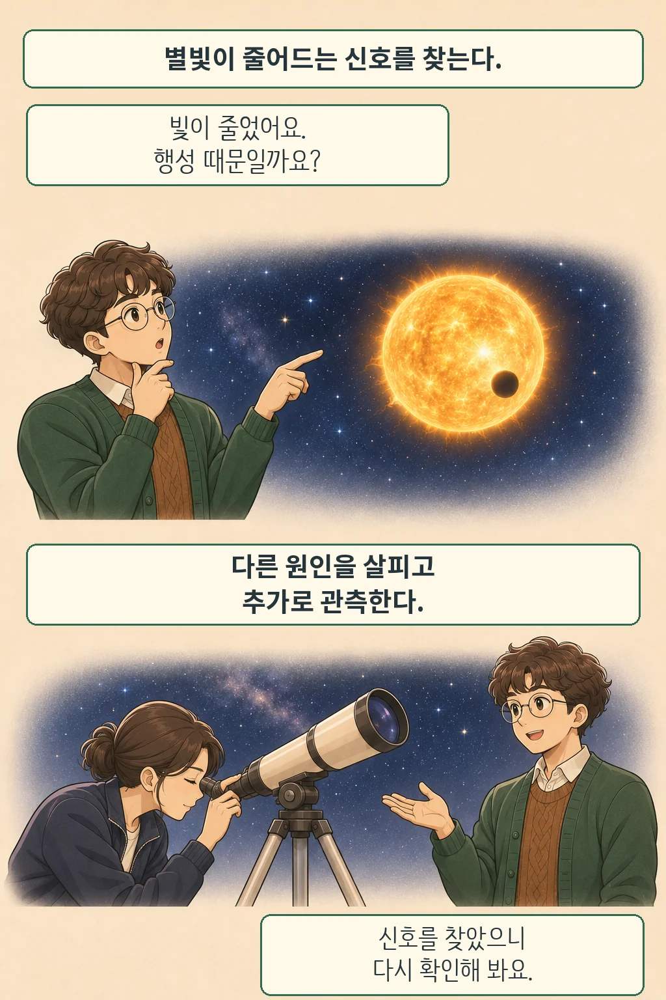

AI가 망원경 자료에서 낯선 신호를 골랐다면, 새 행성을 발견했다고 말해도 될까요? OpenAI는 2026년 11월 24일, 아마추어 천문가들이 Codex와 Astra를 이용해 공개 관측 자료에서 **외계행성 후보를 찾은 사례**를 소개했습니다. 현재 성과는 전문 천문가가 더 살펴볼 대상을 좁힌 단계입니다.

글·해설: 다메카솔

## AI가 한 일은 탐색 프로그램을 만드는 것

발표에 따르면 OpenAI 엔지니어이자 아마추어 천문가인 Kevin Bond는 Codex로 기존 탐색 방법을 비교하고 코드를 만들었습니다. 한 에이전트가 별의 밝기 기록에서 유망한 신호를 고르면 다른 에이전트가 더 자세히 점검하는 방식입니다. 창업자 Ethan Byrd는 별도로 Astra를 활용해 탐색 소프트웨어를 구성했죠.

두 사람의 현재 결과는 다음처럼 구분할 수 있습니다. 같은 자료에서 신호를 다시 찾는 일과, 그 신호의 원인이 행성임을 입증하는 일은 서로 다른 단계입니다.

| 탐색 사례 | 사용한 자료와 도구 | 발표 시점의 후속 상태 |
| --- | --- | --- |
| Kevin Bond | Kepler 공개 관측 자료, Codex | SETI 연구자가 독립 탐색으로 같은 신호 두 개를 찾음. 원인 확인은 진행 중 |
| Ethan Byrd | TESS 등을 포함한 공개 자료, Astra | 강한 후보 하나를 TESS 연구진에 전달. 추가 분석 대기 |

이 사례에서 AI는 기존 방법을 찾아 코드로 엮고 후보를 추리는 작업에 참여했습니다. 전문 관측 장비가 새로 생긴 것이 아니라, 이미 쌓인 자료에 질문을 던지고 검사하는 과정이 달라진 셈입니다. [과학 도구를 연결한 에이전트 평가](/posts/agent-evaluation-system-configuration/)에서도 다뤘듯, 모델 이름과 함께 어떤 자료·도구·검사 절차를 사용했는지 읽어야 역할이 보입니다.

## 별빛이 줄어드는 순간을 찾는다

행성이 관측자와 별 사이를 지나가면 별빛 일부를 가립니다. NASA는 이를 통과, 즉 트랜싯이라고 설명합니다. 시간에 따라 밝기를 그린 ‘광도 곡선’에는 작은 움푹한 구간이 생기죠. 밝기 변화가 반복되는지 찾으면 다음 관측 시점을 예상하는 데 도움이 됩니다.

예를 들어 책상 스탠드 앞에서 작은 공을 움직인다고 생각해 보세요. 보는 위치가 맞으면 공이 빛의 일부를 가립니다. 천문 관측에서는 훨씬 미세한 변화를 오래 기록해 이런 단서를 찾습니다. 밝기 감소의 깊이나 지속 시간도 분석 대상이므로, 단순히 어두워진 순간을 하나 찾는 것으로 끝나지 않습니다.

## 같은 신호를 찾아도 원인은 다시 확인한다

OpenAI는 별 두 개가 서로를 가리거나 망원경 기기의 상태가 변해도 비슷한 신호가 생길 수 있다고 설명합니다. 따라서 후보를 얻으면 통계적 검토와 후속 관측으로 다른 설명을 좁혀야 합니다. AI가 내놓은 답을 다시 AI에게 묻는 것만으로 관측 근거가 추가되는 것은 아니죠.

이번 보도에서 구분해 읽을 지점은 **후보 선별, 독립적인 신호 재확인, 원인 검증**입니다. 첫 단계는 많은 기록 중 볼 곳을 고르는 일이고, 다음 단계는 다른 분석에서도 신호가 나오는지 살피는 일입니다. 마지막에는 추가 관측 등을 통해 행성이라는 설명을 뒷받침해야 합니다. 발표의 후속 상태를 확인하면 어느 단계까지 진행됐는지 알 수 있습니다.

## 처음 시작한다면 밝기 기록부터

천문학에서 AI 활용 자체가 처음인 것은 아닙니다. NASA는 2017년 신경망으로 Kepler 자료를 분석해 Kepler-90i를 찾았다고 발표했습니다. 이번 소식의 관심사는 대화형 AI와 코딩 에이전트가 개인의 탐색 프로그램 제작을 어떻게 돕느냐에 있습니다.

직접 원리를 익히고 싶다면 NASA Exoplanet Watch의 공개 참여 경로를 살펴볼 만합니다. 개인 망원경이 없어도 제공받은 관측 자료를 무료 EXOTIC 도구로 분석하고 광도 곡선을 만드는 과정을 배울 수 있어요. 데이터를 받아 밝기를 측정하고 결과를 제출하는 경험은, ‘AI가 발견했다’는 제목 뒤에 어떤 증거가 필요한지 이해하는 출발점이 됩니다.

## 출처

- [OpenAI의 사례 발표](https://openai.com/index/searching-for-distant-planets-with-astra/) — 2026년 11월 24일. 두 탐색의 방법과 후속 검토 상태.
- [NASA Exoplanet Watch 참여 안내](https://science.nasa.gov/citizen-science/exoplanet-watch/how-to-contribute/) — 관측 자료 제공, EXOTIC 분석과 결과 제출 경로.
- [NASA의 2017년 Kepler-90i 발표](https://www.nasa.gov/news-release/artificial-intelligence-nasa-data-used-to-discover-eighth-planet-circling-distant-star/) — 이전 신경망 활용 사례.
- [NASA의 외계행성 관측 원리](https://science.nasa.gov/citizen-science/exoplanet-watch/background/) — 통과와 광도 곡선의 기초.

새 후보의 성과와 검토 상태는 OpenAI 발표를 바탕으로 정리했습니다. NASA 자료는 관측 원리와 참여 방법의 근거이며, 이번 후보를 확인했다는 자료는 아닙니다. 관측 자료의 독립 분석은 수행하지 않았습니다.

이 글의 본문과 이미지는 생성형 AI로 제작했습니다. 기획과 편집 기준은 다메카솔이 정했습니다.
