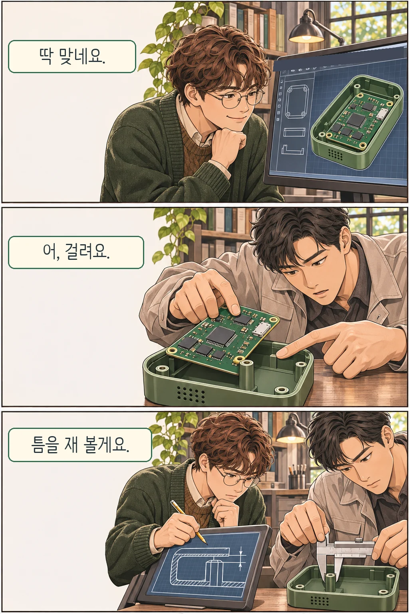

화면 위 3D 도면에서는 초록색 회로 기판이 케이스 안쪽 자리에 딱 들어맞습니다. 막상 조립대에서 기판을 비스듬히 기울여 넣으려 하면 모서리가 내부 나사 기둥에 걸려 들어가지 않는 일이 적지 않죠. 도면이 보여 주는 최종 배치와 실제 조립이 끝나는 공정 사이에는 어떤 빈틈이 숨어 있을까요?

글·해설: 다메카솔

## 일주일 설계와 한 달 제작이 가리키는 다른 단계

OpenAI는 2026년 11월 3일 물리적 공학 설계에 AI 모델을 적용한 사례를 공개하며, 말로 Codex와 대화하는 시험 기기를 설계한 과정을 소개했습니다. 회사 설명에 따르면 Astra는 손에 쥐는 케이스와 내부 지지대를 설계하고, 그 안에 들어갈 전자 부품을 골라 인쇄회로기판(PCB) 위에 배치했습니다. 부품 사이의 전기 연결과 기기를 움직이는 펌웨어도 초기 설계 작업에 포함됐죠.

발표에서 눈에 띄는 두 기간은 서로 다른 단계를 잽니다. OpenAI 보고에 따르면 팀원 두 명이 다른 업무와 병행하면서 Astra로 시험 기기를 설계하는 데는 일주일이 채 걸리지 않았습니다. 반면 그 설계 파일을 넘겨받아 소량의 시제품을 실제로 만든 주체는 외주 제조사였고, 제작에는 한 달 미만이 걸렸습니다.

| 단계 | 작업 주체 | 다룬 내용 | 회사 보고 기간 |
| --- | --- | --- | --- |
| 기기 설계 | OpenAI 팀원 2명 · Astra | 손에 쥐는 케이스 · 내부 지지대 · 부품 선정 · PCB 배치 · 전기 연결 · 펌웨어 | 일주일 미만(타 업무 병행) |
| 시제품 제작 | 외주 제조사 | 제조·조립 검토와 수정 반영, 소량 시제품 제작 | 한 달 미만 |

소프트웨어는 코드가 완성되면 곧바로 빌드해 동작을 확인하기 쉽습니다. 반면 하드웨어는 설계 파일이 나오더라도 실물 가공과 공차·조립 검토라는 물리적 공정을 거쳐야 하므로 설계 속도와 제조 리드타임을 구분해 읽어야 합니다.

## 도면에서 맞던 부품이 조립대에서 걸리는 이유

OpenAI가 짚은 핵심 문제는 모델이 제조사의 생산 한계, 허용되는 치수 오차인 공차, 조립에 필요한 세부 조건을 일관되게 반영하지 못했다는 점입니다. 이 때문에 초기 설계 파일을 곧장 제작에 넘길 수 없었고, 생산 단계로 넘어가기까지 여러 차례 검토와 수정을 거쳐야 했습니다.

예를 들어 기판 폭과 케이스 안쪽 폭을 도면에 똑같은 치수로 맞춰 두었다고 가정해 보겠습니다. 3D 화면에서는 모서리끼리 빈틈없이 정렬되지만, 실제 제작 과정에서는 기판이 허용 오차 범위 안에서 조금 넓게 나오고 케이스 내벽은 조금 좁게 만들어질 수 있습니다. 각 부품이 규격 안에 있더라도 두 오차가 반대로 겹치면 조립 순서가 맞더라도 기판이 들어갈 여유 자체가 사라지는 셈이죠.

조립 동선 역시 완성 상태만 그려진 도면으로는 놓치기 쉬운 부분입니다. 기판을 수직으로 그대로 내릴 공간이 부족해 비스듬히 기울여 넣어야 하는 구조라면, 들어가는 각도에서 모서리가 내부 나사 기둥에 걸리거나 고정 작업에 필요한 틈이 막히기 쉽거든요. 생산에 넘기기 전 검토 단계에서는 크게 세 가지 조건을 함께 확인합니다.

- **생산 한계 확인**: 외주 제조사의 가공 방식과 설비 여건 안에서 도면의 형상을 실제로 만들어 낼 수 있는지 먼저 따집니다.
- **공차 여유 점검**: 개별 부품 치수가 허용 오차 범위 안에서 흔들려도 서로 부딪히거나 끼이지 않도록 여유 틈새를 확보합니다.
- **조립 동선 검증**: 부품이 최종 위치까지 들어가는 방향과 순서에서 내부 구조물과 간섭이 생기지 않는지 미리 살핍니다.

## 시제품 발표를 읽을 때 확인해야 할 경계

이번 발표에서 확인할 수 있는 근거 범위는 외주 제조사가 만든 소량의 시제품까지입니다. Astra가 케이스와 PCB, 펌웨어를 한 흐름으로 설계해 일주일 미만 만에 초기 설계를 마친 점은 분명하지만, 그 파일이 곧바로 제작으로 이어진 것이 아니라 사람의 검토와 수정 절차를 함께 거쳐야 했습니다.

개발자나 빌더가 비슷한 하드웨어 AI 시연을 볼 때는 마지막에 검증된 결과물이 어느 단계인지부터 짚어 보는 편이 좋습니다. 화면에 띄운 도면인지, 검토와 수정을 거쳐 제작한 소량 시제품인지, 아니면 같은 품질로 반복 생산할 수 있는 단계인지에 따라 AI 설계 파일이 해결한 문제의 범위가 전혀 다르기 때문입니다.

## 출처

- OpenAI, [Accelerating engineering for the physical world](https://openai.com/index/accelerating-engineering-for-the-physical-world/), 2026년 11월 3일 공개 · 2026년 11월 4일 확인

발표 자료를 바탕으로 정리했으며 별도 기기 제작이나 공정 검증은 포함하지 않았고, 만화 장면은 설명을 위해 새로 구성했습니다.
이 글의 본문과 이미지는 생성형 AI로 제작했습니다. 기획과 편집 기준은 다메카솔이 정했습니다.
