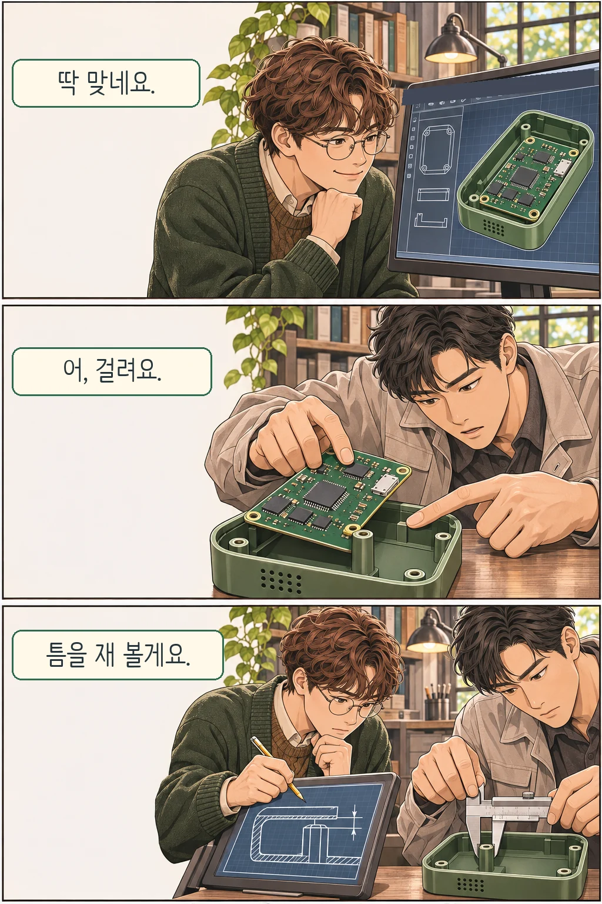

글·해설: 다메카솔

화면에서는 초록색 기판이 케이스 안에 꼭 맞습니다. 그런데 조립대에서 기판을 비스듬히 넣으려니 모서리가 나사 기둥에 걸립니다. 도면에 그려진 것은 조립이 끝난 위치입니다. 부품을 그 위치까지 밀어 넣을 길도 있을까요?

## 모델이 설계하고 제조사가 만든 것

OpenAI는 2026년 11월 3일, 말로 Codex와 대화하는 시험 기기를 설계한 과정을 공개했습니다. 회사 설명에 따르면 Astra는 손에 쥐는 케이스와 내부 지지대를 설계하고, 그 안에 들어갈 전자 부품을 골라 인쇄회로기판(PCB) 위에 배치했습니다. 부품 사이의 전기 연결과 기기를 움직이는 펌웨어도 설계 작업에 포함됐습니다.

발표에 등장하는 두 기간은 서로 다른 일을 잽니다. 팀원 두 명이 다른 업무와 병행해 Astra와 시험 기기를 설계하는 데는 일주일이 채 걸리지 않았습니다. 설계를 받아 소량의 시제품을 실제로 만든 쪽은 외주 제조사였고, OpenAI는 그 제작 기간을 한 달 미만으로 보고했습니다.

## 기판을 끼워 보면 보이는 것

첫 장면의 나사 기둥은 조립 조건을 보여 주기 위해 그린 예시입니다. OpenAI가 보고한 문제는 모델이 제조사의 생산 한계, 허용되는 치수 오차인 공차, 조립에 필요한 세부 조건을 일관되게 반영하지 못했다는 것입니다. 생산에 넘기기까지 여러 차례 검토와 수정이 필요했습니다.

가령 기판 폭과 케이스 안쪽 폭을 도면에 똑같이 적으면 화면에서는 맞습니다. 실제 기판은 허용 범위 안에서도 조금 넓게, 케이스는 조금 좁게 만들어질 수 있습니다. 조립 순서가 맞더라도 이번에는 기판이 들어갈 여유가 사라집니다. 제조사는 부품을 어느 방향으로 넣을지와 함께, 치수가 흔들려도 들어갈 공간이 남는지 확인해야 합니다.

다메카솔이 이 발표에서 눈여겨본 대목은 설계 파일을 받은 다음 장면입니다. 모델은 케이스와 기판을 함께 설계했고, 제조사는 그 파일로 시험 제작을 거쳤습니다. 여러분이 비슷한 시연을 볼 때는 마지막으로 확인한 물건을 찾아보세요. 화면에 띄운 도면, 손으로 조립한 시제품, 같은 품질로 반복 생산한 제품은 각각 다른 질문에 답합니다. 이번 발표에서 확인할 수 있는 범위는 소량의 시제품까지입니다.

[OpenAI의 기기 설계·시제품 제작 발표](https://openai.com/index/accelerating-engineering-for-the-physical-world/) · 2026년 11월 4일 확인

이 글의 본문과 이미지는 생성형 AI로 제작했습니다. 기획과 편집 기준은 다메카솔이 정했습니다.
