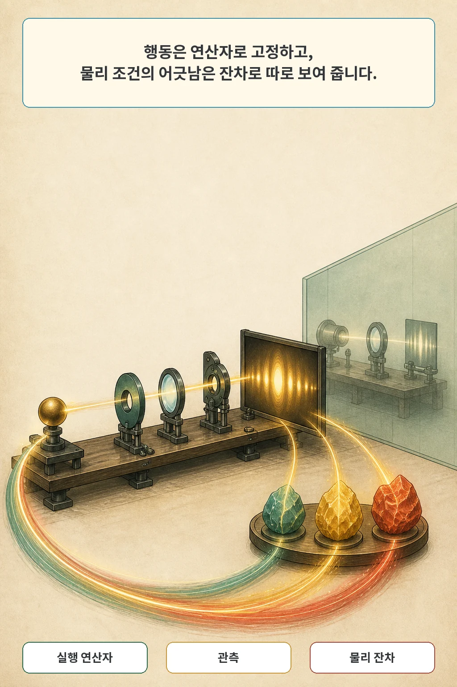
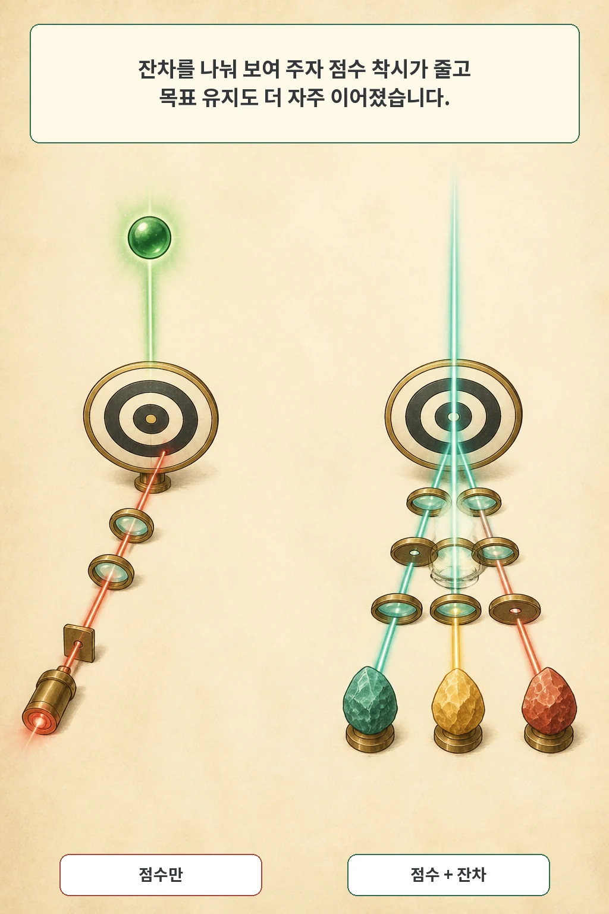

자율 실험 에이전트가 보고하는 요약 점수는 오르는데 실제 실험 성능이 제자리라면, 에이전트 추론보다 피드백 설계를 먼저 점검해야 합니다. 광학 실험 에이전트에게 요약 점수만 돌려주었을 때, 최대 39.0%에 이르는 결정에서 점수는 올랐지만 물리 성능은 나아지지 않았거든요. **OPERA** 논문은 실행 행동을 검사 가능한 **연산자(operator)**로 묶고 물리 조건의 어긋남을 분해된 **잔차(residual)**로 되돌려 주어, 점수 착시를 줄이고 분포 변화에도 실험을 안정적으로 이어 가는 구조를 검증했습니다.

글·해설: 다메카솔

## 핵심 내용

- **점수 착시 급감**: 세 광학 과제에서 물리 개선 없는 점수 상승 결정이 `23.6~39.0%`에서 `0.9~1.9%`로 줄었습니다.
- **유지율·예산 개선**: 270개 문제에서 목표 도달 후 유지율 `75.8%`, 예산 사용률 `61.7%`로 기준 전략을 앞섰습니다.
- **분해된 잔차 효과**: 단일 스칼라(`11.6%`)보다 분리 벡터(`2.3%`)가 불일치를 줄였고, 채널 정보·설명 추가 시 예산이 줄었습니다.
- **적용 경계**: 익숙한 분포에서는 과제 특화 알고리즘이 앞섰고, 장비 실험은 고정 전사 오프라인 검증이었습니다.

## 점수 상승과 실제 물리 개선은 다른 사건이다

언어 모델 에이전트가 눈에 보이는 요약 점수만 높이려다 실제 광학 성능을 악화시키거나 제자리에 묶어 두는 일을 어떻게 막을 수 있을까요? 저자들은 세 광학 과제에서 네 개 언어 모델을 같은 실행 하네스로 평가해, 점수만 줄 때와 물리 잔차를 함께 줄 때 결정 품질이 얼마나 달라지는지 확인했습니다.

- **실험 구성**: 빔 성형·구조광 3차원 재구성·간섭계 과제에서 `GPT-5.1`, `DeepSeek v4 pro`, `Qwen 3.7-max`, `Claude Opus 4.7`을 평가했습니다(독립 문제 `90개`, 문제 단위 `5,000회` 부트스트랩 신뢰구간).
- **착시 비율 변화**: 점수만 준 조건에서는 물리 개선 없는 점수 상승 결정이 `23.6~39.0%`였으나, 연산자-잔차 피드백을 더하자 `0.9~1.9%`로 떨어졌습니다.

이를 위해 `OPERA`는 에이전트가 임의 장비 명령을 지어내는 대신 측정·제어·재구성을 바꾸는 검사 가능한 실행 단위인 **연산자(operator)**를 고르게 하고, 실행 결과를 세 층으로 분리합니다.

1. **실행 중 요약 점수**: 에이전트가 매 단계 참고하는 단일 성과 지표입니다.
2. **물리 잔차(residual)**: 관측 결과가 물리 조건에서 벗어난 정도를 이름·방향·단위와 함께 분리해 보여 주는 진단 벡터입니다.
3. **숨긴 최종 물리 기준**: 에이전트에게는 비공개로 두고 오프라인 최종 평가에만 쓰는 실제 물리 성능 기준입니다.

예를 들어 구조광 3차원 재구성에서는 투영 패턴과 재구성 단계를 바꿨을 때 요약 점수가 오르더라도, 분해된 잔차가 쓸 수 없는 깊이 측정치나 비어 있는 측정 영역을 바로 짚어 냅니다. 빔 성형에서는 목표 밖으로 샌 빛을, 간섭계에서는 모델과 어긋난 간섭무늬를 잔차가 알려 주는 셈이죠.

## 잔차를 나누자 목표 유지와 예산 효율이 달라졌다

독립 테스트 270문제(목표 미도달 궤적을 예산 상한까지 포함한 54,000개 기록)에서도 피드백 구조의 차이는 분명하게 나타났습니다. 단일 점수가 놓치는 물리 위반을 어떤 형태로 돌려주느냐에 따라 목표 유지율과 예산 소모가 크게 갈렸습니다.

| 비교 항목 | OPERA (연산자-잔차 피드백) | 비교 기준선 및 세부 조건 |
| --- | --- | --- |
| **목표 도달 후 유지율** (270문제) | **75.8%** | 4개 기준 전략: 33.9~60.1% |
| **예산 상한 대비 사용률** | **61.7%** | 4개 기준 전략: 70.8~86.0% |
| **잔차 표현별 불일치율** | 분리된 벡터 **2.3%** | 점수 단독 39.5%, 단일 스칼라 압축 11.6% |
| **채널 정보·설명 절감** | 예산 추가 절감 | 채널 메타데이터(이름·방향·단위·운영 한계) 시 **-8.6%**, 물리 설명 추가 시 **-5.3%** |
| **오프라인 최선 연산자 선택률** | **34%** (구조광 3D 재구성) | 여섯 후보 연산자 비교, 점수 단독 조건: **2%** |

물리 위반을 단일 스칼라로 합칠 때보다 채널별 벡터로 분해해 보여 줄 때 불일치율이 다섯 배가량 낮아졌고, 단위·방향·물리 설명을 더할수록 불필요한 탐색도 줄었습니다. 물론 잔차 예측 정확도와 낮은 예산 사용 사이의 관계는 관찰 분석의 연관일 뿐 인과성을 입증한 결과로 보기는 어렵지만, 피드백 채널이 구체적일수록 탐색 낭비가 줄어드는 경향은 뚜렷했습니다.

실무에 적용할 때는 세 가지 경계를 함께 살펴봐야 합니다.

- **분포 외(OOD) 적응 vs. 익숙한 조건**: `OPERA`의 예산 절감 이점은 분포가 달라진 조건에 집중됐습니다. 익숙한 조건에서는 과제 특화 알고리즘이 더 적은 예산과 약간 더 높은 최종 물리 성능을 보였습니다.
- **실행 가능성과 새로움의 구분**: `60회` 전략 생성 시도 중 `53회`가 실행 가능했으나(기준 이상 `24개`, 미달 `17개`, 조건부 수용 `1개`·거부 `11개`), `52개`는 기존 알고리즘 계열과 일치하고 `1개`만 부분 일치해 새 계열 발명과는 거리가 있습니다.
- **고정 전사와 공개 코드 범위**: 구조광 3D 재구성 장비 실험에서 전사 절차는 예산 상한의 평균 `60.0%`(고정 Gray code `95.8%`)를 썼지만, 디지털 트윈 절차를 고정 전사한 검증이라 라이브 잔차 기반 온라인 닫힌 고리(closed-loop) 제어와는 다릅니다. 공식 GitHub 저장소·Zenodo 묶음(`10.5281/zenodo.21504254`)에도 제공자 SDK·라이브 제어·최종 통계 파이프라인이 빠졌고, `release_integrity.py` 검사도 매니페스트의 `fig2_*`와 실제 `fig3_*` 경로 차이 및 미서명 파일 탓에 그대로 통과하지 않습니다.

## 다메카솔의 해석: 답보다 물리 확인부터 본다

에이전트 운영 규칙으로 옮기면 최종 요약 점수보다 세 가지를 먼저 점검해야 합니다.

1. 에이전트가 실행할 수 있는 행동이 검사 가능한 연산자 단위로 제한돼 있는가
2. 실행 뒤 단일 점수 대신 어떤 물리·도메인 조건이 얼마나 어긋났는지 분해된 잔차로 보여 주는가
3. 최종 승인 평가는 에이전트가 실시간으로 최적화하는 신호와 분리돼 있는가

코딩 에이전트에 빗대면 허용 도구 집합, 실패 원인 분해 로그, 숨긴 회귀 테스트 세트를 분리해 두는 설계와 맞닿아 있습니다. 점수를 높이는 최적화만큼이나 점수가 가릴 수 있는 실패 신호를 구조적으로 드러내 두는 편이 실무에서는 훨씬 안전하죠.

## 논문 정보

| 항목 | 내용 |
| --- | --- |
| 제목 | OPERA: Operator–Residual Feedback for Reliable Autonomous Optical Experiments with Language-Model Agents |
| 저자 | Ning Xu 외 |
| arXiv v1 제출 | 2026-08-06 13:03:22 UTC (`cs.AI`, `physics.optics`) |
| 상태 | arXiv preprint, 동료심사 채택 여부 미확인 |

## 출처

- [논문 초록과 메타데이터 — arXiv:2608.05990](https://arxiv.org/abs/2608.05990)
- [논문 원문 PDF](https://arxiv.org/pdf/2608.05990)
- [공식 OPERA 코드 저장소](https://github.com/ningxu1995/OPERA/tree/9fabab3991edbf092c2d7a6391895567cd5bca28)
- [공식 Zenodo 공개 묶음](https://zenodo.org/records/21504254)
- [관련 글: AI 영상 평가가 점수 하나로 끝나면 안 되는 이유](/posts/videoargus-evidence-video-evaluation/)
- [관련 글: AI가 화면을 본다고 정말 더 잘 푸는 걸까](/posts/visual-tool-use-causal-audit/)

이 글은 2026년 8월 9일 확인한 논문 원문과 공식 공개 자료를 바탕으로 해설했으며, 별도의 실험 재현은 포함하지 않았습니다.

이 글의 본문과 이미지는 생성형 AI로 제작했습니다. 기획과 편집 기준은 다메카솔이 정했습니다.
