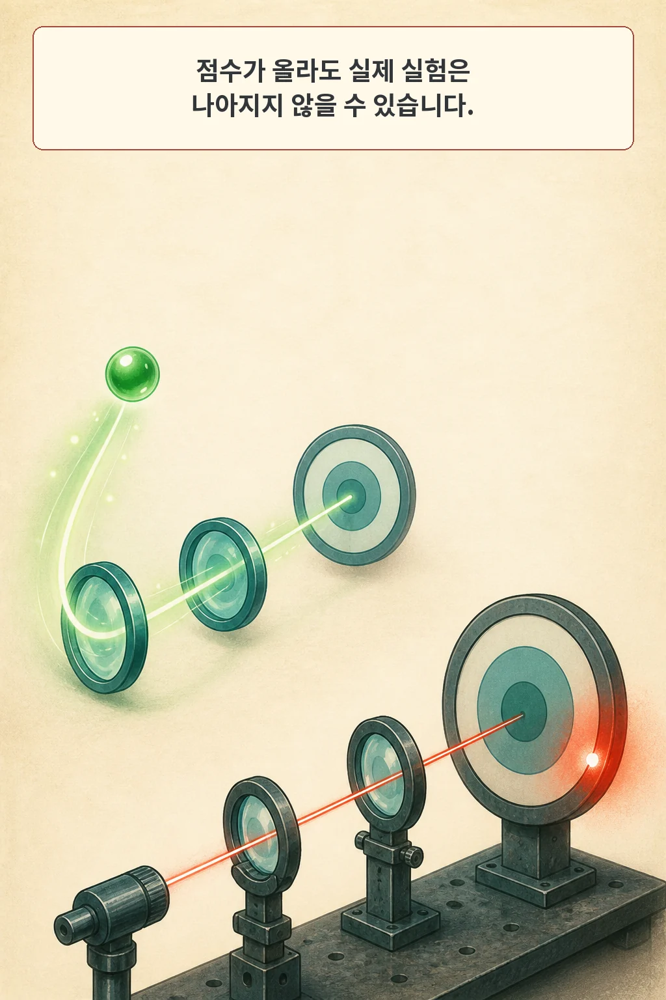
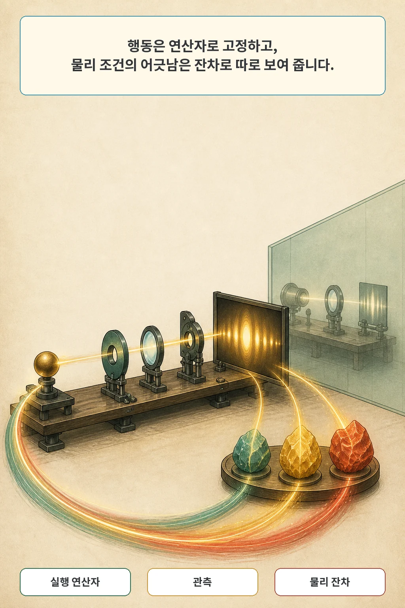
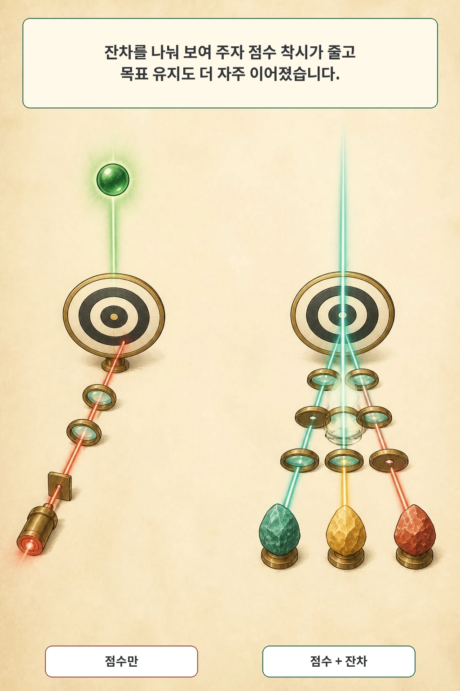
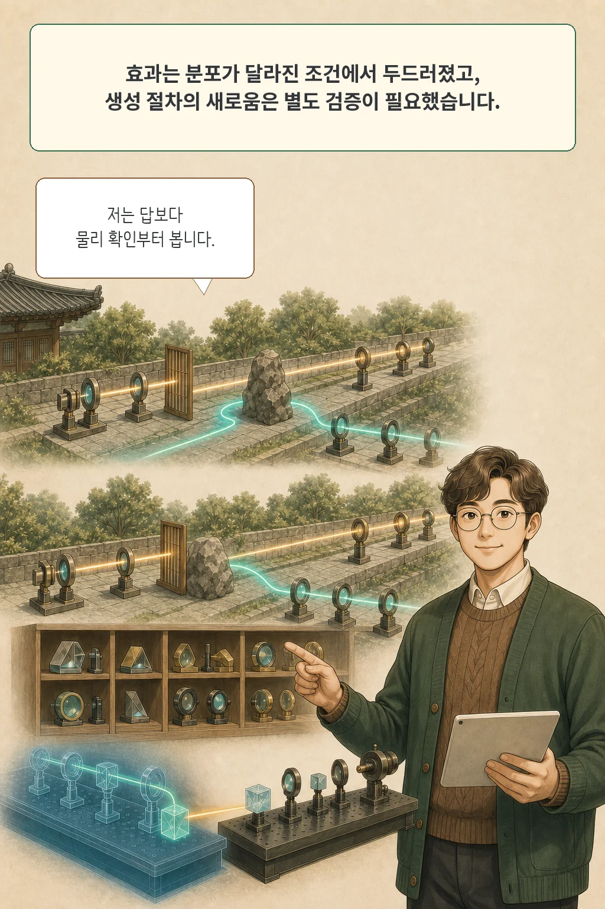

자율 실험 에이전트가 보는 요약 점수는 올랐는데 실제 광학 성능은 나아지지 않은 결정이 최대 39.0%에 달했습니다. 에이전트가 엉뚱한 답을 낸 것이 아니라, 에이전트가 최적화하는 요약 점수와 우리가 실제로 개선하려는 물리 상태가 어긋난 결과입니다. **「OPERA: Operator–Residual Feedback for Reliable Autonomous Optical Experiments with Language-Model Agents」**는 실행 가능한 광학 행동을 검사 가능한 `연산자(operator)`로 제한하고 관측 결과가 물리 조건에서 얼마나 벗어났는지를 분해된 `잔차(residual)`로 보여 주어, 점수 착시를 줄이고 분포가 달라진 조건에서도 실험을 안정적으로 이어 가는 구조를 검증했습니다.

글·해설: 다메카솔

## 핵심 내용

- **점수 착시 대폭 감소**: 빔 성형·구조광 3차원 재구성·간섭계 세 과제(독립 문제 90개, 4개 모델)에서 점수는 올랐지만 실제 물리 개선이 없던 결정 비율이 점수만 줄 때의 23.6~39.0%에서 연산자-잔차 피드백 시 0.9~1.9%로 줄었습니다.
- **목표 유지율과 예산 절감**: 독립 테스트 문제 270개(54,000개 궤적)에서 목표 도달 후 끝까지 유지한 비율은 75.8%(네 기준 전략은 33.9~60.1%), 예산 상한 대비 사용률은 61.7%(기준 전략은 70.8~86.0%)였습니다.
- **분해된 잔차 벡터의 효과**: 물리 위반을 단일 스칼라로 합치면 불일치율이 11.6%였으나 분리된 벡터로 보여 주자 2.3%까지 낮아졌고, 채널 이름·방향·단위·운영 한계와 물리 설명을 더할수록 예산 사용이 추가로 줄었습니다.
- **적용 경계**: 익숙한 분포에서는 과제 특화 알고리즘이 더 적은 예산과 약간 더 높은 최종 성능을 보였으며, 물리 장비 실험은 디지털 트윈에서 찾은 절차를 고정 전사한 오프라인 검증이었습니다.

## 점수 상승과 실제 물리 개선은 다른 사건이다

논문의 핵심 질문은 언어 모델 에이전트가 눈에 보이는 요약 점수만 높이려다 실제 광학 성능을 악화시키거나 제자리에 머물게 하는 일을 어떻게 막을 것인가입니다. 저자들은 빔 성형, 구조광 3차원 재구성, 간섭계의 세 과제에서 GPT-5.1, DeepSeek v4 pro, Qwen 3.7-max, Claude Opus 4.7을 동일한 실행 하네스로 평가했습니다(독립 문제 90개, 문제 단위 5,000회 부트스트랩 신뢰구간).

점수만 제공한 조건에서는 점수가 올라도 실제 물리 개선이 없었던 결정이 과제에 따라 23.6~39.0%에 달했지만, 연산자-잔차 피드백을 제공하자 이 비율이 0.9~1.9%로 떨어졌습니다.

이를 위해 `OPERA`는 에이전트가 임의의 장비 명령을 새로 만드는 대신 측정·제어·재구성을 바꾸는 검사 가능한 실행 단위인 **연산자(operator)**를 고르게 하고, 실행 결과를 세 층으로 분리합니다.

1. 에이전트가 실행 중 참고하는 요약 점수
2. 이름·방향·단위와 함께 분리해 보여 주는 **물리 잔차(residual)**
3. 에이전트에게는 숨기고 오프라인 최종 평가에만 쓰는 실제 물리 성능 기준

## 잔차를 나누자 점수 착시와 예산 낭비가 줄었다

독립 테스트 문제 270개(목표 미도달 궤적을 예산 상한까지 포함한 54,000개 기록)에서 측정한 `OPERA`의 주요 성과와 한계는 다음과 같습니다.

| 비교 항목 | OPERA (연산자-잔차 피드백) | 비교 기준선 및 세부 조건 |
| --- | --- | --- |
| **목표 도달 후 유지율** (270문제) | **75.8%** | 4개 기준 전략: 33.9~60.1% |
| **예산 상한 대비 사용률** | **61.7%** | 4개 기준 전략: 70.8~86.0% |
| **잔차 표현별 불일치율** | 분리된 벡터 **2.3%** | 점수만 제공 39.5%, 단일 스칼라 압축 11.6% (채널 메타데이터 제공 시 예산 -8.6%, 물리 설명 추가 시 -5.3% 추가 절감) |
| **오프라인 최선 연산자 선택률** | **34%** (구조광 3D 재구성) | 점수만 본 조건: 2% |

다만 결과를 해석할 때 세 가지 경계를 분명히 해야 합니다.

- **분포 외(OOD) 적응 vs. 익숙한 조건**: 강력한 과제 특화 알고리즘과 비교했을 때 `OPERA`의 예산 절감 이점은 분포가 달라진 조건에 집중됐습니다. 익숙한 조건에서는 과제 특화 방법이 더 적은 예산을 쓰고 최종 물리 성능도 약간 더 높았습니다.
- **실행 가능성과 알고리즘적 새로움의 구분**: 60회 전략 생성 시도 중 53회가 실행 가능한 절차를 만들었고(24개는 기준 이상, 17개는 기준 미달, 조건부 수용 1개·거부 11개), 그중 52개는 기존 알고리즘 계열과 일치하고 1개는 부분 일치해 완전히 새로운 알고리즘 계열이 발명된 것은 아니었습니다.
- **고정 절차 전사와 공개 패키지 경계**: 구조광 3D 재구성 하드웨어 실험에서 전사된 절차는 예산 상한의 평균 60.0%(고정 Gray code는 95.8%)를 썼지만, 디지털 트윈에서 고른 절차를 장비에 고정 전사한 것이지 라이브 하드웨어 잔차로 닫힌 고리(closed-loop) 온라인 제어를 한 것은 아닙니다. 또한 2026년 8월 9일 확인한 공식 GitHub 저장소(커밋 `9fabab3991edbf092c2d7a6391895567cd5bca28`)와 Zenodo 묶음에는 제공자 SDK·라이브 장비 제어·최종 통계 파이프라인이 제외되어 있고, `release_integrity.py` 실행 시 매니페스트의 `fig2_*`와 실제 `fig3_*` 경로 차이 및 미서명 파일로 무결성 검사가 바로 통과하지 않는 경계가 확인됐습니다.

## 다메카솔의 해석: 답보다 물리 확인부터 본다

이 논문의 구조를 소프트웨어 및 실험 에이전트 운영 규칙으로 옮긴다면 최종 요약 점수보다 세 가지를 먼저 물어야 합니다.

1. 에이전트가 실행할 수 있는 행동이 검사 가능한 연산자 단위로 제한돼 있는가?
2. 실행 뒤 단일 점수 대신 어떤 물리·도메인 조건이 얼마나 어긋났는지 분해된 잔차로 보여 주는가?
3. 최종 승인 평가는 에이전트가 실시간으로 최적화하는 신호와 분리돼 있는가?

코딩 에이전트로 치면 허용된 도구 집합, 테스트 실패의 분해된 원인 로그, 그리고 모델에게 숨긴 최종 회귀 테스트 세트를 분리하는 설계와 정확히 맞닿아 있습니다.

## 논문 정보

| 항목 | 내용 |
| --- | --- |
| 제목 | OPERA: Operator–Residual Feedback for Reliable Autonomous Optical Experiments with Language-Model Agents |
| 저자 | Ning Xu 외 |
| arXiv v1 제출 | 2026-08-06 13:03:22 UTC |
| 분야 | cs.AI, physics.optics |
| 상태 | arXiv preprint, 동료심사 채택 여부 미확인 |

## 출처

- [논문 초록과 메타데이터 — arXiv:2608.05990](https://arxiv.org/abs/2608.05990)
- [논문 원문 PDF](https://arxiv.org/pdf/2608.05990)
- [공식 OPERA 코드 저장소](https://github.com/ningxu1995/OPERA/tree/9fabab3991edbf092c2d7a6391895567cd5bca28)
- [공식 Zenodo 공개 묶음](https://zenodo.org/records/21504254)
- [관련 글: AI 영상 평가가 점수 하나로 끝나면 안 되는 이유](/posts/videoargus-evidence-video-evaluation/)
- [관련 글: AI가 화면을 본다고 정말 더 잘 푸는 걸까](/posts/visual-tool-use-causal-audit/)

이 글의 본문과 이미지는 생성형 AI로 제작했습니다. 기획과 편집 기준은 다메카솔이 정했습니다.

Updated: 2026-08-09
