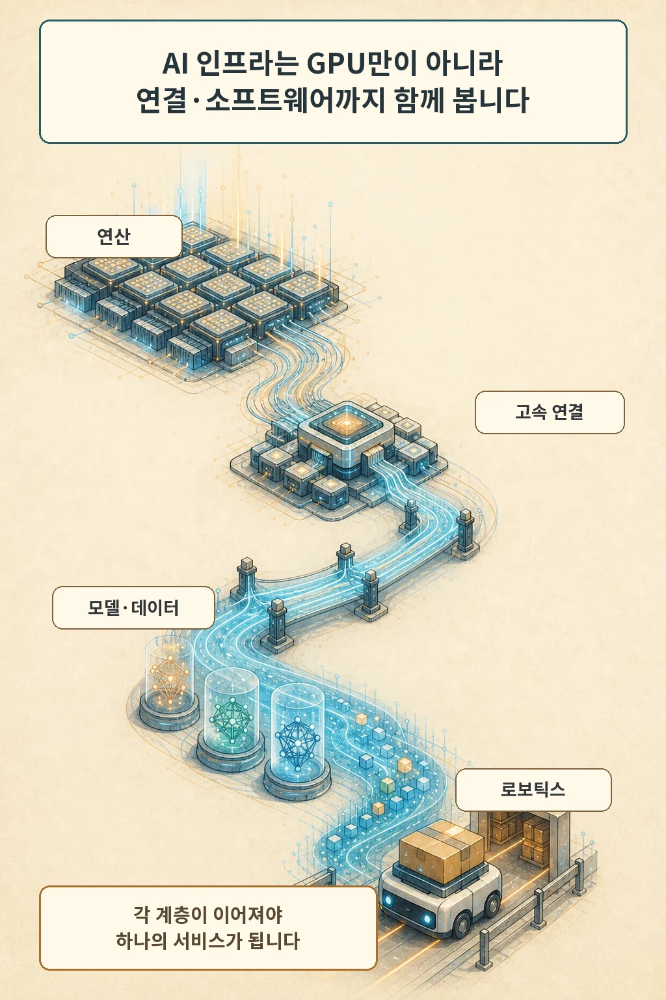

클라우드 인프라를 설계할 때 대형 GPU 공급 발표를 만나면 "다음 분기에 바로 할당받을 수 있을까"부터 따지게 됩니다. AWS와 NVIDIA가 **2026년 8월 26일** 대규모 AI 인프라 협력을 공동 발표했지만, 헤드라인의 **GPU 200만 장**은 당장 콘솔에서 고를 수 있는 물량이 아니거든요. 중장기 배치 목표에 더해 CPU와 고속 연결, 모델·데이터·로보틱스를 하나로 묶는 공급 청사진에 가깝습니다.

글·해설: 다메카솔

## 지금 쓸 수 있는 것과 2027~2028년 계획 나누기

발표 자료를 읽을 때는 **이미 정식 출시된 기반**과 **앞으로 배치할 계획**을 먼저 나눠야 합니다. AWS는 2026년 3월에도 NVIDIA GPU 100만 장 이상을 추가하겠다는 계획을 밝힌 바 있고, 이번 200만 장은 그 물량과 별도로 제시된 목표입니다.

| 구분 | 발표·제공 범위 | 시점 및 공개 상태 (2026-08-27 기준) |
| --- | --- | --- |
| **현재 정식 제공 (GA)** | EC2 G7 인스턴스, Bedrock·SageMaker의 Nemotron 모델, AWS Nitro System·EFA 연결 | 2026년 6월부터 미국 동부(오하이오)·서부(오리건) 정식 제공 |
| **기존 발표 계획** | NVIDIA GPU 100만 장 이상 추가 배치 | 2026년 3월 발표된 기존 계획(2026년부터 추가) |
| **이번 추가 계획** | AWS 글로벌 인프라에 Blackwell Ultra·Rubin·Rubin Ultra GPU 200만 장 추가 | **2027~2028년** 배치 목표(리전·인스턴스 유형·가격·구매 시점 미공개) |
| **공급사 제시 성능 수치** | G7 이전 세대 대비 추론 성능, EMR 처리·가성비, OpenSearch 벡터 인덱싱 개선치 | 공급사 비교 수치(세부 구성·반복 원자료 등 독립 검증 미공개) |

특히 NVIDIA는 GPU 수요·가용성·성능·통합 효과 문장을 **미래예측진술(forward-looking statements)**로 분류해 실제 결과가 달라질 수 있다고 고지했습니다. 현재 쓸 수 있는 G7과 2027~2028년 목표치를 나눠 읽어야 설계 판단이 어긋나는 일을 줄일 수 있습니다.

## GPU 너머, 전체 스택을 함께 묶는 이유

이번 협력은 단순한 가속기 확보보다 **전체 스택을 하나의 공급망으로 묶는 구성**에 무게가 실렸습니다. 향후 계획에는 **NVIDIA Vera CPU** 기반 인프라, **NVLink Fusion과 고대역폭 메모리(HBM) 연동**, 미국 정부용 AI 팩토리, EMR·OpenSearch 가속, **Amazon Robotics**의 피지컬 AI 활용까지 함께 담겼습니다.

클라우드 워크로드는 어느 한 계층만 빠르다고 본래 성능을 온전히 내기 어렵습니다. GPU 연산량이 커져도 CPU가 작업을 제때 공급하지 못하거나 여러 랙을 잇는 인터커넥트가 막히면 전체 처리량이 따라오지 못하기 때문이죠. 여기에 Bedrock·SageMaker 모델 서빙과 데이터 검색·전처리, 물리적 로봇 제어까지 맞물려야 완결된 서비스가 돌아갑니다.

앞서 다룬 [NVIDIA Vera Rubin 랙 스케일 아키텍처 글](/posts/nvidia-vera-rubin-full-production/)이 한 랙 안의 칩과 연결 구조를 다뤘다면, 이번 발표는 그 하드웨어를 AWS 관리형 서비스와 묶어 공급하려는 청사진을 보여 줍니다. 랙 설계 로드맵과 클라우드 고객 가용성은 이어져 있으면서도 현재 단계가 엄연히 다른 셈입니다.

## 실제 도입 전 넘어야 할 세 가지 관문

발표된 계획이 실제 운영 환경에 들어오려면 세 가지 관문을 차례로 넘어야 합니다.

1. **리전과 인스턴스 개방**: 서비스 리전에 원하는 GPU 세대 인스턴스가 실제로 열려야 합니다.
2. **가격과 예약 조건**: 온디맨드·예약 인스턴스·용량 블록(Capacity Blocks) 가운데 적용 가능한 방식과 단가를 확인해야 총비용을 계산합니다.
3. **운영 성숙도와 자체 벤치마크**: 네트워크 구성과 소프트웨어 성숙도를 살핀 뒤, 우리 모델의 처리량·지연 시간·네트워크 포화 여부·장애 복구 동작을 동일 조건에서 직접 측정해야 합니다.

예를 들어 다음 분기 추론 클러스터 증설을 검토하는 인프라 팀을 떠올려 볼까요? 200만 장 발표만 보고 차세대 Rubin 전환 일정부터 잡으면, 대상 리전과 용량 블록 가격표가 열리지 않아 설계 단계에서 멈추기 쉽습니다. 당장 예산을 집행할 프로젝트라면 정식 출시된 G7이나 현 세대 인스턴스로 기준선을 세우고, 차세대 물량은 콘솔·API 개방 뒤 별도로 검증하는 편이 안전합니다.

## 다메카솔의 해석

이번 발표에서 주목할 신호는 GPU 총량보다 **클라우드 조달 단위가 넓어졌다는 점**입니다. 대형 클라우드 협력이 가속기 칩만 들여오는 일을 넘어 CPU, 랙 스케일 연결, 모델 배포, 데이터 처리, 피지컬 AI까지 단일 공급망으로 묶는 방향으로 움직이고 있거든요.

하지만 범위가 넓어질수록 운영상 종속 지점도 늘어납니다. 특정 GPU가 준비되더라도 리전 배치나 Nitro·EFA 네트워크, 모델·데이터 서비스 중 하나가 늦어지면 전체 일정이 밀립니다. 헤드라인의 200만이라는 숫자보다 **계층별 실제 가용성 표**를 기준으로 대조해 보는 편이 실무에 보탬이 됩니다.

## 출처

- [AWS, AWS and NVIDIA to Deliver 2 Million Additional GPUs and Next-Generation Infrastructure for Agentic and Physical AI (2026-08-26)](https://press.aboutamazon.com/aws/2026/8/aws-and-nvidia-to-deliver-2-million-additional-gpus-and-next-generation-infrastructure-for-agentic-and-physical-ai)
- [NVIDIA Newsroom, 같은 공동 보도자료 (2026-08-26)](https://nvidianews.nvidia.com/news/aws-and-nvidia-to-deliver-2-million-additional-gpus-and-next-generation-infrastructure-for-agentic-and-physical-ai)
- [AWS, AWS and NVIDIA deepen strategic collaboration to accelerate AI from pilot to production (2026-03-16)](https://aws.amazon.com/blogs/machine-learning/aws-and-nvidia-deepen-strategic-collaboration-to-accelerate-ai-from-pilot-to-production/)
- [AWS, Amazon EC2 G7 instances are now generally available (2026-06-18)](https://aws.amazon.com/about-aws/whats-new/2026/06/amazon-ec2-g7-generally-available/)

이 글은 2026년 8월 26일 공개된 AWS·NVIDIA 공동 보도자료와 공식 문서를 바탕으로 정리했으며, 별도 실행 측정이나 원문 도표 복제는 포함하지 않았습니다.
이 글의 본문과 이미지는 생성형 AI로 제작했습니다. 기획과 편집 기준은 다메카솔이 정했습니다.
