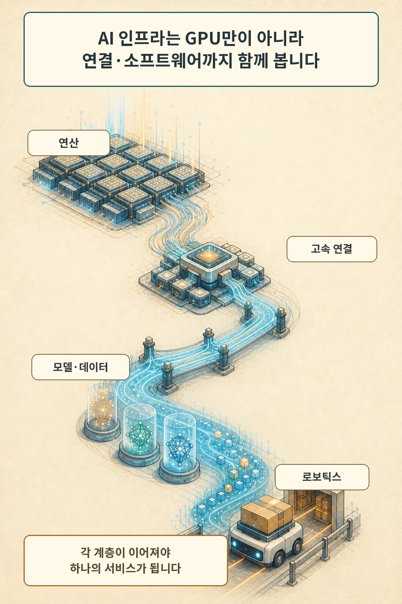

AWS와 NVIDIA가 2026년 8월 26일 대규모 AI 인프라 협력 확대를 공동 발표했습니다. 제목에서 가장 눈에 띄는 숫자는 **GPU 200만 장**이지만, 이 물량이 지금 당장 쓸 수 있는 용량은 아닌데요. 두 회사가 밝힌 배치 시점은 **2027~2028년**이며, 발표 범위 역시 GPU 수량에 그치지 않고 CPU·고속 인터커넥트·모델·데이터 처리·로보틱스까지 전체 스택으로 이어집니다. [C001][C002][C003]

## 핵심 내용

- **2027~2028년 추가 배치 계획**: 2026년 3월 발표된 100만 장 이상 계획과 별도로, 2027~2028년에 Blackwell Ultra·Rubin·Rubin Ultra 계열 GPU 200만 장을 추가 배치하겠다는 미래 계획입니다(리전·인스턴스명·가격은 미공개). [C002][C006][C007]
- **현재 사용 가능 항목과 구분**: EC2 G7 인스턴스(2026년 6월 미국 동부 오하이오·서부 오리건 정식 출시), Nemotron 모델의 Bedrock·SageMaker 지원, Nitro·EFA 연결은 현재 제공 중인 기반입니다. [C004]
- **전체 스택 묶음과 도입 게이트**: NVIDIA Vera CPU, NVLink Fusion, EMR·OpenSearch 가속, Amazon Robotics까지 한 공급망으로 묶었으며, 실제 도입 시에는 리전 가용성·가격 조건·자체 워크로드 운영 증거의 세 단계를 확인해야 합니다. [C003][C008][C009]

## 200만 장은 추가 배치 계획입니다

AWS는 이미 2026년 3월부터 NVIDIA GPU 100만 장 이상을 추가하겠다는 계획을 밝혀 왔습니다. 이번 공동 발표는 그 물량과 별도로 **2027~2028년**에 걸쳐 Blackwell Ultra, Rubin, Rubin Ultra 계열 GPU **200만 장**을 추가로 배치하겠다는 약속이어서, 이미 설치를 마쳤다는 실적 보고와는 시제가 다릅니다. [C002][C006]

구체성의 한계도 분명히 짚어야 합니다. 2026년 8월 27일 확인 기준 보도자료에는 새 물량을 어느 리전에 언제 배치할지, 고객이 콘솔에서 선택할 인스턴스 이름과 가격은 무엇인지에 관한 세부 정보가 빠져 있습니다. NVIDIA 역시 이러한 가용성·성능·통합 효과 관련 문장을 미래예측진술(forward-looking statements)로 분류하며 실제 결과는 달라질 수 있다고 고지했습니다. [C007][C010]

## 전체 스택을 함께 묶는 발표입니다

이번 협력은 단순한 가속기 물량 확보 계약을 넘어섭니다. 두 회사는 NVIDIA Vera CPU 기반 인프라, NVLink Fusion과 고대역폭 메모리(HBM) 연동, 미국 정부용 AI 팩토리, 데이터 처리 및 벡터 인덱싱 가속, Amazon Robotics의 피지컬 AI 활용까지 한 묶음으로 제시했습니다. [C003]

인프라 계층은 결국 서로의 속도를 기다릴 수밖에 없습니다. GPU가 아무리 늘어나도 CPU가 작업을 제때 공급하지 못하거나 네트워크가 여러 랙을 빠르게 잇지 못하면 전체 처리량은 따라오지 못하는데요. 모델을 서빙하는 Bedrock·SageMaker, 데이터를 전처리·검색하는 EMR·OpenSearch, 나아가 실제 물리적 로봇 작업까지 맞물려 돌아가야 비로소 완결된 클라우드 서비스가 됩니다. [C008][C011]

앞서 다룬 [NVIDIA Vera Rubin 랙 스케일 아키텍처 글](/posts/nvidia-vera-rubin-full-production/)이 한 랙 안의 GPU·CPU·네트워크 구조를 짚었다면, 이번 발표는 그 하드웨어를 AWS의 관리형 서비스 계층과 묶어 공급하려는 청사진을 보여 줍니다. 하드웨어 설계 발표와 실제 클라우드 고객 가용성은 서로 이어져 있으면서도 현재 단계가 다릅니다. [C011]

## 지금 쓸 수 있는 항목도 따로 있습니다

물론 발표된 모든 항목이 미래 계획인 것은 아닙니다. 보도자료가 현재 이용 가능한 기반으로 꼽은 항목은 다음과 같습니다.

- **정식 제공 중인 인프라·모델**: AWS의 **EC2 G7 인스턴스**는 2026년 6월부터 미국 동부(오하이오)와 미국 서부(오리건) 리전에서 정식 제공(GA)되고 있으며, Nemotron 모델의 Bedrock·SageMaker 지원과 AWS Nitro System·EFA를 통한 GPU 인스턴스 연결도 현재 쓸 수 있는 구성입니다. [C004]
- **공급사 발표 성능 지표의 해석**: 보도자료에는 G7의 이전 세대 대비 추론 성능, EMR의 처리 속도와 가격 대비 성능, OpenSearch의 벡터 인덱싱 속도와 비용 절감 수치가 함께 제시됐습니다. 다만 이는 비교 워크로드와 세부 구성, 반복 측정 원자료를 모두 공개한 독립 검증이 아니므로 공급사 발표 범위로 읽어야 합니다. [C005]

## 발표 뒤에는 세 개의 게이트가 남습니다

발표된 계획이 우리 팀의 실제 인프라가 되려면 세 가지 관문을 차례로 통과해야 합니다.

1. **리전과 인스턴스 개방**: 우리 서비스가 쓰는 지역에 원하는 GPU 세대 인스턴스가 실제로 열려야 합니다.
2. **가격과 예약 조건**: 온디맨드·예약 인스턴스·용량 블록(Capacity Blocks) 가운데 어떤 방식으로 확보할 수 있는지 확인해야 총비용을 계산할 수 있습니다.
3. **자체 워크로드 운영 증거**: 우리 모델의 실제 처리량, 지연 시간, 네트워크 포화 여부, 장애 복구 동작을 동일한 조건에서 직접 측정해야 합니다. [C009][C010]

거대한 GPU 수치는 공급사의 투자 방향을 보여 줄 뿐 당장의 구매 결정을 대신하지는 않습니다. 계획이 실제 제품이 되는 순간은 콘솔과 API에서 인스턴스를 고르고 가격표를 확인한 뒤 우리 워크로드로 반복 측정할 수 있을 때입니다. [C002][C007][C009]

## 다메카솔의 해석

이번 발표는 단순한 GPU 확보 경쟁의 규모보다 **클라우드 조달 단위가 넓어졌다**는 신호로 읽힙니다. 이제 대형 클라우드 협력은 가속기 칩만 들여오는 일이 아니라 CPU, 랙 스케일 연결, 모델 배포, 데이터 처리, 피지컬 AI 시스템까지 하나의 공급망으로 묶는 방향으로 움직이고 있습니다. [C008][C011]

하지만 함께 묶이는 범위가 넓어질수록 운영상의 종속 지점도 늘어납니다. 특정 차세대 GPU가 준비되더라도 리전 배치, 네트워크, 관리형 모델, 데이터 서비스 가운데 하나가 늦어지면 전체 도입 일정이 밀릴 수 있기 때문에, 헤드라인의 총량 수치보다 **계층별 실제 가용성 표**를 꼼꼼히 따져 보는 편이 실용적입니다. [C009]

## 출처

- [AWS, AWS and NVIDIA to Deliver 2 Million Additional GPUs and Next-Generation Infrastructure for Agentic and Physical AI (2026-08-26)](https://press.aboutamazon.com/aws/2026/8/aws-and-nvidia-to-deliver-2-million-additional-gpus-and-next-generation-infrastructure-for-agentic-and-physical-ai)
- [NVIDIA Newsroom, 같은 공동 보도자료 (2026-08-26)](https://nvidianews.nvidia.com/news/aws-and-nvidia-to-deliver-2-million-additional-gpus-and-next-generation-infrastructure-for-agentic-and-physical-ai)
- [AWS, AWS and NVIDIA deepen strategic collaboration to accelerate AI from pilot to production (2026-03-16)](https://aws.amazon.com/blogs/machine-learning/aws-and-nvidia-deepen-strategic-collaboration-to-accelerate-ai-from-pilot-to-production/)
- [AWS, Amazon EC2 G7 instances are now generally available (2026-06-18)](https://aws.amazon.com/about-aws/whats-new/2026/06/amazon-ec2-g7-generally-available/)

글·해설: 다메카솔

이 글의 본문과 이미지는 생성형 AI로 제작했습니다. 기획과 편집 기준은 다메카솔이 정했습니다.
