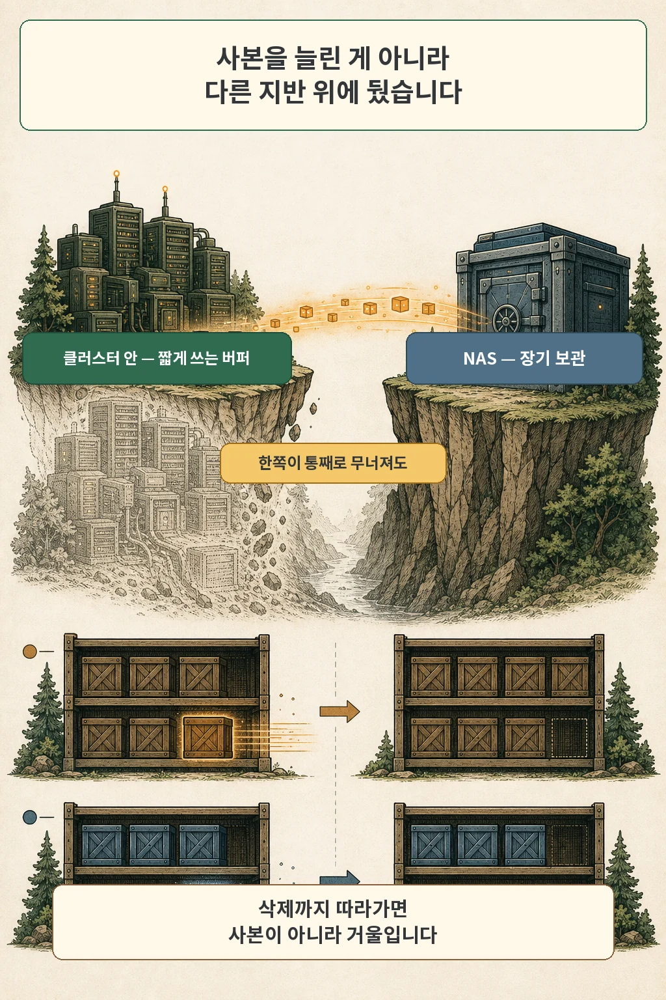
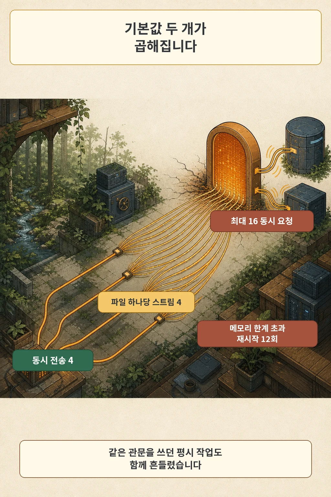
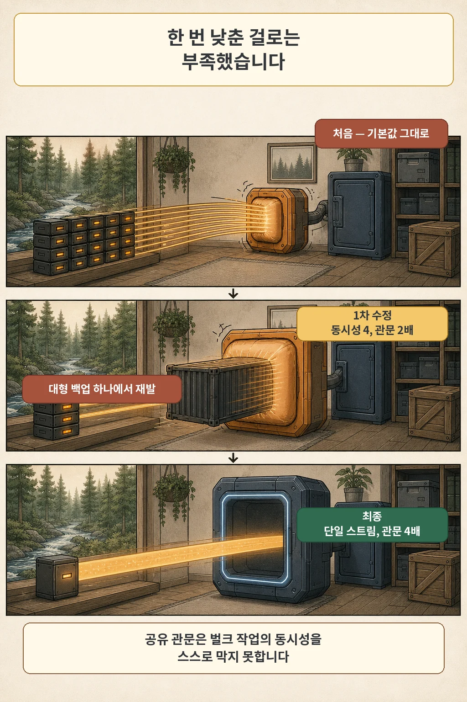

대용량 백업을 옮길 때 복사 작업 로그만 보면 한동안은 아무 문제가 없어 보입니다. 약 90GB 백업을 처음 수동으로 넘기던 날도 47분 동안 잘 흐르던 전송이 갑자기 `connection refused`를 뱉으며 멈췄는데요. 끊어진 쪽은 복사 작업이 아니라 그 요청을 받아 내던 인클러스터 S3 게이트웨이였습니다.

글·해설: 다메카솔

## 핵심 내용

- **원인**: `rclone` 기본 동시성(`--transfers 4` × `--multi-thread-streams 4` = 최대 16 스트림)에 `1Gi` 공유 게이트웨이가 `OOMKilled`로 12회 재시작했습니다.
- **조치**: `--multi-thread-streams 1`, `--transfers 2`로 낮추고 게이트웨이 메모리를 `4Gi`까지 올려 재발을 막았습니다.
- **검증**: init(복사)·메인(대조) 컨테이너 분리와 시간 창 보정으로 DB 백업 6,094개 객체 차이 0개를 확인했습니다.

## 사본을 하나 더 두는 게 아니라, 다른 지반 위에 둡니다



이 작업은 클러스터 스토리지 전체를 잃는 날에 대비합니다. 인클러스터 저장소 안에만 둔 사본은 클러스터 장애 시 함께 무너지기 때문에, 클러스터는 단기 버퍼로 남기고 별도 물리 장비인 NAS를 장기 보관 계층으로 분리했습니다.

배선 전에는 문서와 코드의 불일치부터 바로잡았습니다. **예를 들어** 소스와 목적지를 똑같이 맞추는 `sync` 방식을 그대로 두면, 원본 버킷에서 기한 만료로 지워진 파일이 다음 실행 때 NAS에서도 사라져 며칠짜리 거울에 그치거든요.

- **동기화에서 복사로 전환**: 삭제를 전파하지 않는 `rclone copy`로 바꾸고 NAS 보존 정리는 잡 안의 별도 단계로 분리했습니다.
- **중첩 경로 보존 분리**: 최근 백업은 14일, 하위 디렉터리의 월간 논리 덤프는 400일로 두어 14일 정리 규칙에서 해당 하위 경로를 명시적으로 제외했습니다.

## 47분 뒤에 시작된 connection refused

2026년 7월 19일 첫 수동 동기화에서 핵심 단서는 실패 시점이었습니다. 자격증명이나 NetworkPolicy 문제였다면 첫 연결부터 막혔을 텐데, 47분간 정상 복사되다 중간부터 접속 거절이 시작됐거든요. 이처럼 전송 중반에 `connection refused`가 쏟아지면 상대 서비스의 재시작을 먼저 의심하는 편이 빠릅니다.

게이트웨이 파드 상태를 조회하자 12회 재시작과 함께 메모리 `1Gi` 한도 초과로 인한 `OOMKilled`가 확인됐습니다.

```bash
kubectl -n <저장소 네임스페이스> get pods -l <게이트웨이 라벨>
kubectl -n <저장소 네임스페이스> get pod <게이트웨이 파드> \
  -o jsonpath='{.status.containerStatuses[0].lastState.terminated.reason}'
```



원인은 기본값으로 둔 `rclone` 두 플래그의 곱셈이었습니다. `--transfers`(기본값 4)에 파일당 `--multi-thread-streams`(기본값 4)가 곱해지면서 **최대 16개의 동시 GET 요청**이 게이트웨이 한 대로 몰린 셈이죠. 그 여파로 같은 게이트웨이를 쓰던 데이터베이스 백업 아카이빙과 원격 로그 수집 경로까지 함께 흔들렸습니다.

## 동시성은 두 번 낮춰야 했습니다

먼저 게이트웨이 메모리를 `2Gi`로 늘리고, 클라이언트를 전송 2개 × 스트림 2개(최대 동시 요청 4개)로 낮췄습니다.

하지만 약 `22GB` 대형 백업 객체를 옮기는 구간에서 게이트웨이가 다시 OOM으로 종료됐습니다. 힙 프로파일을 남기지 못해 단정하기는 어렵지만, 대용량 파일을 여러 스트림으로 분할 수신할 때 버퍼 메모리가 부푼 것으로 의심됐습니다. 공유 게이트웨이는 벌크 동시성을 스스로 막지 못하므로 클라이언트 상한이 필수입니다.



결국 `--multi-thread-streams 1`(단일 스트림 GET)을 적용하고 게이트웨이 메모리를 `4Gi`로 올린 뒤에야 OOM이 사라졌습니다.

```bash
rclone copy <소스>:<버킷> <NAS 경로>/<버킷> \
  --checksum \
  --transfers 2 \
  --multi-thread-streams 1
```

## 복사와 검증을 분리하고 시간 창을 맞췄습니다

복사 명령의 종료코드 0은 전송 에러가 없었다는 뜻일 뿐 사본 일치를 보장하지는 않거든요. 그래서 복사는 Kubernetes **init 컨테이너**, 검증은 **메인 컨테이너**로 분리해 복사 실패 시 검증 단계 자체가 시작되지 않도록 막았습니다.

```bash
rclone check <소스>:<버킷> <NAS 경로>/<버킷> \
  --one-way \
  --checksum \
  --min-age 30m
```

- **`--one-way`와 체크섬 폴백**: NAS에만 남은 과거 백업은 무시하고 소스 객체를 대조합니다. 멀티파트 객체는 크기 대조로 폴백되므로 해시 미지원 안내는 정상입니다.
- **시간 창 보정**: **가령** 복사와 검증 사이 3분 동안 라이브 버킷에 새 객체 15개가 들어오면 누락 오탐이 발생합니다(4회차 당시 기존 6,111개 정합). `--min-age 30m`으로 최근 파일을 다음 회차로 넘기고, 2026년 8월 3일 보존 정리 삭제분 1개가 오탐(4,292개 정합·1개 불일치)된 뒤에는 최대 나이 상한도 맞췄습니다.

다섯 차례 시도의 수정 이력은 아래 표에 정리했습니다.

| 회차 | 중단 지점 | 원인 | 조치 내용 |
| --- | --- | --- | --- |
| **1회차** | 47분 뒤 `connection refused` | 최대 16 스트림 유입으로 `1Gi` 게이트웨이 `OOMKilled` 12회 | 게이트웨이 `2Gi`, 전송 2 × 스트림 2 축소 |
| **2회차** | 약 `22GB` 객체 구간 | `2Gi`에서도 OOM 재발(다중 스트림 분할 수신 의심) | `--multi-thread-streams 1`, 게이트웨이 `4Gi` 상향 |
| **3회차** | 복사 시작 직후 | 빈 소스 방어가 비어 있는 개별 버킷에서 오발 | 개별 빈 버킷은 스킵, 전체가 비었을 때만 실패 |
| **4회차** | 검증 단계 (`rclone check`) | 3분 사이 신착 객체 15개를 누락으로 판정 | `--min-age 30m` 적용 (8월 3일 상한도 추가) |
| **5회차** | **완주 (8분 2초)** | DB 버킷 **6,094개 대조 차이 0개** 확인 | 2026년 7월 19일 일일 `CronJob` 가동 |


여기서 8분 2초는 앞선 시도들이 이미 대부분의 데이터를 올려 둔 뒤 일일 증분만 처리해 잰 기록이며, 90GB 전체 전송 속도와는 별개입니다. 검증 통과 뒤 `CronJob`의 `suspend`를 해제해 자동 백업을 가동했습니다.

## 이 작업이 증명하는 범위와 실무 체크포인트

이 파이프라인은 소스의 DB 백업 6,094개 객체가 같은 내용으로 NAS에 복사돼 있음을 입증합니다. 그 파일들로 실제 데이터베이스를 시점 복구할 수 있는지는 별도의 복원 리허설이 답할 몫이죠.

공유 게이트웨이 뒤에 대용량 배치를 붙일 때는 세 가지를 먼저 챙기는 편이 좋습니다.

- **동시성 상한 명시**: `--transfers`와 `--multi-thread-streams` 같은 곱셈 플래그를 기본값으로 두지 않습니다.
- **벌크 피크 메모리 산정**: 게이트웨이 `limit`을 평시가 아닌 벌크 피크 기준으로 잡습니다.
- **게이트웨이 재시작 감시**: 첫 실행 동안 잡 로그와 함께 게이트웨이 파드의 `restartCount`를 관측합니다.

> **검증 환경 (2026년 7월 실측)**: `k3s` 노드 3대, 인클러스터 S3 호환 오브젝트 스토리지 게이트웨이, NAS NFS export, `rclone 1.74.4` 컨테이너 이미지.

이어지는 편에서는 `kubectl drain`이 단일 Vault의 PDB 앞에서 멈춘 사건과 애플리케이션·스토리지 복제 수를 분리한 이유를 다룹니다.

## 함께 읽을 개념 글

- [NetworkPolicy가 Synced였는데, 막히는지는 따로 시험했습니다](/posts/networkpolicy-negative-test/)
- [RAM은 32GB인데 Airflow DAG가 계속 실패한 이유](/posts/why-homelab-kubernetes/)
- [애플리케이션보다 먼저 살아 있어야 한다: DB·오브젝트 스토리지 가동시간 설계](/posts/state-service-uptime-design/)

## 출처

- 개인 GitOps 저장소 기록: 백업 2차 사본 CronJob 활성화와 4회 시도 이력, 2026-07-19, commit `777f2d838`
- 개인 GitOps 저장소 문서: 백업 2차 사본 CronJob 매니페스트와 운영 문서(복사·검증 분리, 동시성 상한, 보존 계층, 검증 창 상한)
- 개인 인프라 변경 기록 및 실패 패턴 원장: 게이트웨이 OOM 교정과 공유 게이트웨이 뒤 벌크 소비자, 2026-07-19
- [rclone: Global Flags](https://rclone.org/flags/)
- [rclone: Documentation — multi thread transfers](https://rclone.org/docs/)
- [rclone: rclone check](https://rclone.org/commands/rclone_check/)
- [Kubernetes: Init Containers](https://kubernetes.io/docs/concepts/workloads/pods/init-containers/)
- [Kubernetes: Resource Management for Pods and Containers](https://kubernetes.io/docs/concepts/configuration/manage-resources-containers/)

개인 인프라 변경·GitOps 기록과 공식 문서를 바탕으로 정리했으며, 버킷 이름·내부 주소·NAS 경로는 역할 이름으로 일반화하고 외부 이미지 자산은 복제하지 않았습니다.

이 글의 본문과 이미지는 생성형 AI로 제작했습니다. 기획과 편집 기준은 다메카솔이 정했습니다.
