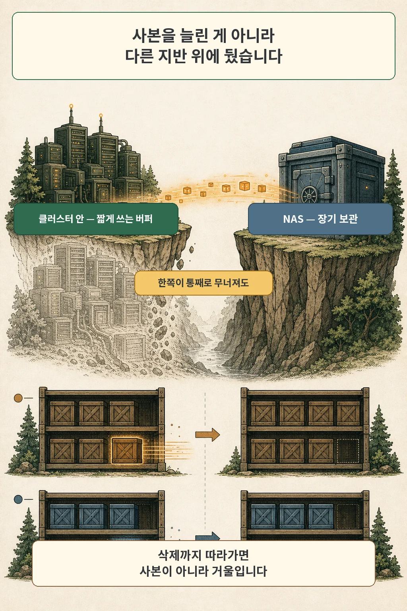
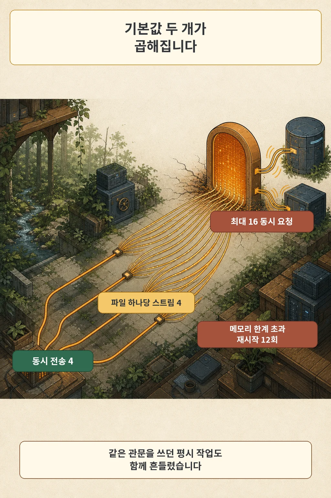
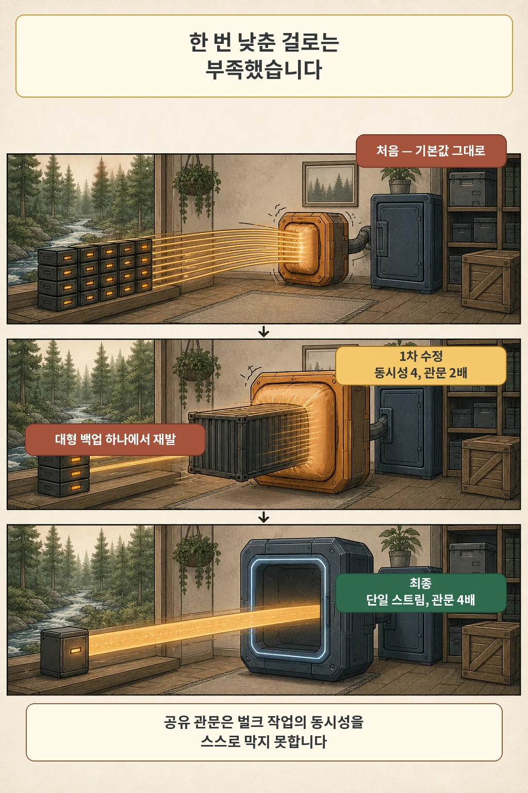

글·해설: 다메카솔

옮겨야 할 백업 데이터는 약 90GB였습니다. 2026년 7월 19일에 돌린 첫 수동 동기화는 47분 동안 아무 문제 없이 복사하다가 갑자기 `connection refused`를 뱉으며 멈췄습니다. 끊어진 쪽은 복사 잡이 아니라, 그 잡이 읽고 있던 인클러스터 S3 게이트웨이였습니다.

> 이 글은 2026년 7월 19일 GitOps 커밋(`777f2d838`)과 CronJob 매니페스트·운영 문서, 개인 인프라 변경 기록을 대조해 정리했습니다. 버킷 이름, 내부 주소, NAS 경로는 역할 이름으로 일반화했습니다.

## 핵심 내용

- **장애 현상과 원인**: 90GB 백업 동기화 중 47분 지점부터 발생한 `connection refused`는 rclone 기본 동시성(`--transfers 4` × `--multi-thread-streams 4` = 최대 16개 동시 스트림)과 약 22GB 대형 객체 분할 수신이 겹쳐, 메모리 상한이 1Gi였던 공유 S3 게이트웨이가 12회 `OOMKilled`로 재시작되면서 발생했습니다.
- **동시성 하향 및 리소스 조정**: `rclone copy`를 `--transfers 2 --multi-thread-streams 1`(단일 스트림 수신)로 낮추고 게이트웨이 메모리를 1Gi → 2Gi → 4Gi로 단계적으로 상향해 OOM 재발을 막았습니다.
- **복사·검증 분리와 시간 창 고정**: 복사는 init 컨테이너에서, 객체 단위 체크섬 대조(`rclone check --one-way --checksum`)는 메인 컨테이너에서 실행하도록 순서를 강제하고, 라이브 버킷의 신착 객체(15개)와 보존 정리 객체(1개)가 오탐을 일으키지 않도록 최소 나이(`--min-age 30m`)와 최대 나이 범위를 지정해 6,094개 객체 무결성(차이 0개, 일일 증분 8분 2초 완주)을 확인했습니다.

## 사본을 하나 더 두는 게 아니라, 다른 지반 위에 둡니다



이 작업이 대비하는 상황은 클러스터 스토리지 전체를 잃는 날입니다. 기존 백업은 인클러스터 오브젝트 스토리지 안에만 있었는데, 클러스터와 같은 지반 위에 있는 사본은 장애 시 함께 무너집니다. 그래서 인클러스터 저장소는 단기 버퍼로, 별도 물리 장비인 NAS는 장기 보관 계층으로 분리했습니다.

배선에 앞서 명령 방식과 보존 경로 규칙부터 바로잡았습니다.

- **동기화(sync)에서 복사(copy)로 전환**: 초기 스크립트는 목적지를 소스와 일치시키는 동기화 명령을 쓰고 있었습니다. 이대로면 소스 버킷에서 보존 기한이 지나 삭제된 백업이 다음 실행 때 NAS에서도 지워져 단기 거울에 그치게 됩니다. 삭제를 전파하지 않는 `rclone copy`로 바꾸고 NAS 측 보존 정리는 별도 단계로 분리했습니다.
- **중첩 경로의 보존 주기 분리**: 최근 백업 계층은 14일, 월간 논리 덤프 계층은 400일 보존으로 설정했습니다. 월간 덤프가 최근 백업 경로의 하위 디렉터리에 들어 있어, 14일 정리 규칙에서 해당 하위 경로를 명시적으로 제외하지 않으면 400일 보관본까지 함께 삭제되는 함정을 미리 막았습니다.

## 47분 뒤에 시작된 connection refused

첫 실행은 47분 동안 순조롭게 진행되다가 갑자기 `connection refused`를 쏟아냈습니다. 자격증명 오류나 NetworkPolicy 차단이었다면 첫 연결부터 막혔을 텐데, 47분간 정상 복사됐다는 사실이 중요한 단서였습니다. **전송 중반부터 시작되는 접속 거절은 상대 서비스가 죽고 재시작 중이라는 신호로 먼저 의심해야 합니다.**

즉시 복사 잡 대신 상대편 S3 게이트웨이 파드 상태를 조회했습니다.

```bash
kubectl -n <저장소 네임스페이스> get pods -l <게이트웨이 라벨>
kubectl -n <저장소 네임스페이스> get pod <게이트웨이 파드> \
  -o jsonpath='{.status.containerStatuses[0].lastState.terminated.reason}'
```

재시작 횟수는 12회, 직전 종료 사유는 `OOMKilled`(당시 메모리 limit 1Gi)였습니다.



원인은 명시하지 않고 기본값으로 둔 rclone 플래그 두 개의 곱셈이었습니다. 동시 전송 파일 수를 정하는 `--transfers` 기본값 4와, 파일 하나를 여러 갈래로 쪼개 받는 `--multi-thread-streams` 기본값 4가 곱해져 **최대 16개의 동시 스트림**이 게이트웨이 한 대로 몰려들고 있었습니다. 그 여파로 같은 게이트웨이를 바라보던 데이터베이스 백업 아카이빙과 원격 로그 수집 경로까지 함께 흔들렸습니다.

## 동시성은 두 번 낮춰야 했습니다

첫 조치는 게이트웨이 메모리를 1Gi에서 2Gi로 올리고, 클라이언트를 전송 2개 × 스트림 2개(최대 동시 요청 4개)로 낮추는 것이었습니다. 하지만 약 22GB짜리 대형 백업 객체를 받는 구간에서 게이트웨이가 다시 OOM으로 죽었습니다. 요청 수를 줄여도 대용량 객체를 여러 스트림으로 분할 수신하는 과정에서 게이트웨이의 버퍼 메모리 사용량이 크게 부풀어 오른 것으로 판단됐습니다(당시 힙 프로파일은 남기지 못해 기록 원장에 의심 원인으로 등재).



결국 파일 분할 수신을 완전히 끄고 단일 스트림으로 받도록 바꾼 뒤, 게이트웨이 메모리를 4Gi로 올려 안정화했습니다.

```bash
rclone copy <소스>:<버킷> <NAS 경로>/<버킷> \
  --checksum \
  --transfers 2 \
  --multi-thread-streams 1
```

## 복사와 검증을 분리하고 시간 창을 맞췄습니다

복사 명령이 종료코드 0으로 끝났다는 것은 ‘보내는 쪽이 에러를 내지 않았다’는 뜻이지 ‘목적지 사본이 소스와 일치한다’는 증명은 아닙니다. 그래서 복사는 **init 컨테이너**에서, 대조 검증은 **메인 컨테이너**에서 돌도록 분리했습니다. Kubernetes의 init 컨테이너는 성공적으로 끝나야만 메인 컨테이너가 시작되므로, 복사가 실패했는데 검증만 통과하는 역전이 구조적으로 차단됩니다.

```bash
rclone check <소스>:<버킷> <NAS 경로>/<버킷> \
  --one-way \
  --checksum \
  --min-age 30m
```

- **`--one-way`와 체크섬 대조**: 장기 보관소인 NAS에만 남아 있는 과거 백업 파일은 무시하고, 소스에 있는 모든 객체가 목적지에 동일한 체크섬(멀티파트 업로드 객체는 크기 대조)으로 존재하는지 확인합니다.
- **시간 창(`--min-age` / 최대 나이) 보정**: 소스가 실시간으로 쓰이는 라이브 버킷이다 보니, 복사가 끝나고 검증이 도는 3분 사이에 새로 들어온 객체 15개가 ‘목적지 누락’으로 잡혀 4회차 시도가 실패했습니다(기존 6,111개는 정합). `--min-age 30m`을 추가해 방금 도착한 객체는 다음 회차에 검사하도록 분리했습니다. 또한 2026년 8월 3일에는 보존 정리로 NAS에서 지운 오래된 객체 1개를 검증 단계가 누락으로 오탐(4,292개 정합, 1개 불일치)하는 일이 발생해, 검증 범위의 최대 나이도 보존 주기와 일치시켰습니다.

다섯 번의 시도 끝에 완성된 전체 수정 이력은 다음과 같습니다.

| 회차 | 중단 지점 | 원인 | 조치 내용 |
| --- | --- | --- | --- |
| **1회차** | 47분 뒤 `connection refused` | 최대 16개 동시 스트림 유입으로 게이트웨이(1Gi) `OOMKilled` 12회 | 게이트웨이 메모리 1Gi→2Gi, 전송 2 × 스트림 2로 축소 |
| **2회차** | 약 22GB 대형 객체 구간 | 2Gi에서도 OOM 재발(대형 객체 다중 스트림 분할 수신 영향 의심) | `--multi-thread-streams 1`(단일 스트림) 적용, 게이트웨이 4Gi로 상향 |
| **3회차** | 복사 시작 직후 | 빈 소스 방어 로직이 정상적으로 비어 있는 개별 버킷에서 오발 | 개별 빈 버킷은 건너뛰고 전체 버킷이 비었을 때만 자격 오류로 판정 |
| **4회차** | 검증 단계 (`rclone check`) | 복사 종료 후 검증 사이 3분 동안 도착한 신착 객체 15개를 누락으로 판정 | 검증 대상에 `--min-age 30m` 조건 추가 (이후 8월 3일 보존 정리 경계와 맞춰 최대 나이 상한도 추가) |
| **5회차** | **완주 (8분 2초)** | DB 백업 버킷 객체 **6,094개 전수 대조 차이 0개** 확인 | 앞선 시도에서 초기 물량이 올라간 뒤의 일일 증분 운영 시간이며, 당일부터 일일 자동 스케줄 가동 |


## 이 작업이 증명하는 것과 증명하지 않는 것

이 파이프라인이 보장하는 것은 **소스에 있는 6,094개 백업 객체가 동일한 내용으로 NAS에 복사되어 있다**는 사실까지입니다. 그 파일들로 실제 데이터베이스를 원하는 시점까지 되살릴 수 있는지는 복원 리허설이 답해야 할 별개의 영역입니다.

공유 게이트웨이 뒤에 대용량 배치 작업을 붙일 때는 세 가지를 먼저 챙겨야 합니다. 클라이언트 동시성 상한을 기본값에 맡기지 않고 명시할 것, 게이트웨이 메모리 상한을 평시가 아닌 벌크 피크 기준으로 잡을 것, 그리고 첫 실행 동안 복사 잡 로그뿐 아니라 **상대 게이트웨이의 재시작 횟수**를 함께 감시할 것입니다.

> 검증 환경: k3s 노드 3대, 인클러스터 S3 호환 오브젝트 스토리지 게이트웨이, NAS NFS export, rclone 1.74.4 컨테이너 이미지(2026년 7월 실측).

이어지는 편에서는 노드 점검을 위해 실행한 `kubectl drain`이 단일 Vault의 PDB 앞에서 멈춘 사건과, 애플리케이션 복제 수와 스토리지 복제 수를 따로 정한 이유를 다룹니다.

## 함께 읽을 개념 글

- [NetworkPolicy가 Synced였는데, 막히는지는 따로 시험했습니다](/posts/networkpolicy-negative-test/)
- [RAM은 32GB인데 Airflow DAG가 계속 실패한 이유](/posts/why-homelab-kubernetes/)
- [애플리케이션보다 먼저 살아 있어야 한다: DB·오브젝트 스토리지 가동시간 설계](/posts/state-service-uptime-design/)

## 출처

- 개인 GitOps 저장소 기록: 백업 2차 사본 CronJob 활성화와 4회 시도 이력, 2026-07-19, commit `777f2d838`
- 개인 GitOps 저장소 문서: 백업 2차 사본 CronJob 매니페스트와 운영 문서(복사·검증 분리, 동시성 상한, 보존 계층, 검증 창 상한)
- 개인 인프라 변경 기록 및 실패 패턴 원장: 게이트웨이 OOM 교정과 공유 게이트웨이 뒤 벌크 소비자, 2026-07-19
- [rclone: Global Flags](https://rclone.org/flags/)
- [rclone: Documentation — multi thread transfers](https://rclone.org/docs/)
- [rclone: rclone check](https://rclone.org/commands/rclone_check/)
- [Kubernetes: Init Containers](https://kubernetes.io/docs/concepts/workloads/pods/init-containers/)
- [Kubernetes: Resource Management for Pods and Containers](https://kubernetes.io/docs/concepts/configuration/manage-resources-containers/)

이 글의 본문과 이미지는 생성형 AI로 제작했습니다. 기획과 편집 기준은 다메카솔이 정했습니다. 만화 이미지는 텍스트 없는 원화에 결정적 레터링을 합성해 만들었습니다. 공식 로고·UI·문서 도표 등 외부 이미지 자산은 사용하지 않았습니다.
