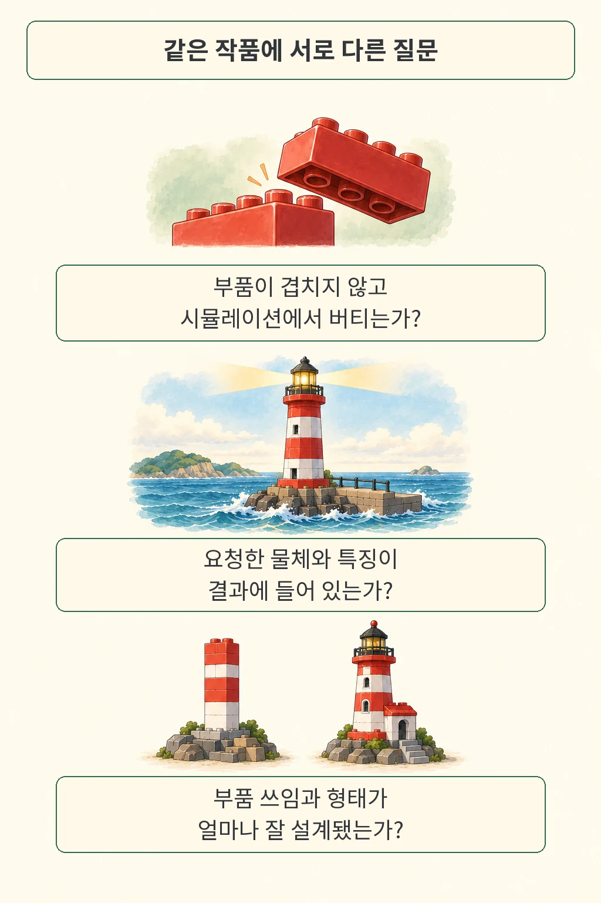
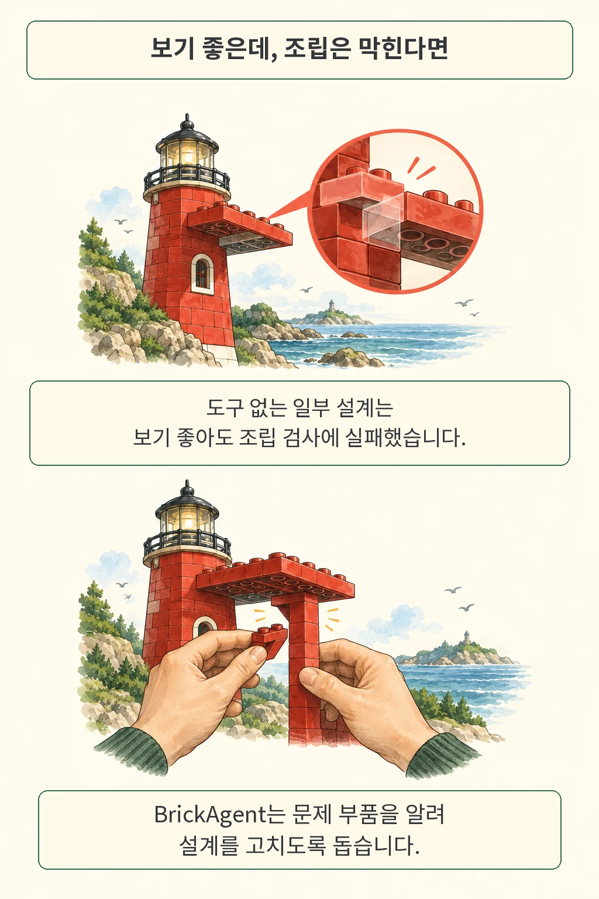
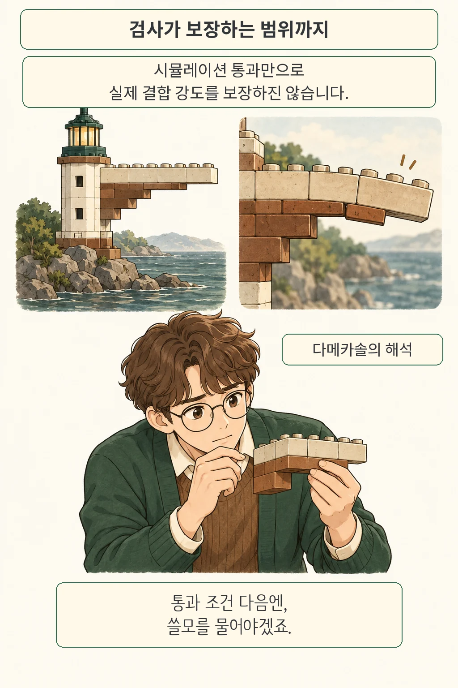

테스트는 전부 초록색인데 결과물을 열어 보면 고개가 갸웃해지는 순간이 있습니다. AI가 만든 레고 설계를 평가한 **BrickBench**는 바로 이 간격을 파고들어, 조립 규칙 충족과 요청 반영, 디자인 완성도를 각각 따로 측정했죠. 자동 검사를 에이전트의 완료 조건으로 삼는 개발자라면 한 번쯤 마주쳤을 법한 질문입니다.

글·해설: 다메카솔

## 핵심 내용

- **세 갈래로 나눈 평가 축**: 300개 브릭 설계 요청을 대상으로 조립 가능 여부(`Valid`), 시각적 요청 충족(`VQA`), 상대적 디자인 완성도(`ELO`)를 분리해 측정했습니다.
- **도구 제거가 드러낸 긴장**: 부품 탐색·렌더링·오류 피드백 도구를 묶은 `BrickAgent`를 빼자 조립 통과율은 급락했지만, 도구 없는 `GPT-5.6 Luna`는 조립 실패 설계를 포함한 채로 요청 충족과 상대 평가 점수가 오히려 올랐습니다.
- **시뮬레이션과 인간 비교의 경계**: 물리 시뮬레이션은 연결 부품을 강체로 가정해 실제 결합 강도나 처짐까지 재지 못하며, 사람 작품 식별 실험(360회 중 323회 식별)은 부품 수만 맞춘 다른 주제의 작품을 비교한 결과입니다.

이 실험은 Peter Kulits, Yiqing Xu, R. Kenny Jones, Cordelia Schmid, Jiajun Wu가 2026년 10월 공개한 **「BrickBench: Evaluating Agentic Brick Design」**(arXiv 프리프린트)에 담겨 있습니다. 저자들은 11개 코딩 에이전트와 2개 특화 모델을 통해, 조립 검사 통과와 실제 디자인 품질 사이의 거리를 추적했습니다.

## BrickBench는 무엇을 따로 보았을까

**예를 들어** "바위섬 위에 빨간 줄무늬 등대와 빛나는 등불을 세워 달라"는 요청을 에이전트에게 맡겼다고 해 봅시다. 부품들이 겹치지 않고 바닥에 서 있기만 하면 조립 관문은 넘기지만, 그게 뭉툭한 원기둥인지 정교한 등대인지는 전혀 별개의 문제거든요. API 응답이 JSON 스키마 검사를 통과했다고 해서 사용자가 원한 업무 목적까지 달성했다고 볼 수 없는 것과 같은 이치입니다.

연구진은 10개 주제 범주에서 고른 300개 요청을 부품 수와 재고 제약이 다른 세 가지 설정으로 나누어 시험했습니다.

| 설계 조건 | 프롬프트 수 | 허용 부품과 라이브러리 범위 |
| --- | --- | --- |
| **Model** | 100개 | 최대 400개 부품 (전체 LDraw 14,441종) |
| **Set** | 100개 | 400~4,000개 부품 (상용 세트 규모의 대형 조립) |
| **Alt-Build** | 100개 | 리테일 10698 세트 재고 783개 부품(104종) 한정 |

각 설계는 아래 세 가지 기준으로 따로 채점합니다.

- **조립 판정 (`Valid`)**: 부품 제한 준수, 부품 간 충돌 여부, PyBullet 물리 시뮬레이션 안정성을 검사합니다.
- **요청 충족 (`VQA`)**: 8개 각도 렌더링 이미지를 보고, 프롬프트를 분해한 예·아니오 질문에 시각언어모델(Gemma 4 31B)이 답합니다.
- **디자인 비교 (`ELO`)**: 같은 요청 결과물을 짝지어 프롬프트 없이 공식 세트 기준으로 부품 쓰임과 형태를 비교합니다. 102명(4,080건)의 사람 판정과 대조했을 때 9개 기준 모델(36쌍) 중 34쌍의 순위가 일치했지만, 시각언어모델의 상대 평가이므로 절대적인 미적 품질 인증과는 다릅니다.

여기서 눈여겨볼 점은 `VQA`와 `ELO`가 조립 검사를 통과하지 못한 설계도 거르지 않고 그대로 채점한다는 사실입니다. 덕분에 조립 가능성과 시각적 완성도가 어긋나는 지점이 수치로 선명하게 드러납니다.

## 도구를 빼자 무엇이 달라졌을까

`BrickAgent`는 부품 검색, 커넥터 배치, 다각도 렌더링, 충돌·안정성 오류 피드백을 함께 제공하는 작업 환경입니다. 저자들은 같은 컨테이너와 최대 300턴 제한 조건에서 LDraw 라이브러리와 형식 설명만 남긴 채 이 도구 묶음을 통째로 제거해 비교했습니다([원문 실험 설정과 표 2](https://arxiv.org/html/2610.12452v1#S5.T2)).

| 모델 (추론 설정) | 도구 사용 `Valid` | 도구 제거 `Valid` | 도구 제거 후 평균 충돌·분리 및 점수 변화 |
| --- | --- | --- | --- |
| **GPT-6 Astra** (`high`) | 100% | 40% | 충돌 7.19쌍 · 분리 6.12조각 · VQA 0.954→0.940 · ELO 1297→1309 |
| **GPT-5.6 Luna** (`max`) | 100% | 1/300 | 충돌 155.51쌍 · 분리 83.00조각 · VQA 0.792→0.813 · ELO 898→960 |

도구를 빼자 두 모델 모두 조립 통과율이 크게 떨어졌습니다. 특히 도구를 뺀 Luna는 300개 중 299개가 조립 검사에서 탈락했는데도 `VQA`와 `ELO` 점수가 오히려 올랐거든요. 조립 제약이 사라지자 부품이 겹치거나 공중에 떠 있더라도 눈으로 보기에 그럴듯한 형태를 자유롭게 만들어 낸 셈이죠.

다만 이 결과는 검증기 하나만 떼어 낸 것이 아니라 검색·배치·렌더링 도구까지 묶은 **전체 환경**을 제거한 비교입니다. 개별 검증기의 단독 효과로 좁히기보다는, 피드백 환경 전체가 모델의 수렴 방향을 바꾼 사례로 읽는 편이 정확합니다.

## 시뮬레이션과 인간 비교의 한계

조립 검사에 합격했다고 해서 실물 브릭에서도 똑같이 버틴다고 보기는 어렵습니다. **가령** 옆으로 길게 뻗은 등대 난간처럼 무게가 쏠리는 구조를 떠올려 볼까요? 논문의 물리 시뮬레이션은 연결 부품을 하나의 강체 덩어리로 취급해, 무게 중심만 맞고 3 LDU(스터드 높이의 3/4) 이내로 움직이면 통과시킵니다. 실제 레고의 결합 강도나 처짐까지는 재지 않으므로, 저자들도 이 검사를 충분조건이 아닌 최소한의 필요조건으로 선을 긋습니다.

사람 작품과 AI 작품을 나란히 놓고 사람 설계를 고르게 한 실험에서는 참가자 5명이 360회 중 323회 사람 작품을 찾아냈습니다. 비율과 세부 부품 활용에서 사람 설계와의 간격이 여전히 크게 남아 있는 편입니다.

하지만 이 비교 역시 전제 조건을 함께 봐야 합니다. 당시 같은 프롬프트의 사람 작품이 없어 **부품 수만 맞춘 서로 다른 주제의 설계**를 짝지었고, 미적 선호 투표가 아니라 사람 작품 식별 과제였으며, 나중에 추가된 `Claude Opus 5.5`와 `GPT-6.1 Sol`은 실험에서 빠졌습니다.

## 다메카솔의 해석: 완료 조건을 두 층으로 설계하기

에이전트 워크플로의 완료 조건을 짤 때도 자동 검증 규칙과 사용 목적 평가를 두 층으로 나누어 두는 편이 안전합니다. **실무에서** 코드 수정이나 설정 파일을 만드는 에이전트를 운영한다고 가정해 봅시다. 앞 단계에서는 구문 오류, 참조 무결성, 단위 테스트처럼 명확히 판정할 수 있는 검사를 붙여야 에이전트가 고칠 지점을 정확히 짚어내거든요.

반면 자동 통과율만 완료 기준으로 삼으면 규칙만 간신히 맞추고 정작 유지보수하기 어렵거나 의도에서 벗어난 결과물이 나오기 쉽습니다. [에이전트 평가에 실행 설정을 함께 적어야 하는 이유](/posts/agent-evaluation-system-configuration/)에서 살폈듯 어떤 도구와 피드백 루프를 붙였는지에 따라 모델의 행동 양상 자체가 달라집니다. 자동 검증 도구가 최소 기준선을 지키는 동안, 최종 산출물이 실제 쓸모를 다했는지는 누가 어떤 기준으로 판정할지 함께 정해 두어야겠죠.

## 출처

- Peter Kulits, Yiqing Xu, R. Kenny Jones, Cordelia Schmid, Jiajun Wu, [BrickBench: Evaluating Agentic Brick Design (arXiv:2610.12452v1)](https://arxiv.org/abs/2610.12452v1), 2026년 10월 8일 제출된 프리프린트.
- [원문 PDF](https://arxiv.org/pdf/2610.12452v1): §3.2 물리 시뮬레이션, §4.1–4.4 설정·지표, §5.2–5.4 도구 제거·인간 비교 실험, §6 한계.
- [원문 HTML 4.4절과 표 2](https://arxiv.org/html/2610.12452v1#S5.T2)
- [저자 프로젝트 페이지](https://www.brickben.ch) (2026년 10월 9일 확인 당시 403 응답으로 코드·데이터 공개 상태 미확인)

확인·업데이트: 2026-10-09

이 글은 논문 원문을 바탕으로 정리했으며, 모델 실행과 실제 브릭 조립 검증은 포함하지 않았습니다.

이 글의 본문과 이미지는 생성형 AI로 제작했습니다. 기획과 편집 기준은 다메카솔이 정했습니다.
