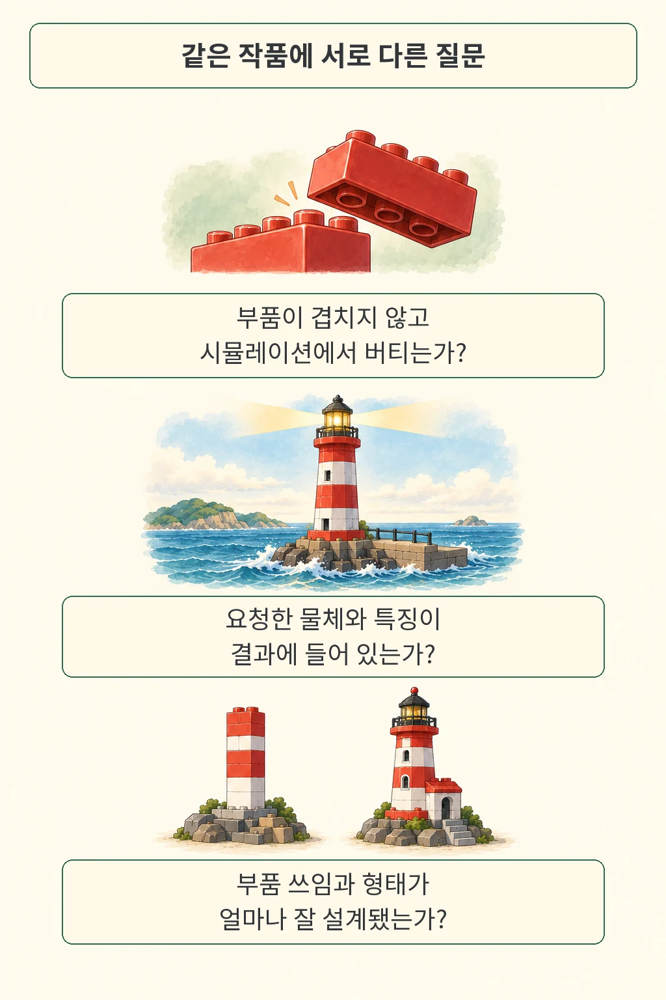
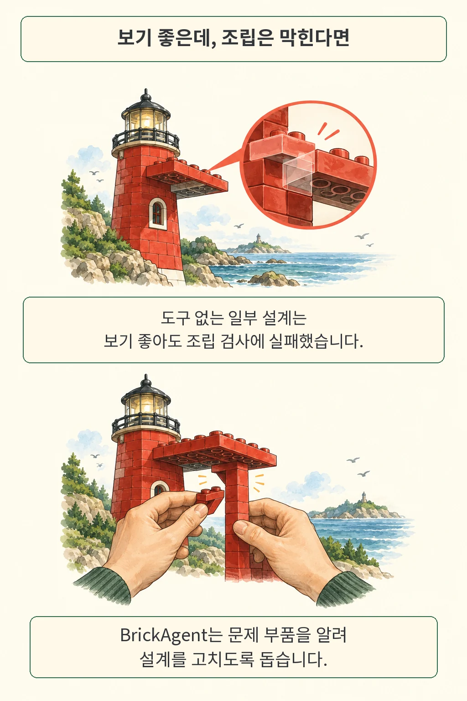
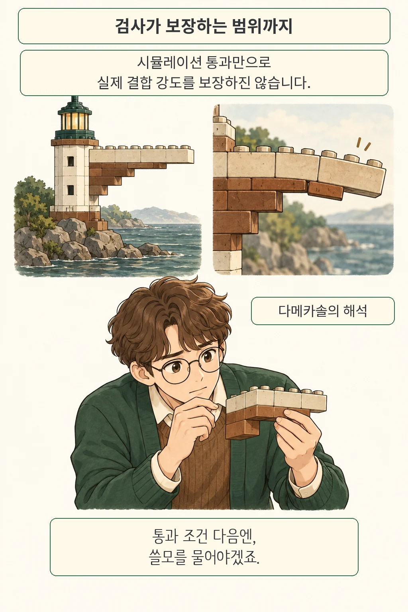

글·해설: 다메카솔

테스트는 전부 초록색인데 결과물을 열어 보면 고개가 갸웃해지는 순간이 있습니다. AI가 만든 레고 설계를 평가한 **BrickBench**는 바로 이 간격을 파고들어, 물리적·규칙적 조립 조건을 만족하는지와 요청한 특징이 들어갔는지, 그리고 디자인이 매력적인지를 각각 나누어 평가했습니다. 자동 검사를 에이전트의 완료 조건으로 삼는 개발자에게도 익숙한 질문입니다.

## 핵심 내용

- **세 갈래로 나눈 평가 축**: 300개 브릭 설계 요청에 대해 조립 가능 여부(부품 제한·충돌·물리 시뮬레이션 안정성), 요청 특징 충족(렌더링 이미지 기반 문답), 미적·구조적 선호(작품 간 상대 평가)를 분리해 측정했습니다.
- **검증 도구의 유무와 결과의 갈림**: 부품 탐색·렌더링·오류 피드백 도구를 묶은 BrickAgent를 제거하자 조립 통과율은 100%에서 40%(GPT-6 Astra)와 1/300(GPT-5.6 Luna)로 급락했지만, 도구 없는 Luna가 시각적 요청 충족과 상대 평가에서는 오히려 더 높은 점수를 받았습니다.
- **시뮬레이션과 인간 비교의 해석 경계**: 시뮬레이션은 연결된 부품을 강체로 가정해 실제 브릭의 결합 강도나 처짐까지는 재지 못하며, 사람 작품 식별 실험(360회 중 323회 식별)은 부품 수만 맞춘 서로 다른 주제의 작품을 비교한 결과입니다.

## BrickBench는 무엇을 따로 보았을까

연구진은 300개 요청을 부품 수와 재고 조건이 다른 세 범주(최대 400개를 쓰는 Model, 400~4,000개를 쓰는 Set, 특정 세트의 부품만 쓰는 Alt-Build)에 배정하고 세 가지 질문을 따로 물었습니다.

- **조립 판정**: 부품 제한 준수, 부품 간 충돌 여부, 시뮬레이션상의 물리적 안정성
- **요청 충족**: 렌더링된 이미지를 두고 요청한 시각적 특징이 들어갔는지 확인하는 문답
- **디자인 비교**: 작품들을 나란히 두고 판정하는 상대 평가

API 응답이 JSON 스키마 검사를 통과했다고 해서 사용자가 원한 업무 목적까지 달성했다고 볼 수 없듯, 브릭 설계에서도 조립 규칙 통과와 디자인 완성도를 분리해 본 점이 이 벤치마크의 핵심입니다.

## 도구를 빼자 무엇이 달라졌을까

BrickAgent는 부품을 찾고 연결해 렌더링하는 도구와 문제 부품을 알려 주는 검증 피드백을 함께 제공합니다. 저자들은 LDraw 부품 라이브러리와 형식 설명만 남긴 채 이 도구 묶음을 통째로 제거하는 비교 실험(Astra는 high, Luna는 max 추론 설정, 요청당 최대 300턴)을 진행했습니다. ([원문 4.4절과 표 2](https://arxiv.org/html/2610.12452v1#S5.T2))

| 300개 요청의 조립 검사 통과율 | BrickAgent 사용 | 도구 묶음 제거 |
| --- | --- | --- |
| GPT-6 Astra | 100% | 40% |
| GPT-5.6 Luna | 100% | 1/300 |

검증과 렌더링 도구 묶음을 빼자 조립 검사 통과율은 크게 떨어졌습니다. 흥미로운 점은 도구 없이 생성한 Luna의 결과물이 조립 검사에서 대부분 탈락한 설계를 포함한 상태에서도, 렌더링 이미지 기준의 요청 충족 점수와 상대 평가에서는 도구를 쓴 경우보다 더 높은 점수를 받았다는 사실입니다. 조립 가능한 구조로 수렴하게 만드는 피드백과 눈으로 보기에 그럴듯한 형태를 만드는 과정이 서로 다른 방향으로 작동할 수 있음을 보여 줍니다.

## 시뮬레이션과 인간 비교의 한계

조립 검사를 통과했다고 해서 실물 브릭에서도 똑같이 버티는 것은 아닙니다. 논문의 물리 시뮬레이션은 서로 연결된 부품들을 하나의 단단한 강체 덩어리로 취급하므로, 실제 레고 조립에서 중요한 클러치 결합 강도나 무게에 따른 처짐까지는 검사하지 못합니다.

사람 작품과 AI 작품을 나란히 놓고 어느 쪽이 사람이 만든 설계인지 고르게 한 실험에서는 참가자 5명이 360회 중 323회 사람 작품을 찾아냈습니다. 꽤 뚜렷한 차이지만, 이때 비교한 쌍은 **부품 수만 맞췄을 뿐 같은 프롬프트 요청으로 만든 설계가 아니었고**, 미적 선호를 묻는 투표도 아니었으며 나중에 추가된 Opus 5.5와 GPT-6.1 Sol은 이 실험에 포함되지 않았습니다.

## 다메카솔의 해석: 완료 조건을 두 층으로 설계하기

에이전트 워크플로의 완료 조건을 설계할 때도 자동 검증 규칙과 사용 목적 평가를 두 층으로 나누어 두는 편이 안전합니다. 앞 단계에서는 파일 형식, 참조 무결성, 충돌 검사처럼 명확히 판정할 수 있는 오류를 잡아야 에이전트가 어느 부분을 고쳐야 할지 구체적인 피드백을 얻을 수 있습니다.

반면 자동 통과율만 높이는 방향으로 반복을 거듭하면, 조립 규칙만 간신히 맞추고 정작 사용자가 원한 형태나 가독성은 무너진 결과물이 나올 수 있습니다. [에이전트 평가에 실행 설정을 함께 적어야 하는 이유](/posts/agent-evaluation-system-configuration/)에서 살폈듯 어떤 도구와 피드백 루프를 붙였는지에 따라 모델의 행동 양상이 달라지므로, 오류를 고치는 검증 도구와 최종 결과물의 품질 기준을 함께 맞물려 설계해야 합니다.

## 출처와 확인 범위

- Peter Kulits, Yiqing Xu, R. Kenny Jones, Cordelia Schmid, Jiajun Wu. [BrickBench: Evaluating Agentic Brick Design, arXiv:2610.12452v1](https://arxiv.org/abs/2610.12452v1). 2026년 10월 8일 제출된 프리프린트.
- [원문 PDF](https://arxiv.org/pdf/2610.12452v1)의 평가 정의, 표 2, 사람 실험과 한계를 대조했습니다.
- [저자 프로젝트 페이지](https://www.brickben.ch)는 확인 시 403 응답으로 접근하지 못해 코드·데이터의 공개 상태를 확인하지 못했으며, 모델 실행과 실제 브릭 조립은 독립 재현하지 않았습니다.

확인·업데이트: 2026-10-09

이 글의 본문과 이미지는 생성형 AI로 제작했습니다. 기획과 편집 기준은 다메카솔이 정했습니다.
