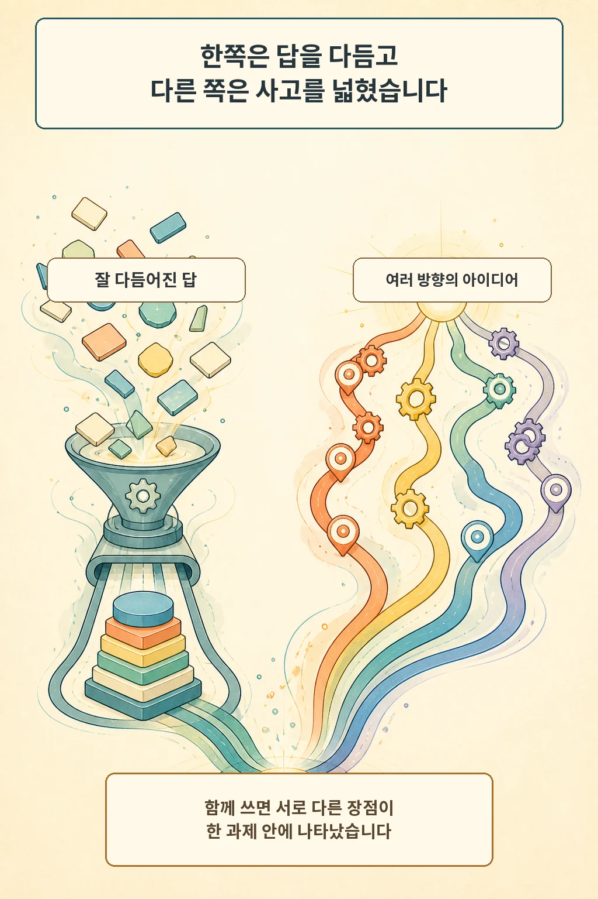
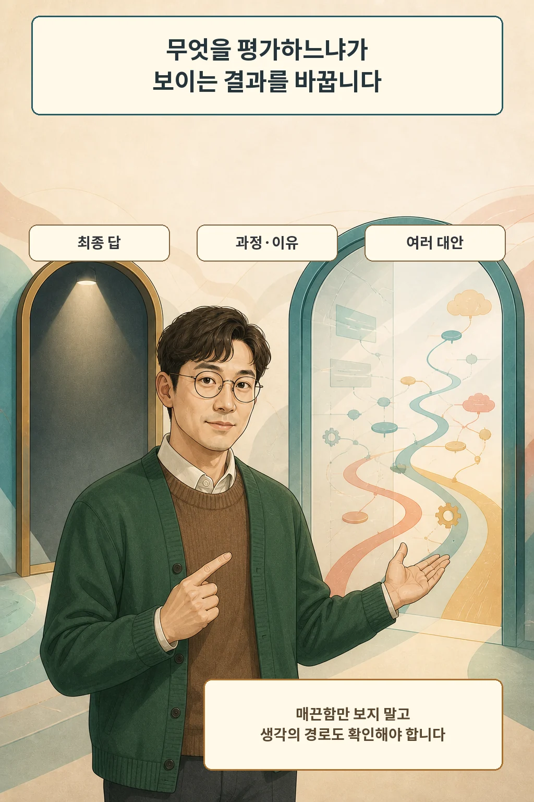

OpenAI는 2026년 8월 27일 Bocconi University 연구진 등이 수행한 무작위 대조 실험(RCT) 결과를 소개했습니다. 질문은 명쾌했는데요. 초보 학습자에게 ChatGPT를 제공하는 것과 인과추론을 훈련하는 것은 과제 결과를 각각 어떻게 바꿀까요? 실험이 보여 준 결론은 어느 한쪽의 승패가 아니라, 두 개입이 서로 다른 역량을 바꿨다는 점이었습니다. [C001][C008]

## 핵심 내용

- **교실 단위 4개 조건 실험**: 경제·경영·금융 전공 1학년 1,053명을 13개 수업 단위로 묶어 인과추론 훈련만 받은 집단, ChatGPT Edu(GPT-4o)만 쓴 집단, 둘 다 받은 집단, 통제집단으로 나누어 45분 마케팅 추천안 과제를 수행했습니다. [C002][C003]
- **ChatGPT의 효과 (답변 완성도)**: 통제집단(2.09점) 대비 5점 척도에서 **0.862점** 높은 점수를 받았고 아이디어 수와 논리적 일관성이 커졌으나, 참가자 간 아이디어 다양성은 뚜렷하게 늘지 않았습니다. [C004][C005]
- **인과추론 훈련의 효과 (사고 확장)**: 작동 메커니즘 설명, 반증 가능 조건 제시, 답변 내·참가자 간 아이디어 다양성을 높였으나 표준 마케팅 채점표의 점수를 올리지는 못했습니다. [C005][C008]

## 네 조건으로 나눈 교실 실험입니다

연구진은 한 유럽 대학의 경제·경영·금융 전공 1학년 학생 **1,053명**을 13개 수업 단위로 나누어 네 가지 조건에 배정했습니다. 인과추론 훈련만 받은 집단, ChatGPT Edu에서 GPT-4o를 사용한 집단, 두 가지를 모두 받은 집단, 그리고 아무것도 받지 않은 통제집단입니다(개인별 무작위 배정이 아니라 교실 단위 배정이었다는 점도 결과를 읽을 때 함께 봐야 할 조건입니다). [C002]

참가자들은 45분 동안 대학 굿즈 매장의 인지도와 이용률을 높이는 추천안을 180단어 이내로 작성했습니다. 작성된 답안은 석사과정 평가자 20명이 표준 마케팅 기준으로 채점했고, 연구진은 이를 별도의 전문가 3명이 작성한 추천안과도 비교했습니다. [C003]

## ChatGPT는 표준 답의 완성도를 높였습니다

ChatGPT를 사용한 집단의 평균 평가 점수는 통제집단의 추정 점수(2.09점)보다 5점 만점 척도에서 **0.862점** 더 높았습니다. 답안에 더 많은 아이디어가 담겼고 논리적 일관성이 높아졌으며 전문가 추천안과도 한층 비슷해졌는데요. 연구진은 단순히 문장 표현이 매끄러워진 효과만으로는 이 점수 차이 전체를 설명할 수 없다고 보고했습니다. [C004]

그렇다고 ChatGPT가 모든 종류의 사고를 넓혔다는 뜻은 아닙니다. 참가자들 사이의 아이디어 다양성은 ChatGPT만 제공한 조건에서 뚜렷하게 늘어나지 않았습니다. 즉 이 실험에서 ChatGPT가 발휘한 강점은 새로운 갈래를 여는 일보다, 정해진 과제와 평가 기준에 부합하는 아이디어를 더 많이 묶어 일관된 답안으로 정돈하는 쪽에 가까웠습니다. [C004][C005]

## 인과추론 훈련은 다른 부분을 바꿨습니다

반면 인과추론 훈련을 받은 학생들은 **왜 그런 효과가 생기는지(작동 메커니즘)**를 더 구체적으로 설명했고, **어떤 조건에서 자신의 주장이 틀릴 수 있는지(반증 가능성)**를 더 많이 적었습니다. 한 답안 안의 아이디어와 참가자들 사이의 아이디어 역시 더 다양해졌지만, 정작 이러한 변화가 표준 마케팅 평가 점수를 높이지는 못했습니다. [C005]

두 개입을 함께 제공한 집단에서는 양쪽의 장점이 한 과제 안에 나란히 나타났습니다. 논리적 일관성과 아이디어 수는 ChatGPT 접근의 효과를 보였고, 메커니즘 설명·반증 가능성·아이디어 다양성은 인과추론 훈련의 효과를 그대로 유지했습니다(다만 최종 평가 점수 자체에서 두 개입이 합쳐진 추가 시너지 보너스가 뚜렷했다고 보기는 어렵습니다). [C006]

## 평가표가 보지 않으면 결과에도 잘 안 보입니다

왜 인과추론 훈련으로 넓어진 사고가 점수 상승으로 이어지지 않았을까요? 이 실험의 채점표는 ‘인지도와 이용률 제고’라는 표준 마케팅 목표에 얼마나 잘 답했는지를 중점적으로 보았을 뿐, 참신한 대안이나 반례를 제시하는 일을 핵심 보상 항목으로 삼지 않았기 때문입니다. 익숙한 모범 답안 공간에서 벗어난 시도는 오히려 점수를 얻기 어려웠던 셈인데, 이는 비판적 사고력의 무가치함이 아니라 **평가 기준의 시야 한계**를 드러냅니다. [C005][C008]

따라서 학교나 조직이 AI 시대의 진짜 이해도를 평가하고 싶다면 매끈하게 다듬어진 최종 답안만 제출하게 해서는 부족합니다. 어떤 가정을 세웠는지, 원인과 결과를 어떻게 연결했는지, 자신의 주장이 깨지는 반례는 무엇인지, 그리고 여러 대안 가운데 왜 지금의 안을 골랐는지를 함께 요구해야 합니다. [C009]

## 이 결과를 어디까지 믿을 수 있을까요?

실험의 외적 타당성 경계도 분명합니다. 연구 대상은 한 유럽 대학의 1학년 학생이었고 과제는 45분짜리 단발성 마케팅 추천안이었습니다. 또한 교실 단위 배정이었으며, 사용된 모델은 GPT-4o였고, AI 사용 규칙 준수 여부 일부는 학생의 자기보고에 의존했습니다(저자 익명성을 위해 대학 이름과 사전분석 등록번호도 비공개 상태입니다). 따라서 다른 학년이나 수학·공학 문제, 장기 학습 효과, 최신 추론 모델에서도 똑같은 결과가 나온다고 단정할 수는 없습니다. [C007]

## 다메카솔의 해석

이 연구를 “AI를 쓰면 생각을 멈춘다”거나 반대로 “AI가 사고력 훈련보다 낫다”는 식의 이분법으로 읽을 필요는 없습니다. 진짜 던져야 할 질문은 **우리가 ‘좋은 답’이라고 부르는 기준이 매끈한 최종 결과물만 채점하는지, 아니면 그 답에 이르는 여러 이유와 실패 가능성까지 함께 살피는지**에 있습니다. [C008]

AI 도구는 답안의 완성도를 빠르게 끌어올릴 수 있고, 인과추론 훈련은 남들과 다른 대안 경로를 찾게 돕습니다. 두 가지를 함께 쓰는 환경에서 교육과 평가가 해야 할 일은 도구를 무조건 금지하는 것이 아니라, 생각의 경로와 근거가 드러나도록 과제와 채점표를 다시 설계하는 일입니다. [C009]

## 출처

- [OpenAI, Better answers, broader thinking: What students gain from ChatGPT and critical-thinking training (2026-08-27)](https://openai.com/index/what-students-gain-from-chatgpt-critical-thinking-training/)
- [Asirvatham et al., Training novices to think, or giving them LLMs? Evidence from an RCT (2026-08)](https://cdn.openai.com/pdf/novices-and-llm-august-2026.pdf)

글·해설: 다메카솔

이 글의 본문과 이미지는 생성형 AI로 제작했습니다. 기획과 편집 기준은 다메카솔이 정했습니다.
