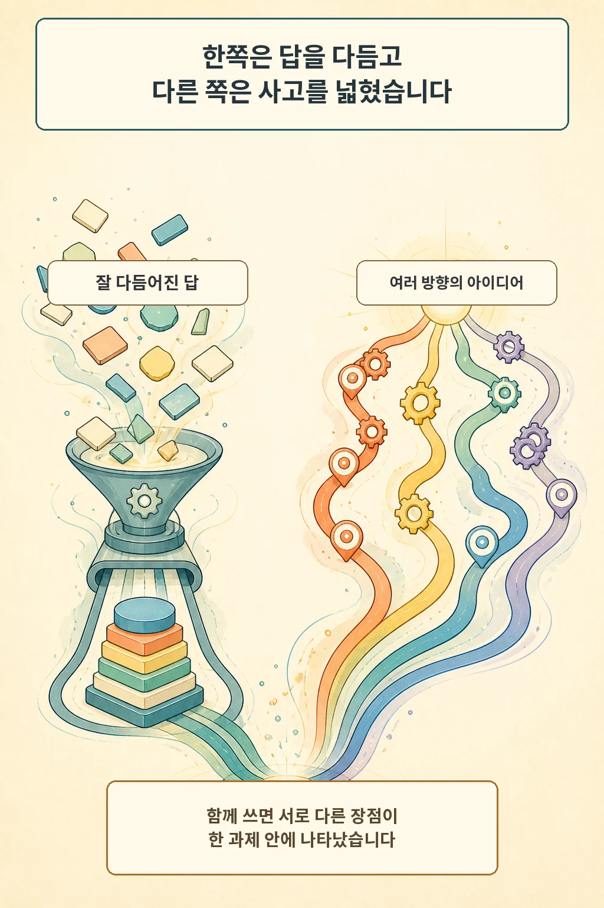
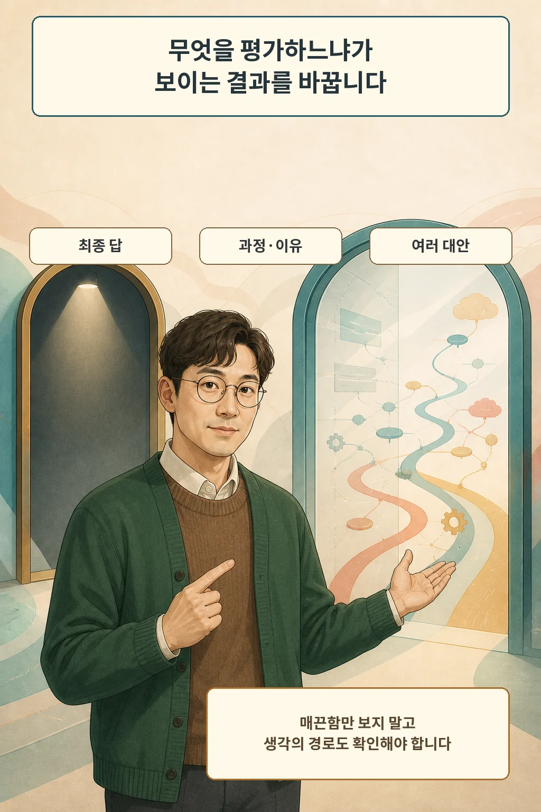

새 학기 리포트나 팀 기획안을 받아 읽다 보면 문장은 흠잡을 데 없이 매끈한데 왠지 글마다 비슷해 보일 때가 있습니다. 초보 학습자에게 ChatGPT를 제공하는 것과 원인과 근거를 따지는 사고 훈련을 시키는 것은 결과물을 각각 어떻게 바꿀까요? OpenAI가 **2026년 8월 27일** 소개한 Bocconi University 연구진 등의 무작위 대조 실험(RCT)은 어느 한쪽의 승패보다 두 개입이 서로 다른 역량을 키웠다는 점을 보여 줍니다.

글·해설: 다메카솔

## 네 조건으로 나눈 교실 실험

연구진은 한 유럽 대학의 1학년 학생들을 교실 단위로 묶어 네 조건에 배정하고, 대학 굿즈 매장의 인지도와 이용률을 높이는 추천안을 작성하게 했습니다. 개인별 무작위 배정이 아니라 수업 단위로 나눈 실제 교실 환경이었다는 점까지 포함해, 실험 구성과 주요 결과는 아래 표와 같습니다.

| 항목 | 구성과 주요 관찰 결과 |
| --- | --- |
| **참여자·과제** | 경제·경영·금융 1학년 **1,053명**(13개 수업), **45분**간 **180단어 이내** 매장 추천안 작성 |
| **평가 기준** | 석사과정 평가자 **20명**의 표준 마케팅 채점(5점 척도) 및 별도 전문가 **3명** 추천안과 비교 |
| **ChatGPT Edu (GPT-4o)** | 통제집단 추정 점수(**2.09점**) 대비 **0.862점** 상승, 아이디어 수·일관성·전문가 안 유사도 증가, 참가자 간 다양성은 뚜렷한 증가 없음 |
| **인과추론 훈련** | 작동 메커니즘 설명·반증 가능 조건·답안 내 및 참가자 간 다양성 증가, 표준 채점 점수는 오르지 않음 |
| **두 개입 병행** | 일관성·아이디어 수(ChatGPT)와 메커니즘·반증·다양성(인과훈련) 공존, 추가 점수 시너지는 뚜렷하지 않음 |
| **통제집단** | AI 접근과 인과추론 훈련 없이 동일 과제 수행(추정 점수 **2.09점**) |

## 답을 다듬는 힘과 생각을 넓히는 힘

ChatGPT를 쓴 학생들은 평가 기준에 맞는 아이디어를 더 많이 엮어 논리적으로 정돈했습니다. 연구진은 단순히 문장이 매끄러워진 효과만으로는 점수 차이 전체를 설명하기 어렵다고 보고합니다. 다만 답안을 서로 견주어 보면 ChatGPT만 쓴 집단에서는 남들과 구별되는 새로운 갈래의 아이디어까지 뚜렷이 늘어나지는 못했습니다.

반면 인과추론 훈련을 받은 학생들은 다른 축에서 힘을 발휘했습니다. 여기서 인과추론 훈련이란 "왜 이 방안이 효과를 내는지" 작동 원리를 설명하고, "어떤 조건에서 내 주장이 틀릴 수 있는지" 반증 가능성을 따져 묻는 연습을 가리킵니다. 이 집단은 한 답안 안에서도, 학생들 사이에서도 훨씬 다양한 아이디어를 내놓았습니다.

두 개입을 함께 제공한 집단에서는 양쪽 강점이 한 과제 안에 나란히 나타났습니다. 논리적 일관성과 아이디어 수는 ChatGPT의 효과를, 메커니즘 설명·반증 가능성·다양성은 인과추론 훈련의 효과를 그대로 유지한 셈이죠. 최종 점수에서 추가 시너지 보너스는 두드러지지 않았지만 두 역량이 서로를 밀어내지 않고 공존했습니다.

## 평가표가 보지 않는 역량은 점수에 잡히지 않습니다

그렇다면 인과추론 훈련으로 생각이 넓어졌는데도 왜 표준 마케팅 점수는 오르지 않았을까요? 실험 채점표가 '인지도와 이용률 제고'라는 익숙한 목표에만 점수를 주었을 뿐, 참신한 대안이나 반례 제시에는 가산점을 두지 않았기 때문입니다. 모범 답안에서 벗어난 시도가 점수를 얻기 어려웠던 건데, 이는 비판적 사고가 무가치해서가 아니라 평가 기준의 시야가 좁았던 탓입니다.

가령 대학 수업이나 스터디에서 '매장 홍보 기획안'을 45분 안에 써 내는 과제를 생각해 볼까요? 한 학생은 AI로 모범 답안 같은 기획안을 매끄럽게 제출하고, 다른 학생은 손님이 지나치는 원인과 실패 조건까지 따져 색다른 대안을 적었습니다. 채점표가 정해진 정답 틀만 따진다면 앞선 답안이 유리하고, 뒤쪽 학생의 고민은 점수 밖으로 밀려나기 마련입니다.

물론 이 실험은 유럽 한 대학 1학년의 단발성 마케팅 과제, 교실 단위 배정, **GPT-4o**, 규칙 준수 여부 일부의 자기보고 의존에 한정되며 저자 익명성을 위해 대학명과 사전분석 등록번호도 비공개된 상태입니다. 다른 전공이나 수학·공학 문제, 장기 학습 효과, 최신 추론 모델까지 같은 양상이 이어진다고 일반화하기에는 무리가 따릅니다.

## 다메카솔의 해석

이번 연구를 "AI를 쓰면 생각을 멈춘다"거나 "AI가 사고력 훈련보다 낫다"는 이분법으로 읽으면 본질을 놓치기 쉽습니다. AI가 답안의 완성도를 끌어올리는 동안 인과추론 훈련은 다른 경로와 반례를 찾게 돕거든요.

AI 시대에 학습자나 팀원의 진짜 이해도를 보려면, 최종 답안의 매끈함만 채점하는 관성에서 벗어나 과제와 리뷰 기준에 아래 세 가지를 함께 물어야 합니다.

- **가정과 작동 원리**: 주장의 전제가 무엇이며 왜 그런 결과가 나오는지 설명하게 합니다.
- **반증 가능 조건**: 어떤 상황이나 반례가 나타나면 현재 안이 깨지는지 짚어 보게 합니다.
- **대안 비교와 선택 이유**: 여러 갈래 가운데 왜 지금의 안을 골랐는지 근거를 남기게 합니다.

도구를 무조건 막기보다 결과물 뒤의 생각 경로가 드러나도록 평가 기준을 함께 설계할 때 두 역량이 각자의 역할을 다합니다.

## 출처

- [OpenAI, Better answers, broader thinking: What students gain from ChatGPT and critical-thinking training (2026-08-27)](https://openai.com/index/what-students-gain-from-chatgpt-critical-thinking-training/)
- [Asirvatham et al., Training novices to think, or giving them LLMs? Evidence from an RCT (2026-08)](https://cdn.openai.com/pdf/novices-and-llm-august-2026.pdf)

이 글은 2026년 8월 27일 공개된 OpenAI 발표와 연구 보고서를 바탕으로 정리했으며, 별도 실험 재현이나 원문 도표 복제는 포함하지 않았습니다.
이 글의 본문과 이미지는 생성형 AI로 제작했습니다. 기획과 편집 기준은 다메카솔이 정했습니다.
