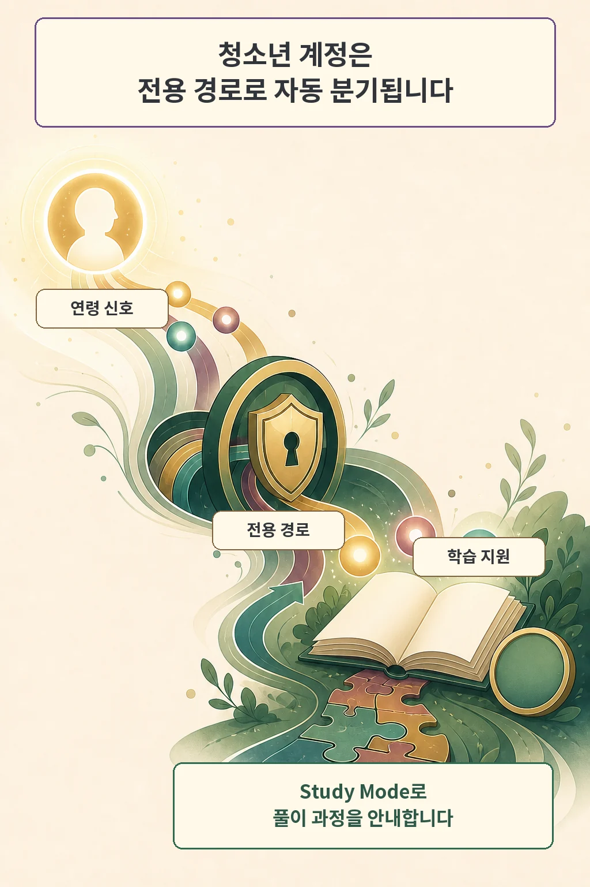
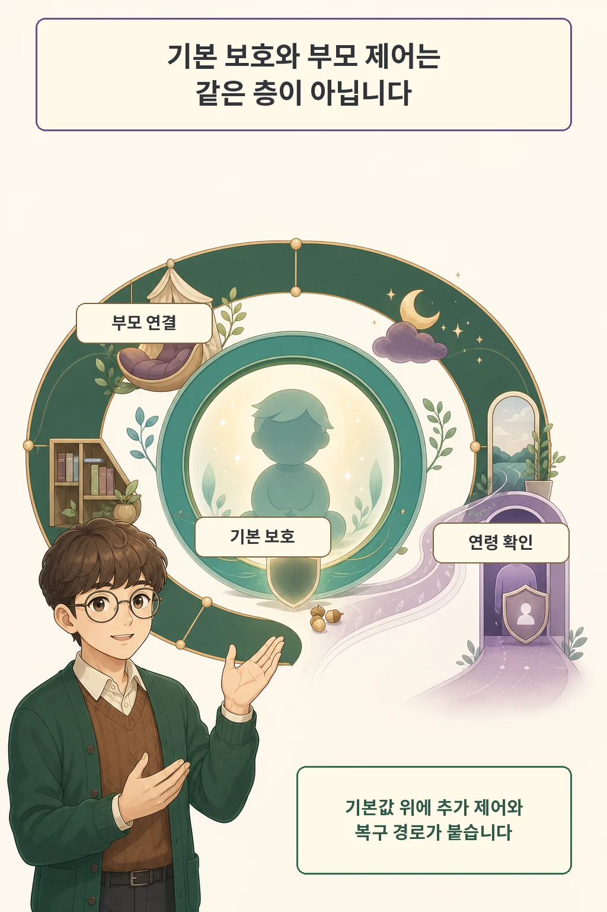

청소년용 AI 서비스를 만들 때 기존 성인용 모델에 금지어 규칙 몇 개만 덧붙여서는 실제 사용 경계를 지키기 어렵습니다. 부모 계정이 연결되기 전에 청소년이 먼저 대화를 시작하는 경우도 많고, 반대로 성인이 미성년자로 잘못 분류됐을 때 권한을 되돌릴 출구도 필요하거든요. OpenAI가 **2026년 8월 18일** 공개한 [ChatGPT for Teens 공식 발표](https://openai.com/index/chatgpt-for-teens/)는 자동 계정 분기, 학습 지원 도구, 기본 안전 보호, 부모 연결 제어를 하나의 제품 구조로 묶어 이 경계를 재정비한 사례입니다.

글·해설: 다메카솔

## 부모 연결 전부터 자동 분기되는 학습·보호 경로

이번 출시에서 먼저 짚어 볼 변화는 계정 진입 방식입니다. [OpenAI 연령 예측 도움말](https://help.openai.com/en/articles/12652064-age-prediction)에 따르면, 시스템이 사용자를 18세 미만으로 추정하거나 가입 과정에서 13~17세로 밝히면 부모 계정을 먼저 연결하지 않아도 `ChatGPT for Teens` 경로가 자동으로 켜집니다.

적용 일정은 지역별 규제 환경에 따라 조금씩 달라지는데요. 전 세계 계정에 순차적으로 도입되는 가운데, 유럽연합(EU)에서는 현지 규제 요건을 반영해 이후 몇 주에 걸쳐 적용될 예정입니다.

전용 경로에 들어가면 바로 정답만 건네기보다 단계와 질문을 통해 풀이를 돕는 `Study Mode`를 비롯해 책임 있는 숙제 알림, 퀴즈, 학습 시각화, `Study Hours`가 함께 제공됩니다. OpenAI는 이 구성이 빠른 답 대신 스스로 풀이 과정을 밟아 가는 능동적 학습을 돕도록 설계됐다고 설명합니다.

안전장치 역시 부모 연결 여부와 무관하게 기본값으로 작동합니다. [Model Spec 청소년 보호 업데이트](https://openai.com/index/updating-model-spec-with-teen-protections/) 기준의 고위험 영역(자해, 폭력, 섭식장애, 위험 활동, 성적·그래픽 콘텐츠)에 연령 적합 보호가 켜지고, 대화 상대가 AI임을 알리는 단서와 휴식 알림도 함께 동작합니다.

## 기본 보호, 부모 연결, 오분류 복구가 나뉜 세 층

`ChatGPT for Teens`의 핵심은 개별 기능 목록보다 **자동 기본값·부모 위임·복구 출구**를 서로 다른 층으로 분리한 권한 구조에 있습니다. 세 층의 적용 조건과 제어 범위를 아래 표로 나란히 정리했습니다.

| 권한 층 | 적용 조건 | 주요 기능과 제어 범위 | 운영 경계 및 참고 사항 |
| --- | --- | --- | --- |
| **기본 보호·학습** | 18세 미만 추정 또는 13~17세 입력 시 자동 적용 | `Study Mode`, 책임 있는 숙제 알림, 퀴즈, 학습 시각화, `Study Hours`, 고위험 보호, AI 고지·휴식 알림 | 부모 연결 없이도 기본 작동, 전 세계 순차 적용 중(EU는 수주 내 적용) |
| **부모 연결 제어** | 부모와 청소년 계정을 연결한 경우 선택 적용 | `Quiet Hours`, 음성·메모리·이미지 생성·모델 개선 데이터 사용 설정, 제한된 고위험 안전 알림 | 모든 일상 대화를 상시 열람하는 기능으로 설명되지 않음 |
| **성인 오분류 복구** | 18세 이상 성인이 청소년 경로에 잘못 분류된 경우 | 설정 화면에서 보호 적용 여부를 확인하고 Persona 셀피 연령 확인으로 전체 권한 복구 | 연령 예측 모델의 실제 오분류율과 지역별 완료 시점은 미공개 |

이 구조에서 부모 계정 연결은 기본 안전장치의 대체재가 아니라 가정별 사용 규칙을 더하는 선택층입니다. [부모 제어 안내](https://openai.com/index/introducing-parental-controls/)를 보면 연결된 부모는 `Quiet Hours`를 정하고 음성·메모리·이미지 생성·모델 개선용 데이터 사용 같은 일부 설정을 관리하며, 제한된 고위험 상황에서 안전 알림을 받을 수 있죠. 반면 일상 대화 전체를 상시 열람하는 기능으로 설명되지는 않았으므로, 미연결 계정의 안전 공백과 과도한 열람 권한 문제를 함께 줄이는 설계입니다.

자동 연령 추정을 도입할 때 함께 살펴야 할 지점은 오분류 복구 흐름입니다. 예를 들어 가족이 함께 쓰는 공용 기기에서 성인 계정이 미성년자 이용 패턴으로 분류되는 상황을 떠올려 볼까요? 이때 시스템은 우선 청소년 보호 경로를 적용해 두되, 당사자는 설정 화면에서 적용 여부를 확인한 뒤 Persona 셀피 연령 확인을 거쳐 전체 접근 권한을 되돌릴 수 있습니다.

다만 공개된 발표와 도움말·정책 문서는 제품의 구조와 설계 의도를 보여 주는 자료입니다. 실제로 `Study Mode`가 학업 성과를 얼마나 높이는지, 또 연령 예측 모델의 실제 오분류율이 어느 수준인지는 추후 공개될 안전 평가와 실사용 데이터를 함께 지켜보며 판단해야 합니다.

## 다메카솔의 해석: 세 층의 경계를 따로 검증해야 합니다

연령별 AI 서비스를 설계하거나 교육·가정 환경에 도입하려는 팀이라면, 기능 목록보다 **기본 보호·부모 위임·복구 경로**가 각자의 경계를 지키는지를 먼저 점검하는 편이 좋습니다. 층마다 작동 조건과 권한 주체가 다르기 때문에, 하나의 통합 시나리오만 확인해서는 예외 상황의 빈틈을 놓치기 쉽거든요.

- **부모 미연결 상태의 기본 안전 검증**: 보호자 연결 전에도 고위험 보호와 학습 유도 모드가 예외 없이 기본 작동하는지 확인합니다.
- **부모 제어의 권한 상한 분리**: 연결된 부모 계정이 허용된 기능·시간 통제와 제한된 안전 알림만 다루고 일상 대화 전체 열람으로 번지지 않게 설계합니다.
- **성인 오분류 복구 경로 점검**: 잘못 분류된 성인이 설정 화면에서 상태를 즉시 확인하고 Persona 연령 확인으로 매끄럽게 복구되는지 점검합니다.

## 출처

- [OpenAI, Introducing ChatGPT for Teens: Built for learning, backed by protections (2026-08-18)](https://openai.com/index/chatgpt-for-teens/)
- [OpenAI Help Center, Age prediction in ChatGPT (2026-08-14 확인)](https://help.openai.com/en/articles/12652064-age-prediction)
- [OpenAI, Introducing parental controls (2025-09-29, 2026-07-13 갱신)](https://openai.com/index/introducing-parental-controls/)
- [OpenAI, Updating our Model Spec with teen protections (2025-12-18)](https://openai.com/index/updating-model-spec-with-teen-protections/)

이 글은 2026년 8월 18일 공개된 OpenAI 공식 발표와 도움말·정책 문서를 바탕으로 정리했으며, 실제 계정 분기나 연령 확인 절차를 직접 시험한 결과는 포함하지 않았습니다.
이 글의 본문과 이미지는 생성형 AI로 제작했습니다. 기획과 편집 기준은 다메카솔이 정했습니다.
