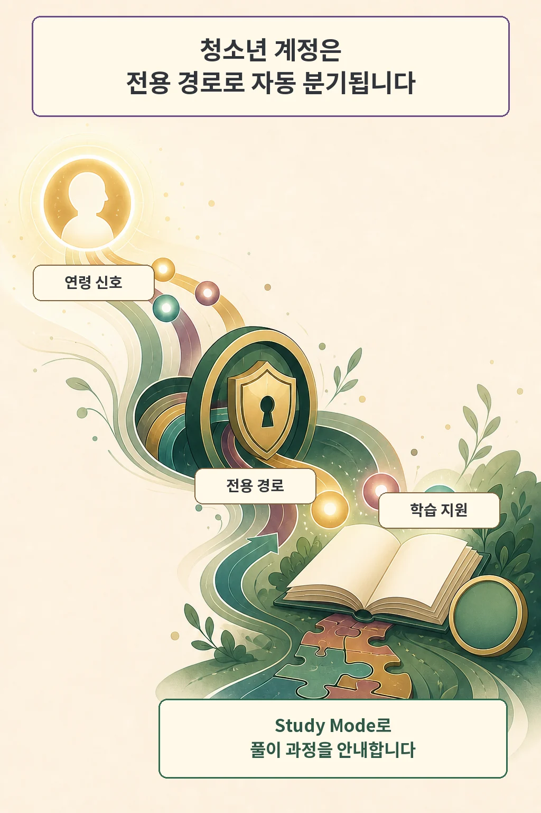
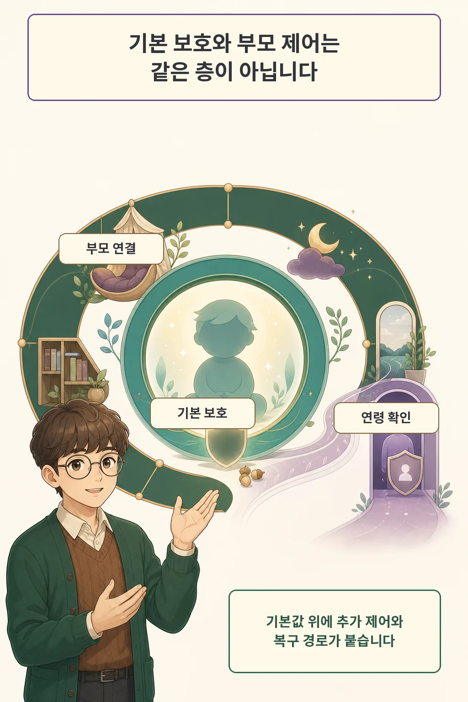

청소년용 AI를 성인용 ChatGPT에 차단 규칙 몇 개만 덧붙인 버전으로 보면 제품 경계가 흐려집니다. OpenAI는 2026년 8월 18일 `ChatGPT for Teens`를 발표하며 자동 계정 분기, 학습 지원 도구, 기본 안전 보호, 부모 연결 제어를 하나의 제품 경험으로 묶었습니다. [C001][C008]

## 핵심 내용

- **자동 계정 분기**: 시스템이 18세 미만으로 추정하거나 가입 시 13~17세로 밝히면 부모 연결 여부와 무관하게 `ChatGPT for Teens` 경로가 자동 적용됩니다(전 세계 순차 적용 중, EU는 지역 요건에 따라 향후 수주 내 적용). [C002][C007]
- **학습 지원과 기본 보호**: `Study Mode`, 책임 있는 숙제 알림, 퀴즈, 학습 시각화, `Study Hours`가 포함되며, 자해·폭력·섭식장애·위험 활동·성적 및 그래픽 콘텐츠 보호와 휴식 알림이 기본 작동합니다. [C003][C004][C005]
- **부모 연결 제어와 오분류 복구**: 연결된 부모는 `Quiet Hours`와 일부 기능 설정(음성·메모리·이미지 생성·모델 개선 데이터 사용) 및 고위험 안전 알림을 관리할 수 있고, 잘못 분류된 성인은 Persona 셀피 연령 확인으로 복구할 수 있습니다. [C006][C007]

## 청소년 계정은 전용 경로로 자동 분기됩니다

OpenAI가 발표한 첫 번째 변화는 계정 진입 경로입니다. 시스템이 사용자를 18세 미만으로 추정하거나 가입 과정에서 13~17세라고 밝히면 부모 계정과 먼저 연결하지 않아도 `ChatGPT for Teens`가 자동 적용됩니다. 다만 실제 적용 시점은 지역마다 달라서 전 세계에 순차 적용 중이며, EU에서는 지역 규제 요구사항 때문에 이후 몇 주에 걸쳐 적용됩니다. [C002][C007]

청소년 경로에는 빠른 정답만 주는 대신 단계별 질문으로 풀이를 돕는 `Study Mode`, 책임 있는 숙제 알림, 퀴즈, 학습 시각화, `Study Hours`가 포함됩니다. 물론 이 설명은 제품의 설계 의도를 보여 주는 것이며, 모든 학습 과제에서 학업 성과가 개선된다는 독립 검증 결과로 읽을 수는 없습니다. [C003][C004][C009]

## 기본 보호와 부모 제어는 서로 다른 층입니다

계정이 청소년 경로에 들어가면 자해, 폭력, 섭식장애, 위험 활동, 성적·그래픽 콘텐츠 등 고위험 영역의 연령 적합 보호가 기본으로 켜지고, 상대가 AI임을 알리는 단서와 휴식 알림도 함께 작동합니다. [C005]

부모 계정 연결은 이 기본 보호 위에 선택 가능한 관리 권한을 더하는 별도 층입니다. 연결된 부모는 `Quiet Hours`를 정하고 음성, 메모리, 이미지 생성, 모델 개선용 데이터 사용 같은 일부 설정을 관리할 수 있으며, 제한된 고위험 상황의 안전 알림도 받을 수 있습니다(모든 일상 대화 내용을 상시 열람하는 기능으로 설명되지는 않았습니다). [C006]

이처럼 청소년 안전의 최소선은 보호자 연결 여부에 기대지 않고 자동 적용하되 가정별 사용 시간과 기능 선택만 연결된 부모에게 위임하면, 미연결 계정의 기본 안전이 약해지거나 부모에게 과도한 열람 권한이 집중되는 문제를 줄일 수 있습니다. [C008]

## 잘못 분류된 성인은 연령 확인으로 복구합니다

자동 연령 추정에는 오분류를 되돌릴 복구 절차가 반드시 따라붙어야 합니다. OpenAI 도움말은 18세 이상 성인 사용자가 청소년 경험에 잘못 분류된 경우 설정 화면에서 보호 적용 여부를 확인하고 Persona를 통한 셀피 연령 확인으로 전체 접근 권한을 복구할 수 있다고 안내합니다. [C007] 다만 연령 예측 모델의 실제 오분류율과 지역별 적용 완료 시점은 현재 공개 자료만으로 독립 검증할 수 없으므로 후속 안전 평가 공개를 함께 지켜봐야 합니다. [C007][C009]

## 다메카솔의 해석

이번 출시의 핵심은 청소년용 화면 하나가 아니라 **자동 적용되는 안전 기본값**, **부모에게 위임된 추가 제어**, **성인 오분류를 되돌리는 복구 경로**라는 세 층의 권한 구조에 있습니다. [C008]

비슷한 연령별 AI 제품을 운영한다면 이 세 층을 서로 다른 테스트로 검증해야 합니다. 기본 보호가 부모 연결 없이도 빠짐없이 작동하는지, 부모 연결 제어가 허용된 설정 범위만 건드리는지, 그리고 연령 확인이 오분류된 성인 사용자에게 확실한 복구 출구를 주는지 확인하는 것입니다. 출시 발표가 보여 준 것은 기능과 설계 의도이며, 장기적인 학습·안전 효과는 실제 사용 데이터와 외부 평가가 쌓인 뒤에 판단할 영역입니다. [C008][C009]

## 출처

- [OpenAI, Introducing ChatGPT for Teens: Built for learning, backed by protections (2026-08-18)](https://openai.com/index/chatgpt-for-teens/)
- [OpenAI Help Center, Age prediction in ChatGPT (2026-08-14 확인)](https://help.openai.com/en/articles/12652064-age-prediction)
- [OpenAI, Introducing parental controls (2025-09-29, 2026-07-13 갱신)](https://openai.com/index/introducing-parental-controls/)
- [OpenAI, Updating our Model Spec with teen protections (2025-12-18)](https://openai.com/index/updating-model-spec-with-teen-protections/)

글·해설: 다메카솔

이 글의 본문과 이미지는 생성형 AI로 제작했습니다. 기획과 편집 기준은 다메카솔이 정했습니다.
