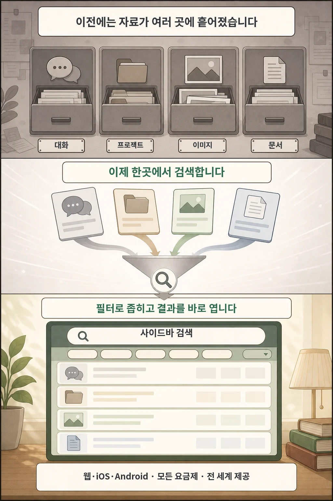
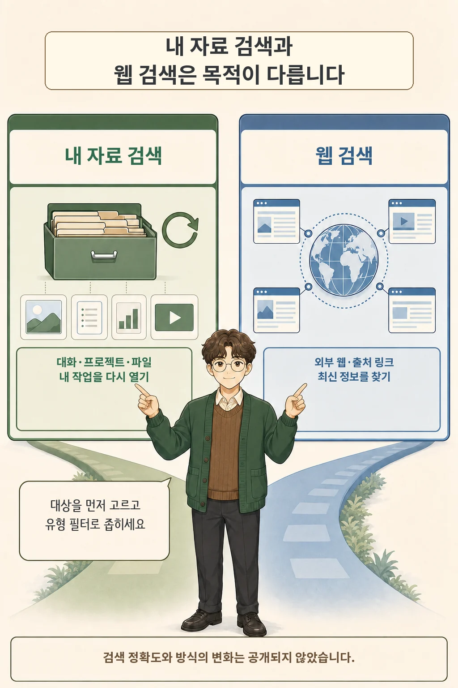

지난주에 ChatGPT와 다듬어 둔 기획서 초안이나 분석을 맡겼던 엑셀 파일을 다시 찾으려고 사이드바 목록을 끝없이 내려 보신 적 있으실까요? 대화가 수십 개만 쌓여도 원하는 자료가 일반 채팅방에 있는지, 프로젝트 폴더에 있는지, 아니면 파일 보관함에 들어 있는지 한눈에 가려내기 어렵습니다. 이런 불편을 덜기 위해 OpenAI는 **2026년 7월 14일** 공식 릴리스 노트를 통해 과거 대화·프로젝트·이미지·문서를 한곳에서 찾는 **통합 검색**을 출시했다고 밝혔습니다.

글·해설: 다메카솔

## 흩어져 있던 작업물이 사이드바 한곳에 모였습니다

이번 업데이트의 핵심은 답변 모델의 변화보다 **이미 만들어 둔 작업물을 다시 꺼내 오는 입구가 하나로 합쳐졌다는 점**입니다. 예전에는 대화 제목을 일일이 훑거나 프로젝트와 파일 보관함을 번갈아 열어 봐야 했지만, 이제는 ChatGPT 사이드바의 검색창 한곳에서 네 가지 자산을 함께 찾습니다.

검색 결과가 많을 때는 **콘텐츠 유형 필터**(`대화`, `프로젝트`, `이미지`, `문서`)로 범위를 좁힌 뒤 원하는 항목을 선택해 곧바로 엽니다. OpenAI 공식 릴리스 노트에 따르면 이 기능은 **웹, iOS, Android**의 **모든 ChatGPT 요금제**에 전 세계로 제공됩니다.

| 항목 | 발표에서 확인된 지원 범위 |
| --- | --- |
| **검색 대상** | 과거 대화, 프로젝트, 이미지, 문서 |
| **지원 플랫폼** | 웹, iOS, Android |
| **요금제·지역** | 모든 ChatGPT 요금제, 전 세계 제공 |
| **필터·동작** | 콘텐츠 유형 필터로 좁힌 뒤 선택한 작업물 바로 열기 |

여기에 더해 ChatGPT의 **Library(파일 보관함)** 도움말을 보면 파일 검색의 구분 기준도 한결 분명해집니다. Library에서는 사용자가 **직접 올린 파일**과 **ChatGPT가 생성한 파일**을 나누어 살펴보고, 이미지·문서·스프레드시트·프레젠테이션·PDF 같은 파일 종류별로도 결과를 추려 냅니다. 다만 개인 계정인지 팀 워크스페이스인지, 그리고 자료 보관 정책이 어떻게 잡혀 있는지에 따라 실제로 보이는 자료 범위는 다를 수 있습니다.

## 내 자료 검색과 웹 검색은 목적부터 다릅니다

두 기능 모두 이름에 '검색'이 들어가지만, **사이드바 통합 검색**과 **ChatGPT 웹 검색**은 찾는 대상과 쓰임새가 완전히 다릅니다. 통합 검색이 내 ChatGPT 계정 안에 쌓인 작업물을 다시 여는 탐색 도구라면, 웹 검색은 외부 검색 제공자와 웹 문서를 바탕으로 최신 정보와 출처 링크가 담긴 답변을 만드는 기능이거든요.

예를 들어 지난달에 요약을 맡겼던 회의용 PDF 파일이나 가계부 정리용 스프레드시트를 다시 꺼내야 하는 상황을 떠올려 볼까요? 이럴 때는 대화 입력창의 웹 검색을 켜는 대신 사이드바 통합 검색에서 `문서` 필터만 골라도 예전 작업물로 바로 들어갑니다. 반면 방금 발표된 소프트웨어 업데이트 내역이나 최신 철도 요금 안내처럼 외부의 최신 정보가 필요하다면, 출처 링크를 붙여 주는 ChatGPT 웹 검색을 써야 알맞은 답을 얻는 셈이죠.

| 찾으려는 대상 | 알맞은 기능 | 실제 결과 동작 |
| --- | --- | --- |
| 예전에 나눈 대화, 프로젝트, 업로드·생성 파일 | **사이드바 통합 검색** | 콘텐츠 유형 필터로 좁혀 내 작업물 다시 열기 |
| 최신 뉴스, 공식 문서, 현재 가격 등 외부 정보 | **ChatGPT 웹 검색** | 외부 웹 정보를 탐색해 출처 링크와 함께 답변 |

## 확인된 범위와 쓰기 전에 챙겨 둘 네 가지 기준

기능이 한곳에 모인 만큼 이번 공식 발표가 **다루지 않는 범위**도 함께 살펴볼 필요가 있습니다. OpenAI 릴리스 노트는 검색 대상과 필터, 지원 플랫폼을 안내하지만 검색 알고리즘이 어떻게 달라졌는지나 정확도 개선 폭, 새 파일이 검색 결과에 잡히기까지 걸리는 지연 시간은 공개 범위에서 빠져 있습니다. 제목과 대화 본문, 업로드한 파일 안의 문장 가운데 무엇을 어떤 기준으로 일치시키는지도 공개 자료에서는 다루지 않으므로, 모든 파일 속 글자가 빠짐없이 검색된다고 기대하기보다 흩어진 입구가 정리됐다는 점에 초점을 맞추는 편이 정확합니다.

실제 일상이나 업무에서 통합 검색을 헛걸음 없이 쓰려면 아래 네 가지 순서로 확인하는 습관이 도움이 됩니다.

1. **내 작업물인지 외부 최신 정보인지 먼저 가르기**: 계정에 쌓인 대화·파일을 찾는다면 사이드바 통합 검색을, 바깥의 최신 사실과 출처가 필요하다면 ChatGPT 웹 검색을 선택합니다.
2. **결과가 많을 때는 콘텐츠 유형 필터부터 누르기**: 흔한 단어로 검색해 목록이 길어진다면 `대화`, `프로젝트`, `이미지`, `문서` 필터를 눌러 후보를 빠르게 줄입니다.
3. **안 보이는 자료는 보관 상태와 계정부터 살피기**: 찾던 파일이 바로 뜨지 않아도 곧바로 삭제됐다고 단정하기보다, 로그인한 계정과 프로젝트 위치, 워크스페이스 보관 정책을 함께 확인합니다.
4. **오래 이어갈 작업은 프로젝트에 모아 두기**: 여러 주에 걸쳐 참고할 파일과 대화는 일반 채팅창에 흩어 두기보다 프로젝트 기능 안에 묶어 두어야 나중에 한 번에 다시 찾기 편합니다.

## 출처

- [OpenAI — ChatGPT Release Notes: Search across chats, projects, and files (2026-07-14)](https://help.openai.com/en/articles/6825453-chatgpt-release-notes)
- [OpenAI — File storage and Library in ChatGPT](https://help.openai.com/en/articles/20001052-library)
- [OpenAI — ChatGPT Search](https://help.openai.com/en/articles/9237897-chatgpt-search)

이 글은 2026년 7월 14일 공개된 OpenAI 공식 릴리스 노트와 고객지원 문서를 바탕으로 정리했으며, 실제 계정 환경에서의 검색 정확도와 색인 지연 시간은 별도로 측정하지 않았습니다.
이 글의 본문과 이미지는 생성형 AI로 제작했습니다. 기획과 편집 기준은 다메카솔이 정했습니다.
