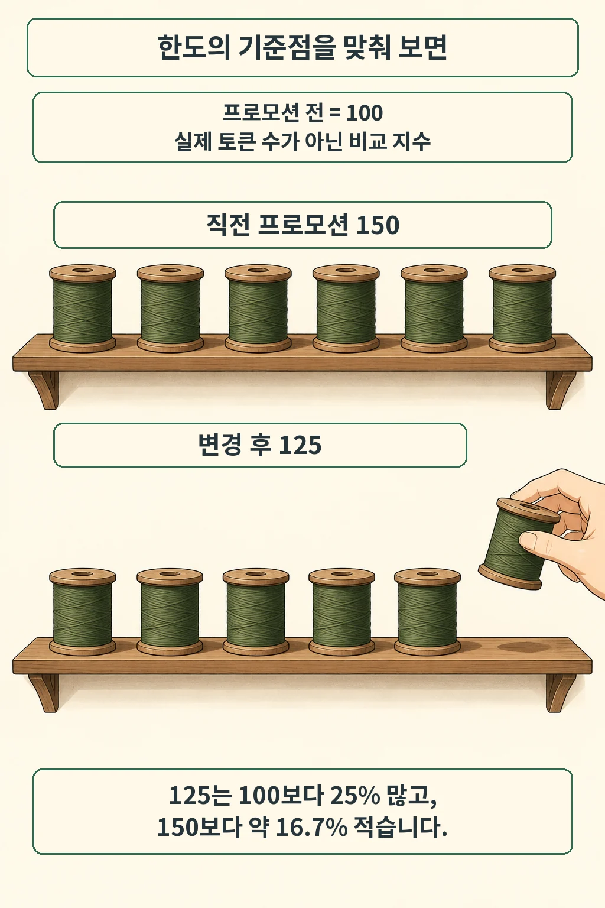
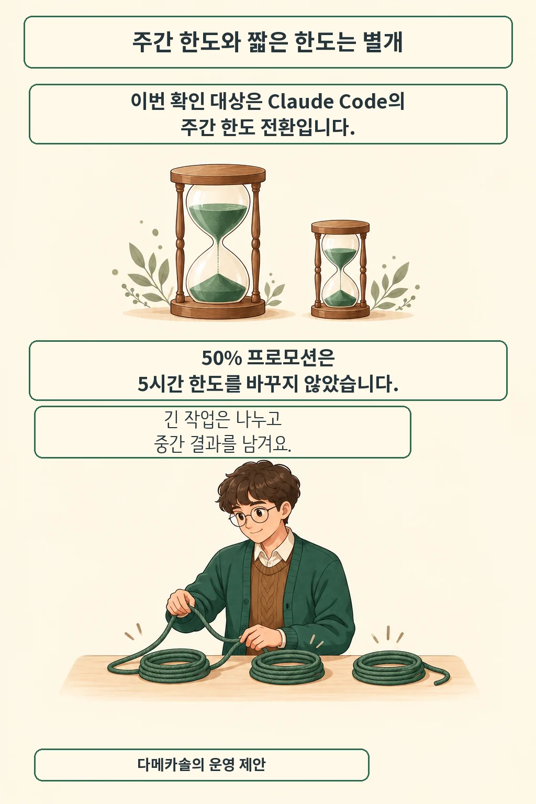

**“기본 한도가 25% 늘었다”는 말과 “쓰던 한도가 약 16.7% 줄었다”는 말이 동시에 맞습니다.** 어느 시점을 기준으로 비교하느냐가 다르기 때문인데, Anthropic [공식 도움말](https://support.claude.com/en/articles/15910845-claude-code-may-august-2026-weekly-limits-promotion)에 따르면 2026년 9월 14일부터 Claude Code의 주간 사용 한도는 프로모션 이전 기본값보다 25% 높은 수준으로 고정됐습니다. 다만 직전까지 적용되던 ‘50% 추가 프로모션’ 기간과 비교하면 체감 한도가 내려간 셈입니다.

글·해설: 다메카솔

Updated: 2026-09-15

## 100에서 150으로, 이제 125로

프로모션 이전의 기본 주간 한도를 `100`(상대 비율 설명용 수치이며 실제 토큰 수가 아님)으로 놓으면, 5~8월 프로모션 기간에는 `150`이었고 9월 14일 이후의 새 기본값은 `125`가 됩니다.

| 비교 기준 시점 | 계산식 | 변화율 |
| --- | --- | --- |
| 프로모션 이전 기본 한도 (100) 대비 | $(125 - 100) \div 100$ | **+25% 증가** |
| 직전 50% 프로모션 한도 (150) 대비 | $(125 - 150) \div 150$ | **약 −16.7% 감소** |

50% 프로모션의 공식 종료 시각은 2026년 9월 13일 오후 11시 59분(PT, 한국 시각 9월 14일 오후 3시 59분)이며, 새 기본 한도가 적용되는 대상은 Pro, Max, Team 및 좌석 기반 Enterprise 요금제입니다.

## 5시간 롤링 한도와 구분해 읽기

이번 변경을 읽을 때 주의할 점은 **주간 한도와 5시간 단기 한도가 별개로 작동한다**는 사실입니다. 공식 도움말은 50% 프로모션이 주간 한도에만 적용됐을 뿐, 5시간 한도나 Claude의 다른 제품 한도는 바꾸지 않았다고 명시하고 있습니다(현재 계정별 잔여 한도는 터미널 CLI의 `/usage` 명령으로 확인할 수 있습니다).

## 다메카솔의 해석: 멈춘 뒤 이어 갈 수 있게

긴 리팩터링이나 다단계 자동 작업을 설계할 때는 주간 총량 여유만 믿고 큰 작업을 한 번에 밀어 넣기보다, **중간에 5시간 한도나 주간 한도에 걸려 멈추더라도 바로 이어 갈 수 있는 체크포인트**를 남기는 편이 안전합니다.

예를 들어 여러 모듈을 순차적으로 고치는 작업이라면, 모듈 하나의 수정과 테스트가 끝날 때마다 변경된 파일 목록과 다음 진행할 단계를 작업 기록에 남겨 두는 식입니다. [관리형 에이전트 실행 구조](/posts/openai-agents-api-managed-harness/)를 고를 때도 마찬가지여서, 프로모션 기간의 넉넉한 한도를 기준으로 작업 크기를 잡기보다 중단 후 재개 비용(재탐색 토큰 소모)을 줄이는 설계가 한도 변화에 흔들리지 않습니다.

## 출처

- [Anthropic 도움말 — Claude Code 주간 한도 프로모션](https://support.claude.com/en/articles/15910845-claude-code-may-august-2026-weekly-limits-promotion): 전환 시점, 적용 대상 요금제 및 5시간 한도 구분 확인(2026년 9월 15일 확인, 계정별 절대 토큰 할당량 실측은 포함하지 않음).

이 글의 본문과 이미지는 생성형 AI로 제작했습니다. 기획과 편집 기준은 다메카솔이 정했습니다.
