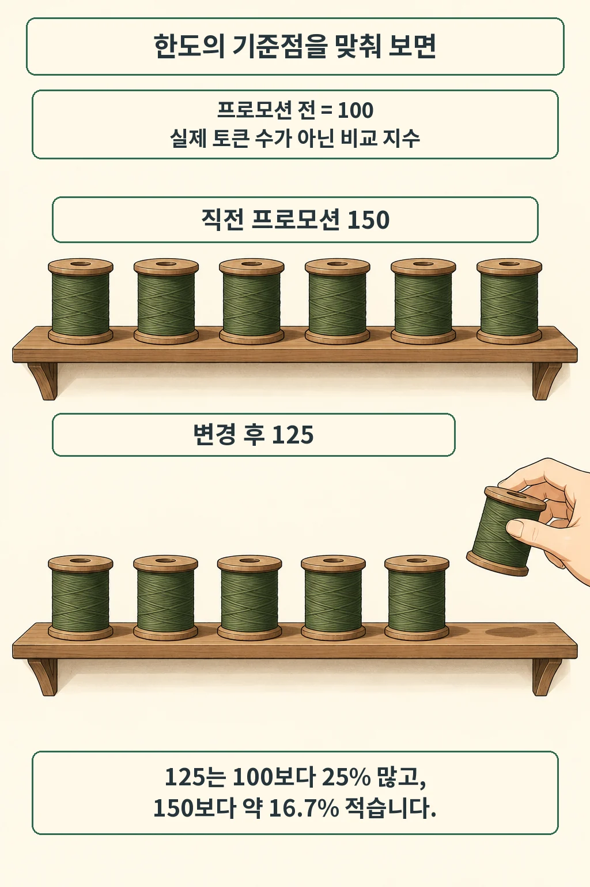
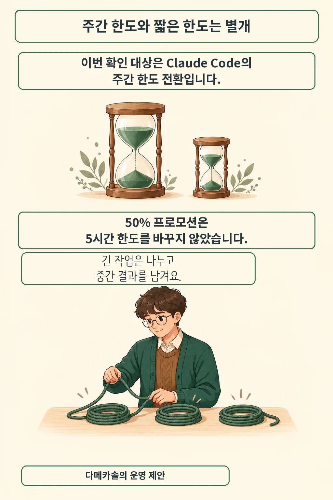

Claude Code를 쓰다 보면 “주간 기본 한도가 **25%** 늘었다”는 공지와 “직전보다 한도가 줄었다”는 체감이 엇갈려 헷갈리기 쉽습니다. 비교 기준이 서로 다르기 때문인데요, Anthropic [공식 도움말](https://support.claude.com/en/articles/15910845-claude-code-may-august-2026-weekly-limits-promotion)을 보면 상시 기준선은 프로모션 이전보다 올라갔지만, **50%** 추가 프로모션이 끝나면서 프로모션 기간 대비로는 약 **16.7%** 내려왔습니다. 이 변화가 언제부터 어느 요금제에 적용되는지, 그리고 **5시간** 단기 한도와는 무엇이 다른지 차근차근 짚어 볼까요?

글·해설: 다메카솔

## 100에서 150으로, 이제 125로

이번 전환은 프로모션 이전의 평시 기준과 직전 프로모션 기간을 구분해서 보면 구조가 명쾌해집니다. 프로모션 이전의 기본 주간 한도를 `100`이라는 상대 비교 지수로 두면, 프로모션 기간에는 `150`까지 열렸다가 새 상시 기준이 `125`로 자리 잡은 셈입니다. 이 숫자는 실제 토큰 할당량이나 요금 변동이 아니라 같은 주간 한도의 변화 폭을 가늠하기 위한 비교 수치입니다.

| 비교 기준 시점 | 상대 지수 변화 | 계산식 | 체감 변화율 |
| --- | --- | --- | --- |
| 프로모션 이전 기본 한도 대비 | 100 → 125 | $(125 - 100) \div 100$ | **+25% 증가** |
| 직전 5~8월 프로모션 한도 대비 | 150 → 125 | $(125 - 150) \div 150$ | **약 −16.7% 감소** |

같은 `125`라는 결과값을 두고도 출발점을 어디에 놓느냐에 따라 플러스와 마이너스가 갈리는 구조죠. 공식 도움말에 명시된 전환 시점과 적용 대상 요금제를 함께 확인해 두면 기준이 한층 또렷해집니다.

- **프로모션 종료 시각**: 5~8월 **50%** 추가 프로모션은 **2026년 9월 13일 오후 11시 59분(PT)**에 끝났으며, 한국 시각으로는 **9월 14일 오후 3시 59분**에 해당합니다.
- **새 기준 적용 시점**: **2026년 9월 14일**부터는 프로모션 이전보다 **25%** 상향된 수준이 상시 주간 한도로 유지됩니다.
- **적용 대상 요금제**: 새 주간 한도 기준은 **Pro**, **Max**, **Team** 및 **좌석 기반(seat-based) Enterprise** 요금제에 적용됩니다.

## 5시간 롤링 한도와 구분해 읽기

주간 한도 숫자가 달라졌더라도, 사용량 제한은 주기와 범위가 서로 다른 두 축으로 나뉘어 있습니다. 이번 변경을 읽을 때 **주간 한도와 5시간 단기 한도가 별개로 작동한다**는 사실을 먼저 구분해야 하거든요. 공식 도움말에서도 직전 **50%** 프로모션은 Claude Code의 주간 한도에만 적용됐고, **5시간** 한도나 Claude의 다른 제품 한도는 그 프로모션으로 변동 없이 유지됐다고 명시하고 있습니다.

이 차이를 놓치면 작업 흐름이 끊겼을 때 원인을 잘못 짚기 쉽습니다. 가령 주간 한도에 여유가 꽤 남아 있더라도 짧은 시간에 큰 문맥을 연달아 처리하면 단기 한도에 먼저 걸릴 수 있고, 반대로 단기 속도를 조절해도 며칠간 누적된 호출이 주간 총량에 닿으면 작업이 멈추게 됩니다. 따라서 긴 코딩 작업을 시작하기 전에는 터미널 CLI에서 `/usage` 명령을 실행해 현재 계정의 잔여 한도를 미리 확인해 두는 편이 좋습니다.

## 다메카솔의 해석: 멈춘 뒤 이어 갈 수 있게

상시 한도가 프로모션 이전보다는 늘었지만 직전 **50%** 추가 기간보다 여유가 줄어든 만큼, 이제는 한도 총량 자체를 아끼는 것만큼이나 **중단 후 재개 비용**을 줄이는 작업 설계가 중요해졌습니다. 긴 리팩터링이나 다단계 자동 작업을 한 번에 몰아넣으면, 중간에 **5시간** 한도나 주간 한도에 걸려 멈췄을 때 어디까지 고치고 검증했는지 다시 파악하느라 재탐색 토큰을 이중으로 쓰기 쉽거든요.

예를 들어 여러 모듈을 순차적으로 고치는 작업이라면, 처음부터 전체 저장소를 한 번에 맡기기보다 모듈 단위로 작은 매듭을 짓는 편이 안전합니다. 작업 단위가 하나 끝날 때마다 아래 세 가지만 챙겨 두어도 한도 소진 뒤 재작업을 크게 덜어 줍니다.

1. **완료된 변경과 테스트 기록**: 모듈 하나의 수정과 테스트가 끝날 때마다 변경된 파일 목록과 확인 결과를 작업 기록에 남깁니다.
2. **다음 진행 단계 명시**: 이어서 처리할 대상 파일과 바로 실행할 다음 단계를 한 줄로 고정해 둡니다.
3. **재개 전 잔여 한도 점검**: 다음 단위를 시작하기 전에 터미널 CLI에서 `/usage` 명령으로 주간 한도와 5시간 한도의 남은 여유를 살핍니다.

이처럼 중간 결과를 남겨 두면 한도가 소진돼 세션이 멈추더라도 전체 코드를 처음부터 다시 읽는 낭비를 확실히 줄입니다. 앞서 다룬 [관리형 에이전트 실행 구조](/posts/openai-agents-api-managed-harness/)를 고를 때도 맥락은 비슷한데요, 프로모션 기간처럼 한도가 넉넉할 때를 기준으로 작업 덩치를 키우기보다 재개 비용을 낮추는 구조를 잡아 두어야 한도 정책이 바뀌어도 작업 리듬을 안정적으로 이어 갈 수 있습니다.

## 출처

- [Anthropic 도움말 — Claude Code 주간 한도 프로모션](https://support.claude.com/en/articles/15910845-claude-code-may-august-2026-weekly-limits-promotion): 전환 시점, 적용 대상 요금제 및 5시간 한도 구분 확인(2026년 9월 15일 확인)

이 글은 2026년 9월 15일 확인한 Anthropic 공식 도움말을 바탕으로 정리했으며, 계정별 절대 토큰 할당량 실측은 포함하지 않았습니다.
이 글의 본문과 이미지는 생성형 AI로 제작했습니다. 기획과 편집 기준은 다메카솔이 정했습니다.
