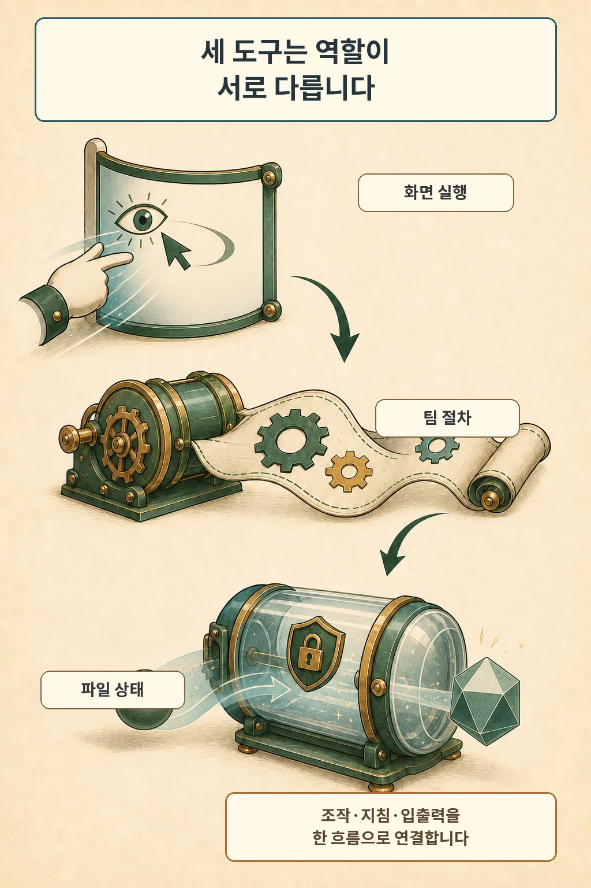

Anthropic은 2026년 8월 20일 Claude Platform의 `computer use`, `Skills API`, `Files API`를 정식 제공(GA)으로 전환하고 새로운 `browser use` 도구를 함께 공개했습니다. 이번 변화의 실무적 의미는 에이전트가 화면에 보이는 소프트웨어를 조작하고, 팀의 표준 절차를 불러오며, 입력 자료와 결과 파일을 하나의 작업 흐름 안에서 이어갈 수 있게 됐다는 데 있습니다. [C001]

## 핵심 내용

- **화면 조작 이원화**: 전체 데스크톱 환경을 조작하는 `computer use`(다중 동작 일괄 응답 지원)와 페이지 구조를 읽어 웹 작업의 실행 면적을 줄이는 `browser use`를 구분해 제공합니다. [C002][C003][C007]
- **팀 절차와 파일 연결**: 폴더 단위로 버전 관리되는 `Skills API`와 `file_id`로 입출력 산출물을 참조하는 `Files API`가 정식 출시됐습니다. [C004][C005]
- **운영 격리와 권한 경계**: `Files API`는 워크스페이스 전체에서 공유되므로 멀티테넌트 서비스에서는 애플리케이션이 파일 소유권을 직접 매핑해야 하며, 프롬프트 인젝션과 고위험 행동에 대한 격리·승인 게이트가 필요합니다. [C006][C008][C009]

## 화면 조작은 브라우저와 데스크톱으로 나뉩니다

`computer use`는 스크린샷을 보고 마우스와 키보드 동작을 요청하는 도구입니다. 모델이 데스크톱에 직접 접속하는 구조가 아니라 애플리케이션이 통제하는 격리 환경에서 각 동작을 실행한 뒤 결과를 모델에 돌려주며, 새 도구 모음(toolset)은 여러 동작을 한 응답에 묶어 왕복 지연을 줄이되 앞선 동작이 실패하면 뒤 동작을 멈추고 결과를 정확히 반환하도록 설계됐습니다. [C002][C007]

웹페이지 안에서 끝나는 작업에는 새로 추가된 `browser use`가 더 알맞습니다. 화면 좌표만 따라가는 대신 페이지 DOM 구조를 읽고 특정 입력 필드나 버튼을 직접 겨냥하므로, 전체 데스크톱 환경을 열지 않고도 웹 자동화의 실행 면적을 줄일 수 있습니다. [C003]

## 팀 절차와 파일 상태는 별도 구성요소입니다

`Skills API`는 팀의 업무 지침과 스크립트, 템플릿을 폴더 단위로 올리고 버전 관리해 요청에 연결하는 기능입니다. 작업에 필요할 때 해당 스킬을 불러와 Claude의 코드 실행 샌드박스(code execution sandbox)에서 돌리므로, 반복되는 업무 절차와 모델 프롬프트를 분리해 관리할 수 있습니다. [C004]

여기에 `Files API`가 작업에 들어가는 입력 자료와 작업 뒤에 나오는 산출물을 이어 줍니다. 한 번 업로드한 파일을 `file_id`로 여러 요청에서 반복 참조하고 스킬이나 코드 실행이 만든 결과 파일도 내려받을 수 있어, 매 요청마다 똑같은 문서를 다시 싣는 방식보다 파일 수명과 작업 상태를 명시적으로 다루기 쉽습니다. [C005]

세 기능을 합치면 에이전트가 파일을 읽고, 팀 절차를 적용하며, API가 없는 웹 업무 화면을 조작한 뒤 결과 확인 파일을 다시 저장하는 루프가 완성됩니다. 물론 각 구성요소의 실행 위치와 권한 경계는 여전히 분리되어 작동합니다. [C002][C003][C004][C005][C011]

## GA가 운영 책임을 없애지는 않습니다

정식 출시(GA)가 됐다고 해서 애플리케이션의 보안·운영 책임이 사라지는 것은 아닙니다. 우선 `Files API`에 올린 파일은 개별 사용자나 대화 단위가 아니라 워크스페이스(workspace) 전체에서 접근됩니다. 한 조직이 여러 고객을 다루는 멀티테넌트 서비스라면 `file_id`를 사용자 입력으로 그대로 믿지 말고 애플리케이션이 사용자-파일 매핑을 직접 검증해야 하며, 강력한 격리가 필요할 때는 워크스페이스를 경계로 나누어야 합니다. [C006]

화면 조작에도 고유한 위험이 따릅니다. 웹페이지나 이미지에 숨겨진 지시가 원래 명령을 덮어쓰려는 프롬프트 인젝션(prompt injection)이 발생할 수 있어, 분류기 방어만 믿지 말고 최소 권한 VM·컨테이너, 제한된 인터넷 허용 목록(allowlist), 민감 데이터 분리, 그리고 결제나 약관 동의처럼 실질적 결과가 따르는 행동의 사람 확인 게이트를 함께 설계해야 합니다. [C008][C009] 또한 Claude API에서는 베타 헤더 없이 정식 제공되지만 Microsoft Foundry나 Google Cloud 같은 외부 플랫폼은 기능별 도착 시점과 지원 모델이 다르므로 배포 경로의 호환성 표를 따로 확인해야 합니다. [C010]

## 다메카솔의 해석

이번 발표의 핵심은 ‘에이전트가 모든 것을 알아서 한다’는 막연한 자동화보다 세 종류의 상태를 명확히 분리해 연결한 제품화에 있습니다. 화면 실행은 애플리케이션이 통제하는 격리 환경에, 팀 절차는 버전이 고정된 스킬에, 입력 자료와 산출물은 워크스페이스 파일에 남기 때문에 어느 단계에서 권한이 커졌고 어디서 실패했는지 추적하기가 한결 쉬워집니다. [C011]

프로덕션 에이전트의 도입 기준도 여기서 분명해집니다. 실행 환경을 격리하고, 스킬 버전을 고정하며, 파일 소유권을 애플리케이션에서 검증하고, 파급력이 큰 행동에 사람 승인을 두는 팀이 이번 GA 도구들을 안전하게 활용할 수 있습니다. 제품의 GA와 운영의 준비 완료는 서로 다른 체크포인트입니다. [C006][C007][C008][C009][C010][C011]

## 출처

- [Anthropic, Build production agents with computer use, the Skills API, and the Files API (2026-08-20)](https://claude.com/blog/computer-use-skills-api-files-api)
- [Claude Platform Docs, Computer use tool (2026-08-21 확인)](https://platform.claude.com/docs/en/agents-and-tools/tool-use/computer-use-tool)
- [Claude Platform Docs, Agent Skills (2026-08-21 확인)](https://platform.claude.com/docs/en/agents-and-tools/agent-skills/overview)
- [Claude Platform Docs, Files API (2026-08-21 확인)](https://platform.claude.com/docs/en/build-with-claude/files)

글·해설: 다메카솔

이 글의 본문과 이미지는 생성형 AI로 제작했습니다. 기획과 편집 기준은 다메카솔이 정했습니다.
