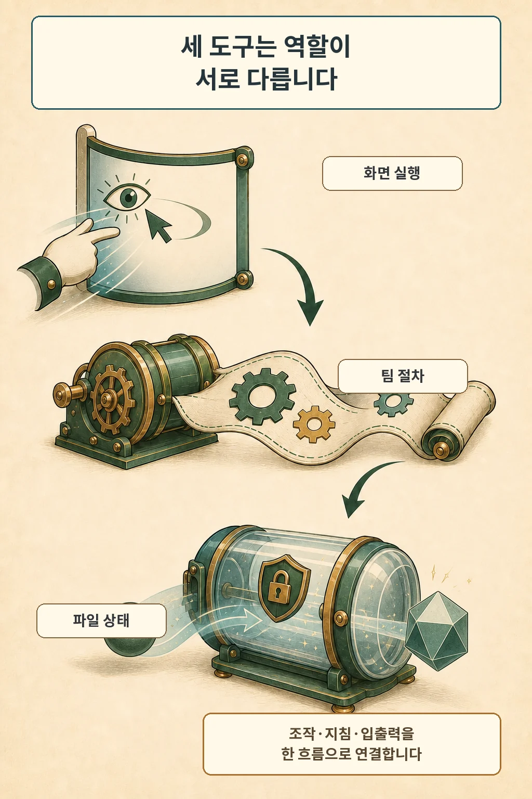

업무 웹 화면이나 데스크톱 앱을 에이전트에게 맡기다 보면 화면 조작, 팀 절차, 입출력 파일 관리가 따로 놀아 유지보수가 금방 꼬이곤 합니다. Anthropic은 2026년 8월 20일 Claude Platform의 `computer use`, `Skills API`, `Files API`를 정식 제공(GA)으로 전환하고 새 `browser use` 도구를 공개하며 이 흐름을 한 루프로 묶었습니다. 기능이 정식 출시됐더라도 실행 격리와 데이터 경계는 여전히 애플리케이션 쪽에서 직접 챙겨야 하거든요.

글·해설: 다메카솔

## 화면 실행·팀 절차·파일 상태를 한 루프로 잇기

이번 발표의 핵심은 모델이 모든 상태를 한꺼번에 떠안지 않고 역할별로 나눠 연결했다는 데 있습니다. 화면 조작도 데스크톱 전체를 다루는 `computer use`와 웹페이지 전용 `browser use`로 나뉘어 작업 성격에 맞춰 실행 면적을 줄일 수 있습니다.

| 도구 / API | 제공 상태 | 핵심 역할과 실행 위치 |
| --- | --- | --- |
| **`computer use`** | GA 전환 | 스크린샷 기반 마우스·키보드 요청을 앱이 통제하는 격리 환경에서 대리 실행 |
| **`browser use`** | 신규 공개 | 좌표 대신 페이지 DOM 구조를 읽어 특정 필드·버튼만 직접 겨냥 |
| **`Skills API`** | GA 전환 | 업무 지침·스크립트·템플릿 폴더를 프롬프트와 분리해 버전 관리하고 Claude 코드 실행 샌드박스에서 실행 |
| **`Files API`** | GA 전환 | 입력 자료와 산출물을 `file_id`로 여러 요청에 걸쳐 참조·다운로드 |

예를 들어 고객사가 제출한 정산 자료를 팀 규정에 맞춰 검증한 뒤, API가 없는 웹 업무 화면에 입력하고 처리 확인서까지 저장하는 흐름을 떠올려 볼까요? 먼저 `Files API`에 문서를 한 번 올려 `file_id`를 받아 두면 매 요청마다 같은 자료를 다시 싣지 않고도 파일 수명과 작업 상태를 추적할 수 있습니다. 이어 `Skills API`로 버전이 고정된 검증 스크립트와 템플릿을 불러와 코드 실행 샌드박스에서 자료를 정리하고, 웹 입력 단계에서는 전체 데스크톱 대신 `browser use`로 DOM 요소만 겨냥하면 한결 깔끔합니다. 웹 입력 뒤에 나온 결과 확인 파일 역시 `Files API`로 내려받아 남길 수 있습니다.

반대로 사내 레거시 앱처럼 데스크톱 화면 전체를 다뤄야 한다면 `computer use`를 쓰면 되는데요. 새 도구 모음(toolset)은 모델이 데스크톱에 직접 접속하는 구조가 아니라 애플리케이션이 통제하는 격리 환경에서 동작을 실행하며, 한 응답에 여러 동작을 묶어 왕복 지연을 줄이되 앞 동작이 실패하면 뒤 동작을 멈추고 정확한 결과를 돌려주도록 설계됐습니다.

## GA 전환 뒤에도 애플리케이션에 남는 경계

정식 출시(GA)로 전환됐더라도 보안과 운영 책임은 여전히 애플리케이션 쪽에 남습니다. 화면 실행과 파일 공유가 한 루프로 이어질수록 경계 설계가 한층 더 중요해집니다.

- **`Files API`의 워크스페이스 경계**: 올린 파일은 개별 사용자나 대화가 아니라 워크스페이스 전체에서 접근됩니다. 멀티테넌트 서비스에서는 `file_id` 입력을 그대로 믿지 말고 앱이 사용자-파일 소유권을 직접 검증해야 하며, 강한 격리가 필요하면 워크스페이스를 분리해 경계를 나누어야 합니다.
- **프롬프트 인젝션 대비와 최소 권한 격리**: 웹페이지나 이미지 속 숨은 지시가 원래 명령을 덮어쓰는 위험은 분류기 방어가 있어도 남습니다. Anthropic 공식 문서 역시 최소 권한 VM·컨테이너 격리, 민감 데이터 접근 축소, 제한된 인터넷 허용 목록(allowlist) 적용을 권고합니다.
- **고위험 행동의 사람 확인 게이트**: 결제 실행이나 약관 동의처럼 되돌리기 어렵고 실질적인 결과가 따르는 행동 앞에는 반드시 사람 확인 절차를 두어야 합니다.

배포 경로별 호환성도 미리 확인해 두어야 합니다. Claude API에서는 새 `computer use` 도구 모음이 베타 헤더 없이 정식 제공되지만, Microsoft Foundry나 Google Cloud 같은 외부 플랫폼은 기능별 도착 시점과 지원 모델이 다르므로 도입 전 지원 표를 대조할 필요가 있습니다.

## 다메카솔의 해석: 통합보다 중요한 경계 분리

이번 GA는 에이전트가 모든 것을 알아서 처리하는 만능 자동화라기보다, 권한과 수명, 실패 경계가 다른 세 구성요소를 분리해 연결한 제품화에 가깝습니다. 화면 실행은 앱의 격리 환경에, 팀 절차는 버전 고정 스킬에, 입출력 문서는 워크스페이스 파일에 남기 때문에 어디서 권한이 커지고 어디서 실패했는지 추적하기가 한결 수월해집니다.

결국 제품 GA와 운영 준비 완료는 별개의 체크포인트인 셈이죠. 격리 실행과 실패 시 중단 규칙, 스킬 버전 고정, 앱 단위의 파일 소유권 검증, 고위험 동작 앞 사람 승인을 갖춘 팀이라면 이번 도구들을 안전하게 실무에 녹여 낼 수 있습니다.

## 출처

- [Anthropic, Build production agents with computer use, the Skills API, and the Files API (2026-08-20)](https://claude.com/blog/computer-use-skills-api-files-api)
- [Claude Platform Docs, Computer use tool (2026-08-21 확인)](https://platform.claude.com/docs/en/agents-and-tools/tool-use/computer-use-tool)
- [Claude Platform Docs, Agent Skills (2026-08-21 확인)](https://platform.claude.com/docs/en/agents-and-tools/agent-skills/overview)
- [Claude Platform Docs, Files API (2026-08-21 확인)](https://platform.claude.com/docs/en/build-with-claude/files)

이 글은 2026년 8월 20일 공개된 Anthropic 공식 발표와 Claude Platform 문서를 바탕으로 정리했으며, 별도 실행 테스트나 고객 사례 성능 검증은 포함하지 않았습니다.
이 글의 본문과 이미지는 생성형 AI로 제작했습니다. 기획과 편집 기준은 다메카솔이 정했습니다.
