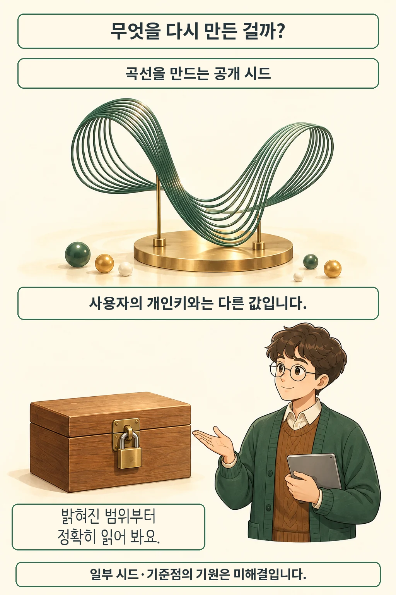

Claude가 ECDSA 표준 곡선의 시드를 찾아냈다는 소식을 접하면 암호 체계가 뚫렸거나 개인키가 풀린 것은 아닌지부터 걱정되기 마련입니다. 하지만 이번에 역추적한 대상은 사용자의 비밀키가 아니라, 표준 문서에 이미 공개돼 있던 **곡선 생성용 공개 시드**거든요. Anthropic은 **2026년 10월 16일** 내부 연구 모델 Claude가 오래전 공개된 NIST 표준 곡선 다섯 종의 시드 생성 경로를 찾아냈다고 발표했습니다. ([공식 발표](https://www.anthropic.com/research/ecdsa-curve-origins))

글·해설: 다메카솔

## 먼저, 어떤 시드였을까

이번 발표의 성격을 읽으려면 2023년 10월 보안 연구자 Filippo Valsorda가 올린 현상금 공고부터 짚어 볼 필요가 있습니다. 당시 공고문에는 이미 다섯 NIST 소수체 곡선의 공개 시드가 실려 있었고, 풀어야 할 질문은 그 값을 **처음에 어떤 방식으로 골랐는지**였죠. 공고문은 영어 문장을 해시해 만들었을 것이라는 가설을 소개하면서도, 전해 들은 기억이 정확하지 않을 가능성을 함께 열어 두었습니다. ([당시 공고](https://words.filippo.io/seeds-bounty/))

| 구분 | 역할과 성격 | 공개 여부 |
| --- | --- | --- |
| **곡선 생성 시드** | 표준 곡선의 일부 매개변수를 만들 때 사용한 초기 입력 | 표준 문서에 처음부터 공개 |
| **사용자 개인키** | 서명 생성과 자산 보호를 위해 사용자별로 지켜야 하는 비밀 키 | 외부에 비공개로 유지 |

예를 들어 서비스에서 서명 검증이나 TLS 인증서에 P-256 곡선을 쓰고 있는 개발자라면 '시드'라는 단어 때문에 지갑 복구 문구나 개인키 생성 시드를 떠올리기 쉽습니다. 하지만 두 개념은 용도와 공개 범위부터 출발선이 다릅니다. 이번 연구가 다룬 값은 모든 구현체가 공유하는 표준 곡선의 매개변수를 만들 때 쓰인 공개 숫자이지, 개별 사용자의 비밀키를 복구하는 문제가 아니기 때문입니다.

## 시계에서 출발한 계산을 다시 돌려 보면

Anthropic이 찾아낸 경로는 영어 문장 해시가 아니라, Unix 시각으로 초기화한 C 계열 의사난수 생성기 `lrand48`이었습니다. 기존 가설에 매달리는 대신 당시 소프트웨어 환경에서 쓰이던 의사난수 생성기의 출력 패턴을 살핀 것이 결정적인 단서가 됐다는 설명입니다. ([발견 경위와 공개 코드](https://www.anthropic.com/research/ecdsa-curve-origins#how-it-was-found))

발표문에 공개된 계산식을 Windows 환경의 Python 3.12.14 표준 라이브러리만으로 직접 실행해 2023년 공고의 다섯 시드와 대조해 보았습니다. 별도의 AI 모델 없이 순수 결정적 계산만으로도 다섯 곡선의 시드 값이 모두 정확히 재현됐습니다.

| NIST 곡선 | 시작 시각 (UTC) | 선택 순번 | 2023년 공고 시드 대조 |
| --- | --- | --- | --- |
| **P-192** | `1997-05-18 14:45:34` | 139번째 후보 | 일치 |
| **P-224** | `1998-04-03 12:52:07` | 7,026번째 후보 | 일치 |
| **P-256** | `1997-08-16 01:52:34` | 1,842번째 후보 | 일치 |
| **P-384** | `1997-08-30 14:50:08` | 2,688번째 후보 | 일치 |
| **P-521** | `1997-08-08 01:12:04` | 1,136번째 후보 | 일치 |

표에서 보듯 P-256 시드는 해당 UTC 시각을 시작값으로 넣고 1,842번째 후보를 택했을 때 원래 값과 맞아떨어집니다. 이 로컬 실행은 공개된 생성식을 따라가면 다섯 시드가 그대로 나온다는 점만 검증한 결과입니다. Claude가 그 규칙을 처음 탐색한 과정이나 당시 설계자의 의도는 별도의 기록으로 확인해야 할 영역으로 남습니다.

## 설명된 기원과 남아 있는 질문

Anthropic은 이번 발견을 ECDSA의 새로운 취약점이나 공격 기법으로 보지 않습니다. 오히려 표준 곡선 매개변수에 임의의 백도어를 심기 어렵게 만드는 출처 단서에 가깝다고 해석하죠. 연구에 쓰인 Claude는 일반 출시 안내 없이 내부 연구용 모델로만 소개됐고, 발표문은 아래 세 가지를 여전히 열린 질문으로 남겨 두었습니다. ([의미와 열린 질문](https://www.anthropic.com/research/ecdsa-curve-origins#open-questions))

- **B-163 시드의 기원**: 이번 `lrand48` 경로로 함께 설명되지 않은 나머지 시드
- **기준점(base point) 생성 방식**: 곡선 시드 외에 여러 기준점이 만들어진 구체적 절차
- **후보 건너뛰기 이유**: 의사난수열에서 조건을 충족하는 일부 후보를 지나치고 특정 순번을 택한 배경

## 다메카솔의 해석: 설명을 실행 가능한 형태로 남기기

이번 발표에서 가장 인상적이었던 대목은 **AI가 찾아낸 설명을 누구나 직접 실행해 대조할 수 있는 짧은 코드로 남겼다는 점**입니다. 생성된 코드를 검토할 때도 모델의 장황한 부연 설명보다 입력과 기대 결과가 분명한 테스트 코드 한 줄이 훨씬 강력한 근거가 되거든요. 기술 발표를 읽을 때도 재현 가능한 산출물로 검증되는 범위와 추가 확인이 필요한 역사적 맥락을 나눠서 보는 편이 좋습니다.

앞서 다룬 [AI Scan의 탐지 결과와 검토 책임](/posts/github-ai-scan-advisory-merge-boundary/)이 도구가 찾은 문제를 누가 최종 판단할지에 관한 이야기였다면, 이번 사례는 검증 가능한 산출물이 주장의 신뢰도를 어떻게 뒷받침하는지 보여 주는 셈입니다. 계산으로 되살린 생성 경로 너머에 왜 특정 순번의 후보들이 선택됐는지에 관한 역사적 기록도 언젠가 함께 밝혀지기를 기대합니다.

## 출처

- [Anthropic · Claude reveals ECDSA curve origins, 2026-10-16](https://www.anthropic.com/research/ecdsa-curve-origins)
- [Filippo Valsorda · NIST 곡선 시드 현상금 공고, 2023-10-05](https://words.filippo.io/seeds-bounty/)

이 글은 2026년 10월 16일 공개된 Anthropic 연구 발표와 2023년 현상금 공고를 바탕으로 정리했으며, 로컬 대조에서는 다섯 공개 시드의 재현식 실행만 확인했습니다.
이 글의 본문과 이미지는 생성형 AI로 제작했습니다. 기획과 편집 기준은 다메카솔이 정했습니다.
