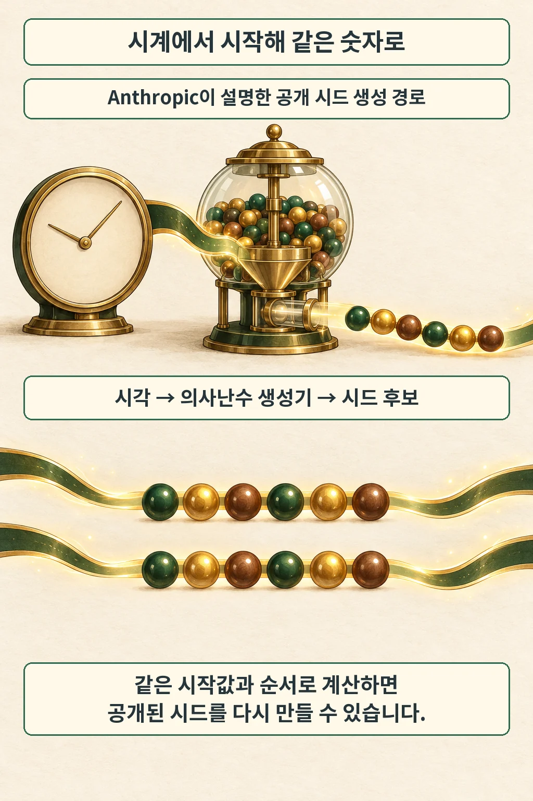
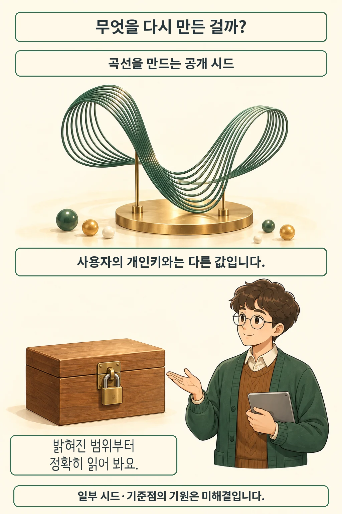

글·해설: 다메카솔

발행·확인: 2026-10-17

Anthropic은 10월 16일, 내부 연구 모델 Claude가 **ECDSA 표준 곡선에 쓰인 공개 시드의 생성 경로**를 찾아냈다고 발표했습니다. 오래전 공개된 숫자를 다시 만드는 방법이 나온 셈인데요. 사용자의 비밀을 알아낸 이야기로 읽기보다, 암호 표준의 설계 이력을 추적한 연구로 보면 의미가 선명해집니다. [공식 발표](https://www.anthropic.com/research/ecdsa-curve-origins)

## 먼저, 어떤 시드였을까

2023년 Filippo Valsorda가 올린 현상금 공고에는 이미 다섯 NIST 곡선의 시드가 공개돼 있었습니다. 당시의 질문은 그 값을 **어떤 방식으로 처음 골랐는지**였죠. 공고는 영어 문장을 해시했을 것이라는 가설을 소개하면서도, 전해 들은 기억이 틀렸을 가능성을 열어 뒀습니다. [당시 공고](https://words.filippo.io/seeds-bounty/)

| 구분 | 이 글에서 뜻하는 것 |
| --- | --- |
| 곡선 생성 시드 | 표준 곡선의 일부 매개변수를 만들 때 사용한 공개 입력 |
| 사용자 개인키 | 사용자별로 비밀을 유지해야 하는 키 |

같은 ‘시드’라는 단어를 지갑 복구 문구와 연결하면 사건의 성격을 잘못 짚게 됩니다. 이번 연구의 출발점은 누구나 읽을 수 있는 표준 속 숫자였습니다.

## 시계에서 출발한 계산을 다시 돌려 보면

Anthropic이 제시한 설명은 Unix 시각으로 초기화한 C 계열 의사난수 생성기 `lrand48`입니다. 정해진 순서로 후보를 만들면 공개 시드에 도달한다는 것이죠. 회사는 기존 가설 대신 옛 소프트웨어의 출력 특징을 살핀 것이 단서였다고 설명합니다. [발견 경위와 공개 코드](https://www.anthropic.com/research/ecdsa-curve-origins#how-it-was-found)

글을 준비하며 공개된 계산 방식을 Windows의 Python 3.12.14에서 실행하고, 결과를 **2023년 공고의 원래 값**과 대조했습니다.

| 대조 대상 | 확인 결과 |
| --- | --- |
| P-192 · P-224 · P-256 · P-384 · P-521 | 다섯 공개 시드 모두 일치 |

예를 들어 P-256은 발표에 적힌 1997년 8월 16일 01:52:34 UTC를 시작값으로 넣고 1,842번째 후보를 택했을 때 일치했습니다. 이 확인은 주어진 방법으로 결과를 다시 만드는 데 한정됩니다. Claude가 그 방법을 발견한 과정이나 당시 설계자의 의도까지 재현한 것은 아닙니다.

## 설명된 기원과 남아 있는 질문

Anthropic은 이번 결과를 새로운 공격이나 ECDSA 취약점으로 보지 않으며, 곡선의 기원에 관한 의심을 줄이는 단서로 평가합니다. 동시에 B-163 시드, 여러 기준점의 생성법, 일부 적합한 후보를 건너뛴 이유는 미해결로 남겼습니다. [의미와 열린 질문](https://www.anthropic.com/research/ecdsa-curve-origins#open-questions)

이 발표에서 사용한 모델은 내부 연구 모델로 소개됩니다. 글의 중심은 연구 결과와 재현 코드이며, 일반 사용자가 같은 모델을 이용할 수 있다는 출시 안내는 담겨 있지 않습니다.

## 다메카솔의 해석: 설명을 실행 가능한 형태로 남기기

저는 이번 사례에서 **AI가 내놓은 설명을 작은 계산으로 대조할 수 있다는 점**에 주목했습니다. 생성된 코드를 검토할 때도 답변의 자신감보다 입력과 기대 결과가 명확한 검사가 더 유용하듯, 연구 발표 역시 무엇을 직접 다시 확인할 수 있는지 살펴볼 여지가 있습니다.

앞서 다룬 [AI Scan의 탐지 결과와 검토 책임](/posts/github-ai-scan-advisory-merge-boundary/)이 발견된 문제를 누가 판단할지에 관한 이야기였다면, 이번에는 설명을 뒷받침하는 산출물에 초점을 맞췄습니다. 공개 숫자의 일치를 확인하는 검사와 암호체계 전체의 안전성을 평가하는 작업은 요구하는 근거의 크기가 다릅니다.

계산으로 되살린 생성 경로 뒤에는 여전히 역사적 질문이 남습니다. 왜 어떤 후보는 지나쳤고 어떤 후보는 표준에 들어갔을까요? 후속 설명에서 제가 더 보고 싶은 것은 그 선택의 기록입니다.

## 출처

- [Anthropic · Claude reveals ECDSA curve origins, 2026-10-16](https://www.anthropic.com/research/ecdsa-curve-origins)
- [Filippo Valsorda · NIST 곡선 시드 현상금 공고, 2023-10-05](https://words.filippo.io/seeds-bounty/)

이 글의 본문과 이미지는 생성형 AI로 제작했습니다. 기획과 편집 기준은 다메카솔이 정했습니다.
