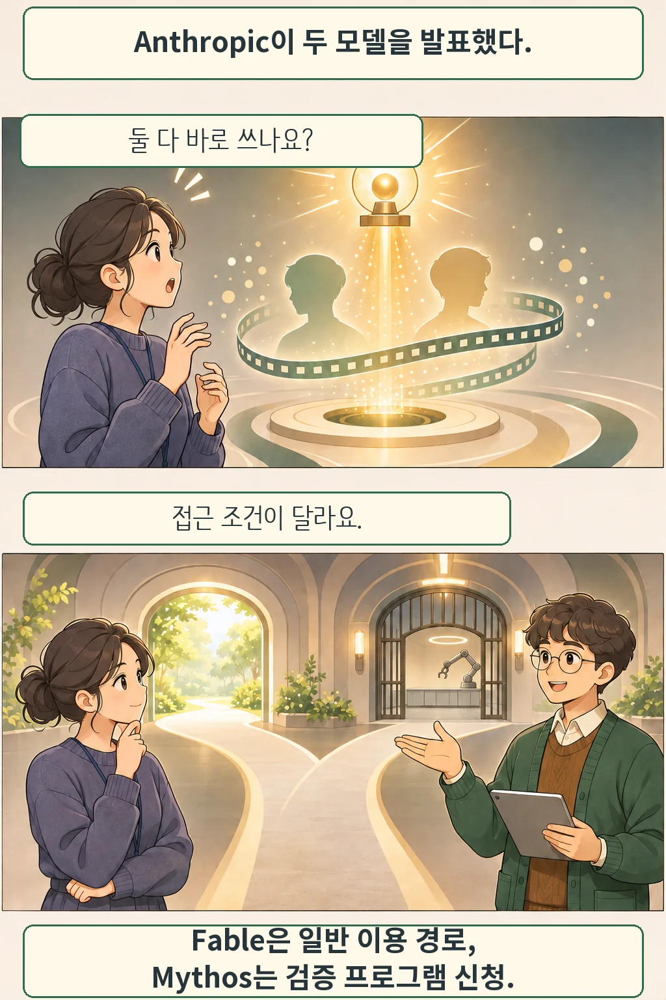

글·해설: 다메카솔

Anthropic은 2026년 11월 9일 Claude Fable 5.2와 Mythos 5.2를 발표했습니다. 회사 설명에 따르면 두 이름은 같은 기반 모델을 가리키지만, 안전장치와 접근 조건이 다릅니다. 11월 10일 확인한 공식 발표에서 Fable은 일반 이용 경로를, Mythos는 검증 프로그램을 통한 신청 경로를 안내합니다.

## 이름보다 먼저 볼 것은 이용 조건

Anthropic은 Fable에 사이버보안·생물학 악용을 막기 위한 안전장치를 적용했다고 설명합니다. 개발자는 Claude Platform에서 `claude-fable-5-2`를 사용할 수 있으며, 발표에는 AWS·Google Cloud·Microsoft Azure도 제공 경로로 나옵니다. 서비스 제공과 각 계정의 요금제·이용 한도는 별개이므로, 이용 화면에서 적용 조건을 확인해야 합니다.

Mythos 5.2의 경우 사이버보안 전문가는 Cyber Verification Program에, 생명과학 연구자는 Life Sciences Verification Program에 접근을 신청할 수 있습니다. 신청 가능하다는 안내가 곧바로 모든 신청자의 승인을 뜻하지는 않습니다. 별도로 Enterprise 고객에게는 Mythos 5.2를 포함한 모델 제품군으로 작동하는 Claude Security도 안내합니다.

## 빨라졌다는 발표와 내 작업의 결과

회사는 이전 Fable 5.1·Mythos 5.1보다 출력 생성이 최대 30% 빨라졌다고 보고했습니다. 일반 모드의 공개 가격은 입력 100만 토큰당 8달러, 출력 100만 토큰당 40달러입니다. 별도 fast mode는 입력 16달러·출력 80달러이며, 제공 플랫폼과 Mythos 접근 자격 조건이 따릅니다. 이는 발표일 기준 회사 안내이며, 이 글에서 속도나 청구액을 직접 측정하지 않았습니다.

다메카솔의 해석: 도입 검토에서는 접근 자격을 먼저 확인하고, 실제 업무 입력으로 결과 품질과 비용을 함께 비교하는 편이 좋습니다. 모델 이름이 비슷하다는 이유로 접근 범위까지 같다고 보면 계획이 어긋날 수 있습니다. 회사가 정한 평가의 범위를 읽는 방법은 [Arete 후학습 실험 해설](/posts/arete-27b-value-post-training/)에서도 다룹니다.

그림의 갈림길은 접근 경로의 비유입니다. 실제 서비스 화면이나 내부 구조를 재현한 그림은 아닙니다.

## 출처

- [Anthropic 공식 발표](https://www.anthropic.com/claude-fable-and-mythos-5-2): 2026년 11월 9일 발표. 모델 관계, 접근 경로와 가격의 단일 출처입니다.

이 글의 본문과 이미지는 생성형 AI로 제작했습니다. 기획과 편집 기준은 다메카솔이 정했습니다.
