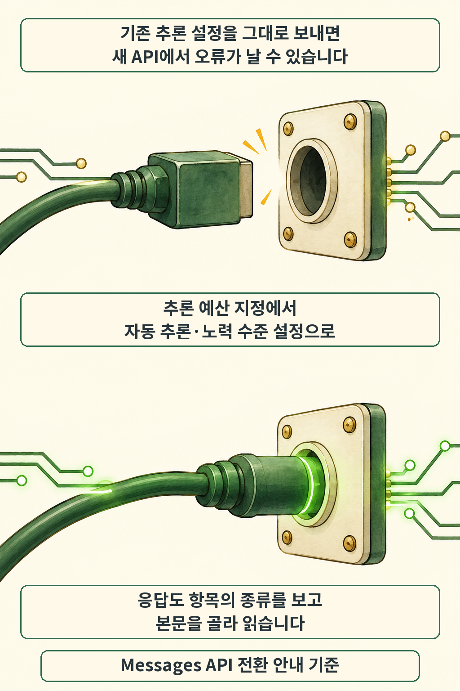

반복 호출이 많은 LLM 서비스를 운영하다 보면, 경량 모델의 단가 인하 소식이 곧바로 운영비 절감으로 이어질지 궁금해집니다. Anthropic이 새로 내놓은 Claude Haiku 5.5는 요약·분류·추출처럼 범위가 명확한 작업에 맞춰 입력 단가를 크게 낮췄습니다. 다만 기존 코드에서 모델 이름만 바꾸면 API 오류가 나거나 예상과 다른 요금이 나올 수 있어, 함께 달라진 추론 설정과 토크나이저 변화를 짚고 넘어가야 합니다. ([공식 발표](https://www.anthropic.com/claude-haiku-5-5))

글·해설: 다메카솔

## 모델 ID만 바꾸면 API 오류가 나는 이유

기존 요청에서 모델 ID만 `claude-haiku-5-5`로 교체하면 추론 설정 충돌로 곧바로 400 오류가 돌아올 수 있습니다. 예전에 쓰던 `thinking`의 `enabled` 모드와 `budget_tokens` 조합이 더 이상 통하지 않거든요. 공식 전환 안내에서 반드시 확인해야 할 변경 사항은 크게 세 가지로 나뉩니다. ([전환 문서](https://platform.claude.com/docs/en/models/haiku-5-5/migration-guide))

- **추론 설정과 `max_tokens` 여유**: Messages API에서 `thinking: {"type": "enabled", "budget_tokens": N}`을 보내던 코드는 `adaptive` 방식과 `output_config.effort` 형태로 바꿔야 합니다. 자동 추론이 기본 활성이며 추론 토큰도 `max_tokens` 한도를 함께 쓰므로, 출력이 잘리지 않게 한도를 넉넉히 잡아야 합니다.
- **응답 배열의 `type` 분기**: 응답 콘텐츠의 첫 항목이 곧바로 최종 답변이라고 가정하면 빈 화면이 나갈 수 있습니다. 예를 들어 고객 문의를 분류하는 백엔드에서 배열의 0번 원소만 꺼내도록 짜 두었다면, 먼저 들어온 추론 블록 때문에 빈 문자열이 전달되는 식이죠. 각 항목의 `type`을 확인해 본문 텍스트만 추출해야 합니다.
- **호환성 점검과 제공 경로**: 샘플링 매개변수(`temperature` 등 생략 권장), assistant 프리필, 컴퓨터 사용 도구, 대화 재생을 쓰는 서비스는 전체 전환 목록을 대조해야 합니다(Claude Managed Agents는 모델명 갱신 외 별도 코드 변경 불필요). 제공 경로는 Claude API(`claude-haiku-5-5`), Amazon Bedrock, Google Cloud, Microsoft Foundry, Claude Platform on AWS이며 플랫폼별로 모델 식별자가 다를 수 있습니다. ([모델 정보와 제공 경로](https://platform.claude.com/docs/en/models/haiku-5-5/overview))

## 낮아진 단가표와 토크나이저 변수

Anthropic은 2026년 10월 7일 이 모델을 공개하면서 범위가 좁고 반복적인 작업에 초점을 맞췄다고 밝혔습니다. 가격표는 프롬프트 길이에 따라 두 구간으로 나뉘는데요. 기존 모델 발표 당시의 비교표와 나란히 놓아 보면 단가 하락 폭이 한눈에 들어옵니다. ([공식 가격표](https://platform.claude.com/docs/en/models/haiku-5-5/overview))

| 항목 (100만 토큰당, USD) | Haiku 4.5 비교표 | Haiku 5.5 (10만 토큰 이하) | Haiku 5.5 (10만 토큰 초과) |
| --- | ---: | ---: | ---: |
| 입력 | $1.00 | $0.10 | $0.50 |
| 출력 | $5.00 | $0.50 | $2.50 |
| 캐시 읽기 | $0.10 | $0.01 | $0.05 |

표는 2026년 10월 8일 공식 가격표 기준이며 캐시 쓰기와 부가 서비스 요금은 별도 계산됩니다. 다만 단가표만 보고 곧바로 비용 절감을 단정하면 실제 청구액과 어긋나기 쉽습니다. 새 토크나이저 분할 방식 때문에 같은 텍스트를 넣어도 입력 토큰 수가 평균 약 30%(언어·내용에 따라 상이) 늘어나기 때문이죠. 기존 로그에 새 단가를 단순 곱하기보다 새 모델 기준으로 토큰을 다시 세어 예산을 잡아야 합니다. ([토큰 재계산 안내](https://platform.claude.com/docs/en/models/haiku-5-5/migration-guide))

공급사가 제시한 '평균 약 75% 실행 비용 절감' 수치도 전제를 함께 볼 필요가 있습니다. 기존 트래픽의 90%가 10만 토큰 이하였다는 분포와 모델별 토큰 변화를 함께 반영한 추정치거든요. 가령 긴 시스템 프롬프트와 참고 문서를 함께 붙이는 서비스라면 10만 토큰 초과 구간에 걸려 체감 절감률이 다를 수 있으니, 자체 요청 로그로 대조해 보는 편이 안전합니다. ([추정 조건과 추가 발표](https://www.anthropic.com/claude-haiku-5-5))

- **Sonnet 5.5 캐시 읽기 인하**: 같은 날 발표에서 100만 토큰당 요금이 $0.20에서 $0.10로 낮아졌습니다.
- **구독자 월간 API 크레딧**: Max·Team 구독자 대상 월간 API 크레딧이 순차 제공될 예정입니다.

## 다메카솔의 해석: 성공한 작업 하나의 비용을 봅니다

모델을 바꿀 때는 토큰 단가만 비교하기보다, 범위가 명확한 반복 작업에서 기존 모델과 나란히 돌려 **성공한 작업 1건당 총비용**을 따져 보는 편이 실용적입니다. 예를 들어 영수증 필드를 추출하거나 고객 문의를 분류할 때, 1회 단가가 싸졌더라도 출력 형식을 어겨 재시도가 늘어나면 총비용과 지연 시간이 커질 수 있거든요. 성공률과 재시도 횟수, 처리 시간을 함께 재는 작은 전환 시험이 그래서 중요합니다.

모든 작업을 경량 모델 하나로 처리할 필요는 없으며, 복잡한 다단계 코딩이나 장문 추론은 Anthropic이 권장하는 대로 Sonnet 5.5 계열이나 더 무거운 추론용 Opus 5.5 계열로 역할을 나누어 두는 편이 낫습니다. 전환 평가 기준은 [ReviewBench가 누락과 잘못된 지적을 나눠 보는 방식](/posts/github-reviewbench-code-review-evaluation/)에서 참고할 수 있고, 보안 업무에서의 모델 접근 등급은 [CVP의 업무별 접근 등급](/posts/anthropic-cvp-three-access-tiers/)에서 이어서 확인할 수 있습니다.

## 출처

- [Anthropic — Introducing Claude Haiku 5.5, 2026-10-07](https://www.anthropic.com/claude-haiku-5-5)
- [Claude Platform Docs — Claude Haiku 5.5 overview](https://platform.claude.com/docs/en/models/haiku-5-5/overview)
- [Claude Platform Docs — Claude Haiku 5.5 migration guide](https://platform.claude.com/docs/en/models/haiku-5-5/migration-guide)

공식 발표와 마이그레이션 문서를 바탕으로 정리했으며, 이 글에서 모델 API를 직접 호출해 비용이나 성능을 실측하지는 않았습니다. 이 글의 본문과 이미지는 생성형 AI로 제작했습니다. 기획과 편집 기준은 다메카솔이 정했습니다.
