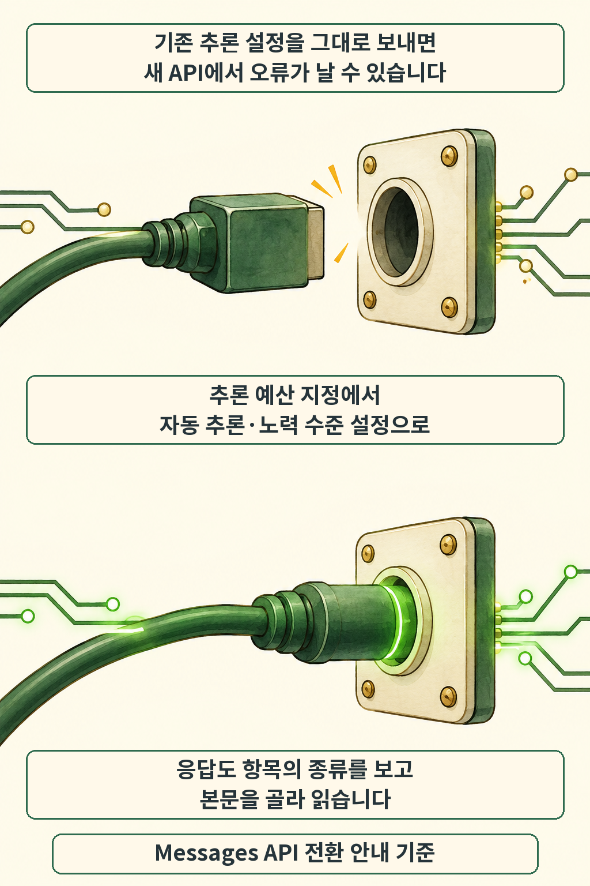

글·해설: 다메카솔

발행·확인: 2026-10-08

**Claude Haiku 5.5의 입력 가격은 짧은 프롬프트 구간에서 100만 토큰당 0.10달러부터 시작합니다.** 반복 호출이 많은 서비스라면 눈길이 갈 만한 단가인데, Anthropic은 2026년 10월 7일 이 모델을 공개하면서 요약·분류·추출처럼 범위가 명확한 작업에 초점을 맞췄다고 설명했습니다. 기존 Haiku 4.5에서 API를 옮길 때는 단가표뿐 아니라 요청 설정과 토큰 계산 방식의 변화도 함께 챙겨야 합니다. ([공식 발표](https://www.anthropic.com/claude-haiku-5-5))

## 모델을 바꾸기 전에 요청 설정부터 맞춥니다

기존 Haiku 4.5 요청에서 모델 ID만 `claude-haiku-5-5`로 바꾸면 추론 설정이나 응답 파싱에서 오류가 날 수 있습니다. 공식 마이그레이션 가이드에서 안내하는 핵심 변경 사항은 아래와 같습니다. ([전환 문서](https://platform.claude.com/docs/en/models/haiku-5-5/migration-guide))

- **추론 설정 형식 변경**: Messages API에서 `thinking: {"type": "enabled", "budget_tokens": N}`을 보내던 코드는 `adaptive` 방식과 `output_config.effort`를 사용하는 형태로 바꿔야 합니다.
- **응답 배열의 `type` 확인과 `max_tokens` 여유**: 자동 추론이 기본으로 켜져 있어 응답 콘텐츠의 첫 번째 항목이 곧바로 최종 답변 텍스트라고 가정하면 화면에 빈 답이 나갈 수 있습니다. 각 항목의 `type`을 확인해 본문을 추출해야 하며, 추론 토큰도 `max_tokens` 한도를 함께 소비한다는 점을 고려해야 합니다.
- **추가 호환성 점검과 제공 경로**: 샘플링 매개변수, assistant 프리필(이어 쓰기), 컴퓨터 사용 도구, 대화 재생 기능을 쓰는 서비스는 전체 마이그레이션 목록을 대조해야 합니다(Claude Managed Agents는 모델명 갱신 외 별도 코드 변경이 필요 없다는 안내입니다). 제공 경로는 Claude API(`claude-haiku-5-5`), Amazon Bedrock, Google Cloud, Microsoft Foundry, Claude Platform on AWS이며 플랫폼별로 모델 식별자가 다를 수 있습니다. ([모델 정보와 제공 경로](https://platform.claude.com/docs/en/models/haiku-5-5/overview))

## 낮은 단가를 우리 서비스 비용으로 바꾸려면

공식 가격표는 프롬프트 길이에 따라 10만 토큰을 기준으로 두 구간으로 나뉩니다(2026년 10월 8일 확인 기준, 미국 달러·100만 토큰당 요금이며 입력·출력·캐시 쓰기 등 각 항목을 별도 계산합니다). ([공식 가격표](https://platform.claude.com/docs/en/models/haiku-5-5/overview))

| 항목 | 프롬프트 10만 토큰 이하 | 프롬프트 10만 토큰 초과 |
| --- | ---: | ---: |
| 입력 | $0.10 | $0.50 |
| 출력 | $0.50 | $2.50 |
| 캐시 읽기 | $0.01 | $0.05 |

여기서 놓치기 쉬운 변수는 **같은 텍스트를 넣어도 토큰 수가 달라진다**는 점입니다. 공식 문서는 새로운 토크나이저 분할 방식 때문에 같은 입력이라도 Haiku 4.5 대비 입력 토큰 수가 평균 약 30%(언어·내용에 따라 상이) 늘어난다고 안내합니다. 따라서 기존 토큰 사용량에 새 단가만 곱하기보다, 새 모델로 다시 측정한 토큰 수를 기준으로 비용을 추정해야 정확합니다. ([토큰 재계산 안내](https://platform.claude.com/docs/en/models/haiku-5-5/migration-guide))

Anthropic이 제시한 ‘평균 약 75% 실행 비용 절감’ 수치 역시 기존 Haiku 트래픽의 길이 분포와 토크나이저 변화를 반영한 공급사 자체 추정이므로, 개별 서비스의 실제 절감 폭은 자체 요청 로그로 확인해야 합니다. 한편 같은 날 발표에서는 Sonnet 5.5의 캐시 읽기 단가 인하(100만 토큰당 $0.20 → $0.10)와 Max·Team 구독자용 월간 API 크레딧의 순차 제공 계획도 함께 안내됐습니다. ([추정 조건과 추가 발표](https://www.anthropic.com/claude-haiku-5-5))

## 다메카솔의 해석: 성공한 작업 하나의 비용을 봅니다

모델을 전환할 때는 토큰 단가만 비교하기보다, 범위가 명확한 반복 작업(예: 고객 문의 분류나 필드 추출)에서 두 모델을 나란히 돌려 **성공한 작업 1건당 총비용**을 비교하는 편이 실용적입니다. 1회 호출 단가가 낮아졌더라도 원하는 형식을 맞추지 못해 재시도가 늘어나거나 추론 토큰 비중이 커지면 최종 비용과 지연 시간이 예상과 달라질 수 있기 때문입니다.

복잡한 다단계 코딩이나 장문 추론처럼 Anthropic 스스로도 Sonnet 5.5나 Opus 5.5를 권장하는 영역은 처음부터 역할을 나누어 두는 편이 낫습니다. 평가 기준을 세울 때는 [ReviewBench가 누락과 잘못된 지적을 나눠 보는 방식](/posts/github-reviewbench-code-review-evaluation/)을 참고할 수 있고, 보안 업무에서의 모델 접근 등급은 [CVP의 업무별 접근 등급](/posts/anthropic-cvp-three-access-tiers/)에서 이어서 확인할 수 있습니다.

## 출처

- [Anthropic — Introducing Claude Haiku 5.5, 2026-10-07](https://www.anthropic.com/claude-haiku-5-5)
- [Claude Platform Docs — Claude Haiku 5.5 overview](https://platform.claude.com/docs/en/models/haiku-5-5/overview)
- [Claude Platform Docs — Claude Haiku 5.5 migration guide](https://platform.claude.com/docs/en/models/haiku-5-5/migration-guide)

공식 발표와 마이그레이션 문서를 바탕으로 정리했으며, 이 글에서 모델 API를 직접 호출해 비용이나 성능을 실측하지는 않았습니다. 이 글의 본문과 이미지는 생성형 AI로 제작했습니다. 기획과 편집 기준은 다메카솔이 정했습니다.
