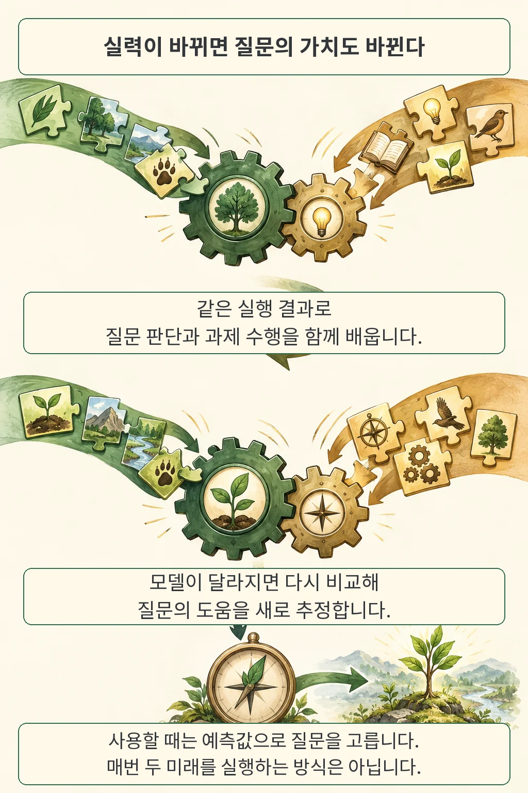

AI 에이전트가 작업 전에 자꾸 되물으면 흐름이 끊기고, 반대로 질문을 줄이면 핵심 요구사항을 놓치기 쉽습니다. 그렇다고 모든 빈칸을 무조건 채우기보다 **답을 들었을 때 에이전트의 다음 선택이 달라지는 질문**만 골라내야 하죠. CLEAT 연구진은 현재 에이전트가 평소대로 이어 간 결과와 특정 질문을 먼저 던진 결과를 나란히 비교해, 질문이 실제로 보태는 효용을 학습하는 방법을 제안했습니다.

글·해설: 다메카솔

## 핵심 내용

- **잔여 질문 가치(RQV)**: 같은 대화 맥락에서 먼저 질문했을 때의 기대 효용에서 현재 에이전트가 평소대로 진행한 기대 효용을 뺍니다.
- **공동 학습과 가벼운 추론**: 비교 실행 결과로 질문 가치 예측기와 과제 정책을 함께 갱신하되, 추론 때는 예측 RQV가 양수인 최고 질문만 고릅니다.
- **정답률과 완전 해결률의 간격**: AskMind 기준 최종 답 정확도(48.37%)와 모든 요구점을 해결한 과제 비율(34.87%) 사이에는 간격이 남았습니다.

가령 보고서 작성 에이전트에게 표 색상 취향을 물어도 결과물 형식은 그대로일 수 있지만, 자동 집계용 데이터 파일인지 요약 문서인지 물으면 작업 방향 자체가 달라집니다. CLEAT는 [원문 1~3절](https://arxiv.org/html/2610.12655v1#S1)에서 이처럼 실제 선택을 바꾸는 질문의 가치를 정의하고 측정합니다.

## 평소대로 진행했을 때와 무엇이 달라졌나

저자들은 학습 중 동일한 대화 이력과 사용자 목표를 두고 두 갈래를 나란히 실행했습니다.

- **기본 진행(PASS)**: 현재 에이전트 정책이 평소 방식대로 과제를 이어 감
- **선제 질문**: 특정 정보를 먼저 묻고 답을 들은 뒤 과제를 이어 감

두 갈래의 평균 과제 효용 차이가 바로 **잔여 질문 가치(RQV)**의 학습 목표입니다. 비교하는 동안 현재 정책은 고정하고, 벤치마크에 정해진 상호작용 비용이 있으면 효용 계산에 함께 반영하죠.

여기서 `PASS`는 ‘질문 전면 금지’를 뜻하지 않고 현재 정책에 진행을 맡긴다는 의미라, 에이전트가 이후 단계에서 스스로 질문을 던질 수도 있거든요. 결국 RQV는 질문을 못 하는 모델과 견준 점수가 아니라 현재 행동에 이 질문을 먼저 보탰을 때의 추가 이득이며, 에이전트가 답을 받아 실제 행동에 반영할 수 있을 때만 커집니다.

## 질문 판단과 과제 수행을 함께 학습한다

그렇다면 에이전트 실력이 올라간 뒤에도 과거에 매겨 둔 질문 점수를 그대로 써도 될까요?

CLEAT는 같은 비교 실행 결과로 **질문 가치 예측기(컨트롤러)**와 **과제 수행 정책**을 함께 학습하고, 정책이 바뀔 때마다 새 비교 결과로 예측기를 갱신한 뒤 마지막에 최종 정책을 고정해 컨트롤러를 한 번 더 다듬습니다.

- **질문 가치 예측값**: 학습 중 우선 수집할 갈래를 안내하고 샘플링 편향을 보정하는 데 쓰며, 정책 보상에는 더하지 않습니다.
- **과제 수행 정책**: 예측 점수가 아닌 실제 관측한 과제 결과만으로 직접 학습합니다.

실제 추론 시점에는 매번 두 갈래 미래를 시뮬레이션하지 않습니다. 고정된 후보 생성기와 표현기가 낸 유한한 후보 중 예측 RQV가 양수(`> 0`)이면서 가장 높은 질문만 고르고, `PASS`가 선택되면 컨트롤러가 물러나 이후 판단과 질문 여부를 과제 정책에 맡깁니다.

## 점수는 올랐지만, 지표의 뜻은 다르다

이 평가에는 실제 사람 대신 대규모 언어 모델 모의 환경을 사용했습니다.

- **모델과 반복**: `Qwen3-4B` 기반으로 4개 벤치마크·10개 설정을 3개 시드 평균과 표준편차(`±`)로 보고했습니다.
- **모의 사용자와 조건**: `Qwen3-30B-A3B`가 사용자 모사와 채점을 맡았고, 같은 벤치마크 내 동일한 평가 분할과 턴 제한을 두되 학습·최적화는 각 방법 설정을 따랐습니다.

대표 비교 방법 가운데 열별 최고 평균을 기록한 SFT와 CLEAT의 저자 보고치를 아래 표에 추려 정리했습니다.

| 평가 지표 | SFT | CLEAT | 평균 차이 |
| --- | ---: | ---: | ---: |
| UserGym Travel 점수 | 50.48 ± 1.76 | 63.72 ± 0.48 | +13.24점 |
| IN3 정보부족 판단 정확도 | 77.47 ± 5.26% | 83.95 ± 1.42% | +6.48%p |

UserGym Travel에서 13점 넘게 앞섰지만 실제 항공권·숙소 예약 성공률로 보면 곤란합니다. 8개 여행 환경의 선호 파악·검색·추천 보상을 집계해 100배 한 점수거든요.

IN3 정확도 역시 질문 여부를 정답 라벨과 대조한 값이라 누락 조건 회복량과는 구분해야 합니다. CLEAT는 10개 설정 모두 최고 평균을 보고했지만, 평균 순위가 모든 쌍의 통계적 유의성을 보장하는 것은 아닙니다.

[원문 그림 4와 표 7](https://arxiv.org/pdf/2610.12655v1)이 보여 주는 AskMind 지표를 나란히 살피면 실무적 간격이 더 또렷해집니다.

| CLEAT의 AskMind 지표 | 저자 보고 평균 ± 표준편차 |
| --- | ---: |
| 최종 답의 정확도 | 48.37 ± 2.66% |
| 모든 요구점을 해결한 과제의 비율 | 34.87 ± 2.20% |

최종 답이 정답으로 채점돼도 일부 세부 조건은 해결되지 않은 채 남을 수 있습니다. 두 번째 수치는 개별 조건 평균 회복률과 달리 모든 요구점을 해결한 과제 비율이므로, 평가 화면에 두 지표를 나란히 두는 편이 좋습니다.

## 실제 사용자에게 옮기기 전에 남은 조건

실서비스에 적용하려면 [원문 6절](https://arxiv.org/html/2610.12655v1#S6)이 짚은 세 가지 전제를 먼저 살펴야 합니다.

- **반복 실행 가정**: 같은 대화 이력과 목표에서 여러 갈래를 반복 실행하는 학습 가정은 실시간 대화에 쓰기 어렵습니다.
- **고정된 질문 후보**: 후보 생성기와 표현기가 고정되어 컨트롤러의 선택 폭이 그 후보 풀 안으로 제한됩니다.
- **변하는 사용자 목표**: 대화 중 목표가 바뀌는 실제 환경에서의 효과는 후속 과제로 남아 있습니다.

또한 2026년 10월 14일 확인한 논문·메타데이터에는 공식 코드나 데이터 링크가 없었고, 제목과 저자 검색에서도 공개 저장소를 찾지 못했습니다. 당장 패키지를 설치해 써 보기보다 질문 가치를 평가하는 설계 방법론으로 참고할 단계입니다.

## 다메카솔의 해석: 질문 뒤의 결정을 기록하자

모델이나 프롬프트를 교체할 때는 **확인 질문이 실제 선택을 바꿨는지도 회귀 테스트 항목**으로 묶어 두어야 합니다. 어떤 정보가 부족하다고 봤는지, 답변 뒤 도구 선택이나 출력 형식이 달라졌는지를 함께 대조해 보는 셈이죠.

이를 위해 로그에는 질문·답변 외에 판단 맥락을 남길 필요가 있습니다.

- **직전 선택지**: 질문 직전에 에이전트가 고려하던 후보 작업
- **실행 버전**: 판단 시점의 모델·프롬프트·도구 버전
- **최종 결정과 충족 결과**: 답변 반영 뒤 바뀐 결정과 요구사항 해결 여부

이 맥락을 연결해 두면 모델 교체 뒤 질문 효용이 달라졌을 때 원인을 역추적하기 수월해집니다. 앞서 다룬 [판단 맥락을 보존하는 Workflow as Knowledge](/posts/workflow-as-knowledge/)와도 자연스럽게 이어지죠.

물론 **삭제·결제·외부 전송 같은 필수 승인과 보안 권한 확인은 질문 효용 추정치와 별도 규칙으로 강제**해야 합니다. 여러 외부 도구를 엮을 때는 [도구 연결 사이의 안전 경계](/posts/x-agentred-cross-service-risk/)도 함께 점검해야 하고요. 결국 사용자의 시간을 빌린 질문이 더 나은 작업 결정으로 이어졌는지, 그리고 정답률과 요구사항 완전 해결률을 나란히 남겼는지가 대화 품질을 가르는 기준이 됩니다.

## 출처

- Jiatan Huang, Zheyuan Zhang, Ziming Li, Tianyi Ma, Mingchen Li, Yanfang Ye, Chuxu Zhang. [CLEAT: Learning Value-Guided Clarification for Interactive Agents, arXiv:2610.12655v1](https://arxiv.org/abs/2610.12655v1). 2026년 10월 8일 19:22:21 UTC 제출 프리프린트.
- [원문 PDF — 방법 §3, 표 1·7, 한계 §6, 실험 부록 B·C](https://arxiv.org/pdf/2610.12655v1)
- [원문 HTML](https://arxiv.org/html/2610.12655v1)

검토·작성일: 2026년 10월 14일. 이 글은 논문 원문을 해설하며 실험을 독립 재현하지 않았고, 본문과 표지의 만화 그림은 원문 도표를 복제하지 않고 새로 구성했습니다.

이 글의 본문과 이미지는 생성형 AI로 제작했습니다. 기획과 편집 기준은 다메카솔이 정했습니다.
