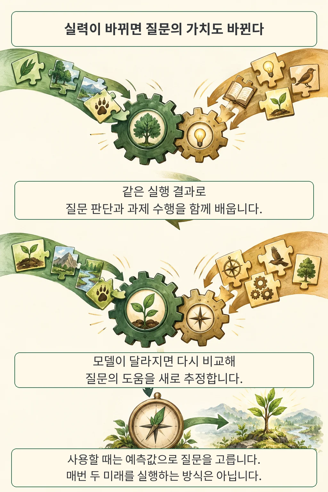

글·해설: 다메카솔

**확인 질문은 답을 들은 뒤 선택이 달라질 때 도움이 됩니다.** 에이전트가 사소한 취향까지 물으면 작업이 자꾸 끊기고, 질문을 줄이면 중요한 조건을 놓칠 수 있어 개발자는 어느 쪽에 기준을 둘지 고민하게 됩니다. CLEAT의 저자들은 현재 에이전트가 평소대로 이어 간 결과와 특정 질문을 먼저 한 뒤의 결과를 비교해, 그 질문이 더하는 도움을 학습했습니다.

가령 보고서를 만드는 에이전트에게 색 취향을 더 알려 주어도 전달 형식은 그대로일 수 있습니다. 반면 사용자가 자동 집계에 쓸 파일을 원하는지, 사람이 읽을 문서를 원하는지는 출력 형식을 바꿉니다. 표지의 보고서 장면은 이 차이를 설명하려고 만든 가상의 예시입니다. 저는 질문 횟수를 줄이는 목표보다, **어떤 답변이 실제 작업 선택을 바꾸는지** 먼저 보자는 접근에 주목했습니다. [CLEAT 원문 §1–3](https://arxiv.org/html/2610.12655v1#S1)

## 평소대로 진행했을 때와 무엇이 달라졌나

비교의 출발점은 같습니다. 저자들은 학습 중 같은 대화 이력과 사용자 목표를 놓고, 한쪽에서는 현재 에이전트가 이어 가게 하고 다른 쪽에서는 특정 정보를 먼저 물은 뒤 이어 가게 했습니다. 두 갈래의 평균 과제 효용 차이가 **잔여 질문 가치, RQV(Residual Query Value)**의 학습 목표가 됩니다. 비교하는 동안에는 에이전트의 정책을 고정합니다. [원문 §3.1–3.2](https://arxiv.org/html/2610.12655v1#S3)

여기서 PASS라는 선택은 과제 수행을 에이전트에게 맡긴다는 뜻입니다. 그 에이전트는 이후에도 스스로 질문할 수 있으므로, 질문을 전면 금지한 상대와 비교한 실험으로 읽으면 의미가 달라집니다. RQV는 **현재 에이전트가 원래 할 행동에 특정 질문을 먼저 더했을 때의 이득**을 겨냥합니다. 과제에서 정한 상호작용 비용이 있으면 효용에 함께 반영합니다.

답을 활용하는 능력도 중요합니다. 필요한 정보를 들어도 무시하거나 잘못 적용하면 결과가 나빠질 수 있고, 반대로 이미 잘 처리하는 에이전트에게 같은 질문을 덧붙이면 이득이 작아질 수 있습니다. 이 관점에서는 “불확실한 것이 남았나”에 더해 “지금 이 에이전트가 그 답을 어떻게 사용할까”를 살펴야 합니다.

## 질문 판단과 과제 수행을 함께 학습한다

그렇다면 모델이 좋아진 뒤에도 예전 질문 점수를 그대로 써도 될까요? CLEAT는 비교 실행에서 얻은 결과로 질문 가치를 예측하는 부분과 실제 과제를 수행하는 정책을 함께 학습합니다. 새 정책으로 다시 얻은 결과를 다음 질문 가치 학습에 사용하며, 마지막에는 최종 정책을 고정한 채 질문 판단 부분을 한 번 더 갱신합니다. [원문 §3.2–3.5·부록 B](https://arxiv.org/pdf/2610.12655v1)

예측과 보상은 역할이 다릅니다. 질문 가치의 예측값은 학습 중 어떤 비교를 우선 수집할지 안내하고, 정책은 실제로 관측한 과제 결과에서 배웁니다. 예측 점수를 정책 보상에 덧붙이는 방식으로 설명하면 원문과 어긋납니다. 저자들은 특정 질문을 더 자주 수집하면서 생기는 편향을 보정하는 절차도 포함했습니다.

사용할 때는 매번 두 갈래의 미래를 실행하지 않습니다. 고정된 후보 생성기가 내놓은 질문 대상 가운데 예측 RQV가 가장 높고 양수인 대상을 선택해 묻습니다. PASS를 선택하면 컨트롤러의 개입은 끝나며, 과제 정책은 이후 작업과 필요에 따른 질문을 맡습니다. 학습용 비교 실행과 사용 시점의 예측을 구분해야 비용 구조도 이해할 수 있습니다.

## 점수는 올랐지만, 지표의 뜻은 다르다

저자들은 Qwen3-4B를 바탕으로 네 벤치마크의 열 설정을 비교했습니다. 주 결과는 세 시드의 평균과 표준편차이며, 사용자 모사와 모델 기반 판정에는 Qwen3-30B-A3B를 사용했습니다. 같은 벤치마크의 방법들에는 같은 평가 분할과 대화 횟수 제한을 적용했지만, 학습 목적과 최적화 설정은 각 방법을 따랐습니다. **실제 사용자를 모집한 실험은 아닙니다.** [표 1·부록 C](https://arxiv.org/pdf/2610.12655v1)

아래는 열 설정 중 의미가 다른 두 지표를 뽑은 **저자 보고치**입니다. SFT는 해당 열에서 평균이 가장 높았던 비교 방법이며, ±는 세 시드의 표준편차입니다.

| 평가 지표 | SFT | CLEAT | 평균 차이 |
| --- | ---: | ---: | ---: |
| UserGym Travel 점수 | 50.48 ± 1.76 | 63.72 ± 0.48 | +13.24점 |
| IN3 정보부족 판단 정확도 | 77.47 ± 5.26% | 83.95 ± 1.42% | +6.48퍼센트포인트 |

Travel에서 13점 넘게 차이가 난다는 점은 눈길을 끕니다. 이 점수는 여덟 여행 환경에서 선호 파악, 검색, 최종 추천 등에 주어지는 보상을 집계하고 100배 한 값입니다. 실제 항공권 예약 성공률 63.72%로 옮겨 말할 근거는 없습니다. IN3의 판단 정확도는 질문했는지를 정보부족 정답 라벨과 비교한 값으로, 누락된 조건을 얼마나 되찾았는지와 또 다릅니다. [원문 §4.1–4.2·부록 C.1](https://arxiv.org/pdf/2610.12655v1)

CLEAT는 열 설정에서 모두 가장 높은 평균을 보고했습니다. 표의 평균 순위와 모든 비교에 대한 통계적 유의성은 구분해서 읽어야 합니다. 이 글에서 학습이나 평가를 다시 실행한 것은 아니며, 수치는 원문 범위로 한정합니다.

AskMind의 두 지표를 나란히 놓으면 남은 문제도 보입니다.

| CLEAT의 AskMind 지표 | 저자 보고 평균 ± 표준편차 |
| --- | ---: |
| 최종 답의 정확도 | 48.37 ± 2.66% |
| 모든 요구점을 해결한 과제의 비율 | 34.87 ± 2.20% |

정답으로 채점된 결과에도 빠진 조건이 남을 수 있다는 뜻입니다. 두 번째 지표는 개별 조건의 평균 회복률이 아니라, **필요한 요구점을 모두 해결한 과제의 비율**입니다. 저는 이 차이를 에이전트 평가 화면에 함께 보여 줄 가치가 있다고 봅니다. 답의 정오만 집계하면 사용자가 왜 다시 설명해야 했는지는 잘 드러나지 않기 때문입니다. [그림 4·표 7·부록 C.1](https://arxiv.org/pdf/2610.12655v1)

## 실제 사용자에게 옮기기 전에 남은 조건

앞의 비교에는 반복 가능한 환경이 필요합니다. 같은 대화 이력과 같은 사용자 목표에서 여러 번 이어 가는 학습 가정은 실제 대화에서 충족하기 어렵다고 저자들도 밝힙니다. 또 질문 후보와 문장 표현을 만드는 부분은 고정돼 있어, 컨트롤러가 고를 수 있는 질문의 범위를 제한합니다. 실제 사용자와 시간이 지나며 바뀌는 목표에 대한 효과는 향후 과제로 남아 있습니다. [원문 §6](https://arxiv.org/html/2610.12655v1#S6)

공개 자료에서 확인한 범위도 좁습니다. 2026년 10월 14일 검토한 논문과 arXiv 메타데이터에는 별도 저자 프로젝트·코드·데이터 링크가 없었고, 제목과 저자 검색에서도 공식 배포를 찾지 못했습니다. 바로 설치해서 같은 성능을 얻는 도구로 소개하기에는 자료가 부족합니다.

## 다메카솔의 해석: 질문 뒤의 결정을 기록하자

저라면 모델을 바꿀 때 확인 질문도 회귀 시험의 대상으로 삼겠습니다. 같은 요청에 어떤 정보가 부족했는지, 답을 받은 뒤 선택이 어떻게 바뀌었는지, 필요한 조건을 끝까지 회복했는지를 묶어 보면 질문이 늘어난 이유를 더 구체적으로 설명할 수 있습니다. 이는 논문 결과에서 끌어낸 설계 해석입니다. 실제 서비스의 비용 절감이나 만족도 개선을 이번 연구가 입증했다고 보지는 않습니다.

기록할 단위는 한 문장보다 넓습니다. 질문과 답만 남기는 대신 당시 가능한 선택, 적용한 모델과 도구 버전, 최종 결과를 연결해 두면 나중에 같은 질문의 가치가 달라진 이유를 살필 수 있습니다. [판단 맥락을 보존하는 Workflow as Knowledge](/posts/workflow-as-knowledge/)와 맞닿는 지점입니다.

필수 승인과 권한 확인은 따로 유지해야 합니다. 질문의 예상 효용이 낮다는 계산이 실행 권한을 만들지는 않으며, 여러 서비스를 연결할 때에는 [도구 사이의 안전 경계](/posts/x-agentred-cross-service-risk/)도 함께 다뤄야 합니다. 제가 취할 기준은 분명합니다. **사용자의 시간을 쓰는 질문에는 바뀐 결정으로 답하고, 작업 완료와 요구사항 회복을 함께 평가하는 쪽**입니다.

## 출처

- Jiatan Huang, Zheyuan Zhang, Ziming Li, Tianyi Ma, Mingchen Li, Yanfang Ye, Chuxu Zhang. [CLEAT: Learning Value-Guided Clarification for Interactive Agents, arXiv:2610.12655v1](https://arxiv.org/abs/2610.12655v1). 2026년 10월 8일 19:22:21 UTC 제출 프리프린트.
- [원문 PDF — 방법 §3, 표 1·7, 한계 §6, 실험 부록 B·C](https://arxiv.org/pdf/2610.12655v1)
- [원문 HTML](https://arxiv.org/html/2610.12655v1)

검토·작성일: 2026년 10월 14일. 최근 24시간 조회에서 선정할 후보를 확인하지 못해 최근 7일 범위에서 골랐습니다. 성능 수치는 저자 보고이며 독립 재현하지 않았습니다.

이 글의 본문과 이미지는 생성형 AI로 제작했습니다. 기획과 편집 기준은 다메카솔이 정했습니다.
