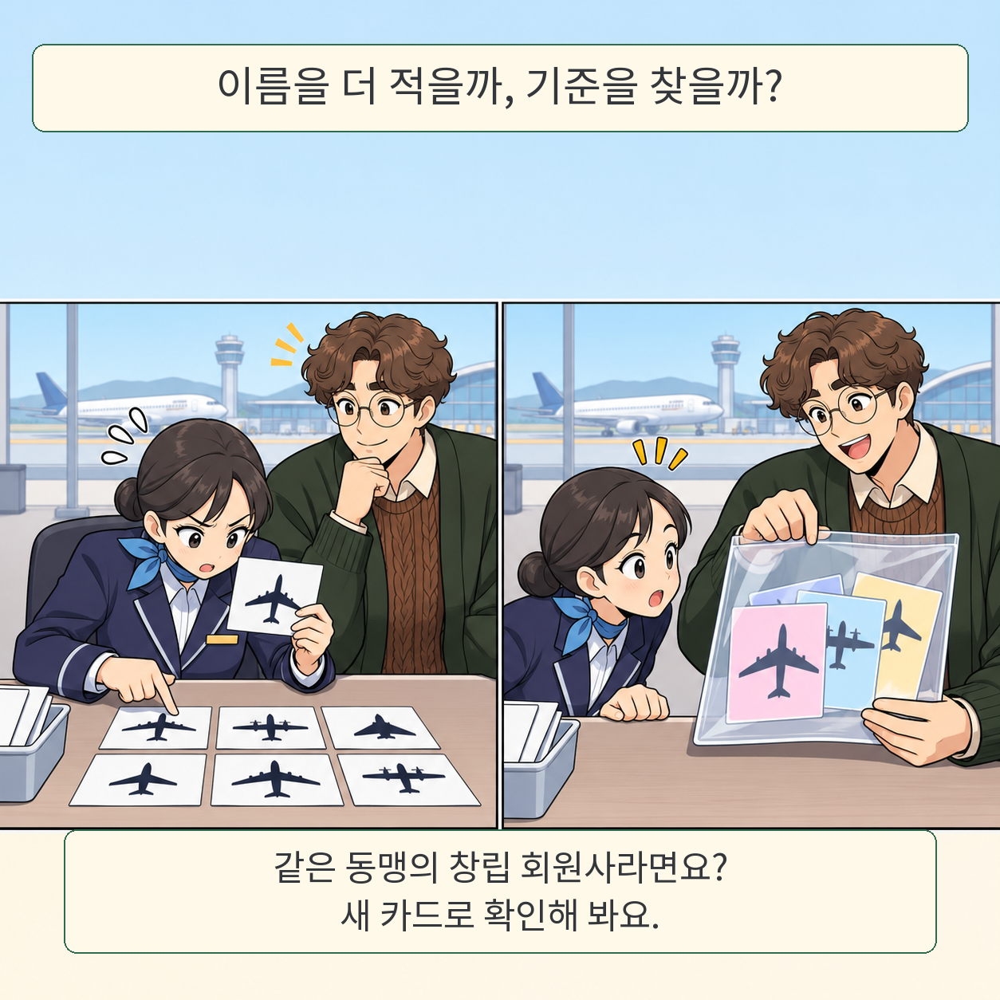

공항 창구에 항공사 카드가 한 장 도착합니다. 직원에게는 어제 틀린 항공사 이름을 빠짐없이 적은 메모가 있습니다. 그런데 오늘 카드의 이름은 메모에 없습니다. 이제 필요한 건 더 긴 명단일까요, 명단에 이름이 올라가는 기준일까요?

글·해설: 다메카솔

## 정답을 고친 뒤, 다른 문제를 내다

이 장면은 CLR-Bench의 실험을 풀어 쓴 비유입니다. Chenjie Qiu와 동료들이 던진 질문은 단순합니다. AI 에이전트가 오답을 지적받아 메모를 다시 썼을 때, 그 메모가 다음 문제에도 쓸모가 있을까요?

논문 속 에이전트는 표에서 조건에 맞는 항목 수를 세야 합니다. 어느 항목을 빼야 하는지 알려 주는 표지는 낯선 이름으로 가려져 있습니다. 가령 그 표지가 실제로 가리키는 것은 특정 항공 동맹의 창립 회원사일 수 있습니다. 연습에서는 예시 외에 회원사 한 곳과 회원사가 아닌 곳 한 곳을 피드백으로 알려 줍니다. 시험에서는 보지 못한 회원사뿐 아니라 헷갈리기 쉬운 비회원사도 등장합니다. 전부 빼 버리는 요령으로는 풀 수 없습니다.

연구진은 10개 영역에서 과제 사슬 20개를 만들었습니다. 각 사슬은 네 단계이고, 다음 단계로 갈 때 앞 규칙을 유지한 채 새 규칙을 더합니다. 그룹 이름을 알려 주면 구성원을 알아보는지, 반대로 피드백 전부터 답을 짐작하지는 않는지도 따로 검사했습니다. 지식이 아예 없는 경우와 아는 지식을 새 단서에 연결하지 못한 경우를 가르기 위해서입니다.

## 95%와 8%는 서로 다른 질문의 답이다

기준 모델 GPT-6-Luna에서 피드백으로 전략 메모를 고치는 ACE는 연습 단계의 95%를 통과했습니다. 그러나 한 규칙만 따로 검사한 시험 셀을 해결한 비율은 8%였습니다. 두 수치의 분모가 다릅니다. 같은 시험에서 성적이 추락했다는 뜻이 아닙니다. 연습에서 방금 지적받은 이름을 추가하면 그 문제는 맞힐 수 있지만, 처음 보는 회원사를 가려내려면 그 이름들이 왜 한데 묶였는지 알아야 합니다.

## 모델을 바꾸자 비교 결과도 바뀌었다

저자들의 표 10에서 추가 힌트 없이 ACE를 썼을 때 평균 정확도는 GPT-6-Luna에서 52.5%, GPT-6-Sol에서 78.3%였습니다. 메모를 다시 쓰지 않고 연습 이력을 그대로 제공한 비교군은 각각 52.3%, 70.3%였습니다. Luna에서는 전략 메모와 원래 기록의 차이가 작았지만, Sol에서는 같은 방법으로 원래 기록보다 높은 점수를 냈습니다. 이 비교의 평균 정확도는 앞의 단일 규칙 셀 해결률과도 다른 지표입니다.

문제 난이도는 Luna를 기준으로 조정했습니다. 또 여기서 숨긴 규칙은 공개 자료에서 이름을 찾을 수 있는 그룹입니다. 이 결과만으로 낯선 회사의 암묵적인 업무 규칙까지 같은 방식으로 배운다고 말할 수는 없습니다.

**다메카솔의 해석:** 고객 문의를 분류하는 AI를 고쳤다면 어제 틀린 문의, 표현만 다른 새 문의, 비슷하지만 다른 부서로 가야 하는 문의를 따로 내 보겠습니다. 첫 번째만 맞히면 오답 수정에는 성공했습니다. 뒤의 두 건까지 맞혀야 다음 고객에게도 쓸 만한 기준을 얻었다고 볼 근거가 생깁니다.

## 출처

- [논문 v1과 제출 이력](https://arxiv.org/abs/2610.40758v1), Chenjie Qiu 외, 2026-10-29 제출.
- [실험 설계와 결과 원문](https://arxiv.org/html/2610.40758v1), §3–7 및 부록 표 10.
- [저자의 코드와 데이터](https://github.com/yausankit/clr-bench). 2026-11-03 확인. 위 수치는 저자가 보고한 결과이며 이 글에서 실험을 다시 실행하지 않았습니다.

이 글의 본문과 이미지는 생성형 AI로 제작했습니다. 기획과 편집 기준은 다메카솔이 정했습니다.
