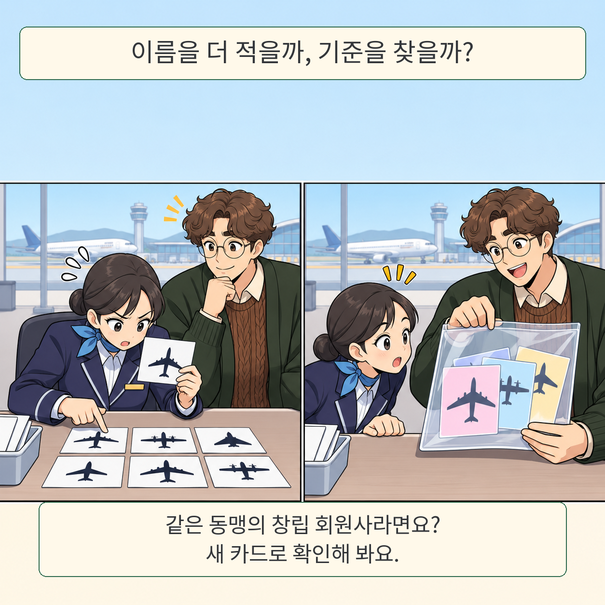

AI 에이전트가 오답 피드백을 받아 전략 메모를 고쳐 썼다면, 그다음에는 처음 보는 사례도 제대로 분류할 수 있을까요? 어제 틀렸던 항목을 메모에 적어 두면 당장 같은 문제는 맞히지만, 숨겨진 기준 자체를 배웠는지는 별개의 문제거든요. 피드백 기반 자가 개선 에이전트를 시험하는 벤치마크 **CLR-Bench**는 에이전트가 예외 목록을 외우는 데 그치는지, 아니면 분류 규칙을 일반화하는지 실험으로 가려냅니다.

글·해설: 다메카솔

## 예외 목록이 아니라 숨은 기준을 찾는 시험

Chenjie Qiu와 동료들이 던진 질문은 단순합니다. 에이전트가 오답을 지적받아 메모를 다시 썼을 때, 그 메모가 다음 문제에도 쓸모가 있느냐는 것입니다. 연구진은 이를 검증하려고 표에서 조건에 맞는 항목 수를 세는 과제를 설계했습니다.

여기서 핵심 장치는 어떤 항목을 빼야 하는지 알려 주는 표지가 낯선 이름으로 가려져 있다는 점입니다. 가령 그 표지가 실제로 가리키는 기준이 **특정 항공 동맹의 창립 회원사**라고 생각해 볼까요? 연습에서는 예시에 더해 회원사 한 곳과 회원사가 아닌 곳 한 곳을 피드백으로 알려 주지만, 시험에서는 보지 못한 회원사뿐 아니라 헷갈리기 쉬운 비회원사까지 함께 나와 전부 빼 버리는 요령으로는 풀기 어렵습니다.

연구진은 이 과제를 **10개 영역의 과제 사슬 20개**로 구성해 커리큘럼을 짰습니다. 각 사슬은 네 단계로 이루어지며, 다음 단계로 넘어갈 때마다 앞 규칙을 유지한 채 새 규칙을 하나씩 더합니다. 단계가 쌓여 규칙이 늘어날수록 에이전트가 예외 명단만 길게 적는지, 아니면 숨은 기준을 뽑아내는지 추적하려는 설계입니다.

여기에 더해 연구진은 두 가지 통제 검사도 따로 돌렸습니다. 그룹 이름을 직접 알려 주었을 때 구성원을 알아보는지, 반대로 피드백 전부터 답을 짐작하지는 않는지 확인한 것입니다. 덕분에 지식이 아예 없는 경우와 아는 지식을 새 단서에 연결하지 못해 일반화에 실패한 경우를 깔끔하게 구분할 수 있습니다.

## 95%와 8%는 서로 다른 질문의 답이다

기준 모델 `GPT-6-Luna`에서 피드백으로 전략 메모를 고치는 **ACE** 방식을 적용하면 겉보기에 크게 엇갈리는 두 수치가 나타납니다. 연습 단계 통과율은 **95%**에 달했는데, 한 규칙만 따로 검사한 단일 규칙 시험 셀 해결률은 **8%**에 그쳤거든요.

그렇다고 같은 시험 세트를 풀다가 성적이 갑자기 추락한 상황으로 해석하면 곤란합니다. 애초에 두 수치는 **분모와 평가 질문이 다른 지표**를 잰 결과이기 때문이죠. 연습에서는 방금 지적받은 항공사 이름만 메모에 추가해도 해당 문제를 맞힐 수 있지만, 처음 보는 회원사를 가려내려면 그 이름들이 왜 한데 묶였는지 기준을 알아야 합니다.

| 평가 지표 (논문 근거) | 평가 모델 | 비교 조건 | 보고된 결과 | 확인하려는 질문 |
| --- | --- | --- | --- | --- |
| **연습 단계 통과율** (§7.2.3) | GPT-6-Luna | 피드백으로 전략 메모를 고치는 ACE | `95%` | 지적받은 오답을 메모에 반영해 통과하는가 |
| **단일 규칙 시험 셀 해결률** (§7.2.3) | GPT-6-Luna | ACE (한 규칙만 따로 검사) | `8%` | 보지 못한 구성원과 헷갈리는 비구성원을 가리는가 |
| **평균 정확도** (부록 표 10) | GPT-6-Luna | 추가 힌트 없는 ACE vs 연습 이력 그대로 제공 | `52.5%` vs `52.3%` | 기준 모델에서 메모 재작성이 단순 이력보다 나은가 |
| **평균 정확도** (부록 표 10) | GPT-6-Sol | 추가 힌트 없는 ACE vs 연습 이력 그대로 제공 | `78.3%` vs `70.3%` | 모델을 바꾸었을 때도 메모 재작성의 이점이 나타나는가 |

## 모델을 바꾸면 메모 활용 효과도 달라진다

저자들의 부록 표 10을 보면 기반 모델에 따라 전략 메모 방식의 효용이 갈리는 양상이 뚜렷해집니다. 추가 힌트 없이 ACE를 썼을 때 `GPT-6-Luna`의 평균 정확도는 `52.5%`로, 메모를 다시 쓰지 않고 연습 이력을 그대로 제공한 비교군(`52.3%`)과 차이가 미미했습니다.

반면 같은 방법을 `GPT-6-Sol`에 적용하자 ACE가 `78.3%`를 기록해, 원래 연습 이력을 그대로 둔 비교군(`70.3%`)보다 높은 점수를 냈습니다. 다만 이 평균 정확도는 앞의 단일 규칙 셀 해결률과도 다른 지표여서, 두 숫자의 크기를 같은 척도 위에서 나란히 견주기는 어렵습니다.

실험 결과를 해석할 때 함께 확인해야 할 조건도 두 가지 있습니다. 문제 난이도는 `GPT-6-Luna`를 기준으로 조정했고, 과제에서 숨긴 규칙 역시 공개 자료에서 구성원 이름을 찾을 수 있는 그룹에 속합니다. 따라서 공개된 범주에서 높은 점수를 얻었더라도, 낯선 회사의 암묵적인 업무 규칙까지 같은 방식으로 배운다고 결론짓기는 어렵습니다.

## 다메카솔의 해석

피드백 기능을 갖춘 에이전트를 평가할 때는 **"어제 틀린 문제를 오늘 맞혔는가"** 하나만 보고 넘기기 쉽습니다. 하지만 CLR-Bench가 드러내듯, 예외 이름을 덧붙이는 요령과 분류 기준을 익히는 일반화는 서로 다른 축에서 움직이거든요.

예를 들어 고객 문의를 분류하는 AI를 고쳤다면, 검증 데이터를 적어도 다음 세 갈래로 나누어 따로 내 보는 편이 안전합니다.

- **어제 틀린 문의**: 피드백을 반영한 뒤 같은 실수가 재발하지 않는지 오답 수정 여부를 점검합니다.
- **표현만 다른 새 문의**: 어제 고친 표현과 달리 쓰였더라도 같은 분류 기준에 속하는 새 문의를 맞히는지 봅니다.
- **비슷하지만 다른 부서로 가야 하는 문의**: 겉보기만 비슷한 경계 사례까지 전부 제외해 버리는 거친 요령을 피하는지 확인합니다.

첫 번째 문의만 맞혔다면 오답 수정에 성공한 셈이고, 뒤의 두 건까지 맞혀야 비로소 다음 고객에게도 쓸 만한 기준을 얻었다고 볼 근거가 생깁니다. 에이전트의 피드백 기억을 점검할 때는 메모가 얼마나 길어졌는지가 아니라, 보지 못한 사례와 경계 사례를 얼마나 일관되게 갈라내는지를 중심에 두어야 하는 셈이죠.

## 출처

- Chenjie Qiu 외, [More Rules, Longer Lists? Benchmarking Self-Evolving Agents on a Hidden-Rule Curriculum (arXiv:2610.40758v1)](https://arxiv.org/abs/2610.40758v1), 2026-10-29 제출.
- [실험 설계와 결과 원문(HTML)](https://arxiv.org/html/2610.40758v1), §3–7 및 부록 표 10.
- [CLR-Bench 공식 코드와 데이터(GitHub)](https://github.com/yausankit/clr-bench), 2026-11-03 확인.

이 글은 논문 원문과 공개 저장소를 바탕으로 정리했으며 별도 실험 재현은 수행하지 않았고, 만화는 원문 그림을 복제하지 않고 개념을 새로 구성했습니다.
이 글의 본문과 이미지는 생성형 AI로 제작했습니다. 기획과 편집 기준은 다메카솔이 정했습니다.
