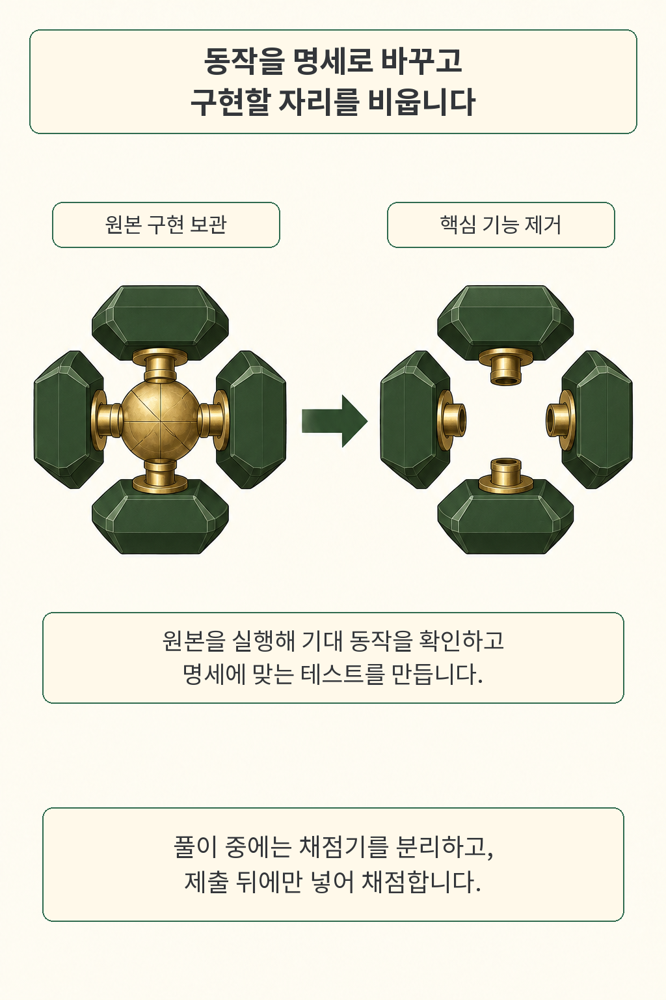
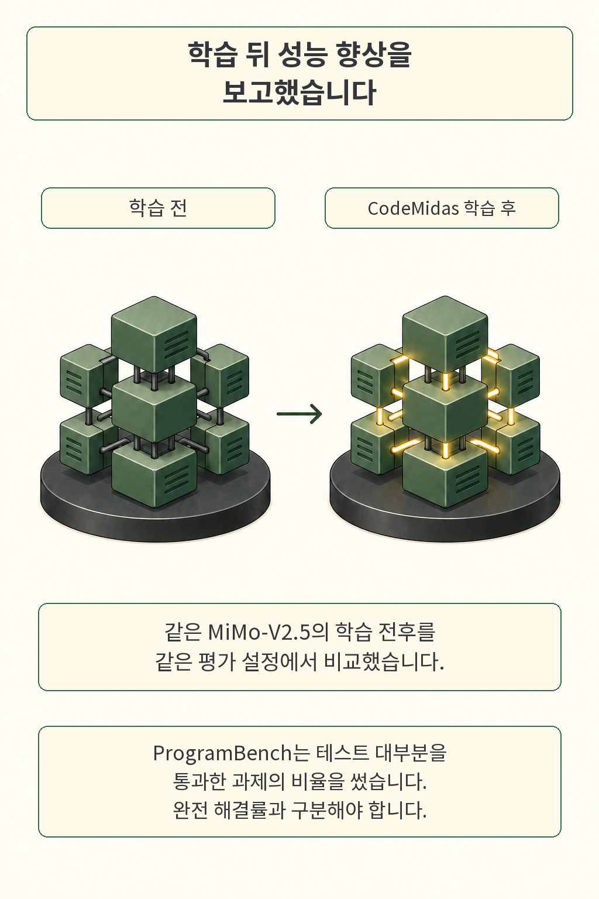

잘 돌아가는 오픈소스 코드에서 핵심 함수 하나만 비워 두면 코딩 AI의 좋은 연습문제가 될 것 같지만, 막상 학습에 쓰려면 의외의 함정이 기다립니다. 올바르게 짠 다른 구현을 테스트가 탈락시키거나, 에이전트가 빌드 캐시에 남은 정답 사본을 베껴 통과하면 강화학습 보상 신호부터 어긋나기 때문이죠. **CodeMidas는 실제 코드베이스를 학습 문제로 바꿀 때 문제 생성과 채점 타당성, 환경 유출 검증을 한 파이프라인으로 묶은 연구입니다.**

글·해설: 다메카솔

## 핵심 내용

- **외부 관측 명세 중심 설계**: 공개 진입점과 의존 관계를 바탕으로 명세를 쓰고 핵심 구현을 비우되, 명세 밖 내부 구현까지 테스트가 강제하지 않도록 분리합니다.
- **다단계 환경·채점 필터링**: 새 컨테이너에서 시작 코드 2회 실패와 원본 4회 통과를 확인하고, 빌드 산출물·캐시 유출과 채점 불일치를 걸러 냅니다.
- **MiMo-V2.5 강화학습 효과**: 3,185개 저장소에서 정제한 5,545문제(23개 언어·15개 분야)로 학습해 SWE-bench Pro(+4.1%p), DeepSWE v1.1(+11.7%p), ProgramBench Almost Solved(+17.0%p), RepoZero C2Rust(+11.3%p), Terminal-Bench v2.1(+8.5%p) 점수가 올랐습니다.

## 코드에서 무엇을 문제로 만들까

코드를 덜어 내기 전에 먼저 정할 기준은 외부에서 관측할 동작 계약입니다. 연구팀은 저장소의 공개 진입점(API)과 의존 관계를 분석해 문제 명세를 작성한 뒤, 핵심 구현만 제거한 시작 환경을 구성합니다. 보관한 원본 코드는 기대 동작을 확인하는 데 쓰고, 채점 테스트는 풀이 환경 밖에 두었다가 제출 뒤에만 넣어 성공·실패 보상을 돌려주도록 설계했죠. ([원문 3절](https://arxiv.org/html/2609.22068v1#S3))

여기서 가장 신경 써야 할 대목은 **명세와 구현의 경계**입니다. 예를 들어 요구사항에는 특정 예외를 던져야 한다고만 적혀 있는데, 채점 테스트가 원본 코드의 에러 문구나 내부 구조까지 똑같이 요구하면 어떻게 될까요? 명세를 충실히 지킨 다른 올바른 구현도 오답 처리되어 에이전트가 엉뚱한 감점을 받게 됩니다. CodeMidas가 생성된 테스트에서 명세 밖의 과도한 제약을 걸러 내는 검토 단계를 둔 이유입니다.

## 정답이 새거나 채점이 틀린 문제를 거른다

문제 설명과 테스트를 만들었다고 해서 곧바로 강화학습에 넣기에는 위험이 남아 있습니다. 저자들은 치팅 경로와 불량 문제를 걸러 내기 위해 다음 네 가지 기준으로 문제를 정제합니다. ([3.3~3.4절](https://arxiv.org/html/2609.22068v1#S3.SS3))

1. **실행 일관성 검증**: 새 컨테이너에서 시작 코드는 2회 모두 실패하고, 보관한 원본 구현은 4회 모두 통과해야 합니다.
2. **정답 유출 차단**: 컴파일 산출물, 캐시 디렉터리, 패키지 설치 경로 등에 원본 정답 사본이 남아 있지 않은지 검사합니다.
3. **채점 정합성 검토**: 제출 코드에 대한 별도 검토 판정과 테스트 실행 결과가 서로 어긋나는 문제를 제외합니다.
4. **난이도 선별**: 선별용 모델의 정해진 시도 예산에서 성공과 실패가 함께 나오는 문제만 남겨 유효한 학습 신호를 확보합니다.

이 네 단계는 단순히 문제 수를 줄이는 작업이 아니라 학습 신호의 순도를 지키는 안전장치인 셈입니다. 가령 작업 환경에 이전 컴파일 산출물이 남아 있다면 에이전트는 코딩 실력이 아니라 파일 탐색으로 점수를 따게 되거든요. 반대로 한 모델이 예산 안에서 모두 성공하거나 모두 실패하는 문제는 난이도나 결함 탓에 비교 신호를 얻기 어려워 걸러 내는 편이 낫습니다.

## 같은 모델의 학습 전후를 비교했다

이렇게 정제한 문제가 실제로 에이전트 성능을 끌어올리는지 확인하기 위해, 연구팀은 **MiMo-V2.5** 모델의 강화학습 전후를 같은 평가 설정에서 비교했습니다. 학습 데이터와 실험 조건은 아래 세 가지로 정리됩니다. ([4절·그림 5](https://arxiv.org/html/2609.22068v1#S4))

- **학습 풀 규모**: 3,185개 코드베이스에서 선별한 5,545문제 (23개 언어·15개 기술 분야)
- **중복 제거와 학습**: 공식 평가셋과 겹치는 과제를 제거한 뒤 GRPO 방식으로 강화학습 수행
- **외부 평가 조건**: SWE-bench Pro 등 5개 공식 벤치마크에서 학습 전후를 동일 조건으로 비교

| 외부 벤치마크 | 학습 전 | 학습 후 | 변화폭 (%p) | 지표 기준 |
| --- | ---: | ---: | ---: | --- |
| SWE-bench Pro | 50.3% | **54.4%** | +4.1%p | Pass rate |
| DeepSWE v1.1 | 10.0% | **21.7%** | +11.7%p | Pass rate |
| ProgramBench | 4.5% | **21.5%** | +17.0%p | **Almost Solved** (테스트 95% 이상 통과 비율) |
| RepoZero C2Rust | 40.5% | **51.8%** | +11.3%p | Pass rate |
| Terminal-Bench v2.1 | 63.7% | **72.2%** | +8.5%p | Pass rate |

다섯 개 벤치마크 점수가 모두 상승했지만, 지표를 읽을 때는 ProgramBench의 기준을 구분해야 합니다. 여기에는 완전 통과율이 아니라 **전체 테스트의 95% 이상을 통과한 과제 비율(Almost Solved)**이 적용됐거든요. 나머지 네 개 벤치마크의 pass rate와는 측정 기준이 다르니 수치를 나란히 비교할 때 이 차이를 먼저 짚어 두어야 합니다.

한편 5.1절의 정제 비교 실험에서도 문제의 양보다 질이 중요하다는 결과가 확인됐습니다.

- **정제 전후 비교**: 같은 설정에서 정제 전 약 8,000문제를 모두 학습할 때보다, 정제 후 3,000문제만 썼을 때 SWE-bench Pro·DeepSWE·CodeMidas Val 세 평가 모두 더 높은 점수를 얻었습니다.
- **적용 범위**: 여러 필터가 함께 적용돼 개별 검사 하나의 기여도를 분리해 보기는 어렵고, 단일 모델(MiMo-V2.5) 기준이라 다른 기반 모델이나 실무 생산성으로 효과를 그대로 일반화하기는 이릅니다.

## 다메카솔의 해석: 채점도 검증 대상입니다

사내 에이전트 평가나 학습 파이프라인을 설계할 때 이 연구가 주는 핵심 교훈은 **채점 테스트 자체도 검증 대상**이라는 점입니다. 생성 중인 코드에 컴파일러 피드백을 붙이는 [Generative Compilation 연구](https://blog.damecasol.com/posts/generative-compilation/)가 실행 시점의 검사를 다뤘다면, CodeMidas는 무엇을 정답으로 보상할지 정하는 시험지 제작 과정을 다룬 셈이죠.

기존 코드베이스를 연습문제로 바꿀 때 흔히 빠지기 쉬운 함정은 원본 코드의 실행 결과를 무조건 정답 기준(오라클)으로 고정하는 방식인데요. 이렇게 두면 원본 코드에 숨어 있던 버그나 불필요한 부작용까지 AI가 똑같이 따라 해야 점수를 받는 왜곡이 생길 수 있습니다. 사내 평가 환경을 구축할 때는 다음 세 가지 점검을 함께 묶어 두기를 권합니다.

- **명세·원본·테스트 대조**: 요구 명세와 원본 코드, 채점 테스트 사이에 서로 어긋나는 조건이 없는지 먼저 확인합니다.
- **다각도 채점기 점검**: 정답 구현의 통과뿐 아니라 다른 올바른 구현의 수용, 잘못된 구현의 거절, 정답 사본 노출 여부를 함께 검사합니다.
- **실패 로그 분리 보관**: 환경 구축 실패와 에이전트의 코드 풀이 실패를 따로 기록해야 원인 분석이 선명해집니다.

## 출처

- Bowen Ye 외, [CodeMidas 원문과 버전 정보](https://arxiv.org/abs/2609.22068v1), 2026년 9월 18일 제출된 v1 프리프린트.
- [원문 PDF](https://arxiv.org/pdf/2609.22068v1): 방법 3절, 평가 4절, 정제 비교 5.1절, 학습 설정 부록 A.
- [저자 연결 프로젝트 URL](https://mimo.xiaomi.com/rl/): 2026년 9월 21일 확인 시 MiMo-v2.6 RL 대시보드가 표시됐으며, CodeMidas 전용 코드·데이터셋 공개는 확인되지 않았습니다.

출처 확인·작성: 2026년 9월 21일.

이 글은 논문 원문을 바탕으로 해설했으며, 별도의 학습·평가 재현은 수행하지 않았습니다.

이 글의 본문과 이미지는 생성형 AI로 제작했습니다. 기획과 편집 기준은 다메카솔이 정했습니다.
