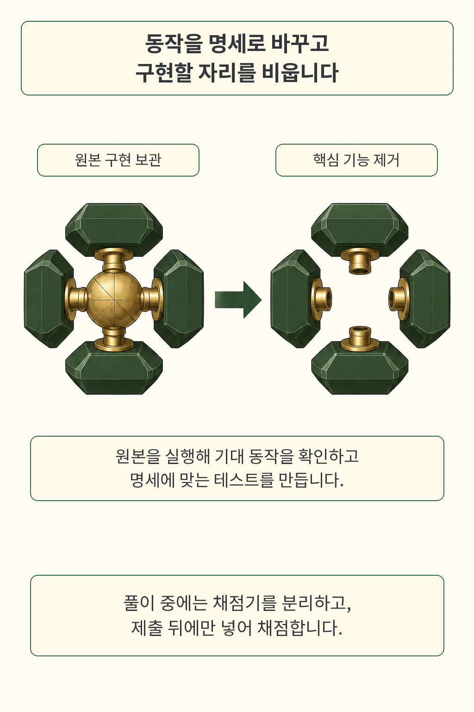
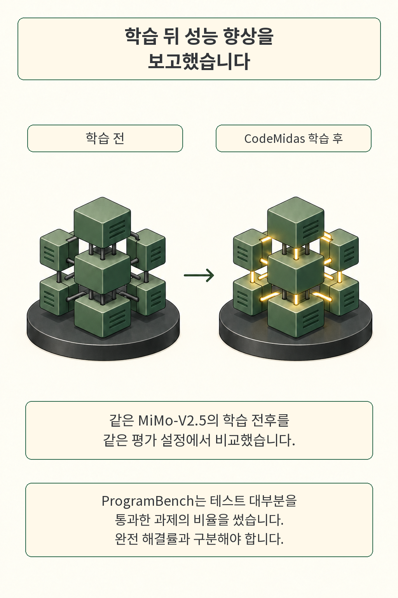

잘 돌아가는 오픈소스 코드에서 핵심 함수 하나를 비워 두면 코딩 AI의 좋은 연습문제가 될 것 같습니다. 원본 구현이라는 모범 답안도 이미 있으니까요. 그런데 다른 방식으로 올바르게 구현한 코드를 채점 테스트가 탈락시키거나, 에이전트가 빌드 캐시에 남아 있던 정답 바이너리를 베껴 통과한다면 강화학습 보상 신호부터 어긋납니다. **CodeMidas는 실제 코드베이스에서 학습 문제를 만들 때 채점 타당성과 환경 유출 검증까지 한 파이프라인으로 묶은 연구입니다.**

글·해설: 다메카솔

## 핵심 내용

- **외부 관측 명세 중심의 문제 구성**: 기존 코드의 공개 진입점과 의존 관계를 바탕으로 요구 명세를 작성하고 핵심 구현을 비운 시작 환경을 만들되, 명세에 없는 내부 구현 세부사항을 강제하지 않도록 테스트를 구성합니다.
- **다단계 환경·채점 필터링**: 새 컨테이너에서 시작 코드는 2회 모두 실패하고 원본 구현은 4회 모두 성공하는지 확인하며, 빌드 산출물·캐시·설치 경로의 정답 유출과 채점기 판정 불일치를 걸러 냅니다.
- **MiMo-V2.5 강화학습 효과**: 3,185개 저장소에서 정제한 5,545문제(23개 언어·15개 기술 분야)로 MiMo-V2.5를 강화학습한 결과, SWE-bench Pro(+4.1%p), DeepSWE v1.1(+11.7%p), ProgramBench Almost Solved(+17.0%p), RepoZero C2Rust(+11.3%p), Terminal-Bench v2.1(+8.5%p)에서 학습 전보다 점수가 올랐습니다.

## 코드에서 무엇을 문제로 만들까

구현 코드를 덜어 내기 전에 외부에서 관측할 동작 계약부터 정해야 합니다. 연구팀은 저장소의 공개 진입점(API)과 의존 관계를 분석해 문제 명세를 작성하고, 핵심 구현을 제거한 시작 환경을 만듭니다. 원본 코드는 따로 보관해 기대 동작을 확인하는 데 쓰며, 에이전트가 문제를 푸는 동안 채점 테스트는 환경 바깥에 두었다가 제출 후에만 실행합니다. ([원문 3절](https://arxiv.org/html/2609.22068v1#S3))

여기서 가장 신경 써야 할 부분은 **명세와 구현의 경계**입니다. 예를 들어 요구사항에는 특정 예외를 던져야 한다고만 적혀 있는데 채점 테스트가 원본 코드의 토씨 하나까지 같은 에러 메시지를 요구한다면, 명세를 충실히 지킨 다른 구현도 오답 처리됩니다. CodeMidas가 생성된 테스트에서 명세 밖의 과도한 제약을 걸러 내는 단계를 둔 이유입니다.

## 정답이 새거나 채점이 틀린 문제를 거른다

문제 설명과 테스트가 준비됐다고 해서 바로 강화학습에 넣을 수는 없습니다. 저자들은 다음 네 가지 기준으로 문제를 정제합니다. ([3.3~3.4절](https://arxiv.org/html/2609.22068v1#S3.SS3))

1. **재현성 검증**: 깨끗한 컨테이너에서 비워 둔 시작 코드는 2회 실행 모두 실패하고, 보관해 둔 원본 구현은 4회 실행 모두 통과해야 합니다.
2. **정답 유출 차단**: 컴파일 산출물, 캐시 디렉터리, 패키지 설치 경로 등에 원본 정답 사본이 남아 있지 않은지 검사합니다.
3. **채점 정합성 검토**: 제출된 구현 코드에 대한 검토 판정과 테스트 실행 결과가 서로 어긋나는 문제를 제외합니다.
4. **난이도 선별**: 선별용 모델의 여러 풀이 시도에서 성공과 실패가 함께 나타나는(학습 신호가 있는) 문제를 남깁니다.

## 같은 모델의 학습 전후를 비교했다

연구팀은 3,185개 코드베이스에서 선별한 5,545문제(23개 프로그래밍 언어·15개 기술 분야, 공식 평가셋과의 중복 제거)로 **MiMo-V2.5** 모델을 강화학습하고, 동일한 평가 설정에서 학습 전후를 비교했습니다. ([4절·그림 5](https://arxiv.org/html/2609.22068v1#S4))

| 외부 벤치마크 | 학습 전 | 학습 후 | 변화폭 (%p) | 지표 기준 |
| --- | ---: | ---: | ---: | --- |
| SWE-bench Pro | 50.3% | **54.4%** | +4.1%p | Pass rate |
| DeepSWE v1.1 | 10.0% | **21.7%** | +11.7%p | Pass rate |
| ProgramBench | 4.5% | **21.5%** | +17.0%p | **Almost Solved** (테스트 95% 이상 통과 비율) |
| RepoZero C2Rust | 40.5% | **51.8%** | +11.3%p | Pass rate |
| Terminal-Bench v2.1 | 63.7% | **72.2%** | +8.5%p | Pass rate |

표에서 ProgramBench 항목은 100% 통과율이 아니라 **테스트의 95% 이상을 통과한 과제 비율(Almost Solved)**이라는 점을 구분해 읽어야 합니다. 또한 정제한 3,000문제만 사용한 학습이 정제 전 약 8,000문제를 모두 쓴 경우보다 3개 벤치마크에서 더 높은 점수를 기록해(5.1절), 문제 수 못지않게 채점·환경 정제가 중요함을 보여 주었습니다(여러 필터가 함께 적용된 비교라 개별 필터 하나의 기여도를 단독 분리한 수치는 아닙니다).

## 다메카솔의 해석: 채점도 검증 대상입니다

이 연구에서 사내 에이전트 평가나 학습 파이프라인으로 가져올 가장 중요한 교훈은 **채점 테스트 자체도 검증 대상**이라는 점입니다. 생성 중인 코드에 컴파일러 피드백을 붙이는 [Generative Compilation 연구](https://blog.damecasol.com/posts/generative-compilation/)가 실행 시점의 검사를 다뤘다면, CodeMidas는 무엇을 정답으로 보상할지 정하는 시험지 제작 과정을 다룹니다.

특히 원본 코드의 동작을 무조건 정답 기준으로 삼으면, 원본 코드에 숨어 있던 버그나 불필요한 부작용까지 AI가 똑같이 따라 해야 점수를 받는 왜곡이 생길 수 있습니다. 사내 벤치마크를 구축할 때도 **요구 명세·원본 코드·채점 테스트가 서로 충돌하는지** 확인하는 절차를 두고, 환경 구축 실패와 풀이 실패 로그를 분리해 보관하기를 권합니다.

## 출처

- Bowen Ye 외, [CodeMidas 원문과 버전 정보](https://arxiv.org/abs/2609.22068v1), 2026년 9월 18일 제출된 v1 프리프린트.
- [원문 PDF](https://arxiv.org/pdf/2609.22068v1): 방법 3절, 평가 4절, 정제 비교 5.1절, 학습 설정 부록 A.
- [저자 연결 프로젝트 URL](https://mimo.xiaomi.com/rl/): 2026년 9월 21일 확인 시 MiMo-v2.6 RL 대시보드가 표시됐으며, CodeMidas 전용 코드·데이터셋 공개는 확인되지 않아 학습·평가 재현은 수행하지 않았습니다.

출처 확인·작성: 2026년 9월 21일.

이 글의 본문과 이미지는 생성형 AI로 제작했습니다. 기획과 편집 기준은 다메카솔이 정했습니다.
