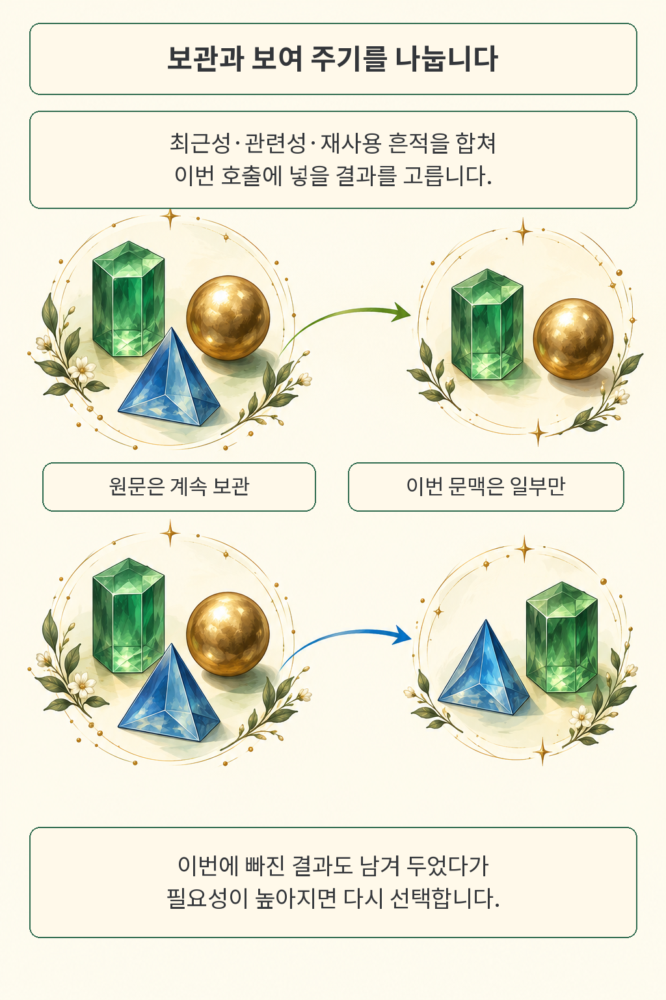

**AI 에이전트의 문맥을 줄일 때는 도구 결과를 따로 보관하고, 뒤의 작업에서 실제로 다시 쓰인 결과를 선택 후보로 남기는 방법이 있습니다.** ContextRender는 최근에 나온 정보와 현재 질문에 의미가 비슷한 정보에 더해, 실행 도중 실제로 반복 등장한 값의 흔적을 활용합니다. 방금 받은 긴 검색 결과보다 몇 단계 전에 조회해 둔 식별자 하나가 다음 도구 호출에 훨씬 중요할 수 있기 때문입니다.

*글·해설: 다메카솔*

확인·작성: 2026년 9월 30일

## 핵심 내용

- **재사용 흔적 추적(Tool-Flow Analysis, TFA)**: 대소문자를 구분하는 정확한 문자열 일치 규칙으로 앞선 도구 결과의 식별자나 경로가 뒤의 모델 출력·도구 호출에 다시 등장한 흔적을 영속 그래프에 연결합니다.
- **영속 보관소와 입력 선택의 분리**: 이력 예산(기본 6K 토큰) 안으로 모델 입력을 추릴 때 최근성·의미 유사도·재사용 점수를 함께 계산하며, 이번 호출에서 빠진 도구 결과도 저장소에 원문을 남겨 다음 호출에서 다시 선택할 수 있게 합니다.
- **전체 이력 대비 비용과 정확도**: 세 모델·세 벤치마크(AppWorld Normal 168·Challenge 417·8-objective QA 100과제) 9개 조합에서 전체 이력(Full history) 대비 표준화 추론 비용을 10.2~32.2% 낮췄고, 9개 중 7개 조합에서 동등 이상의 성능을 기록했습니다(GPT-4.1 Normal과 DeepSeek V4 Pro Challenge 두 조합은 Full history가 더 높음).

이번에 읽은 논문은 미시간대 Savini Kashmira, Jayanaka L. Dantanarayana, Lingjia Tang, Jason Mars가 공개한 **ContextRender: From Execution Dependencies to Agent Context**(2026년 9월 29일 제출 arXiv v1)입니다. 단순히 “이력을 얼마나 짧게 요약할까”를 넘어, **어떤 도구 결과를 원문 그대로 보관하고 그중 무엇을 이번 호출에 보여 줄 것인가**를 다룹니다.

## 앞선 결과가 다시 쓰였다는 흔적

고객을 조회하고 주문을 찾은 뒤 환불 단계로 넘어가는 다단계 작업을 생각해 보면, 중간 검색 결과가 길어졌다는 이유로 첫 고객 조회를 문맥에서 잘라 버리는 순간 마지막 환불 호출에 필요한 고객 번호(`C142XYZ`)도 함께 사라집니다. ContextRender의 **Tool-Flow Analysis(TFA)**는 이후 모델 출력이나 다른 도구 호출에서 같은 값이 다시 등장했을 때, 그 값을 처음 담고 있던 도구 결과에 재사용 점수를 더해 줍니다.

이 과정은 의미가 비슷한 문장을 찾는 임베딩 검색이 아니라 **대소문자를 구별하는 정확한 문자열 일치 규칙**을 따릅니다(원문 부록 A.2). 구분자로 토큰 후보를 나눈 뒤 6자 이상이면서 대문자·숫자·밑줄·하이픈·마침표 조건을 만족하는 식별자나 슬래시(`/`)로 나뉜 경로 조각을 검사하며, 첫 글자만 대문자인 일반 영단어는 제외하고 여러 도구 결과에 흔하게 등장하는 값은 등장 결과 수의 역수로 가중치를 낮춥니다.

물론 이 규칙은 문자열의 재등장을 관찰할 뿐 값의 인과적 원산지를 완벽히 증명하지는 못합니다(처음부터 사용자 메시지에 있던 값이 도구 결과에 찍힌 뒤 다시 쓰여도 첫 도구 결과에 귀속될 수 있습니다). 다만 결과 안의 핵심 식별자 하나가 재사용되면 그 도구 결과 블록 전체의 선택 점수가 올라가므로, 같은 결과 안에 묶여 있던 주변 맥락을 함께 살려 두는 효과를 냅니다.

## 이번에 안 보여 줘도 원문은 남습니다

영속 보관소와 매 턴의 모델 입력창을 분리하면, 이번 호출에서 제외된 도구 결과도 다음 호출에서 다시 꺼내 쓸 수 있습니다. ContextRender는 메시지, 도구 호출, 결과 원문과 재사용 관계를 영속 그래프에 저장해 두고, 매 모델 호출 전에 **최근성, 현재 작업과의 의미 유사도, 이후 실행에서의 재사용 빈도** 세 신호를 합산합니다.

선택기는 이미 고른 결과와 지나치게 중복되는 항목의 점수를 깎으면서 과거 실행 이력 예산(기본 실험 기준 **6K 토큰**, 시스템 프롬프트와 현재 사용자 메시지는 별도) 안에 들어갈 결과들을 고른 뒤, 실제 모델 입력에는 원래의 시간 순서대로 배치합니다(단일 결과가 예산보다 클 때만 압축본을 쓰는 예외 경로가 있으나 평가 실행에서는 관찰되지 않았습니다). 물리적인 샌드박스 메모리 스냅샷을 줄이는 [AgentZip 연구](/posts/agentzip-sandbox-memory/)와 달리, 모델에게 보여 줄 실행 이력을 매 턴 동적으로 구성하는 방식입니다.

## 무엇을 얼마만큼 비교했나

저자들은 GPT-4.1, Muse Glimmer 30B, DeepSeek V4 Pro 세 모델로 AppWorld의 Test-Normal(168과제, 목표 통과율 TGC), Test-Challenge(417과제, TGC), 8-objective QA(100과제, 답변 토큰 F1)를 각 1회씩(temperature 0, top-p 1, seed 42) 평가했습니다. 원문 표 6의 **GPT-4.1 기준 전체 이력(Full history) 대비 ContextRender** 결과는 아래와 같습니다.

| 과제 묶음 (문항 수) | Full history 성능 | ContextRender 성능 | Full history 평균 비용 | ContextRender 평균 비용 |
| --- | ---: | ---: | ---: | ---: |
| AppWorld Normal (168개) | **77.4%** (TGC) | 75.6% (TGC) | $0.177 | **$0.120** |
| AppWorld Challenge (417개) | 51.1% (TGC) | **55.4%** (TGC) | $0.302 | **$0.215** |
| 8-objective QA (100개) | 50.8% (F1) | **53.1%** (F1) | $0.167 | **$0.150** |

*원문 표 6 요약. 비용 단위는 표준화 단가(입력 $2·캐시 입력 $0.5·출력 $8·임베딩 $0.13 / 100만 토큰)를 적용한 reference USD이며, Full history에서 이력이 6K를 넘긴 과제 집합을 대상으로 계산한 값입니다.*

Normal에서는 평균 비용이 줄어든 대신 TGC가 1.8%p 낮아졌고, 더 복잡한 Challenge와 QA에서는 비용을 줄이면서 점수도 함께 올랐습니다(다른 예산형 기법과 비교할 때도 득실이 갈리는데, 예컨대 DeepSeek V4 Pro의 Challenge에서는 의미 검색 대비 TGC가 상대적으로 13.6% 높았지만 비용도 11.7% 더 들었습니다).

## 비용과 재사용 지표가 말해 주는 범위

결과표를 읽을 때 함께 확인해야 할 조건은 세 가지입니다.

- **성능 분모와 비용 분모의 차이**: 성능(TGC·F1)은 전체 평가 과제를 분모로 계산했지만, 평균 비용은 Full history 실행에서 이력이 6K 토큰을 넘겨 실제로 문맥 관리가 필요했던 고정 과제 집합(성공·실패 포함)만을 대상으로 환산했습니다. 또한 그래프 저장 비용이나 로컬 선택 연산은 제외한 토큰 단가 환산치입니다.
- **재사용 신호 추가 효과와 원문 가용성**: GPT-4.1(6K 예산)에서 최근성·관련성만 쓴 선택기에 재사용 신호(TFA)를 더하자 Normal TGC(72.6% → 75.6%)와 QA F1(50.8% → 53.1%)이 올랐고, 나중에 다시 쓰인 결과 원문이 입력 문맥에 남아 있던 비율도 AppWorld **61.6% → 87.2%**, QA **76.1% → 91.0%**로 상승했습니다(Full history 고정 궤적 위에서 대화 최초 등장 위치가 도구 결과인 값들을 기준으로 측정한 지표입니다).
- **런타임 통합 수준과 공개 범위**: 논문은 5개 런타임 연결을 언급하지만 opencode는 통합만, OpenClaw는 간단 점검, Meta ARE는 통합 확인 수준이며 주 평가는 AppWorld와 ACON 에이전트에서 수행됐습니다. 2026년 9월 30일 기준 공식 코드·데이터 저장소는 공개 확인되지 않았습니다(연구실 프로젝트 페이지는 403 제한).

## 다메카솔의 해석: 선택 이유가 남는 문맥 관리

이 방식을 실제 에이전트 서비스에 적용할지 검토한다면, 먼저 **우리 도구의 반환값에서 고객 ID나 주문 번호 같은 정형 식별자가 얼마나 자주 그대로 재사용되는지**부터 확인하겠습니다. 정형 식별자가 이어지는 업무에서는 정확한 문자열 일치 규칙이 잘 작동하지만, 앞선 결과를 자연어로 풀어서 다시 언급하는 업무에서는 문자열 일치만으로는 재사용 흔적을 잡기 어렵기 때문입니다.

또한 운영 로그에는 저장소에 무엇을 남겼는지뿐 아니라 **매 모델 호출마다 어떤 도구 결과가 선택됐고 어떤 점수로 탈락했는지**를 함께 기록해야 장애 원인을 복기할 수 있습니다. [조사 단계까지 맞춰 장애 기록을 검색하는 RAFT](/posts/raft-stateful-troubleshooting/)가 검색 시점의 조사 상태를 강조했다면, ContextRender는 앞선 도구 결과가 실행 흐름 속에서 어떻게 다시 참조됐는지를 문맥 선택의 근거로 삼게 해 줍니다.

## 출처

- [ContextRender arXiv v1 및 서지 정보](https://arxiv.org/abs/2609.37743v1): 제출 2026-09-29 14:57 UTC, 확인 2026-09-30.
- [원문 PDF v1](https://arxiv.org/pdf/2609.37743v1) 및 [원문 HTML v1](https://arxiv.org/html/2609.37743v1): 방법 §3, 실험 §4, 표 1·2·6~9, 부록 A~D 대조(공개 코드·데이터 미확보로 실험 재현은 미수행).

이 글의 본문과 이미지는 생성형 AI로 제작했습니다. 기획과 편집 기준은 다메카솔이 정했습니다.
