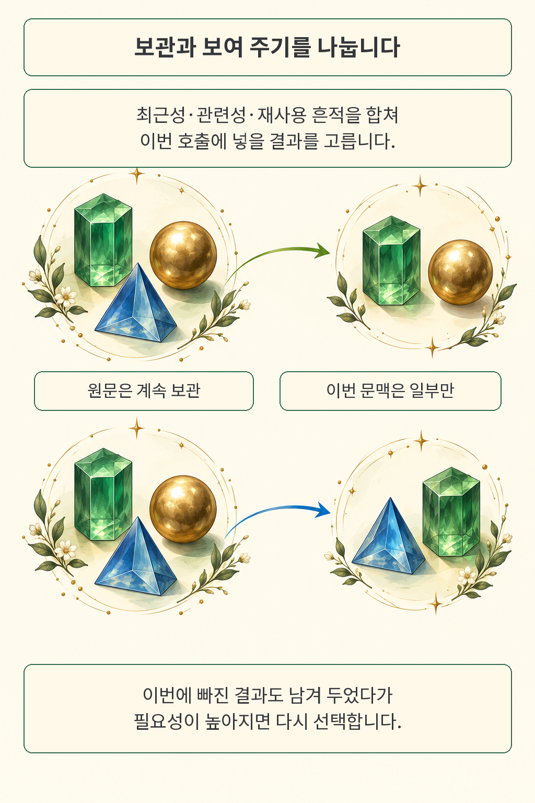

에이전트 작업이 길어지면 방금 받은 긴 검색 결과 때문에 몇 단계 전에 조회해 둔 고객 번호가 문맥에서 밀려나곤 합니다. 마지막 결제나 환불 호출에서 필요한 값을 놓쳐 작업이 꼬이는 경우가 적지 않죠. **ContextRender**는 최근성이나 의미 유사도뿐 아니라, 실행 도중 실제로 다시 쓰인 값의 흔적을 추적해 꼭 필요한 도구 결과를 문맥에 되살려 놓습니다.

글·해설: 다메카솔

## 핵심 내용

- **재사용 흔적 추적(TFA)**: 대소문자를 구분하는 정확한 문자열 일치로 앞선 도구 결과의 식별자·경로가 뒤의 출력이나 호출에 다시 쓰인 흔적을 그래프에 연결합니다.
- **영속 보관소와 입력 선택의 분리**: 기본 6K 토큰 이력 예산 안에서 최근성·유사도·재사용 점수로 문맥을 고르며, 빠진 결과도 저장소에 원문을 남겨 다음 턴에 다시 선택할 수 있습니다.
- **비용·성능 트레이드오프**: 미시간대 연구진(Savini Kashmira 외, arXiv v1, 2026-09-29)의 실험에서 9개 모델·과제 조합의 추론 비용을 10.2~32.2% 낮추고 7개 조합에서 동등 이상의 성능을 냈습니다.

## 앞선 결과가 다시 쓰였다는 흔적

예를 들어 고객을 조회해 주문을 찾고 환불까지 처리하는 다단계 작업을 떠올려 보겠습니다. 중간 검색 결과가 길어졌다고 첫 고객 조회를 잘라 내면, 마지막 환불에 필요한 고객 번호(`C142XYZ`)도 함께 사라지고 맙니다. ContextRender의 **Tool-Flow Analysis(TFA)**는 이후 모델 출력이나 다른 도구 호출에서 같은 값이 다시 등장할 때, 그 값을 처음 담고 있던 도구 결과에 재사용 점수를 더해 줍니다.

이 추적은 임베딩 검색이 아니라 **대소문자를 구별하는 정확한 문자열 일치 규칙**을 따릅니다. 구분자로 값을 나눈 뒤 6자 이상이면서 대문자·숫자·밑줄(`_`)·하이픈(`-`)·마침표(`.`)를 포함한 식별자나 슬래시(`/`) 경로 조각을 검사하죠. 이때 첫 글자만 대문자인 일반 영단어는 제외하고, 여러 결과에 흔한 공통 값은 등장 수의 역수로 가중치를 낮춘 뒤 최초로 값을 담은 도구 결과에 귀속합니다.

물론 문자열 재등장만으로 인과적 출처를 완벽히 증명하기는 어렵습니다. 사용자 메시지에 있던 값이 도구 결과에 찍힌 뒤 다시 쓰여도 첫 도구 결과로 연결될 수 있고, 다른 말로 풀어쓴 재사용은 놓치기 때문입니다. 다만 핵심 식별자 하나만 다시 쓰여도 해당 도구 결과 블록 전체의 점수가 올라가므로, 묶여 있던 주변 맥락까지 함께 살려 두는 효과를 냅니다.

## 이번에 안 보여 줘도 원문은 남습니다

영속 보관소와 매 턴의 모델 입력창을 분리하면 이전 턴의 선택을 얼마든지 바꿀 수 있습니다. ContextRender는 메시지, 도구 호출, 결과 원문과 재사용 관계를 영속 그래프에 쌓아 두고, 호출 직전마다 **최근성·의미 유사도·재사용 빈도** 세 신호를 합산해 문맥을 새로 구성하거든요.

선택기는 이미 고른 결과와 겹치는 항목의 점수를 깎아 다양성을 맞추면서 이력 예산 안의 결과를 고른 뒤 원래 시간 순서대로 배치합니다. 이번 턴에서 빠진 결과도 원문이 저장소에 남아 있으므로 다음 호출에서 다시 꺼내 쓸 수 있는 셈이죠. 기본 실험의 이력 예산은 **6K 토큰**(시스템 프롬프트·현재 사용자 메시지 별도, 단일 결과 초과 시 압축 예외는 평가 중 미발생)입니다. 물리적인 샌드박스 메모리 스냅샷을 줄이는 [AgentZip 연구](/posts/agentzip-sandbox-memory/)와 달리, 모델에 보여 줄 실행 이력을 매 턴 동적으로 재조합하는 방식입니다.

## 무엇을 얼마만큼 비교했나

저자들은 세 언어 모델을 대상으로 AppWorld와 다중 목표 QA 벤치마크를 평가했습니다. 원문 표에 실린 대표 모델 기준 전체 이력(Full history) 대비 비교 결과는 아래와 같습니다.

| 과제 묶음 (GPT-4.1, 문항 수) | 전체 이력 성능 | ContextRender 성능 | 전체 이력 평균 비용 | ContextRender 평균 비용 |
| --- | ---: | ---: | ---: | ---: |
| AppWorld Normal (168개) | **77.4%** (TGC) | 75.6% (TGC) | $0.177 | **$0.120** |
| AppWorld Challenge (417개) | 51.1% (TGC) | **55.4%** (TGC) | $0.302 | **$0.215** |
| 8-objective QA (100개) | 50.8% (F1) | **53.1%** (F1) | $0.167 | **$0.150** |

단순한 Normal에서는 비용을 낮춘 대신 통과율이 소폭 내려갔지만, 복잡한 Challenge와 QA에서는 비용을 아끼면서 정확도까지 함께 끌어올렸습니다. 전체 조합으로 보면 모든 상황에서 일방적으로 앞선 결과만 나온 것은 아니며, 예산형 기법 사이에서도 득실이 갈립니다. 세부 실험 조건과 전체 범위도 함께 짚어 볼까요?

- **모델·평가 설정 및 전체 범위**: GPT-4.1, Muse Glimmer 30B, DeepSeek V4 Pro로 AppWorld Normal(168)·Challenge(417)와 8-objective QA(100)를 각 1회씩(temperature 0, top-p 1, seed 42) 평가했습니다. 9개 조합에서 표준화 평균 비용을 10.2~32.2% 줄였고 7개 조합에서 동등 이상 성능을 냈습니다(GPT-4.1 Normal -2.3%·DeepSeek V4 Pro Challenge -0.9% 상대 감소; DeepSeek Challenge는 의미 검색 대비 TGC +13.6%이나 비용 +11.7%).
- **분모와 표준화 비용 기준**: 성능은 전체 과제 분모이고, 평균 비용은 전체 이력에서 6K 토큰을 넘긴 고정 과제 집합(성공·실패 포함)만 대상으로 입력 $2·캐시 $0.5·출력 $8·임베딩 $0.13(100만 토큰당)과 전체 이력 캐시 비율을 적용한 reference USD입니다. 그래프 저장과 로컬 선택 연산은 제외한 값으로 실제 청구액 추정치와는 다릅니다.
- **재사용 신호(TFA) 효과와 런타임 범위**: GPT-4.1(6K)에 TFA를 더하자 Normal TGC가 72.6%→75.6%, QA F1이 50.8%→53.1%, 재사용 원문 가용성(고정 궤적 위 최초 등장 위치가 도구 결과인 값 기준)이 AppWorld 61.6%→87.2%·QA 76.1%→91.0%로 올랐습니다. 주 평가는 AppWorld·ACON 에이전트이며 opencode(통합), OpenClaw(간단 점검), Meta ARE(통합 확인)로 구분됩니다.

## 다메카솔의 해석: 선택 이유가 남는 문맥 관리

실제 에이전트 서비스에 적용할지 검토한다면, 먼저 **우리 도구 반환값에서 고객 ID나 주문 번호 같은 정형 식별자가 얼마나 자주 그대로 재사용되는지**부터 확인하는 편이 좋습니다. 식별자가 이어지는 업무에서는 문자열 일치 규칙이 잘 먹히지만, 앞선 결과를 자연어로 풀어서 넘기는 업무에서는 흔적을 놓치기 쉽거든요.

운영 로그에는 저장소에 남긴 기록뿐 아니라 **매 호출마다 어떤 도구 결과가 어떤 점수로 선택되고 탈락했는지** 함께 남겨야 장애를 복기할 수 있습니다. [조사 단계까지 맞춰 장애 기록을 검색하는 RAFT](/posts/raft-stateful-troubleshooting/)가 검색 시점의 조사 상태를 강조했다면, ContextRender는 앞선 도구 결과가 실행 흐름에서 어떻게 다시 참조됐는지를 문맥 선택의 근거로 삼게 해 줍니다.

## 출처

- [ContextRender: From Execution Dependencies to Agent Context (arXiv v1)](https://arxiv.org/abs/2609.37743v1): Savini Kashmira, Jayanaka L. Dantanarayana, Lingjia Tang, Jason Mars, 제출 2026-09-29 14:57 UTC, 확인 2026-09-30.
- [원문 PDF v1](https://arxiv.org/pdf/2609.37743v1) 및 [원문 HTML v1](https://arxiv.org/html/2609.37743v1): 방법 §3, 실험 §4, 표 1·2·6~9, 부록 A~D 대조.

2026년 9월 30일 확인 기준 검증 가능한 공식 코드·평가 데이터 저장소는 확보되지 않았으며(연구실 프로젝트 페이지 403 제한), 이 글은 논문 원문을 해설한 정리로 모델 벤치마크는 독립 재현하지 않았습니다.

이 글의 본문과 이미지는 생성형 AI로 제작했습니다. 기획과 편집 기준은 다메카솔이 정했습니다.
