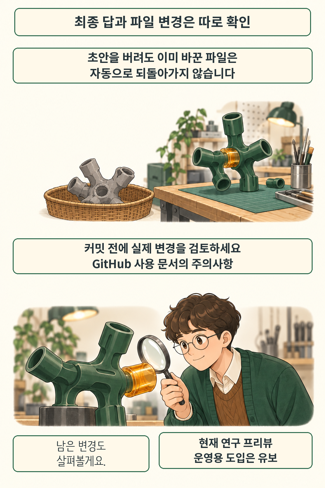

코딩 에이전트가 여러 초안을 거쳐 더 나은 최종 답변을 내놓았다면, 작업 폴더 안의 코드도 그 최종안 기준으로 깔끔하게 정리돼 있을 거라 기대하기 쉽습니다. 하지만 GitHub가 2026년 10월 14일 [공식 발표](https://github.blog/changelog/2026-10-14-hydrafusion-updates-and-new-max-option/)로 공개한 **HydraFusion 업데이트와 Max 옵션**에서는 답변을 고르는 단계와 작업공간의 파일 상태를 관리하는 단계가 따로 움직이거든요. 초안 작성과 검토의 역할 분담이 정교해진 만큼, 커밋 전에 디스크에 남은 변경분을 어떻게 가려낼지도 함께 살펴볼 필요가 있습니다.

글·해설: 다메카솔

## 초안은 medium, 검토는 high로 나눈 실행 구조

기존에는 각 모델의 기본 추론 강도를 그대로 썼다면, 이번 업데이트부터는 **초안 작성에 `medium`, 검토 단계에 `high`** 추론 강도를 나누어 배분합니다. 공식 문서의 [실행 방식 안내](https://docs.github.com/en/early-access/copilot/hydrafusion#how-hydrafusion-works)를 보면, 요청마다 **Single · Cascade · Critique** 가운데 알맞은 경로를 고른 뒤 최종 응답 하나를 돌려주는 구조입니다.

| 실행 방식 | 동작 흐름 | 이번 업데이트 핵심 |
| --- | --- | --- |
| **Single** | 단일 경로로 응답 생성 | 요청 성격에 따라 다중 모델 없이 단독 실행 선택 |
| **Cascade** | 초안을 먼저 판단하고 필요 시 더 강한 모델로 전환 | 단계별 검토 구조에 초안 `medium`·검토 `high` 배분 적용 |
| **Critique** | 여러 모델이 병렬 비평 후 최종 응답 하나를 선택 | 텍스트 요약 대신 도구로 실제 작업공간 확인 비중 확대 |

특히 Critique 방식에서는 여러 모델이 병렬로 비평할 때 텍스트 요약본만 돌려 읽지 않고, 도구를 써서 실제 작업공간을 직접 확인하는 비중을 높였습니다. 요약문만 보고 판단할 때보다 코드 파일과 작업 맥락을 직접 대조하는 근거가 두터워진 셈입니다.

## 버린 초안이 바꾼 파일은 왜 그대로 남을까

검토를 거쳐 깔끔한 최종 답변을 받았더라도 커밋 전에는 실제 파일 변경(`git diff`)을 확인해야 합니다. GitHub 공식 문서는 [제약 사항](https://docs.github.com/en/early-access/copilot/hydrafusion#limitations-of-hydrafusion)에서 **채택되지 않고 버려진 초안이 이미 작업공간에 만든 파일 수정을 자동으로 되돌리지 않는다**고 명시하고 있습니다.

화면에 보여 줄 '최종 응답 선택'과 디스크에 기록되는 '작업 상태 관리'가 따로 움직이기 때문입니다. 채팅창에는 걸러진 최종 답변 하나만 올라오니 이전 시도의 흔적도 함께 치워졌다고 넘겨짚기 쉬운데, 폐기된 초안이 먼저 고친 파일은 디스크에 그대로 남을 수 있죠.

예를 들어 핵심 로직 수정을 요청했을 때, 앞선 초안이 연관 설정 파일까지 손댔다가 검토에서 탈락하고 최종 답변에는 핵심 모듈 수정만 요약돼 올라오는 경우를 떠올려 볼까요? 채팅 설명만 믿고 스테이징하면 설명에 없던 설정 파일 변경까지 커밋에 섞여 들어가기 쉽습니다. 남은 수정이 실제로 필요한지, 다른 코드와 충돌하지 않는지는 개발자가 `git diff`로 직접 가려낼 몫으로 남습니다.

## Max 옵션과 연구 프리뷰 도입 전 확인할 조건

GitHub가 더 깊은 추론을 위한 선택지로 내놓은 **Max** 역시 같은 구조 위에서 추론 강도를 한 단계 더 끌어올리는 옵션입니다. 공식 [사용 조건과 과금 문서](https://docs.github.com/en/early-access/copilot/hydrafusion)에서는 `extra high` 추론 강도도 안내하고 있으며, HydraFusion과 Max 모두 아직 연구 프리뷰 단계로 제공됩니다.

- **제공 환경·요금제**: VS Code, Copilot 앱, CLI에서 Pro, Pro+, Business, Enterprise 사용자에게 제공
- **활성화와 정책**: 실험 또는 프리뷰 기능 활성화와 조직의 모델 정책 조건이 적용
- **지원 수준**: 연구 프리뷰이므로 SLA가 보장되지 않으며 프로덕션 워크로드용으로 의도되지 않음
- **과금과 비용**: 별도 HydraFusion 추가 요금은 없지만 실행된 각 모델의 표준 요금이 부과되고 Auto 할인은 빠짐. 검토 단계가 늘어날수록 응답 시간과 AI 크레딧 소모가 함께 커질 수 있음

개인 요금제(Pro·Pro+)에서는 프리뷰 기능 활성화가 중심이라면, Business·Enterprise 환경에서는 조직의 모델 정책이 실제 단말에 적용되는 범위까지 함께 맞춰 봐야 합니다. 조직 차원의 정책 관리와 적용 시점은 앞서 다룬 [Copilot 시작 시 정책 확인](/posts/copilot-startup-policy-freshness/) 글에서도 살펴본 바 있습니다.

## 다메카솔의 해석: 결과를 채택하는 실무 기준

제가 이 연구 프리뷰 기능을 실무에 시험 적용한다면, 격리된 작업 브랜치에서 시작해 **채팅창의 최종 설명 · 실제 `git diff` · 테스트 통과 여부** 세 가지를 나란히 대조하는 기준을 먼저 세우겠습니다. 응답 검토와 작업 폴더의 변경 확인을 별개 절차로 두고, 실제 변경분으로 채택 범위를 결정하는 편이 안전하기 때문이죠.

검토 모델이 늘고 추론 강도가 `high`나 `extra high`로 높아질수록 최종 답변의 설명은 훨씬 설득력 있게 읽힙니다. 하지만 저장소에 실제로 반영되는 대상은 요약문이 아니라 디스크에 바뀐 코드와 동작 결과이므로, 마지막 판단 기준 역시 작업공간의 실제 상태에서 출발합니다.

## 출처

- [GitHub · HydraFusion 업데이트와 Max 발표, 2026-10-14](https://github.blog/changelog/2026-10-14-hydrafusion-updates-and-new-max-option/)
- [GitHub Docs · Using HydraFusion, 2026-10-15 확인](https://docs.github.com/en/early-access/copilot/hydrafusion)

이 글은 GitHub 공식 발표와 문서를 바탕으로 정리했으며 별도의 실행 테스트나 성능·비용 측정은 포함하지 않았고, 만화 그림은 이해를 돕기 위해 새로 구성했습니다.
이 글의 본문과 이미지는 생성형 AI로 제작했습니다. 기획과 편집 기준은 다메카솔이 정했습니다.
