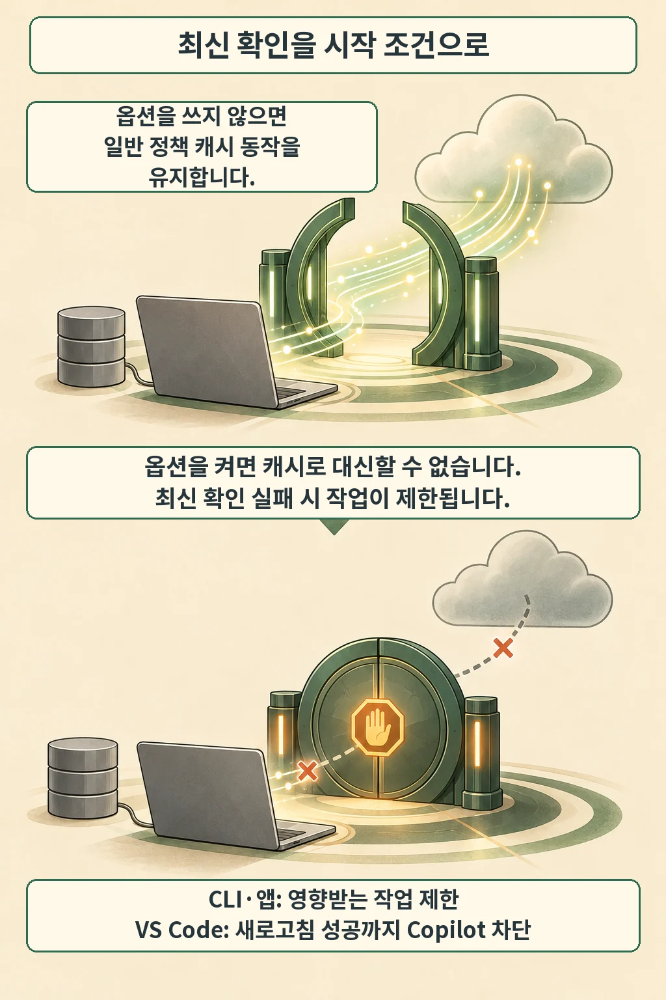

글·해설: 다메카솔

발행·확인: 2026-10-14

GitHub는 10월 13일 **Copilot이 시작할 때 최신 조직 정책을 다시 확인하도록 요구하는 옵션**을 발표했습니다. `forceRemoteSettingsRefresh`를 켜면 정책 확인에 실패한 클라이언트가 예전 캐시를 그대로 믿고 작업하는 경로를 막습니다. 조직이 설정을 바꾼 시점과 개발자 도구가 그 설정을 받은 시점을 함께 봐야 하는 변경입니다. [공식 발표](https://github.blog/changelog/2026-10-13-enterprise-managed-settings-enforcement-updates/)

## 연결 실패 때 어디까지 멈추나

지원 대상은 Copilot CLI, VS Code, GitHub Copilot app입니다. 선택하는 옵션입니다. 이를 사용하지 않으면 기존 관리 설정 캐시로 시작 속도와 일시적 장애 대응을 유지하고, 켜면 시작 전에 최신 서버 정책을 받아야 합니다. [발표의 적용 범위](https://github.blog/changelog/2026-10-13-enterprise-managed-settings-enforcement-updates/)

새로고침이 실패했을 때의 동작은 클라이언트별로 구분해야 합니다. 공식 문서는 CLI와 Copilot app에서 **영향받는 작업을 제한**한다고 설명하며, VS Code에서는 필요한 새로고침이 성공할 때까지 **Copilot 기능을 차단**한다고 적습니다. 편집기 전체가 종료된다는 뜻으로 확대할 수는 없습니다. 그림의 닫힌 문은 이 작업 제한을 표현한 비유입니다. [설정 참조](https://docs.github.com/en/enterprise-cloud@latest/copilot/reference/enterprise-administrators/enterprise-managed-settings#forceremotesettingsrefresh)

## 서버에 올렸다면 첫 수신부터 확인합니다

클라이언트가 이 요구사항을 처음 받는 경로에 따라 적용 시작점이 달라집니다. MDM이나 파일로 단말에 전달하면 첫 로그인 전부터 적용할 수 있지만, 서버로 배포한 값은 클라이언트가 한 번 받은 뒤 **후속 시작부터** 새로고침을 요구합니다. 첫 전달이 중요합니다. [배포 방식 설명](https://docs.github.com/en/enterprise-cloud@latest/copilot/how-tos/administer-copilot/manage-for-enterprise/use-managed-settings/deploy-managed-settings#requiring-fresh-server-managed-settings-on-startup)

관리 설정 JSON에서는 `"forceRemoteSettingsRefresh": true`처럼 불리언을 씁니다. CLI의 Windows 레지스트리나 macOS 관리 환경설정에서는 `true` 또는 `false`를 담은 문자열로 저장해야 하며, 정책 helper script로는 이 키를 지정할 수 없습니다. 배포 도구의 값 형식도 함께 확인할 부분입니다. [값 형식](https://docs.github.com/en/enterprise-cloud@latest/copilot/reference/enterprise-administrators/enterprise-managed-settings#forceremotesettingsrefresh)

앞서 다룬 [JetBrains의 모델·MCP 시작 설정](/posts/copilot-jetbrains-model-mcp-startup/)은 어떤 기능을 시작할지에 관한 변경이었습니다. 이번 발표는 시작 전에 정책을 얼마나 새롭게 확인할지에 초점을 맞춥니다. 지원 대상 목록에도 차이가 있으므로 JetBrains에 이 옵션이 적용된다고 옮겨 읽지 않습니다.

## sandbox 설정에는 최소 버전 조건도 붙습니다

같은 발표에서 GitHub는 관리 설정의 `sandbox` 키에 최소 클라이언트 버전 강제를 추가했습니다. 이 키가 포함되면 기준보다 오래된 클라이언트는 업데이트할 때까지 Copilot 연결이 차단됩니다. 업데이트 준비가 먼저입니다. 10월 14일 공식 문서의 기준은 아래와 같습니다. [최소 버전 표](https://docs.github.com/en/enterprise-cloud@latest/copilot/reference/enterprise-administrators/enterprise-managed-settings#minimum-client-version-enforcement-for-sandbox)

| 클라이언트 | sandbox 최소 버전 |
| --- | --- |
| VS Code | 1.141.0 |
| Copilot CLI | 1.0.93 |
| GitHub Copilot app | 1.1.26 |

이 표는 `sandbox`의 버전 조건입니다. 시작 시 새로고침 옵션의 최소 버전 표로 재사용하지 않습니다. 다른 관리 키로 확대하는 일은 GitHub가 밝힌 향후 방향이며, 이번 발표에서 시작점으로 명시한 키는 `sandbox`입니다. [현재 변경과 계획](https://github.blog/changelog/2026-10-13-enterprise-managed-settings-enforcement-updates/)

## 다메카솔의 해석: 정책 연결도 시작 경로에 들어옵니다

저는 이 변경을 정책 배포와 실제 적용 사이의 시간을 줄이는 선택으로 봅니다. 그만큼 정책 서버에 닿지 못하는 상황이 개발 도구 사용에 직접 영향을 줍니다. 정책 최신성과 작업 연속성을 함께 판단해야 하는 지점입니다.

제가 배포를 설계한다면 대표 단말에서 첫 수신, 연결 실패, 연결 복구, 최소 버전 미달을 각각 확인하겠습니다. 특히 서버 배포만으로 첫 시작부터 요구사항이 전달됐다고 가정하면, 관리자가 생각한 적용 범위와 단말 상태가 어긋날 수 있습니다. 단말 업데이트를 준비하고 실패 안내까지 살핀 뒤 범위를 넓히는 편이 낫다고 판단합니다.

이 글은 공식 발표와 문서를 읽은 해설입니다. 실제 조직에 설정을 배포한 결과는 다루지 않았습니다. 최신 확인이 필요한 범위와 연결 장애를 감수할 범위를 함께 정하는 것이 이번 변경을 검토하는 출발점입니다.

## 출처

- [GitHub 공식 발표 · 2026-10-13](https://github.blog/changelog/2026-10-13-enterprise-managed-settings-enforcement-updates/)
- [GitHub Docs · 관리 설정 배포 방식](https://docs.github.com/en/enterprise-cloud@latest/copilot/how-tos/administer-copilot/manage-for-enterprise/use-managed-settings/deploy-managed-settings)
- [GitHub Docs · 설정 키와 최소 버전](https://docs.github.com/en/enterprise-cloud@latest/copilot/reference/enterprise-administrators/enterprise-managed-settings)

이 글의 본문과 이미지는 생성형 AI로 제작했습니다. 기획과 편집 기준은 다메카솔이 정했습니다.
