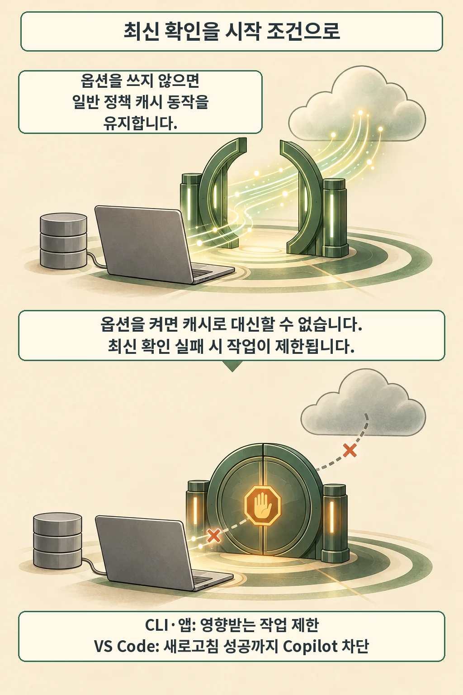

회사에서 Copilot 보안 정책을 바꿨는데도 단말이 예전 로컬 캐시로 계속 동작하면 통제에 빈틈이 생깁니다. 반대로 시작할 때마다 최신 정책 확인을 강제하면, 오프라인 환경에서 편집기까지 멈추지는 않을지 걱정되죠. GitHub가 2026년 10월 13일 발표한 관리 설정 업데이트는 이 정책 시차와 실패 시 제한 범위, 첫 적용 시점을 함께 다룹니다.

글·해설: 다메카솔

## 캐시 대신 최신 정책부터 확인하는 조건

새로 추가된 `forceRemoteSettingsRefresh` 옵션은 **Copilot CLI, VS Code, GitHub Copilot app**에서 관리자가 켜고 끌 수 있습니다. 옵션을 끄거나 생략하면 기존 캐시로 빠른 시작과 일시적 네트워크 장애 대응력을 유지하고, 켜면 확인 실패 시 예전 캐시를 대신 쓰는 경로를 막아 정책 반영 시차를 줄여 주죠. ([공식 발표](https://github.blog/changelog/2026-10-13-enterprise-managed-settings-enforcement-updates/))

그렇다면 시작 시 정책 새로고침이 실패하면 어디까지 멈출까요? [설정 참조 문서](https://docs.github.com/en/enterprise-cloud@latest/copilot/reference/enterprise-administrators/enterprise-managed-settings#forceremotesettingsrefresh)는 클라이언트별 제한을 두 갈래로 구분합니다.

- **Copilot CLI · GitHub Copilot app**: 정책 영향을 받는 작업을 제한합니다.
- **VS Code**: 필요한 정책 새로고침이 성공할 때까지 Copilot 기능을 차단합니다.

가령 사내망 연결 전 개발자가 VS Code를 먼저 연 상황을 떠올려 봅시다. 이때 편집기 자체가 종료되는 것은 아니며, 필요한 정책 새로고침이 성공할 때까지 Copilot 기능만 차단됩니다.

## 서버 배포와 MDM 배포, 첫 적용 시점이 갈립니다

운영에서 놓치기 쉬운 대목은 **단말이 이 설정을 맨 처음 전달받는 경로**입니다.

MDM이나 설정 파일로 단말에 직접 배포하면 첫 로그인 전부터 곧바로 강제할 수 있습니다. 반면 서버로 배포한 값은 클라이언트가 한 번 수신한 뒤 그다음 후속 시작부터 새로고침을 요구하거든요. ([배포 방식 설명](https://docs.github.com/en/enterprise-cloud@latest/copilot/how-tos/administer-copilot/manage-for-enterprise/use-managed-settings/deploy-managed-settings#requiring-fresh-server-managed-settings-on-startup))

예를 들어 서버에서 옵션을 켠 직후 아직 접속한 적 없는 단말이 처음 켜진다면 그 첫 시작은 막히지 않고, 첫 수신을 마친 다음 재시작부터 규칙이 작동합니다. 배포 수단에 따라 값 형식과 지원 여부도 달라 확인이 필요합니다. ([값 형식](https://docs.github.com/en/enterprise-cloud@latest/copilot/reference/enterprise-administrators/enterprise-managed-settings#forceremotesettingsrefresh))

- **관리 설정 JSON**: `"forceRemoteSettingsRefresh": true`처럼 불리언(boolean) 값을 씁니다.
- **CLI용 Windows 레지스트리 · macOS 관리 환경설정**: `"true"` 또는 `"false"` 문자열로 저장합니다.
- **정책 helper script**: `forceRemoteSettingsRefresh` 키 지정을 지원하지 않습니다.

앞서 살펴본 [JetBrains의 모델·MCP 시작 설정](/posts/copilot-jetbrains-model-mcp-startup/)이 새 대화의 기본 모델과 도구 서버 자동 시작을 다뤘다면, 이번 발표는 시작 전 정책 최신성 강제에 초점을 맞춥니다. 지원 대상도 Copilot CLI, VS Code, GitHub Copilot app으로 구분되므로 JetBrains IDE까지 함께 적용된다고 보기 어렵습니다.

## sandbox 설정을 넣는다면 최소 버전부터 맞춥니다

같은 발표에서 GitHub는 관리 설정에 `sandbox` 키를 넣을 때 적용되는 **최소 클라이언트 버전 강제 조건**도 추가했습니다. 기준보다 오래된 클라이언트는 업데이트할 때까지 Copilot 연결이 차단되므로 배포 전에 단말 버전부터 점검해야 하거든요. 10월 14일 공식 문서의 기준 버전은 아래 표와 같습니다. ([최소 버전 표](https://docs.github.com/en/enterprise-cloud@latest/copilot/reference/enterprise-administrators/enterprise-managed-settings#minimum-client-version-enforcement-for-sandbox))

| 클라이언트 | `sandbox` 최소 버전 |
| --- | --- |
| VS Code | 1.141.0 |
| Copilot CLI | 1.0.93 |
| GitHub Copilot app | 1.1.26 |

이 표는 `sandbox` 키에 붙는 조건이므로 `forceRemoteSettingsRefresh`의 최소 버전 기준으로 혼동하지 않도록 유의해야 합니다. 다른 관리 설정 키로 최소 버전 강제를 넓히는 계획은 GitHub가 예고한 향후 로드맵에 해당합니다. ([현재 변경과 계획](https://github.blog/changelog/2026-10-13-enterprise-managed-settings-enforcement-updates/))

## 다메카솔의 해석

이 옵션을 켜면 **정책 서버 연결 상태가 개발 도구의 시작 조건에 직접 들어온다**는 점이 핵심입니다. 보안 정책의 즉시성을 높이는 대신 작업 연속성까지 함께 설계해야 하는 셈이죠.

실무에서 사내 배포를 설계한다면 전사 적용 전에 대표 단말로 네 가지 시나리오를 먼저 점검하는 편이 안전합니다.

1. **첫 정책 수신**: MDM과 서버 배포에서 각각 언제부터 강제가 시작되는지 확인합니다.
2. **연결 실패 시 동작**: 사내망 제한이나 오프라인 상태에서 어떤 안내가 뜨는지 점검합니다.
3. **연결 복구 후 재개**: 네트워크 복구 뒤 재설치 없이 바로 풀리는지 살펴봅니다.
4. **최소 버전 미달**: `sandbox` 설정 시 구버전 단말의 업데이트 경로가 열려 있는지 확인합니다.

특히 서버 배포만 걸어 두고 첫 시작부터 전 단말에 새 규칙이 적용된다고 가정하면, 기대한 통제 범위와 실제 단말 상태가 어긋나기 쉽습니다. 업데이트 안내와 실패 대응 절차부터 마련한 뒤 적용 범위를 넓히는 편이 한결 안정적입니다.

## 출처

- [GitHub 공식 발표 · 2026-10-13](https://github.blog/changelog/2026-10-13-enterprise-managed-settings-enforcement-updates/)
- [GitHub Docs · 관리 설정 배포 방식](https://docs.github.com/en/enterprise-cloud@latest/copilot/how-tos/administer-copilot/manage-for-enterprise/use-managed-settings/deploy-managed-settings)
- [GitHub Docs · 설정 키와 최소 버전](https://docs.github.com/en/enterprise-cloud@latest/copilot/reference/enterprise-administrators/enterprise-managed-settings)

공식 발표와 문서를 바탕으로 정리했으며 실제 기업 망에서의 배포·측정은 포함하지 않았고, 만화 그림은 이해를 돕기 위해 새로 구성했습니다.
이 글의 본문과 이미지는 생성형 AI로 제작했습니다. 기획과 편집 기준은 다메카솔이 정했습니다.
