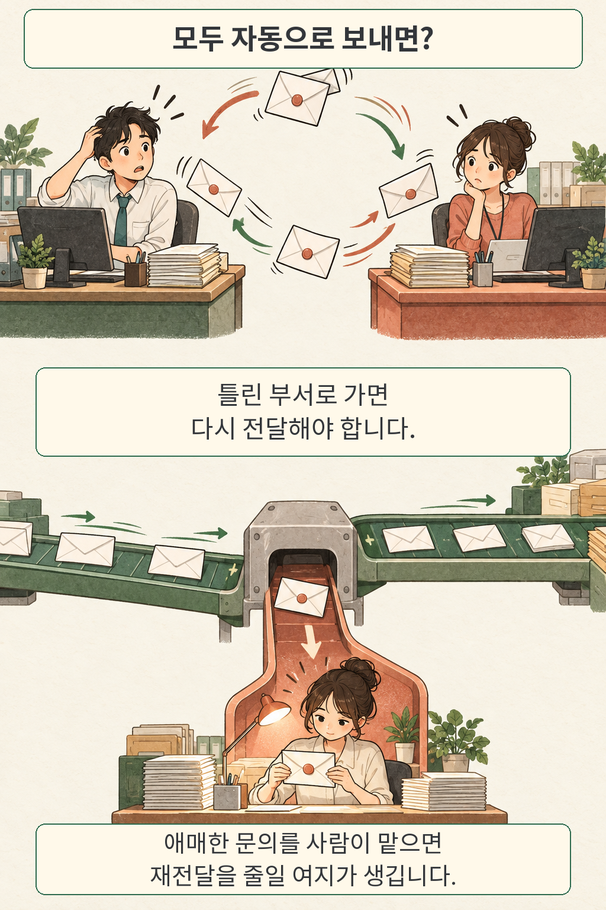
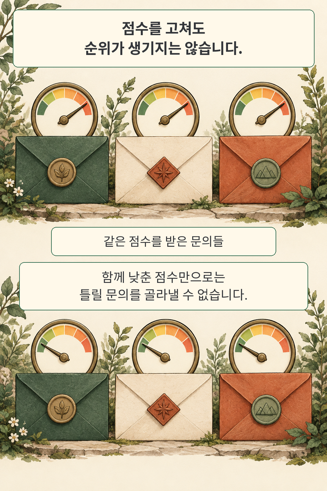

사내 IT 문의를 AI로 자동 분류할 때 가장 아픈 비용은 오답의 뒷수습에서 나옵니다. 가령 권한 요청이 엉뚱한 하드웨어 부서로 가면, 담당자가 내용을 다시 읽고 제 부서로 넘기는 사이 지연과 이중 작업이 겹치기 마련이죠. 그래서 무조건 자동화하기보다 자신 없는 문의를 언제 사람에게 넘겨야 손해가 줄어드는지 따져 볼 필요가 있습니다.

글·해설: 다메카솔

Sachin Gupta의 「Cost-Aware Abstention for LLM-Based IT Ticket Classification」은 자동 분류와 사람 검토의 손익을 비용 모델로 따지는 경험적 연구입니다. 새로운 보류 알고리즘을 제안하거나 보편적 배포 인증을 내리기보다, 어떤 조건에서 보류가 유리한지 검증하는 데 초점을 맞춥니다.

## 틀린 분류와 사람 검토에 값을 매겨 보면

연구는 각 처리 결과에 정분류 0, 사람 검토 1, 오분류 5라는 예시 비용을 두어 보류 기준을 검증했습니다. 이는 실제 화폐가 아니라 재전달이 사람 검토보다 비싸다는 가정이며, 사람에게 넘긴 문의는 최종적으로 맞게 분류되고 담당자 실수나 처리 시간 차이는 제외한다고 전제했습니다.

- **전체 데이터셋 분할**: 공개 IT 문의 47,837건(8개 범주)을 학습 33,486건, 보정 4,784건, 시험 9,567건으로 나눴습니다.
- **LLM 비교 부분집합**: API 비용을 고려해 시험에서 층화 추출한 1,000건과 별도 보정 500건을 썼으며, 일반 분류 모델도 같은 1,000건에서 별도 비교했습니다.

먼저 TF-IDF와 로지스틱 회귀(LR) 모델로 보정 데이터에서 다섯 후보를 비교해 기준값을 정하고, 시험 단계에서는 고정한 채 평가했습니다. 애매한 문의를 사람에게 넘기는 것만으로 건당 기대 비용이 뚜렷하게 줄어들었습니다.

| 항목 (시험 9,567건, 기준 0.60) | 결과 | 계산 기준(분모) 및 비고 |
| --- | --- | --- |
| 보정 임계값 | 0.60 (0.5·0.6·0.7·0.8·0.9 중 선택) | 보정 4,784건에서 선택, 시험 시 고정 |
| 건당 평균 기대 비용 | 0.763 → 0.472 | 상대 38.1% 감소 (1,000회 짝지은 비율 부트스트랩 95% CI 35.7~40.4%) |
| 잘못 분류한 문의 | 15.3% → 3.5% | 전체 시험 문의 |
| 자동 처리율 | 70.5% | 전체 시험 문의 (29.5%는 사람 검토) |
| 자동 처리 문의 정확도 | 95.0% | 사람 검토를 제외한 자동 처리 문의 |

여기서 주의할 점은 지표마다 분모가 다르다는 사실입니다. 자동 처리된 문의의 정확도만 보면 높지만, 전체 문의 중 29.5%를 사람이 직접 넘겨받아 처리한 결과이기도 하거든요. 이 절감률 역시 예시 비용과 시험 데이터 안에서 계산된 수치이므로, 실제 인건비 절감 폭은 조직의 단가에 따라 달라집니다.

## 확신도를 보정해도 오답을 골라낼 수 없는 경우

사람에게 문의를 넘기려면 모델이 틀릴 만한 건에 더 낮은 점수를 매겨야 합니다. **확신도 보정**은 점수 평균을 실제 정답률에 맞추는 일이고, **오류 구별**은 개별 문의 중 어느 쪽이 위험한지 순서를 매기는 능력에 가깝죠. 모든 문의에 똑같은 점수만 주면 사후 보정으로 눈금을 낮춰도 틀릴 문의를 가려낼 수 없습니다.

논문의 LLM 실험이 이 차이를 단적으로 보여 줍니다. GPT-4o-mini의 예시 제공(few-shot) 조건은 시험 문의 전체에 최고점만 출력해 과신이 심했는데요. 분리된 보정 데이터로 등위 회귀(isotonic regression)를 적용하자 점수는 실제 정확도 부근으로 내려왔지만, 정답과 오답을 가르는 순위 지표는 움직이지 않았습니다.

- **보정 전후 (GPT-4o-mini few-shot)**: 시험 1,000건 모두에 나오던 확신도 `1.000`이 별도 보정 500건 학습 후 일괄 `0.480`으로 낮아져 시험 정확도(`0.459`)에 근접했지만, `correctness AUROC`는 전후 모두 `0.500`이었습니다.
- **손익분기점 유도**: 비용 비율 `(0, 1, 5)`에서 정답 확률 `p`일 때 자동 분류 기대 비용 `5 × (1 − p)`가 사람 검토(`1`) 이하가 되려면 `p ≥ 0.80`이어야 합니다. 이 `0.80`은 LR의 경험적 `0.60`과 다른 분석 기준입니다.
- **LLM 8개 조건 결과**: 이 기준에서 8개 조건 중 7개는 1,000건을 전부 보류했습니다. `Claude Haiku 4.5` few-shot만 19건(1.9%)을 자동 처리해 모두 맞혔으나, 정확도의 95% 이항 신뢰구간이 `82.4~100%`로 넓어 넓은 업무의 무오류 근거로 삼기에는 표본이 적습니다.

변별력이 약한 점수에 보수적인 손익분기점을 걸자, 시스템이 대부분의 문의를 보류하며 안전장치로 작동한 셈입니다.

## 이 결과만으로 모델의 우열을 가릴 수 있을까

그렇다면 이 수치만으로 프롬프트 기반 LLM이 기존 분류 모델보다 뒤처진다고 볼 수 있을까요? 연구진은 공정한 대조를 위해 시험 세트에서 뽑은 같은 천 건에서 일반 모델과 LLM을 다시 비교해 봤습니다.

| 비교 항목 | 일반 분류 모델 (DistilBERT 등) | 프롬프트 LLM (최고: Claude Haiku 4.5 few-shot) |
| --- | --- | --- |
| 공통 시험 1,000건 정확도 | 0.879 (DistilBERT) | 0.477 |
| 모델에 제공된 정보 | 라벨링된 학습 데이터 33,486건 | 범주 이름 + 최대 24개 예시 (범주 정의 없음) |
| 생성·조회 조건 | 로컬 분류기 학습·미세 조정 | temperature 0, 최대 64토큰 (2026년 5월 22일 API 조회) |

표에서 보듯 두 쪽이 받은 정보 조건부터 크게 달랐습니다. 예컨대 '사내 프로젝트'나 '기타'처럼 경계가 모호한 범주가 섞여 있을 때, 일반 모델은 수만 건의 과거 라벨로 패턴을 익힌 반면 LLM은 범주 정의 없이 이름과 적은 예시만으로 판단해야 했거든요. 이 격차는 해당 실험 구성과 조회 시점에서의 비교 결과이지, 모델군 전체의 고유 능력을 가린 절대 기준은 아닙니다.

## 다메카솔의 해석: 자동 처리율과 사람 부담을 함께 보자

실무에 이 접근을 적용하려면 연구의 범위와 한계부터 확인해야 합니다. 실험은 단일 공개 데이터와 예시 비용에 묶여 있고 사람 검토 오류나 시간 차이도 빼고 계산했기 때문에, 다른 조직에서도 같은 절감률이 재현되리라 보기는 어렵습니다.

그래서 실무자가 가져갈 핵심은 특정 임계값 숫자가 아니라, **자동 처리율과 남은 오분류, 사람이 맡을 검토량**을 함께 보는 평가 틀입니다. 예를 들어 사내 헬프데스크에서 "개발 도구 라이선스 권한 요청" 문의를 잘못 넘겼을 때 드는 재전달 비용과 담당 팀의 일일 검토 여력을 먼저 가늠해 보세요. 그런 다음 우리 업무 자료로 보류 기준을 정하고 시간 변화에 맞춰 계속 점검하는 편이 안전합니다.

AI가 사람에게 판단을 넘기는 기준을 에이전트 제어 관점에서 더 보고 싶다면 [에이전트가 언제 사람의 개입을 요청해야 하는지 다룬 글](/posts/leash-agent-handoff-oversight/)도 함께 읽어 보세요.

## 출처

이 글은 Sachin Gupta의 논문 v1(2026년 10월 22일 arXiv 공개, 저자·arXiv 표기 기준 ICTAI 2026 채택이며 출판사 최종 수록 기록은 별도 미확인)과 고정 보충자료 v1.1.0(2026년 9월 8일 공개), 공개 코드 저장소를 바탕으로 정리했습니다. 상용 모델 API 주실험은 2026년 5월 22일 시점에 수행됐습니다.

- [논문 초록과 버전 정보 (arXiv v1)](https://arxiv.org/abs/2610.31657v1)
- [원문 PDF: 방법·표 III~VI·한계](https://arxiv.org/pdf/2610.31657v1)
- [저자의 RouteGuard 코드 저장소](https://github.com/sachinkg12/RouteGuard/tree/22a2c3988281bc7b2249fa8ce985678442ff1af3)
- [고정 보충자료 v1.1.0 (Zenodo)](https://zenodo.org/records/22654013)

이 글은 원문과 고정 보충자료를 대조해 해설했으며 모델 재학습이나 API 실험을 독립 재현하지 않았고, 만화 그림은 설명을 위해 새로 구성했습니다.

이 글의 본문과 이미지는 생성형 AI로 제작했습니다. 기획과 편집 기준은 다메카솔이 정했습니다.
