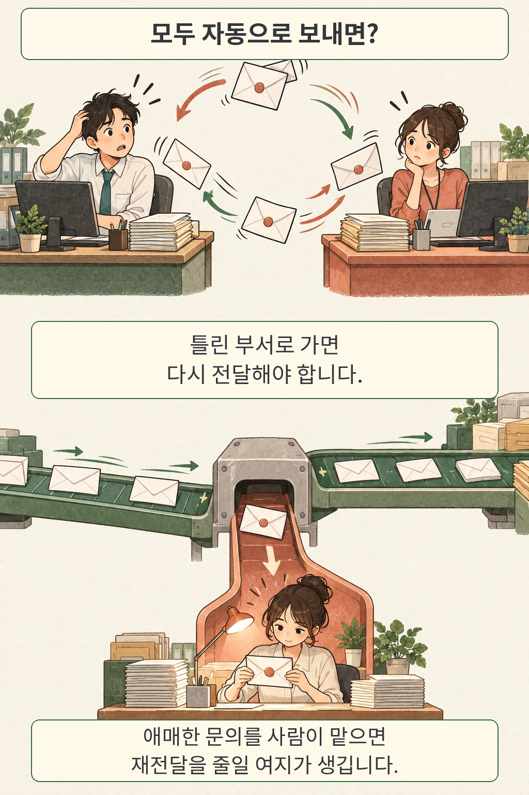
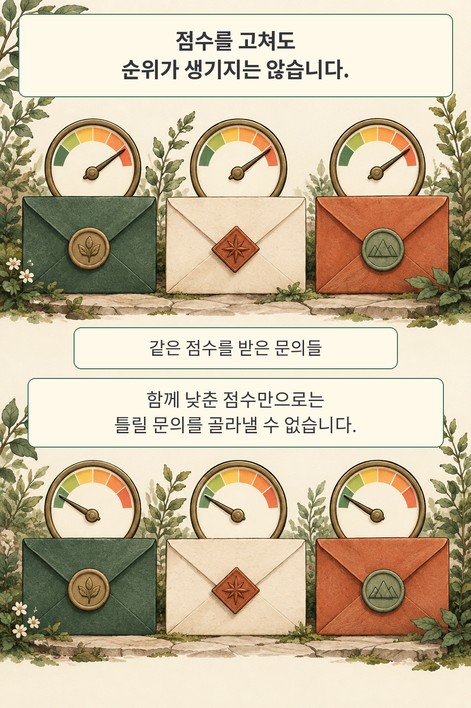

글·해설: 다메카솔

문의가 엉뚱한 부서로 가면, 담당자가 내용을 읽고 다시 전달해야 합니다. AI가 모든 문의에 답을 내놓는다고 해서 이 과정이 짧아지는 것은 아닙니다. 자신 없는 문의를 사람에게 넘기는 편이 나을 때도 있습니다.

Sachin Gupta의 「Cost-Aware Abstention for LLM-Based IT Ticket Classification」은 자동 분류와 사람 검토 사이의 기준을 다룹니다. 핵심 질문은 “얼마나 많이 맞혔나?”에서 한 걸음 더 갑니다. **사람이 처리할 양까지 고려하면, 어떤 문의를 자동으로 보내는 편이 나을까요?** 새로운 보류 알고리즘을 제안하기보다, 이 판단을 비용으로 평가하는 실험입니다.

## 틀린 분류와 사람 검토에 값을 붙이면

연구는 공개 IT 문의 47,837건을 8개 범주로 분류합니다. 학습 33,486건, 보정 4,784건, 시험 9,567건으로 나눴습니다. 비용은 정분류 0, 사람 검토 1, 오분류 5로 놓았습니다. **실제로 측정한 돈이 아니라, 잘못 보낸 문의가 사람 검토보다 비싸다는 예시 가정**입니다. 사람에게 넘긴 문의는 최종적으로 맞게 분류한다고 가정했습니다. 사람의 실수나 문의마다 다른 처리 시간까지 반영한 계산은 아닙니다.

단어의 중요도를 나타내는 TF-IDF와 로지스틱 회귀(LR)를 결합한 모델에서는 보정 자료로 다섯 기준값(0.5·0.6·0.7·0.8·0.9)을 비교했습니다. 그중 0.60을 고르고, 시험할 때는 바꾸지 않았습니다. 이 기준보다 확신도가 낮으면 사람에게 넘겼습니다.

시험 9,567건에서 문의 한 건당 평균 비용은 0.763에서 0.472로 낮아졌습니다. 저자가 보고한 상대 감소율은 38.1%입니다. 같은 시험 항목을 짝지어 1,000회 재표집한 비율 부트스트랩의 95% 신뢰구간은 35.7~40.4%였습니다. 이는 위의 비용 가정과 시험 자료 안에서 나온 결과입니다. 실제 인건비가 그만큼 줄었다는 뜻은 아닙니다.

분모도 함께 읽어야 합니다.

| 지표 | 결과 | 무엇을 기준으로 센 값인가 |
| --- | --- | --- |
| 잘못 분류한 문의 | 15.3% → 3.5% | 전체 시험 문의 |
| 자동 처리율 | 70.5% | 전체 시험 문의 |
| 자동 처리된 문의의 정확도 | 95.0% | 사람이 맡은 문의를 제외한 자동 처리 문의 |

오분류가 줄어든 대신, 나머지 약 29.5%는 사람이 맡습니다. “정확도 95%”만 떼어 보면 이 부담이 가려집니다.

## 확신도를 보정해도 오답을 골라낼 수 없는 경우

여기서 확신도 보정과 오류를 가려내는 능력을 구별해야 합니다. 보정은 “이 정도 자신 있다고 말한 예측이 실제로도 그만큼 맞는가?”를 맞추는 일입니다. 그런데 모든 문의에 똑같은 점수를 준다면, 점수의 수준을 고쳐도 어떤 문의가 더 위험한지는 구별되지 않습니다. 만화의 계기판은 이 차이를 나타낸 비유이며, 측정 그래프는 아닙니다.

논문에서 GPT-4o-mini의 예시 제공(few-shot) 조건은 시험 1,000건 모두에 확신도 1.000을 냈습니다. 별도의 보정 자료 500건으로 등위 회귀(isotonic regression)를 적용하자 모두 0.480으로 바뀌었습니다. 실제 시험 정확도는 0.459였습니다. 지나친 자신감은 낮아졌지만, 정답과 오답을 순서대로 구별하는 지표인 correctness AUROC는 보정 전후 모두 0.500이었습니다. **같은 점수를 함께 낮추는 것만으로 개별 문의의 위험 순위가 생기지는 않은 것입니다.**

앞서 정한 비용에서 정답일 확률을 p라고 하면, 자동 분류의 기대 비용은 `5 × (1 − p)`, 사람 검토는 `1`입니다. 따라서 p가 0.80 이상일 때 자동 분류의 기대 비용이 사람 검토 이하가 됩니다. 이 계산은 보정 점수를 정답 확률로 해석할 수 있다는 전제에서 나옵니다. 논문이 LLM에 적용한 이 **0.80은 LR의 보정 자료에서 경험적으로 고른 0.60과 다른 기준**입니다.

이 기준을 적용한 LLM 8개 조건 중 7개는 시험 1,000건을 모두 사람에게 넘겼습니다. Haiku의 few-shot 조건만 19건을 자동 처리했고, 그 19건은 모두 맞았습니다. 그러나 자동 처리율은 1.9%에 불과합니다. 이 19건의 정확도에 대한 95% 이항 신뢰구간도 82.4~100%입니다. 적은 수에서 오분류가 없었다는 결과를 넓은 업무 범위의 무오류 보장으로 읽어서는 안 됩니다.

## 이 결과로 모델의 우열까지 정할 수 있을까

LLM의 시험 자료는 전체 시험 집합에서 범주 비율을 맞춰 뽑은 1,000건입니다. 연구는 일반 분류 모델도 같은 1,000건에서 다시 비교했습니다. 여기서 DistilBERT의 정확도는 0.879, 프롬프트로 분류한 모델 중 가장 높은 Haiku는 0.477이었습니다.

다만 두 쪽이 받은 정보가 다릅니다. 일반 분류 모델은 라벨이 붙은 학습 자료 33,486건을 사용했습니다. LLM에는 범주 이름과 최대 24개 예시가 주어졌고, 범주의 정의는 주어지지 않았습니다. 주실험의 생성 설정은 temperature 0, 최대 출력 64토큰이었습니다. 상용 모델 API 조회 시점도 2026년 5월 22일입니다. 이 차이는 해당 구성의 비교 결과이며, 현재 모든 LLM과 분류 모델의 고유 능력을 가르는 순위표가 아닙니다.

## 다메카솔의 해석: 사람이 맡을 양까지 함께 보자

이 연구에서 가져올 만한 것은 특정 기준값보다 **자동 처리율, 남은 오분류, 사람이 맡을 양을 함께 보는 방식**입니다. 우리 업무에서 잘못 전달한 문의가 얼마나 번거로운지, 사람이 검토할 수 있는 양은 어느 정도인지에 따라 선택이 달라집니다. 가능하면 우리 업무의 별도 검증 자료와 비용으로 기준을 정하고, 시간이 지나도 그 기준이 맞는지 살펴볼 필요가 있습니다. 이는 다메카솔의 해석이며, 논문에서 검증된 현장 도입 성과는 아닙니다.

단일 공개 데이터와 예시 비용에 묶인 연구이므로, 다른 조직에서 같은 절감률이 나올지는 알 수 없습니다. 사람 검토에도 오류가 생기고 처리 시간이 달라지는 실제 업무, 시간에 따른 문의 변화도 추가로 확인해야 합니다. 이 글은 원문과 저자의 고정 보충자료를 대조했으며, 모델 재학습이나 API 실험을 독립적으로 재현하지는 않았습니다.

AI가 사람에게 판단을 넘기는 다른 맥락은 [에이전트가 언제 사람의 개입을 요청해야 하는지 다룬 글](/posts/leash-agent-handoff-oversight/)에서도 이어 볼 수 있습니다. 이번 연구의 범위는 IT 문의 분류입니다.

## 출처와 공개 시점

원문 v1의 arXiv 제출일은 2026년 10월 22일입니다. 이번 탐색에서는 최근 24시간의 확인 범위에서 적합한 신규 후보를 찾지 못해 최근 7일로 넓혔습니다. 논문 공개일과 실험일은 다릅니다. 보충자료 v1.1.0은 9월 8일에 공개됐고, 상용 모델 주실험은 앞서 설명한 5월에 수행됐습니다.

저자와 arXiv는 ICTAI 2026 채택을 표기합니다. 출판사의 최종 수록 기록은 이 글에서 별도로 확인하지 못했습니다. 코드 저장소의 확인한 revision과 고정 보충자료를 구분해 연결합니다.

- [논문 초록과 버전 정보](https://arxiv.org/abs/2610.31657v1)
- [원문 PDF: 방법·표 III~VI·한계](https://arxiv.org/pdf/2610.31657v1)
- [저자의 RouteGuard 코드: 확인한 revision](https://github.com/sachinkg12/RouteGuard/tree/22a2c3988281bc7b2249fa8ce985678442ff1af3)
- [고정 보충자료 v1.1.0](https://zenodo.org/records/22654013)

만화는 설명을 위해 새로 그린 비유이며, 논문의 그림을 복제하지 않았습니다.

이 글의 본문과 이미지는 생성형 AI로 제작했습니다. 기획과 편집 기준은 다메카솔이 정했습니다.
