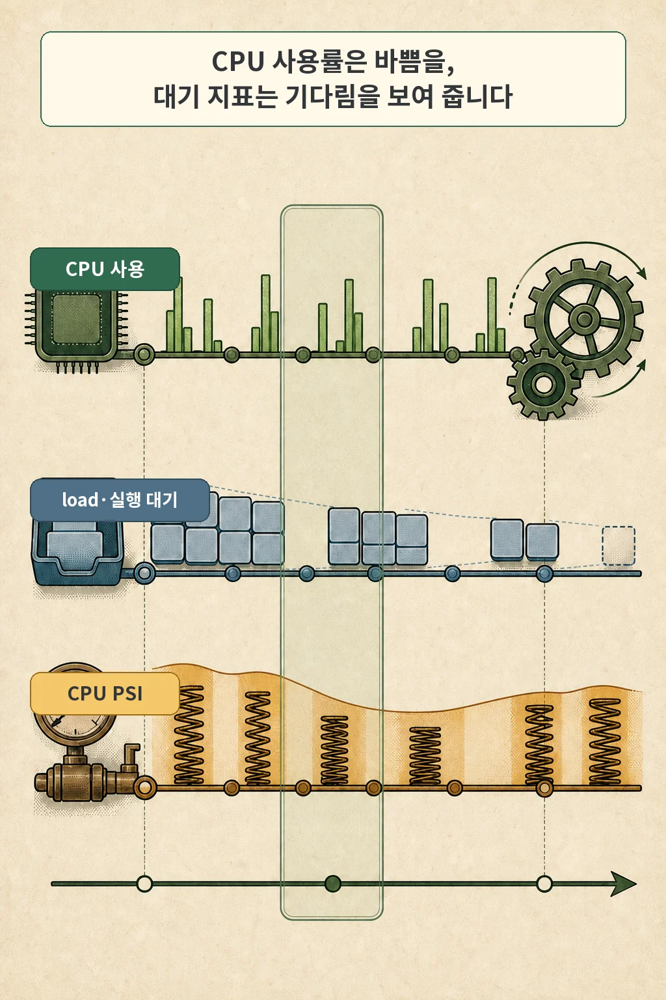
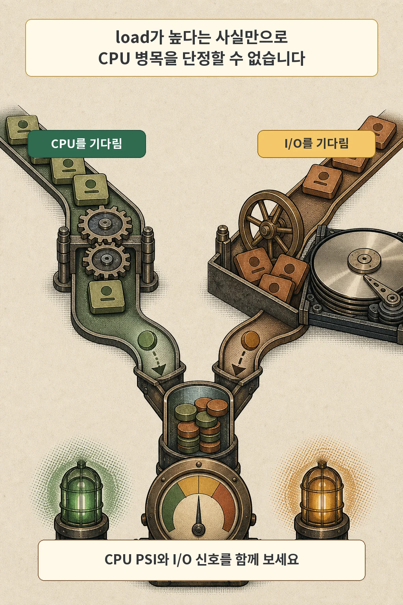
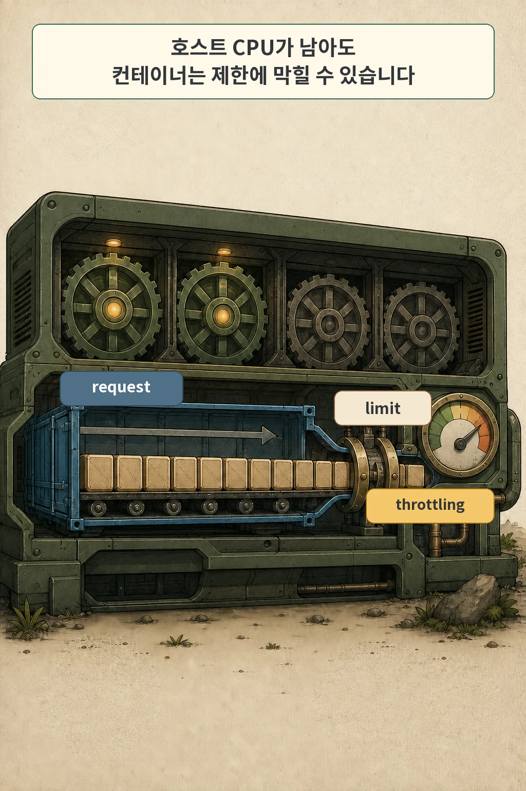

대시보드에 메모리가 남아도 서버가 느리거나 배치가 실패한다면 병목이 CPU 쪽에 있을 확률이 높습니다. 저도 Synology NAS에 학습용 k3s를 올렸을 때 32GB RAM만 믿다가 Airflow DAG 실패를 겪었는데요, 당시 남은 제약은 부족한 CPU 코어였습니다. 남는 RAM과 CPU 처리 여유는 별개이므로 실행 대기·pressure·throttling·동시 실행 수를 함께 대조해야 하죠.

글·해설: 다메카솔

## RAM 여유와 CPU 여유는 왜 다른가


메모리는 코드와 데이터를 담는 공간이고, CPU는 준비된 일을 시간 조각으로 나눠 처리합니다. `available memory`가 많아도 실행할 task가 CPU 코어보다 빠르게 늘면 대기열이 길어지거든요. 반대로 CPU가 한가해 보여도 디스크나 네트워크 응답을 기다리면 서비스는 느려집니다.

| 질문 | 먼저 볼 신호 | 모르는 것 |
| --- | --- | --- |
| 메모리 부족인가 | available memory, working set, swap, OOM | CPU 대기·진척 |
| CPU 사용량 | CPU 사용률, 사용 core 수 | 실행 대기 시간 |
| 대기 위치 | load, 실행 대기, CPU·I/O PSI, throttling | 작업 진척 |

## CPU 사용률과 실행 대기를 같은 시간대에 놓기



CPU 사용률은 관측 `window` 동안 CPU가 일한 평균 비율로, Kubernetes Metrics API도 누적 카운터를 구간 평균으로 계산합니다. `load average`는 대기열 규모를 보이며, 예를 들어 `/proc/loadavg` 앞 세 값은 1분·5분·15분 평균이고 네 번째 필드의 슬래시 앞 값이 실행·대기 중인 프로세스 수입니다.

```text
0.61 0.61 0.55 3/828 22084
```

다만 Linux load는 runnable task뿐 아니라 일부 중단 불가능 I/O 대기까지 반영하므로 단독 판정표로 쓰기 어렵습니다. 이때 PSI(Pressure Stall Information)를 함께 보면 자원이 바빠 작업이 멈춘 비율을 바로 가려낼 수 있죠. `/proc/pressure/cpu`, `/proc/pressure/memory`, `/proc/pressure/io`는 최근 10초·60초·300초 평균을 담으며 `some`은 일부 task가 멈춘 시간 비율입니다.

```bash
uptime
cat /proc/loadavg
cat /proc/pressure/cpu
cat /proc/pressure/io
```

이 명령들은 작업 시작·혼잡·종료 구간에 반복 기록해 CPU와 I/O pressure 중 어느 쪽이 크게 움직이는지 비교해야 합니다.

## load와 CPU 사용률을 함께 가려 보는 기준



높은 load는 밀린 일이 있다는 경고일 뿐 runnable task와 디스크 대기가 섞여 원인명까지 알려주기는 어렵습니다.

| 관측 조합 | 의심할 원인 | 다음 확인 |
| --- | --- | --- |
| CPU·CPU PSI·실행 대기 상승 | CPU 경합 | Pod별 CPU, 동시 실행 수 |
| load 상승 + 낮은 CPU + I/O PSI 증가 | 스토리지·FS 대기 | 디스크 지연, process I/O |
| 호스트 여유 + 특정 Pod 저하 | 컨테이너 CPU limit | resource 설정, throttling |
| 높은 CPU + 출력 정체 + 내부 진행 | 계산·읽기 진행 중 | stage 처리량, 완료 카운터 |
| 모든 지표 낮음 + 요청 지연 | 외부 API, lock, 대기 | trace, thread dump |

가령 CPU 100%라도 압축·파싱·인덱싱 중이라면 정상 진척일 수 있고, 사용률이 낮아도 lock이나 외부 응답 대기로 멈출 수 있습니다. 따라서 CPU가 바쁜 상태와 실제 작업 진척을 분리해 살펴야 헛발질을 줄일 수 있거든요.

## Kubernetes에서는 request와 limit을 따로 본다



Kubernetes CPU `request`는 scheduler의 Pod 배치 판단과 컨테이너 경쟁 시 상대 가중치에 쓰입니다. 반면 `limit`은 실행 상한선이라 한도에 닿으면 커널이 cgroup 실행을 대기시키는 throttling이 걸리죠. 호스트 CPU가 남아도 특정 컨테이너만 느려지는 까닭이 여기에 있습니다.

```bash
kubectl top node
kubectl top pod -A --containers
kubectl get pod -A -o custom-columns='NAMESPACE:.metadata.namespace,NAME:.metadata.name,CPU_REQUEST:.spec.containers[*].resources.requests.cpu,CPU_LIMIT:.spec.containers[*].resources.limits.cpu'
```

`kubectl top`은 metrics-server나 Metrics API 어댑터 기반의 오토스케일링용 구간 수치라 장기 추세나 throttling 분석에는 한계가 있습니다. 정밀 확인은 cgroup v2 `cpu.stat`의 `nr_throttled`·`throttled_usec` 증가량으로 판단하며, OS·배포판·런타임마다 경로가 다르므로 노드의 cgroup v2 여부와 경로를 먼저 확인해야 합니다.

## Airflow 동시성을 결정하는 여러 관문


Airflow의 동시 실행 task 수는 여러 관문을 거친 결과입니다. 2026년 7월 23일 확인한 공식 문서에서 `parallelism`은 scheduler별 task instance 상한을, `max_active_tasks_per_dag`는 DAG별 상한(개별 DAG는 `max_active_tasks`로 재정의)을, Pool은 worker slot 수를 제한하죠.

실제 동시성은 executor·worker 수, active run, Pool, task 제한, 외부 처리량 중 가장 좁은 관문이 정하므로 문제 시간대의 `running` task 수를 세어야 합니다. 코어보다 과도한 동시성은 컨텍스트 전환과 재시도 부하를 키우고, 무조건 낮추면 병렬성이 줄어드니 통제 실험으로 조정하는 편이 안전합니다.

## 첫 진단을 위한 관측 순서와 검증 실험

별도 도구 없이 아래 일곱 단계만 밟아도 CPU 병목 여부를 빠르게 좁힐 수 있습니다.

1. **시간창 고정**: DAG 시작·지연·실패·종료 시각을 단일 타임존으로 기록합니다.
2. **호스트 신호**: CPU 사용률, `/proc/loadavg`, `/proc/pressure/cpu`, `/proc/pressure/io`를 남깁니다.
3. **대기 분리**: load만 보지 말고 CPU·I/O pressure 방향을 대조합니다.
4. **Pod 대조**: request·limit과 `kubectl top` window, 지연 container를 맞춥니다.
5. **throttling 증가량**: 작업 전후 `cpu.stat` 변화량을 비교합니다.
6. **실제 동시성**: 전체·DAG별 running task와 Pool 점유 slot을 셉니다.
7. **단일 변수 재실행**: 입력·코드는 고정하고 한 관문만 낮춰 비교합니다.

비슷한 증상을 다시 겪는다면 장비 증설 전 동시성 상한을 절반으로 낮춘 실험부터 비교해 볼 텐데요.

| 비교 항목 | 기준 실행 | 동시성 축소 실행 |
| --- | --- | --- |
| 입력·코드·외부 조건 | 고정 | 고정 |
| 동시 running task | 현재 값 | 절반으로 축소(가능 시) |
| 완료 여부·소요 시간 | 기록 | 기록 |
| PSI·실행 대기·throttling | 증가량 | 증가량 |
| 재시도·오류 유형 | 기록 | 기록 |

축소 실행에서 완료율이 오르고 CPU 대기와 throttling이 줄면 CPU 경합 가설이 강해집니다. 총 소요 시간만 늘고 오류가 그대로면 다른 병목을, I/O pressure가 크면 저장장치 경로를 먼저 점검해야 하며 이 실험이 장비 구매 전 가장 값싼 검증법이 됩니다.

## 자주 묻는 질문

### load average가 CPU 코어 수보다 높으면 무조건 장애인가요?

단순 비율만으로 장애로 보기는 어렵습니다. 짧은 burst인지 지속 대기인지, runnable task인지 I/O 대기인지와 서비스 지연·실패 동반 여부를 함께 따져야 하죠.

### Airflow parallelism만 낮추면 되나요?

단일 값 조정만으로는 부족한 경우가 흔합니다. DAG별 상한, active run, Pool, executor·worker 중 더 좁은 관문을 먼저 확인해 낮추는 편이 정확하거든요.

이 진단이 필요했던 사례는 [홈랩 쿠버네티스 구축기 1편: RAM은 32GB인데 Airflow DAG가 계속 실패한 이유](/posts/why-homelab-kubernetes/)에서 볼 수 있습니다.

## 출처

- [Linux kernel: The /proc Filesystem](https://docs.kernel.org/filesystems/proc.html)
- [Linux kernel: Pressure Stall Information](https://docs.kernel.org/accounting/psi.html)
- [Linux kernel: Control Group v2](https://docs.kernel.org/admin-guide/cgroup-v2.html)
- [Kubernetes: Resource Management for Pods and Containers](https://kubernetes.io/docs/concepts/configuration/manage-resources-containers/)
- [Kubernetes: Resource metrics pipeline](https://kubernetes.io/docs/tasks/debug/debug-cluster/resource-metrics-pipeline/)
- [Apache Airflow 3.3.0: Configuration Reference](https://airflow.apache.org/docs/apache-airflow/stable/configurations-ref.html)
- [Apache Airflow 3.3.0: Pools](https://airflow.apache.org/docs/apache-airflow/stable/administration-and-deployment/pools.html)

이 글의 홈랩 사례는 작성자 경험에 근거하며 당시 상세 로그와 설정값은 미회수 상태입니다. 기술 설명은 2026년 7월 23일 확인한 공식 문서를 기준으로 했으며 버전·배포판에 따라 설정과 cgroup 경로가 달라질 수 있습니다.

이 글의 본문과 이미지는 생성형 AI로 제작했습니다. 기획과 편집 기준은 다메카솔이 정했습니다.
