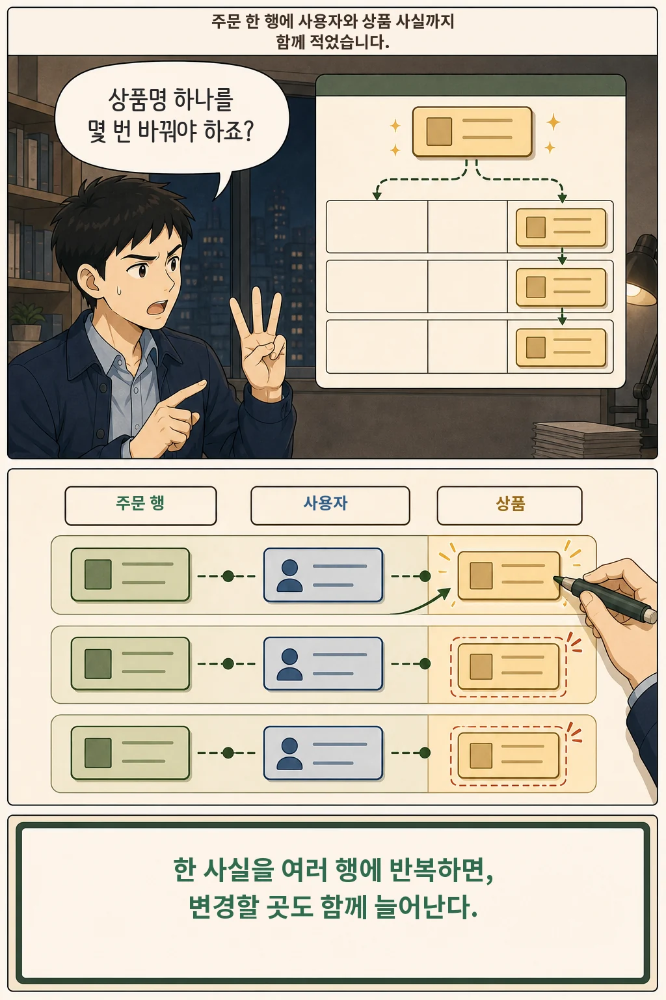
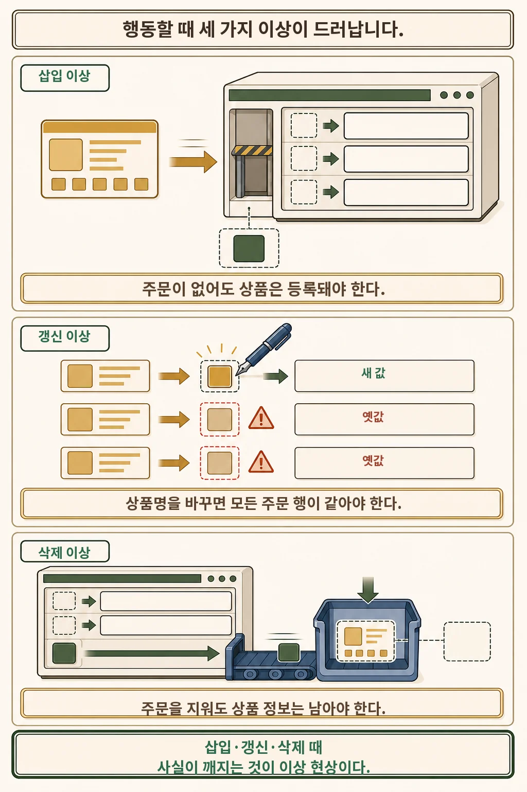
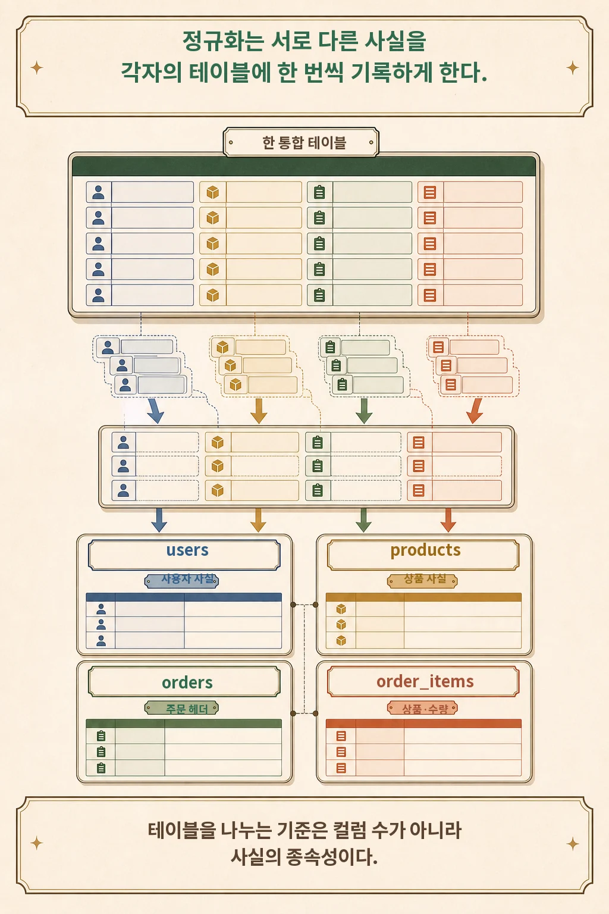
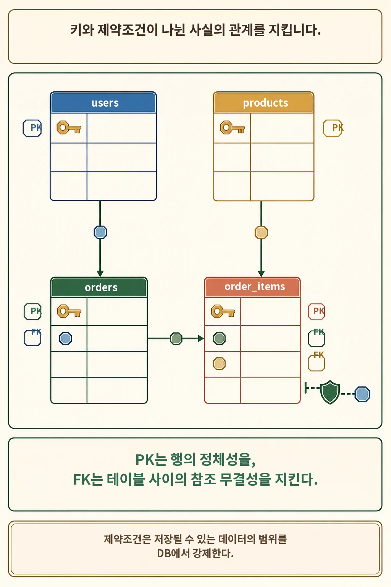
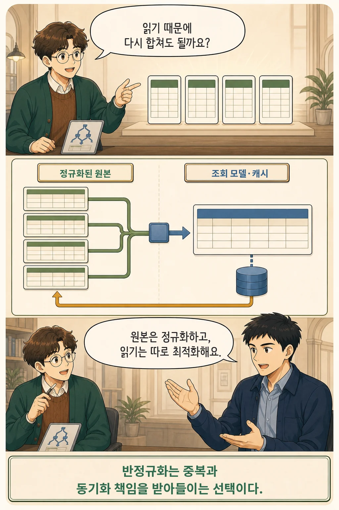

상품명을 하나 고쳤을 뿐인데 주문 내역마다 다른 이름이 남아 있거나, 마지막 주문을 지웠더니 상품 정보까지 사라진 상황을 겪어 보셨나요? 데이터베이스 정규화란 단순히 용량을 아끼려고 중복 컬럼을 없애는 작업이 아니라, 서로 다른 사실을 적절한 테이블과 관계로 나누어 삽입·갱신·삭제 이상을 줄이는 설계 과정입니다. 주문 도메인을 예로 들어 정규화의 핵심 원리와 반정규화의 트레이드오프를 살펴볼까요?

글·해설: 다메카솔

## 핵심 요약

- **무결성 중심 설계**: 정규화의 1차 목표는 용량 절약보다 **삽입·갱신·삭제 이상을 줄여 정합성을 지키는 것**입니다.
- **사실 단위 분리**: 주문 도메인은 `users`, `products`, `orders`, `order_items`처럼 **식별자(PK)와 수명 주기가 다른 사실**별로 나눕니다.
- **스냅샷 보존**: 현재 가격과 주문 당시 단가처럼 의미와 보존 시점이 다르면 별도 컬럼으로 둡니다.
- **단계적 최적화**: JOIN 증가만으로 반정규화하기보다 인덱스와 조회 모델을 먼저 살피고, 중복 저장 시 **갱신·복구 책임**을 정합니다.

## 한 번 고쳤는데 왜 행마다 값이 다를까


주문 화면을 편하게 구현하려고 필요한 컬럼을 모두 합친 통합 테이블 `orders_all`을 설계했다고 가정해 보겠습니다.

```text
orders_all(
  order_id, ordered_at, order_status,
  user_id, user_name, user_email,
  product_id, product_name, product_price,
  quantity
)
```

얼핏 보면 JOIN 없이 한 번에 조회할 수 있어 편해 보이죠. 하지만 이 테이블에는 식별 기준이 다른 네 가지 비즈니스 사실이 섞여 있습니다.

| 컬럼 묶음 | 의미하는 엔티티 | 식별 기준(Key) |
| :--- | :--- | :--- |
| `user_name`, `user_email` | 회원 정보 | `user_id` |
| `product_name`, `product_price` | 상품 정보 | `product_id` |
| `ordered_at`, `order_status` | 주문 헤더 | `order_id` |
| `product_id`, `quantity` | 주문 품목 상세 | `order_id + line_no` |

여기서 `product_name`은 `order_id`가 아니라 `product_id`에 종속되는 값입니다. 상품명을 바꿀 때 수백만 건의 주문 행을 전부 `UPDATE`하다가 단 한 행이라도 빠지면, 같은 상품에 서로 다른 이름이 공존하는 **데이터 불일치(Inconsistency)**가 남게 되죠.

## 중복 저장은 쓰기 비용과 불일치 위험을 키운다



Microsoft Learn 문서에서도 중복 데이터가 여러 곳에 흩어지면 변경 시 모든 위치를 똑같이 고쳐야 해 유지보수가 어려워진다고 설명합니다. 디스크 용량보다 **하나의 변경이 여러 쓰기 지점으로 번진다는 점**이 진짜 비용이거든요.

현업 DB에는 API 서버 외에도 배치 작업, 운영팀 수동 SQL, 공유 DB 서비스, 비동기 재처리 로직 등 여러 쓰기 경로가 동시에 접근합니다. 정규화는 이 위험을 **"상품명은 오직 `products`의 단 한 행에서만 바꾼다"**는 단일 진실 공급원(SSOT) 구조로 정리해 줍니다.

## 시스템을 망가뜨리는 3대 이상 현상



서로 다른 식별자와 수명 주기를 가진 사실을 한 행에 묶어두면 세 가지 이상 현상이 드러납니다. 실제 발생 여부는 `NULL` 허용과 키 설계에 따라 달라질 수 있습니다.

### 갱신 이상 (Update Anomaly)

상품 `P10`의 가격을 올렸는데 주문 행 3,000건 중 일부만 갱신되고 나머지가 누락되는 경우입니다. 같은 `P10`을 조회해도 행마다 다른 가격이 나오니 어느 값이 맞는지 알기 어렵죠.

### 삽입 이상 (Insertion Anomaly)

아직 주문(`order_id`)이 없는 신상품을 등록하려는데, 가짜 주문 번호나 `NULL` 값을 채워야 하거나 등록 자체가 막히는 상황입니다. 상품 생성 시점이 주문 사건에 묶여 버린 셈이죠.

### 삭제 이상 (Deletion Anomaly)

취소된 마지막 주문 1건을 지웠는데 그 행이 상품 상세 정보를 보관하던 유일한 행이었다면, 주문 이력과 함께 상품 마스터까지 사라집니다. 수명 주기가 다른 사실을 같은 행에 가둔 대가입니다.

## 정규화의 핵심: 사실의 소유권 분리



주문 도메인을 각 사실의 소유권에 따라 나누면 네 개의 역할 테이블로 정리됩니다.

```sql
CREATE TABLE users (
  user_id       BIGINT PRIMARY KEY,
  name          VARCHAR(100) NOT NULL,
  email         VARCHAR(255) NOT NULL UNIQUE
);

CREATE TABLE products (
  product_id    BIGINT PRIMARY KEY,
  name          VARCHAR(200) NOT NULL,
  current_price NUMERIC(12, 2) NOT NULL CHECK (current_price >= 0)
);

CREATE TABLE orders (
  order_id      BIGINT PRIMARY KEY,
  user_id       BIGINT NOT NULL REFERENCES users(user_id),
  ordered_at    TIMESTAMP NOT NULL,
  status        VARCHAR(30) NOT NULL
);

CREATE TABLE order_items (
  order_id      BIGINT NOT NULL REFERENCES orders(order_id),
  line_no       INTEGER NOT NULL,
  product_id    BIGINT NOT NULL REFERENCES products(product_id),
  quantity      INTEGER NOT NULL CHECK (quantity >= 1),
  unit_price    NUMERIC(12, 2) NOT NULL CHECK (unit_price >= 0),
  PRIMARY KEY (order_id, line_no)
);
```

이제 회원 이메일은 `users`에서, 상품명은 `products`에서 한 행만 고치면 끝납니다. 신상품은 주문 없이 등록되고, 주문을 지워도 상품 마스터는 안전하게 유지됩니다.

정규형 용어를 외우기보다 **"이 컬럼 값은 현재 테이블의 기본 키 전체에만 종속되는가?"**를 먼저 따져 보는 편이 빠릅니다. 한 칸에 원자적인 값만 두고(1NF), 복합 키 일부에만 걸리거나(2NF) 일반 컬럼을 거쳐 간접 결정되는 속성(3NF)을 떼어내는 기준이 모두 이 질문에서 출발하거든요.

## PK·FK 제약조건과 가격 스냅샷의 구분



테이블을 나눈 뒤에는 제약조건으로 경계를 세워야 합니다. PostgreSQL 공식 문서의 정의처럼 기본 키(PK)는 행을 유일하게 식별하며 `NULL`을 막고, 외래 키(FK)는 참조 대상이 실제 존재하도록 강제해 참조 무결성을 지킵니다. `NOT NULL`, `UNIQUE`, `CHECK`를 더하면 앱 검증을 우회하는 배치나 수동 SQL로부터 저장소 계층을 방어할 수 있으며, 여러 행을 아우르는 불변조건은 트랜잭션·잠금으로 보완합니다.

한편 `products.current_price`와 `order_items.unit_price`를 둘 다 두면 중복이 아니냐는 질문을 자주 받습니다. 예를 들어 내일 상품 가격이 10% 인상되더라도 지난달 고객이 결제한 영수증 금액은 그대로 유지되어야 하거든요.

- **`products.current_price`**: 현재 판매 중인 마스터 가격으로 언제든 변동됩니다.
- **`order_items.unit_price`**: 주문 확정 시점에 체결된 계약 단가로 이후에도 불변입니다.

Google Cloud 문서 역시 계약·송장처럼 원본 변경과 무관하게 보존할 값은 의도적인 스냅샷으로 설명합니다. 두 값은 숫자만 같아 보일 뿐 수명 주기가 다른 별개의 사실입니다.

## 원본은 정규화하고 읽기는 따로 최적화한다



테이블이 네 개로 나뉘면 조회 시 JOIN 연산이 늘어나는 것은 자연스러운 결과입니다. 하지만 성능이 느려질 것 같다는 우려만으로 처음부터 테이블을 합치는 선택은 피하는 편이 좋습니다.

실무에서는 다음 단계로 읽기 성능을 높이는 것이 안정적입니다.

1. **인덱스·쿼리 최적화**: FK와 `WHERE` 컬럼에 복합 인덱스를 두고, N+1 호출을 `JOIN FETCH`나 배치 조회로 제거합니다.
2. **읽기 전용 모델 분리**: 실행 계획상 집계가 병목이면 Redis 캐시, Materialized View, Elasticsearch 같은 검색 엔진이나 CQRS 조회 모델로 읽기 경로를 나눕니다.
3. **선택적 반정규화**: 테이블에 중복 컬럼을 둔다면 **갱신 주체, 허용 지연, 검증·복구 방법**을 함께 정해야 합니다.

반정규화는 정규화의 실패가 아니라, 읽기 단순함을 얻고 그 대가로 동기화 책임을 떠안는 트레이드오프인 셈이죠.

## 다메카솔의 해석: 모델링의 완성은 제약조건과 동기화 책임

데이터베이스 정규화는 테이블을 잘게 쪼개는 기술이 아니라, 도메인 규칙과 데이터 생명주기를 스키마에 못 박는 작업입니다. 모델을 리뷰할 때는 세 가지를 함께 점검해 볼 만합니다.

- **단일 진실 공급원(SSOT)**: 마스터 데이터의 수정 경로가 단일 테이블·행으로 수렴하는가?
- **비즈니스 스냅샷 분리**: 주문 단가나 배송지처럼 시간에 따라 고정할 계약 사실을 마스터와 구분했는가?
- **저장소 계층 제약조건**: PK, FK, `NOT NULL`, `CHECK`를 DB 엔진에 걸어 앱 버그나 배치를 방어하는가?

## 함께 읽을 DB 핵심 원리

- [트랜잭션 ACID와 Commit/Rollback의 내부 동작 원리](/posts/transaction-acid-commit-rollback/): 쓰기 정합성을 보장하는 WAL 로그와 잠금 메커니즘
- [SQL 선언형 모델과 옵티마이저가 쿼리를 실행하는 법](/posts/sql-declarative-language/): JOIN과 인덱스 실행 계획 분석

## 출처

- [Microsoft Learn — 데이터베이스 정규화 기본 사항에 대한 설명](https://learn.microsoft.com/ko-kr/office/troubleshoot/access/database-normalization-description)
- [PostgreSQL Documentation — Constraints](https://www.postgresql.org/docs/current/ddl-constraints.html)
- [Google Cloud — What is database normalization?](https://cloud.google.com/discover/what-is-database-normalization)
- [Microsoft Learn — Modeling for Performance](https://learn.microsoft.com/en-us/ef/core/performance/modeling-for-performance)

주문 통합 테이블 예시는 이상 현상을 설명하기 위해 구성한 개념 모델이며, 별도 벤치마크 측정은 포함하지 않았습니다.

이 글의 본문과 이미지는 생성형 AI로 제작했습니다. 기획과 편집 기준은 다메카솔이 정했습니다.
