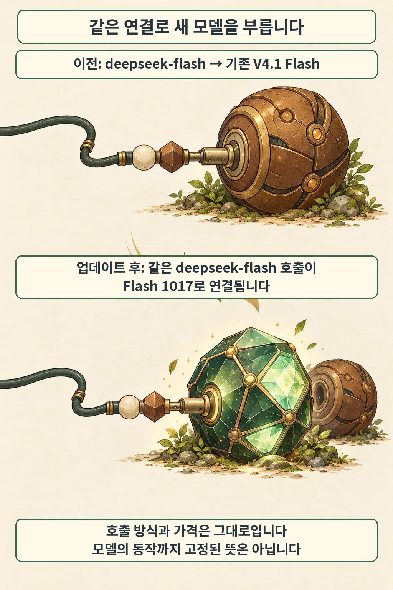
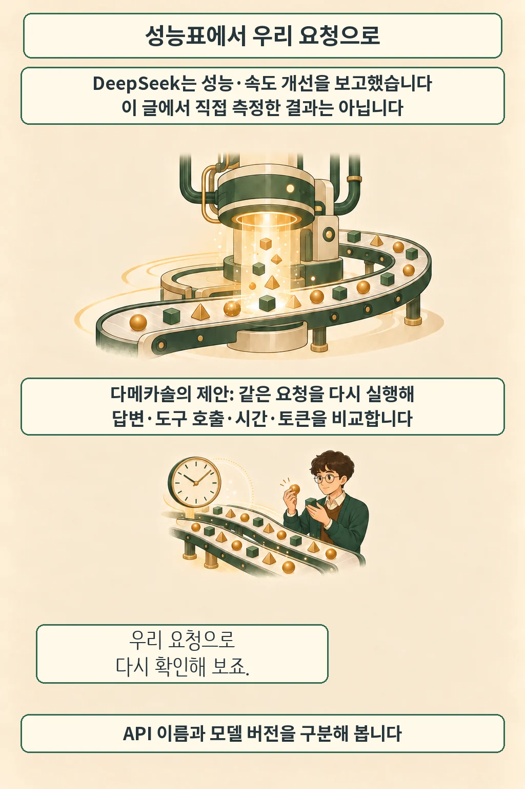

API 엔드포인트와 모델 이름을 한 글자도 바꾸지 않았는데, 어느 날부터 에이전트의 응답 길이와 도구 호출 패턴이 달라진다면 어떻게 확인해야 할까요? DeepSeek가 2026년 10월 17일 V4.1 Flash를 새 버전으로 업데이트하면서, 기존 `deepseek-flash` API 별칭 뒤의 실제 모델이 교체됐습니다. 호출 방식과 토큰 단가는 그대로 유지되지만, 서비스에서 검증해 둔 답변 형식과 도구 인자가 계속 안정적으로 동작하는지는 직접 점검해 볼 필요가 있습니다.

글·해설: 다메카솔

## 같은 이름 뒤에서 바뀐 것

기존에 `model` 파라미터를 `deepseek-flash`로 지정해 쓰던 서비스라면 연동 코드를 고칠 부담이 적습니다. [공식 변경 기록](https://api-docs.deepseek.com/updates/#date-2026-10-17)에 따르면 기존 API 별칭이 새 모델로 곧바로 연결되기 때문에, 호출 코드는 그대로 둔 채 응답을 생성하는 백엔드 모델만 교체되는 구조거든요. 공식 웹과 앱 역시 `DeepSeek-V4.1-Flash-1017`로 함께 전환됐습니다.

| 이용 경로 | 10월 17일 공식 안내 |
| --- | --- |
| DeepSeek 웹·앱 | `DeepSeek-V4.1-Flash-1017`로 업데이트 |
| DeepSeek API | `deepseek-flash` 별칭 유지, 호출 방식·토큰 단가 동일 |
| 공개 가중치 | 공식 저장소에 코드·가중치 공개(MIT 라이선스) |

공개 가중치를 내려받아 자체 서버에 올리는 경우에는 사전 확인이 하나 더 필요합니다. [공식 모델 카드](https://huggingface.co/deepseek-ai/DeepSeek-V4.1-Flash-1017)는 프롬프트를 모델 입력으로 인코딩하는 구현 코드와 로컬 추론 가이드를 함께 제공하지만, Jinja 형식의 채팅 템플릿(`chat_template`)은 빠져 있다고 명시하고 있습니다. 따라서 자체 추론 서버에 모델을 붙일 때는 기본 템플릿에 의존하기보다 공식 인코딩 구현에 맞춰 입력 포맷 처리를 먼저 맞추는 편이 안전합니다.

## 성능표를 읽을 때 함께 볼 조건

DeepSeek는 이번 업데이트로 추론·코딩·에이전트·시각 과제의 성능을 높이는 동시에 작업 시간과 출력 길이를 줄였다고 발표했습니다. 모델 카드에 실린 주요 코딩·에이전트 벤치마크 비교 중 두 항목을 정리하면 아래와 같습니다.

| 공급사 보고 항목 | 기존 V4.1 Flash | Flash 1017 | 공지된 실행 프레임워크 |
| --- | ---: | ---: | --- |
| Terminal-Bench 4.0 | 31.2 | 42.3 | Claude Code |
| DeepSWE v1.1 | 74.2 | 77.0 | Mini-SWE-V2 |

여기서 눈여겨볼 대목은 점수 옆에 적힌 실행 프레임워크와 하네스 조건입니다. 두 수치는 모두 DeepSeek가 자체 보고한 결과이며, 공지에서는 DeepSeek Harness를 함께 쓸 때 `0.2.1-rc.1` 이상 버전으로 업그레이드할 것을 권장하고 있죠. 게다가 토큰 단가가 같고 평균 출력 길이가 줄었더라도, 실제 서비스의 총비용이 반드시 함께 줄어든다고 보기는 어렵습니다. 가령 코딩 에이전트가 파일 수정 과정에서 도구 호출을 한두 번 더 반복하거나 재시도가 늘어나면 전체 토큰 소모량은 오히려 달라질 수 있거든요. 결국 실제 트래픽에서 응답 시간과 호출 횟수가 어떻게 변하는지는 운영 환경의 로그로 확인해야 하는 셈이죠.

## 다메카솔의 해석: 이름보다 요청 기록을 기준으로

고정된 API 별칭(`deepseek-flash`) 뒤에서 모델이 교체되면 배포 설정이나 코드 커밋 이력만 봐서는 변경 시점을 놓치기 쉽습니다. 특히 JSON 스키마를 엄격하게 파싱하는 도구 호출이나 사내 자동화 파이프라인을 운영 중이라면, 10월 17일 공지 시점을 기점으로 대표 요청 묶음을 다시 실행해 보는 회귀 점검을 두는 편이 좋습니다. 예를 들어 PR 코드 리뷰나 이슈 분류처럼 반복 호출되는 대표 시나리오를 정해 두고 아래 항목을 전후로 나란히 비교해 보는 거죠.

- **응답 품질과 JSON 도구 인자**: 함수 이름, 필수 키, 타입 형식이 기존 파서와 어긋나지 않는지 확인합니다.
- **오류율과 재시도 횟수**: 타임아웃이나 포맷 오류로 재호출이 늘어나는지 살펴봅니다.
- **응답 시간과 토큰 사용량**: 입력·출력 토큰 합계와 체감 지연 시간이 실제로 줄었는지 기록합니다.

외부 연구나 벤치마크 글을 읽을 때도 모델 버전의 경계를 구분해 볼 필요가 있습니다. 앞서 소개한 [StateMem의 상태 추적 실험](/posts/statemem-agent-memory-state-tracking/)만 해도 업데이트 이전의 DeepSeek V4 Flash를 기준으로 측정한 결과라, 이번 1017 버전의 성적표를 그 실험에 그대로 포개어 해석하기는 어렵습니다. 변하지 않는 API 별칭보다 날짜와 실행 조건이 함께 남은 자체 검증 로그를 운영 기준으로 삼으시길 권합니다.

## 출처

- [DeepSeek 공식 변경 기록 — 2026-10-17](https://api-docs.deepseek.com/updates/#date-2026-10-17)
- [공식 Flash 1017 모델 카드·코드·가중치](https://huggingface.co/deepseek-ai/DeepSeek-V4.1-Flash-1017)
- [공식 저장소 변경 이력](https://huggingface.co/deepseek-ai/DeepSeek-V4.1-Flash-1017/commits/main): 공개 릴리스 커밋 시각은 2026-10-17 05:46:55 UTC이며, 변경 기록 페이지의 게시 시각은 별도 표시되지 않았습니다.

발표 내용과 벤치마크 수치는 DeepSeek 공식 문서를 대조해 정리했으며, 공개 가중치의 로컬 실행이나 벤치마크 재측정은 수행하지 않았습니다. 이 글의 본문과 이미지는 생성형 AI로 제작했습니다. 기획과 편집 기준은 다메카솔이 정했습니다.
