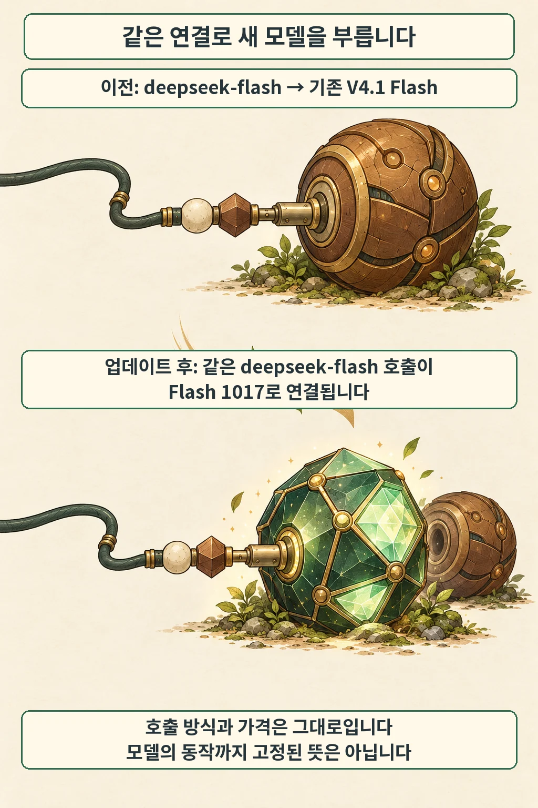
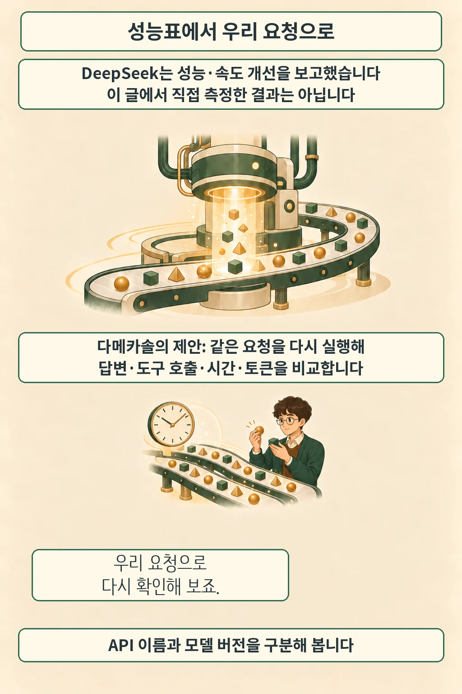

글·해설: 다메카솔

발행·확인: 2026-10-18

**API 이름을 그대로 써도 응답을 만드는 모델은 바뀝니다.** DeepSeek는 10월 17일 V4.1 Flash를 `DeepSeek-V4.1-Flash-1017`로 업데이트하고, 웹·앱과 `deepseek-flash` API 엔드포인트에 새 버전을 반영했다고 공지했습니다. 호출 방식과 토큰 단가가 그대로 유지돼 연동 코드를 바로 고칠 부담은 적지만, 기존에 검증해 둔 답변 형식이나 도구 호출 인자까지 똑같이 유지되는지는 별도로 점검해야 합니다. ([공식 변경 기록](https://api-docs.deepseek.com/updates/#date-2026-10-17))

## 같은 이름 뒤에서 바뀐 것

API 요청에서 `model` 값을 `deepseek-flash`로 지정해 쓰던 서비스는 코드의 모델 이름을 바꿀 필요가 없습니다. 공식 안내에 따라 기존 별칭이 새 버전으로 바로 연결되므로, 호출 코드는 그대로 둔 채 뒤쪽 모델만 교체되는 구조입니다.

| 이용 경로 | 10월 17일 공식 안내 |
| --- | --- |
| DeepSeek 웹·앱 | 새 버전으로 업데이트 |
| DeepSeek API | `deepseek-flash` 유지, 호출 방식·가격 동일 |
| 공개 가중치 | 공식 저장소에 Flash 1017 코드·가중치 공개, MIT 라이선스 명시 |

가중치를 내려받아 직접 호스팅하는 경우에는 준비 절차가 다릅니다. [공식 모델 카드](https://huggingface.co/deepseek-ai/DeepSeek-V4.1-Flash-1017)는 프롬프트를 모델 입력으로 변환하는 구현과 로컬 추론 가이드를 제공하지만, Jinja 형식의 채팅 템플릿(`chat_template`)은 포함하지 않는다고 명시하고 있어 자체 추론 서버에 올릴 때는 입력 포맷 처리를 먼저 확인해야 합니다.

## 성능표를 읽을 때 함께 볼 조건

DeepSeek는 이번 업데이트에서 추론·코딩·에이전트·시각 과제의 성능을 높이면서 작업 시간과 출력 길이를 줄였다고 밝혔습니다. 모델 카드에 실린 주요 코딩·에이전트 벤치마크 비교 중 두 항목은 아래와 같습니다.

| 공급사 보고 항목 | 기존 V4.1 Flash | Flash 1017 | 공지된 실행 프레임워크 |
| --- | ---: | ---: | --- |
| Terminal-Bench 4.0 | 31.2 | 42.3 | Claude Code |
| DeepSWE v1.1 | 74.2 | 77.0 | Mini-SWE-V2 |

표를 읽을 때는 점수 옆에 적힌 실행 프레임워크와 평가 조건을 함께 봐야 합니다. 위 수치는 DeepSeek의 자체 보고값이며, DeepSeek Harness를 사용할 때는 `0.2.1-rc.1` 이상 버전을 권장하고 있습니다. 또한 API 토큰 단가가 같고 평균 출력 길이가 줄었다는 공급사 설명이 곧바로 개별 서비스의 비용 절감을 보장하지는 않으므로, 실제 운영 환경에서 토큰 소비량과 도구 호출 횟수, 재시도 빈도가 어떻게 달라지는지 직접 확인해야 합니다.

## 다메카솔의 해석: 이름보다 요청 기록을 기준으로

고정된 API 별칭(`deepseek-flash`) 뒤에서 모델이 업데이트될 때는 배포 설정이나 코드 커밋 이력만으로는 변경 시점을 알아채기 어렵습니다. 따라서 이번 공지 시점을 기준으로 **서비스의 대표 요청 묶음을 다시 실행해 보는 회귀 점검**을 두는 편이 안전합니다. 같은 입력과 실행 조건에서 최종 답변 품질뿐 아니라 도구에 넘긴 JSON 인자 형식, 오류·재시도 횟수, 응답 시간과 토큰 사용량을 나란히 비교하면 모델 교체의 실제 영향을 한눈에 파악할 수 있습니다.

아울러 이전 버전 모델을 사용한 외부 연구 결과를 읽을 때도 버전 경계를 구분해야 합니다. 예를 들어 앞서 소개한 [StateMem의 상태 추적 실험](/posts/statemem-agent-memory-state-tracking/)은 업데이트 이전의 DeepSeek V4 Flash로 측정한 결과이므로, 이번 1017 버전의 성적표를 그 실험에 그대로 대입할 수는 없습니다. 변하지 않는 API 이름보다 날짜와 실행 조건이 기록된 자체 검증 로그를 운영 기준으로 삼기를 권합니다.

## 출처

- [DeepSeek 공식 변경 기록 — 2026-10-17](https://api-docs.deepseek.com/updates/#date-2026-10-17)
- [공식 Flash 1017 모델 카드·코드·가중치](https://huggingface.co/deepseek-ai/DeepSeek-V4.1-Flash-1017)
- [공식 저장소 변경 이력](https://huggingface.co/deepseek-ai/DeepSeek-V4.1-Flash-1017/commits/main): 공개 릴리스 커밋은 2026-10-17 05:46:55 UTC이며, 변경 기록 페이지의 게시 시각은 별도 표시되지 않았습니다.

발표 내용과 벤치마크 수치는 DeepSeek 공식 문서를 대조해 정리했으며, 공개 가중치의 로컬 실행이나 벤치마크 재측정은 수행하지 않았습니다. 이 글의 본문과 이미지는 생성형 AI로 제작했습니다. 기획과 편집 기준은 다메카솔이 정했습니다.
