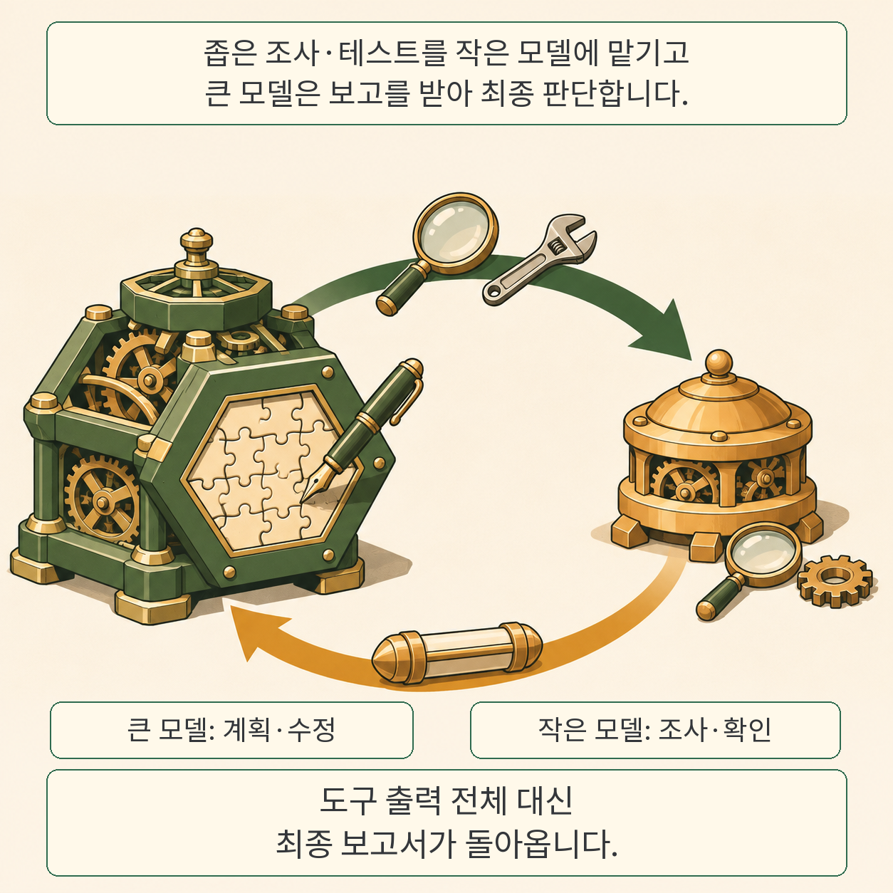

코딩 에이전트가 파일을 찾고 테스트를 돌릴 때마다 비싼 모델을 호출하면, 정작 코드를 고치는 일보다 주변 작업에 비용이 쌓일 수 있습니다. Delegent는 큰 모델이 작업을 끝까지 이끌면서 작은 모델에 조사와 확인을 나눠 주는 연구입니다. 핵심은 모델 교체보다 **무엇을 맡기고 어떤 결과를 돌려받을지**에 있습니다.

글·해설: 다메카솔

## 최종 판단은 남기고 주변 작업을 나눕니다

일반적인 모델 라우터는 질문 전체를 어느 모델에 보낼지 고릅니다. Delegent에서는 큰 모델이 계획을 세우고 최종 패치나 답을 작성합니다. 작은 언어 모델, 즉 SLM은 관련 파일 찾기나 실패 재현처럼 범위가 좁은 일을 맡죠. 모델이나 라우터를 추가 학습하지 않고, Claude Code의 실행 흐름 주변에 역할별 호출 경로를 붙였습니다.

예를 들어 재시도 기능에 버그가 있다면, 작은 모델에 관련 함수와 실패하는 테스트를 찾아 보고하도록 맡길 수 있습니다. 큰 모델은 그 보고를 확인한 뒤 수정 방향을 정하고 코드를 고칩니다. 하위 에이전트가 읽은 파일과 도구 출력 전체가 상위 대화에 들어오는 대신, 필요한 결과가 담긴 최종 보고서만 돌아옵니다.

검색 작업에서는 보고서가 가리킨 문서에 인용 문장이 실제로 있는지도 검사합니다. 인용이 존재한다는 확인 뒤에도 그 내용이 질문에 답하는지는 큰 모델이 판단해야 합니다. 에이전트가 오래 일할수록 맥락 비용이 쌓인다는 점은 [에이전트 메모리 연구](/posts/agent-memory-dose/)와도 연결되는데요. 여기서는 과거 기록을 저장하는 방식보다 현재의 조사 작업을 어디서 수행할지에 초점을 맞춥니다.

## 비용은 줄었지만 무엇을 센 값일까요?

저자들은 코딩과 검색 과제로 이 구조를 비교했습니다. 아래는 긴 코딩 작업을 다루는 DeepSWE 표본의 결과입니다. 주 모델은 GPT-6.1-Sol의 high 추론 설정이며, 기준 실험에서도 프롬프트 캐시를 사용했습니다. 기준의 하위 에이전트와 보조 호출까지 모두 큰 모델로 처리했다는 비교 조건도 중요합니다.

| DeepSWE 50문제 | 해결 수 | 큰 모델 비용/문제 | 작은 모델 API 환산 포함 |
| --- | --- | --- | --- |
| 큰 모델로 모든 호출 처리 | 29 | $2.110 | $2.110 |
| Qwen3.8-27B-FP8에 위임 | 29 | $0.704 | $0.806 |
| MiniCPM5-2B에 위임 | 30 | $0.712 | 환산값 없음 |

Qwen 조건에서는 해결 수가 같으면서 큰 모델 비용이 기준의 약 3분의 1로 줄었습니다. 다만 마지막 열도 논문이 사용한 API 요금으로 계산한 값입니다. 로컬 GPU 구매비·전력·운영 부담까지 합친 총비용은 별도로 봐야 하죠. 표의 요금은 연구 당시 계산 기준이며 현재 서비스 견적을 뜻하지 않습니다.

검색 과제에서도 전체 정답 수는 같고 큰 모델의 평균 비용은 내려갔습니다. 대신 작은 모델을 기다리는 시간이 생겼습니다.

| 비교 항목 | 기준 | Qwen 위임 |
| --- | --- | --- |
| 검색 694문제의 정답 수 | 663 | 663 |
| 검색의 큰 모델 평균 비용 | $0.091 | $0.037 |
| DeepSWE 작업 시간 중앙값 | 25분 | 38분 |

검색 실험에는 작은 모델의 토큰 비용이 집계되지 않았습니다. 작업 시간은 여러 종류의 공유 서버 GPU에서 측정했으므로, 노트북에서도 같은 시간이 나온다고 기대하기는 어렵습니다. 비용을 줄이는 선택이 곧 응답을 빠르게 만드는 선택은 아닌 셈이죠.

## 작은 모델을 붙이는 것만으로는 부족했습니다

연구의 비교 실험에서 눈에 띄는 부분은 위임 지시문입니다. 같은 DeepSWE 표본에서 별도 지시문 없이 MiniCPM에 일을 넘겼을 때는 해결 수가 22개였지만, 조사·확인을 맡기고 주요 코드 변경은 큰 모델이 하도록 안내한 조건에서는 30개였습니다. 기준의 29개와 함께 보면, 작은 모델의 크기뿐 아니라 역할을 정하는 방식이 결과에 영향을 줬음을 알 수 있습니다.

지시문만 추가하고 하위 모델도 큰 모델로 유지한 조건에서도 비용이 줄었습니다. 따라서 절감 전체를 저렴한 모델로 바꾼 효과로 돌릴 수는 없습니다. 더구나 코딩 표본은 비교 시스템들이 인프라 장애 없이 실행을 마친 작업에서 골랐고, 에이전트 실행 자체도 매번 같지 않습니다. 여기서 관찰한 해결 수만으로 모든 저장소에서 품질이 유지된다고 결론 내릴 수는 없어요.

## 다메카솔의 해석

이 논문에서 가져올 만한 설계 질문은 “가장 작은 모델이 어디까지 코딩할 수 있나”보다 “최종 수정자가 빠르게 확인할 수 있는 일을 얼마나 분리할 수 있나”입니다. 파일 위치, 재현 명령, 실패 메시지처럼 확인 가능한 결과를 요구하면 위임의 경계가 구체적이 됩니다. 반대로 수정 책임까지 모호하게 넘기면 보고를 다시 조사하는 비용이 생길 수 있겠죠.

실제로 적용을 판단한다면 큰 모델 요금, 작은 모델 운영비, 완료 시간, 최종 테스트 결과를 같은 작업 묶음에서 함께 비교하는 편이 좋겠습니다. 기다릴 수 있는 긴 작업과 즉시 답이 필요한 짧은 작업은 분리해서 봐야 합니다. 논문에서도 짧은 작업 일부는 위임했을 때 오히려 큰 모델 비용이 늘었습니다.

## 출처

- Lingwei Gu, Jimmy Lin, [Delegent: A Multi-Agent Harness That Reduces Cost without Sacrificing Performance](https://arxiv.org/abs/2611.33098v1), arXiv v1, 2026-11-24 공개. 방법 §2, 결과 표 1–3, 한계와 부록 A–C.
- [논문 전체 HTML](https://arxiv.org/html/2611.33098v1). 저자가 제시한 코드 주소 `github.com/castorini/delegent`는 2026-11-25 확인 시 404를 반환했습니다.

논문 원문을 해설했으며 실험을 독립 재현하지 않았습니다. 만화는 새로 구성했고 논문 그림을 복제하지 않았습니다.

이 글의 본문과 이미지는 생성형 AI로 제작했습니다. 기획과 편집 기준은 다메카솔이 정했습니다.
