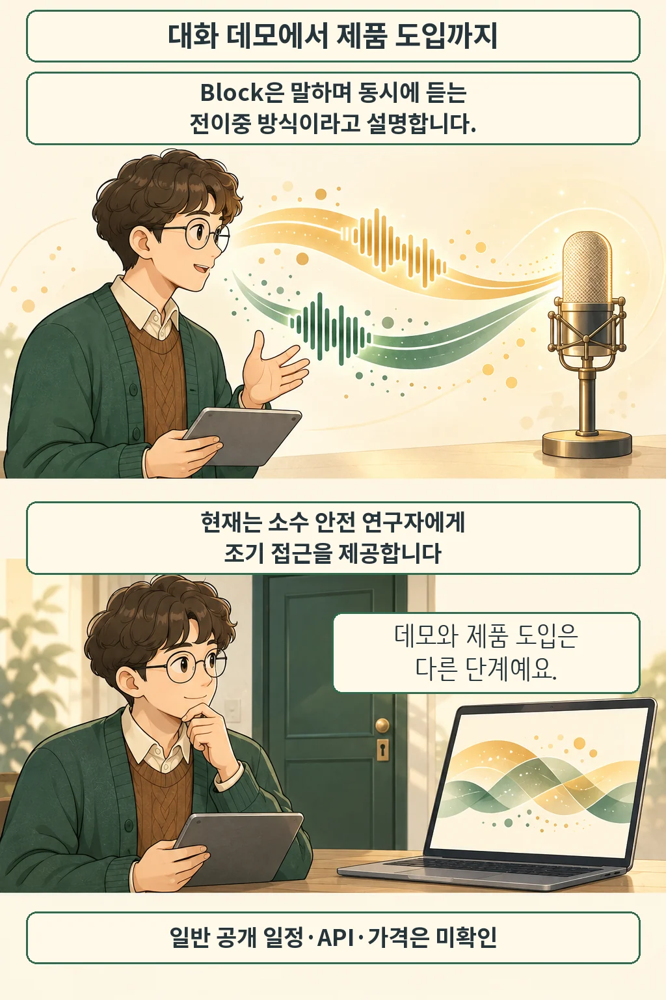

글·해설: 다메카솔

Block은 2026년 10월 23일 **Dessa**를 소개했습니다. 사람의 대화 음성만으로 처음부터 학습했다는 음성 모델입니다. 10월 26일 확인한 공식 페이지는 연구 프리뷰를 안내하며, 대기 등록과 소수 AI 안전 연구자의 조기 접근을 받습니다. 지금 누구나 내려받아 쓰는 공개 모델로 이해하면 안 됩니다.

## 문장뿐 아니라 말하는 타이밍까지

Block에 따르면 Dessa는 텍스트나 사전학습 모델 없이 학습했고, 음성을 받아 음성으로 답합니다. 말하는 동안에도 상대의 소리를 듣는 **전이중(full-duplex)** 방식으로, 끼어들기와 맞장구 같은 타이밍도 다룬다고 설명합니다.

같은 “괜찮아요”라도 힘없이 말할 때와 밝게 말할 때는 듣는 사람이 받아들이는 뜻이 달라집니다. 음성 인터페이스를 설계할 때는 문장의 내용과 함께 억양·쉼·발화가 겹치는 순간을 살펴볼 이유가 있습니다. 이 예시는 원리를 설명하기 위한 것이며, Dessa가 한국어 감정을 정확히 판별했다는 실험 결과가 아닙니다.

## 노트북 실행 주장과 다운로드 가능 여부

회사는 **MacBook Pro M4 Max 이상**에서 로컬로 실행되며 추론이 실시간보다 빠르다고 주장합니다. 공개 페이지에는 이를 재현할 메모리 조건·지연시간 측정법·배포 가중치가 제시돼 있지 않습니다. 따라서 “내 노트북에서 바로 실행 가능”이나 다른 모델 대비 성능 우위로 확대할 근거는 없습니다. 이번 글에서도 모델을 직접 실행하거나 성능을 측정하지 않았습니다.

페이지의 녹음은 회사가 골라 공개한 데모입니다. 데모 설명과 모델의 안정적인 실제 동작, 감정 표현과 안전성 입증을 구분해서 읽어야 합니다. 일반 공개 일정·API·가격·한국어 지원 범위는 확인되지 않았습니다.

## 개발자가 구분해 볼 두 가지

다메카솔의 해석은 이렇습니다. 음성 모델을 비교할 때 **대화가 자연스럽게 이어지는가**와 **내 서비스에 연결할 수 있는가**를 따로 물어야 합니다. 전자는 발화 타이밍과 응답을, 후자는 접근 권한·배포물·운영 조건을 확인하는 질문입니다. 연구 데모가 첫 질문의 가능성을 보여 줘도 두 번째 질문의 답까지 주지는 않습니다.

음성 처리 단계를 나눠 살펴보려면 [Voxtral 3의 음성 에이전트 파이프라인](/posts/voxtral-3-voice-agent-pipeline/)도 함께 읽을 수 있습니다. 두 발표는 서로 다른 구조와 이용 조건을 설명하므로 여기서 성능 순위를 매기지는 않습니다.

## 출처

- [Block, Dessa 공식 소개](https://block.xyz/dessa) — 학습 방식·전이중 대화·하드웨어 주장·접근 범위. 페이지 자체의 게시일은 표시되지 않으며, 2026-10-26 확인했습니다.
- [Block 공식 발표](https://x.com/blocks/status/2113677471417819386) — 2026-10-23. 공식 게시물의 공개 임베드 응답으로 발표일과 소개 문구를 확인했습니다.

이 글의 본문과 이미지는 생성형 AI로 제작했습니다. 기획과 편집 기준은 다메카솔이 정했습니다.
