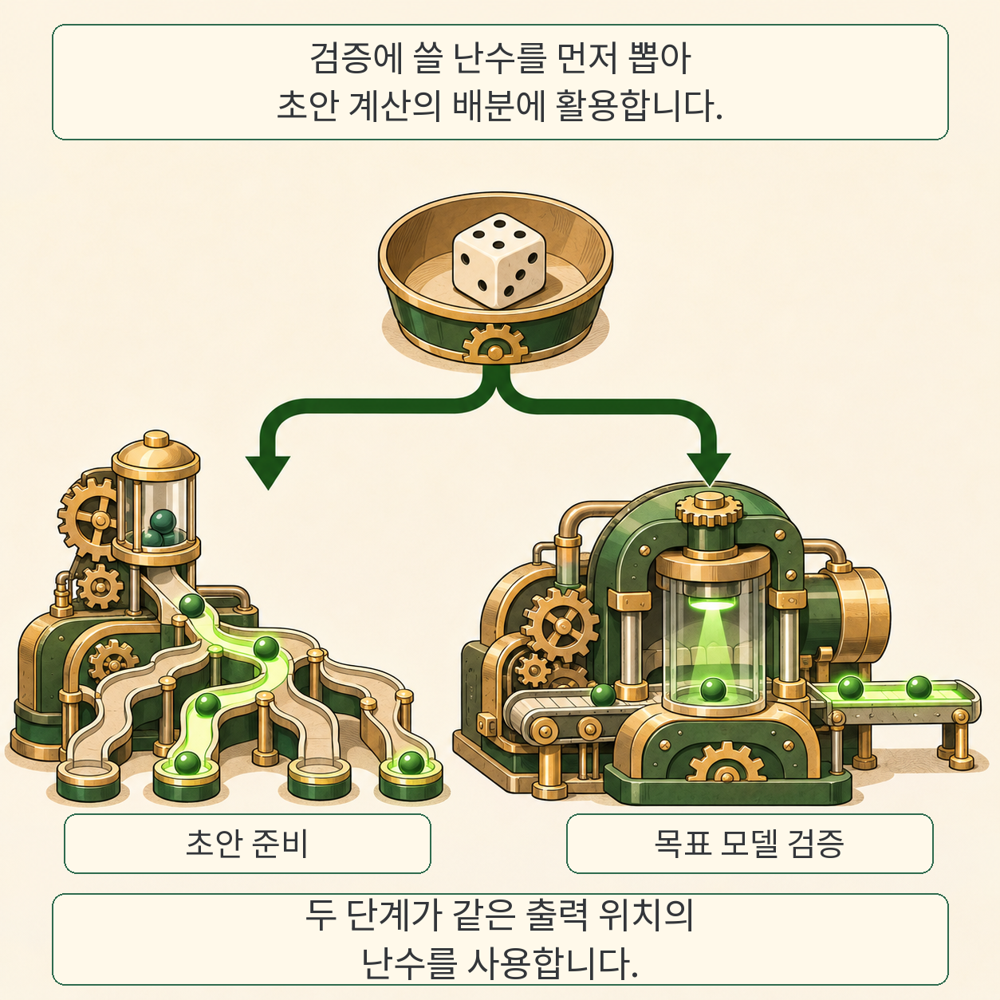
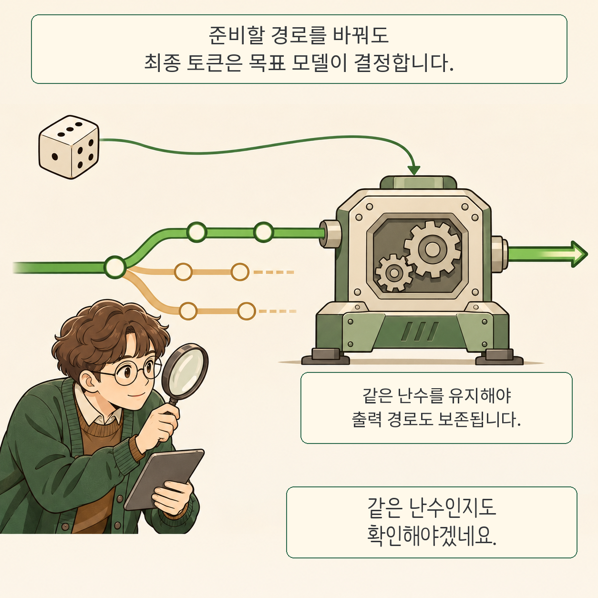

작은 모델이 다음 문장을 미리 써 놓아도, 큰 모델이 다른 길을 고르면 준비한 계산이 낭비됩니다. DICE는 이 낭비를 줄이기 위해 나중에 검증에 사용할 난수를 먼저 뽑아 초안 준비에도 활용합니다. 답변을 뽑는 규칙을 유지하면서, 계산을 어디에 쓸지 바꾸는 연구입니다.

글·해설: 다메카솔

## 큰 모델의 예측과 난수는 다르게 다룰 수 있습니다

추측 디코딩은 작은 초안 모델인 드래프터가 여러 토큰을 준비하고, 큰 목표 모델이 한 번에 확인하는 방식입니다. 모든 후보를 준비하기에는 계산량이 부족하므로 실제 출력으로 이어질 경로를 잘 골라야 하죠. 이 과정에는 아직 계산하지 않은 목표 모델의 예측과, 확률에 따라 토큰을 뽑을 때 쓰는 난수라는 두 가지 불확실성이 있습니다.

목표 모델의 예측은 계산해야 알 수 있지만 난수는 미리 뽑을 수 있습니다. 논문의 도입 예시는 이 차이를 작은 수식으로 보여 줍니다. 고정된 초안 토큰의 확률을 q, 목표 모델의 확률을 p, 검증 난수를 u라고 하면 수락 조건은 `u × q ≤ p`입니다.

| 고정된 초안의 예시 | 작은 난수 | 큰 난수 |
| --- | --- | --- |
| 초안 확률 q | 0.5 | 0.5 |
| 미리 뽑은 u | 0.1 | 0.9 |
| 수락에 필요한 p | 0.05 이상 | 0.45 이상 |

아직 p를 모르더라도 이번 검증이 어느 문턱을 사용할지는 알 수 있습니다. 예를 들어 다음 단어 뒤를 더 길게 준비할지, 거절될 경우의 다른 경로를 준비할지 판단하는 데 이 정보가 도움이 될 수 있겠죠. 이 표는 원리를 설명하는 예시이며, 처리량 실험값은 아래에서 따로 살펴봅니다.

## 같은 난수가 초안과 검증을 연결합니다

DICE의 트리 방식은 드래프터의 점수에 미리 뽑은 검벨(Gumbel) 난수를 결합합니다. 검벨 난수는 점수에 더해 확률적으로 후보를 고르는 데 쓰이는 값입니다. 이 정보를 후보 생성, 다음 가지 확장, 최종 검증할 노드 선택에 모두 반영합니다. 한 갈림길에서만 잘 골라도 나머지 계산을 엉뚱한 경로에 쓰면 효과가 작기 때문입니다.

목표 모델은 자신의 실제 점수와 같은 난수로 최종 토큰을 결정합니다. 논문의 증명은 난수를 출력 위치에 연결하고, 아직 쓰지 않은 값은 다음 회차에 이어 쓸 때 같은 난수의 순차 생성 결과가 유지됨을 보입니다. 초안이 잘못 예상해도 출력 결정을 대신하는 것은 아닙니다.

‘추가 학습 없음’에도 준비 작업은 있습니다. 저자들은 목표·초안 모델 조합마다 점수의 두 계수를 보정합니다.

| 보정에 쓰인 관찰 | 논문의 설명 |
| --- | --- |
| 최초 노드 수 | 2,000개 |
| 프롬프트 분량 | 보통 1~3개 |

모델 가중치를 다시 학습하는 일과 후보 점수를 조정하는 일을 구분해서 읽어야 합니다.

## 처리량 개선은 같은 조건끼리 비교합니다

저자들은 여러 드래프터와 추론 엔진에서 초안 트리를 평가했습니다. 아래는 원문 표의 SPEED-Bench 결과 중 두 사례이며, 각 행 안에서 모델 가중치와 엔진을 유지했습니다.

| 평가 범위와 공통 조건 | 설정 |
| --- | --- |
| 전체 트리 평가 | 모델 조합 16개, 엔진 구분 시 18개 구성 |
| 아래 사례의 하드웨어 | H200 GPU |
| 샘플링 온도 / 동시 요청 | 1 / 1 |

| 목표 모델 / 드래프터 / 엔진 | 기존 트리 방식 | DICE | 논문의 상대 개선율 |
| --- | --- | --- | --- |
| Llama-3.1-8B / EAGLE-3 / Transformers | 53.1토큰/초 | 66.2토큰/초 | 24.62% |
| Qwen3.8-27B / EAGLE-4 / vLLM | 377.6토큰/초 | 456.4토큰/초 | 20.88% |

이는 기존 추측 디코딩 대비 생성 처리량의 차이입니다. 답의 정확도 개선이나 모든 서비스의 응답 시간 단축으로 옮겨 읽을 수는 없습니다. 표의 배수 열은 또 별도로 순차 생성 대비 값을 나타내므로, 어떤 기준을 나눴는지도 확인해야 합니다.

다음 회차의 초안을 미리 준비하는 비동기 방식에도 같은 발상을 적용했습니다. 원문의 두 번째 표는 Alpaca·GSM8K·HumanEval·UltraFeedback에서 기존 SSD와 비교합니다. 위와 같은 하드웨어·온도·동시 요청 조건을 썼습니다.

비교 조합은 목표 모델 Llama-3.1-70B-Instruct와 드래프터 Llama-3.2-1B-Instruct입니다. 결과는 다음과 같습니다.

| 측정 항목 | 기존 SSD | DICE 적용 |
| --- | --- | --- |
| 생성 처리량 | 160.8토큰/초 | 182.0토큰/초 |
| 다음 초안 캐시 적중률 | 59.8% | 77.9% |

여기서는 제안 토큰 자체를 검증 난수에 맞춰 뽑지 않습니다. 독립된 난수로 초안을 만들고, 어느 접두사의 초안을 미리 준비할지만 고릅니다. 이 구분이 출력 분포를 보존하는 조건입니다.

## 다메카솔의 해석: 난수 관리도 추론 설계입니다

항상 빨라지는 장치는 아닙니다. 논문의 온도 0 실험처럼 가장 높은 점수를 고르는 탐욕적 검증에서는 기준 방식과 같은 속도였습니다. 초안 쪽에 실제 검증과 다른 난수를 준 실험에서는 오히려 수락 길이가 줄었습니다. 임의의 잡음을 더하는 것과 같은 난수를 공유하는 것은 효과가 다르죠.

서비스에 적용한다면 난수 스트림과 출력 위치를 어떻게 관리하는지부터 살펴보겠습니다. 요청 시드만 같게 두는 것으로 끝내지 않고, 회차나 실행 순서가 달라져도 해당 위치에 같은 값이 대응하는지 확인해야 합니다. 이후 대표 입력과 실제 동시 요청 수에서 처리량뿐 아니라 사용자가 기다리는 시간도 함께 비교하는 편이 좋겠습니다.

[Nemotron Bolt의 드래프터 제공](/posts/nemotron-bolt-e4b-memory-context/)처럼 초안 모델을 확보하는 일과, 그 모델의 계산을 효율적으로 배분하는 일은 서로 이어집니다. DICE가 보여 주는 흥미로운 지점은 더 좋은 예측 모델을 만드는 것 외에도, 이미 알 수 있는 정보를 계산 순서에 반영할 여지가 있다는 점입니다.

## 출처

- Guanning Zeng·Andrea Zanette, [Speculative Decoding Is Less Speculative Than You Think, v1](https://arxiv.org/abs/2611.27891v1), 2026-11-20 제출된 프리프린트. 방법 §3, 표 1·2, 온도·동기화 실험 §4–5, 분포 보존 증명 부록 B. 2026-11-24 확인.
- [논문 전체 PDF](https://arxiv.org/pdf/2611.27891v1), [HTML 원문](https://arxiv.org/html/2611.27891v1).

논문 실험을 독립 재현하지 않았습니다. 별도 공식 DICE 코드·프로젝트 링크는 확인하지 못했으며, 만화는 원문 그림을 복제하지 않고 새로 구성했습니다.

이 글의 본문과 이미지는 생성형 AI로 제작했습니다. 기획과 편집 기준은 다메카솔이 정했습니다.
