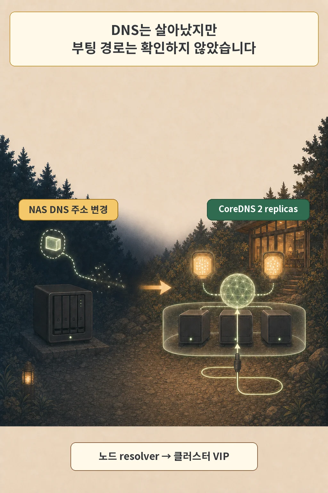
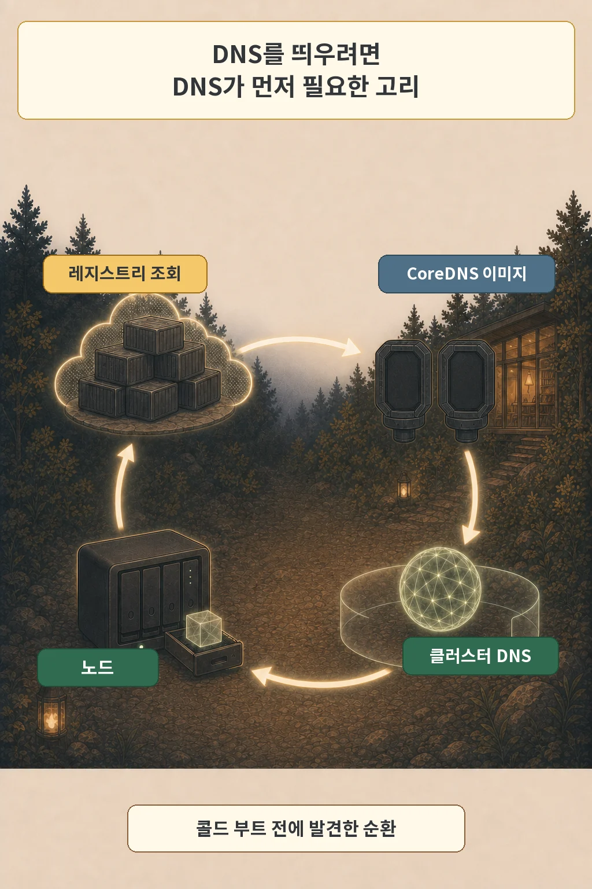
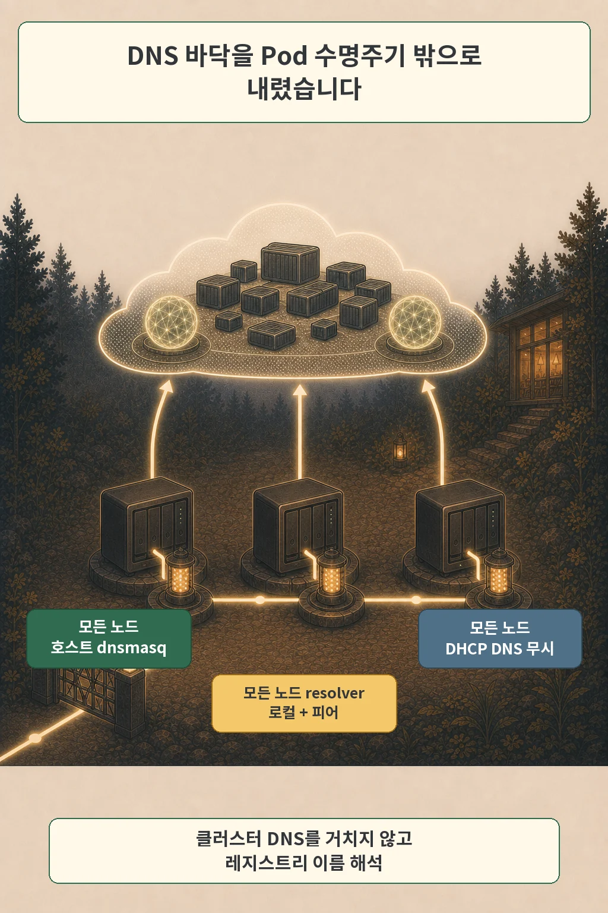
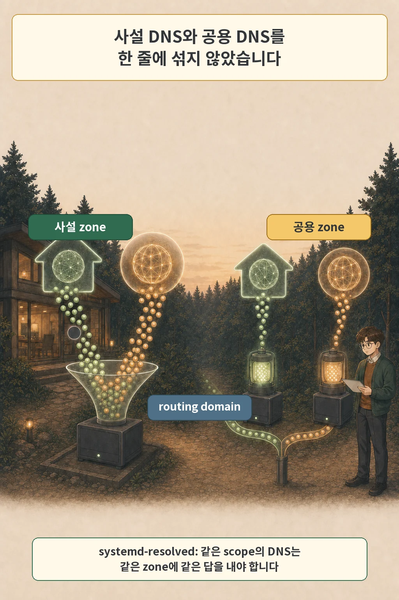

CoreDNS 파드를 두 개로 늘려 이중화하면 평시 장애는 막을 수 있지만, 클러스터를 새로 띄우는 상황까지 안전해지는 건 별개 문제입니다. 두 replica가 지켜 주는 것은 이미 떠 있는 클러스터의 평시 DNS일 뿐, 빈 노드가 첫 이미지를 내려받을 때 쓰는 이름 해석 경로는 따로 챙겨야 하거든요. 2026년 7월 홈랩 DNS 장애를 복구한 직후 노드에서 확인한 `resolvectl status` 한 줄이 바로 이 잠복 순환을 드러냈습니다.

글·해설: 다메카솔

## 핵심 내용

- **평시 가용성과 부트스트랩의 차이**: NAS VM의 내부 DNS를 k3s CoreDNS(2 replica + VIP)로 옮겨 평시 단일 장애점은 없앴지만, 호스트 resolver가 같은 VIP를 가리키며 순환 의존성이 생겼습니다.
- **콜드 부트스트랩 순환 고리**: 빈 노드가 CoreDNS 이미지를 받으려 레지스트리 도메인을 질의해도, 그 요청이 아직 뜨지 않은 CoreDNS VIP로 향하는 교착 구조입니다.
- **호스트 계층 분리와 부팅 순서**: 각 노드에 `dnsmasq` systemd 서비스를 두고(`UseDNS=false`) 사설·공용 도메인을 조건부 전달로 나눈 뒤 `network-online.target` 이후 시작하게 맞췄습니다.

## 두 replica가 해결한 범위와 놓친 질문



첫 번째 장애의 원인은 아주 단순했습니다. 밤마다 꺼지는 NAS VM과 유동 DHCP 주소에 내부 DNS를 묶어 둔 탓에, 2026년 7월 14일 아침 IP가 바뀌자 직접 주소로 확인한 앱과 ingress는 정상인데도 도메인 이름 해석만 끊겼거든요.

그래서 내부 DNS를 24시간 켜져 있는 k3s 클러스터 안으로 옮기고, CoreDNS 2개 replica를 다른 노드에 분산 배치(anti-affinity)한 뒤 PDB와 VIP까지 붙였습니다. 인벤토리 기반 zone 자동 생성과 클러스터 외부 응답 검증까지 마쳤으니 평시 고가용성(HA)과 유동 IP 문제는 해결한 셈입니다.

하지만 직후 노드에서 실행한 `resolvectl status`가 새로운 위험을 드러냈습니다. DHCP가 내려준 인클러스터 CoreDNS VIP가 호스트의 `Current DNS Server`로 잡혀 있었기 때문입니다. 클러스터가 완전히 비어 있을 때 첫 DNS 파드는 어디서 레지스트리 주소를 받아 올 수 있을까요?

## 시작 순서를 그렸더니 보인 고리

K3s는 서버가 시작될 때 기본적으로 CoreDNS를 배포하며, kubelet이 이미지를 받으려면 레지스트리 도메인을 풀어 줄 DNS가 먼저 필요합니다. 노드의 resolver가 아직 뜨지 않은 CoreDNS VIP 하나만 바라본다면 시작 순서는 다음 네 단계를 돌며 멈춰 버립니다.

1. 노드가 CoreDNS 이미지를 내려받기 위해 레지스트리 도메인을 질의합니다.
2. 노드의 DNS 질의가 인클러스터 CoreDNS VIP로 전달됩니다.
3. 그러나 CoreDNS 파드는 아직 클러스터 안에 올라오지 않은 상태입니다.
4. CoreDNS 파드를 시작하려면 1단계의 이미지를 먼저 내려받아야 합니다.



평시에는 이 위험이 로컬 캐시 뒤에 가려지기 쉽습니다. Kubernetes의 `IfNotPresent` 풀 정책에서는 이미지가 이미 캐시되어 있으면 pull을 생략하므로 기존 노드 재부팅 때는 문제가 드러나지 않거든요. 예를 들어 이미지 캐시가 비어 있는 새 노드를 추가하거나 노드를 처음부터 재구축하는 상황을 떠올려 보면, CoreDNS 이미지를 받으려다 뜨지도 않은 VIP에 질의를 보내는 순환 고리가 곧바로 드러납니다(이 글은 `resolvectl` 측정으로 잠복 순환을 사전에 찾아 끊은 사례이며, 실제 신규 노드의 `no such host` 사건은 후속 5편에서 다룹니다).

## Pod 수명주기 밖으로 내린 DNS 바닥

고쳐야 할 대상은 CoreDNS의 replica 수가 아니라 호스트 노드의 첫 이름 해석 경로였습니다. 각 k3s 노드에서 `dnsmasq`를 호스트 systemd 서비스로 실행하고, 노드는 자신의 로컬 `dnsmasq`(`127.0.0.1`)를 먼저 본 뒤 피어 노드의 `dnsmasq`를 바라보도록 구성했습니다.

또한 DHCP 클라이언트가 VIP로 DNS 설정을 덮어쓰지 못하도록 `systemd-networkd` drop-in에 `UseDNS=false`를 명시해 Kubernetes 파드 바깥으로 DNS 바닥을 내렸죠. 물론 K3s 공식 문서의 air-gap 설치처럼 이미지를 노드에 미리 적재하거나 사설 레지스트리·임베디드 미러를 쓰는 방법도 있으므로, 호스트 외부 DNS가 모든 환경의 유일한 해법은 아닙니다.



적용 뒤에는 아래 세 명령으로 클러스터 DNS 없이도 이름 해석이 통과하는지 검증했습니다.

```bash
resolvectl status
dig @127.0.0.1 +short registry.k8s.io
dig +short registry.k8s.io
```

첫 번째 명령에서는 `Current DNS Server`에서 인클러스터 VIP가 사라지고 로컬과 피어 호스트 주소가 잡혔는지 대조했습니다. 이어서 두 번째와 세 번째 명령으로 `dnsmasq` 직접 응답과 시스템 resolver 경유 레지스트리 조회가 모두 통과하는지 확인했습니다.

## 공용 DNS를 단순 예비선으로 섞지 않는 이유

사설 도메인을 아는 내부 DNS 뒤에 `8.8.8.8` 같은 공용 DNS를 단순 예비(fallback) 서버로 나란히 적어 두면 오히려 간헐적 조회 실패를 부릅니다. 가령 내부 서비스 도메인 질의가 예비 공용 서버로 넘어가면, 공용 DNS는 사설 도메인을 모르기 때문에 타임아웃 대신 **존재하지 않는 도메인(`NXDOMAIN`)**을 정상 응답으로 즉시 돌려주거든요.

`systemd-resolved` 공식 문서와 RFC 2308 규격도 같은 맥락을 짚습니다. `NXDOMAIN`은 유효한 부정 응답이자 부정 캐시(negative caching) 대상이며, 같은 조회 범위(lookup scope)에 묶인 DNS 서버들은 동일한 도메인 영역(zone)에 대해 같은 답을 내야 합니다.



그래서 노드의 resolver 목록에는 사설·공용 규칙을 똑같이 아는 로컬·피어 `dnsmasq`만 올리고, 도메인 분기는 `dnsmasq` 내부의 조건부 전달(routing domain)로 분리했습니다.

## 남은 문제: 호스트 서비스 내부의 부팅 순서

호스트 계층으로 내렸다고 모든 시작 순서가 저절로 풀린 것은 아니었습니다. 약 2주 뒤인 7월 27일 노드 재부팅 과정에서 `dnsmasq`가 인터페이스 IP 할당 전에 먼저 올라와 바인딩에 실패하는 문제가 발견돼, `network-online.target` 이후 시작되도록 유닛 의존성을 보강했죠.

콜드 부트스트랩 안전성을 점검할 때는 다음 네 가지를 함께 확인하는 편이 좋습니다.

| 점검 질문 | 확인 방법 및 설계 대안 |
| --- | --- |
| **1. 첫 이미지 전 어떤 DNS를 쓰는가?** | `resolvectl status` 및 시스템 resolver 경유 외부 레지스트리 조회 확인 |
| **2. Kubernetes 없이 시작하는가?** | 호스트 systemd 의존성(`network-online.target`)과 인터페이스 바인딩 확인 |
| **3. 캐시가 없어도 시작 경로가 열리는가?** | 무캐시 신규 노드 검증 또는 K3s air-gap 이미지 적재·독립 미러 구성 |
| **4. 모든 resolver가 같은 답을 내는가?** | 사설·공용을 평면 fallback으로 섞지 않고 조건부 전달(routing domain)로 분리 |

**클러스터를 시작하는 데 필요한 의존성은 아직 시작되지 않은 클러스터 하나에만 기대지 않는다**는 점이 이번 교정의 핵심입니다. 다음 편에서는 CoreDNS가 44시간 동안 정상처럼 보였지만 재시작 시 잘못된 상위 DNS를 읽을 상태였던 `resolv.conf` 스냅숏 문제를 다룹니다(Kubernetes와 k3s의 구조적 차이는 [Kubernetes와 k3s는 무엇이 다른가](/posts/kubernetes-k3s-homelab/)에서 먼저 볼 수 있습니다).

## 출처

- 개인 인프라 Git 기록: DNS VM 주소 변경 교정(`729eec914`), 인클러스터 CoreDNS와 VIP 도입(`65fd80dc5`), 노드 DNS 바닥과 resolver 고정(`893c55256`, 이상 2026-07-14), `dnsmasq` network-online 보강(`76de47a98`, 2026-07-27)
- [K3s: Networking Services](https://docs.k3s.io/networking/networking-services)
- [Kubernetes: Images](https://kubernetes.io/docs/concepts/containers/images/)
- [K3s: Air-Gap Install](https://docs.k3s.io/installation/airgap)
- [systemd-resolved.service manual](https://www.freedesktop.org/software/systemd/man/latest/systemd-resolved.service.html)
- [RFC 2308: Negative Caching of DNS Queries](https://datatracker.ietf.org/doc/html/rfc2308)

이 글의 본문과 이미지는 생성형 AI로 제작했습니다. 기획과 편집 기준은 다메카솔이 정했습니다. 이 글의 홈랩 사례는 실제 Git 작업 기록과 resolver 측정을 바탕으로 정리했으며, zero-cache 콜드 재구축을 별도 재현한 기록은 포함하지 않았습니다.
