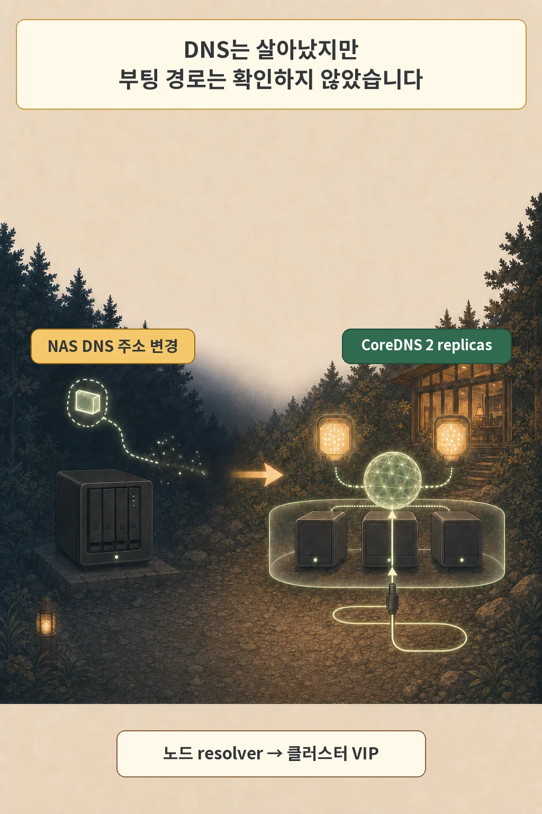
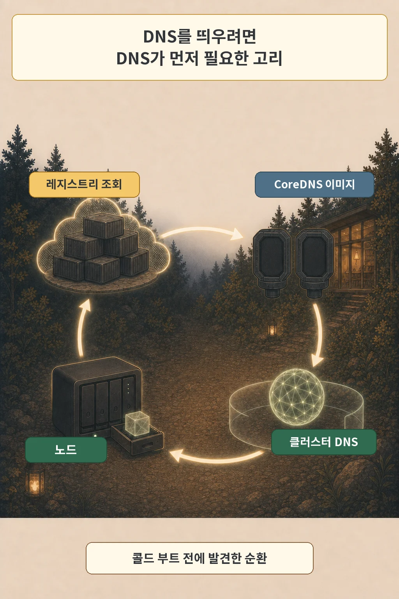
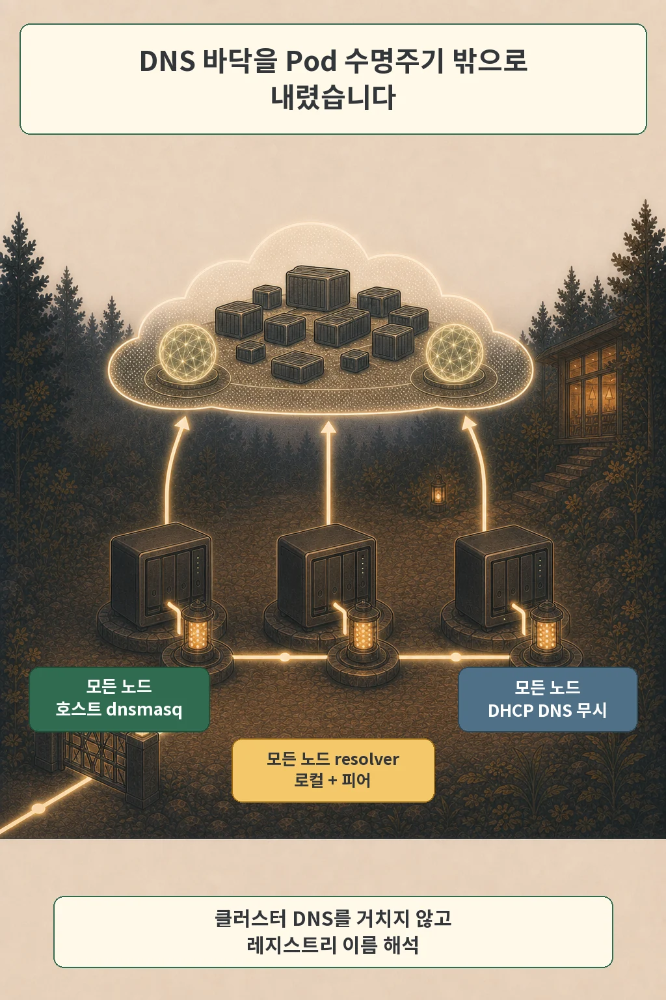
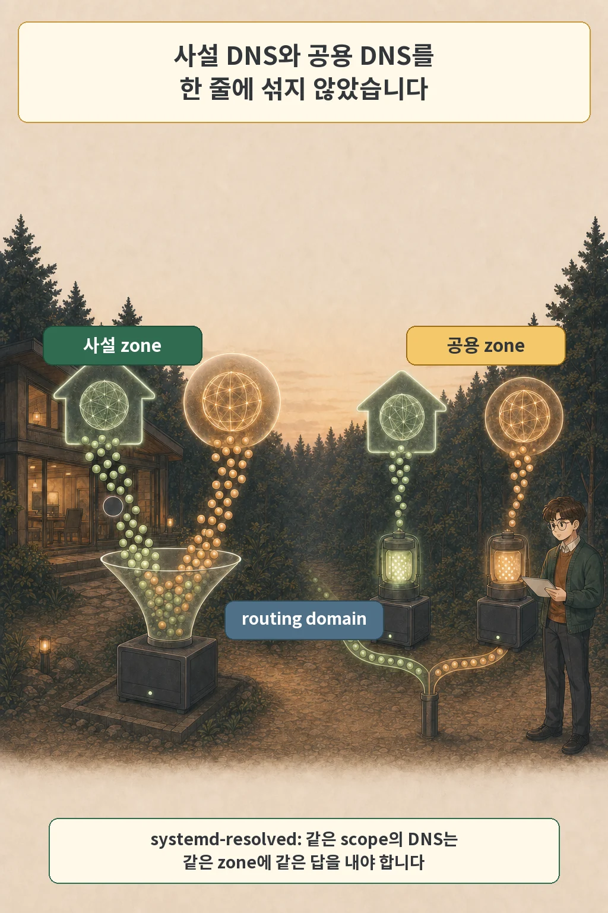

글·해설: 다메카솔

CoreDNS를 두 개의 replica로 띄워 지킨 것은 **이미 떠 있는 클러스터의 평시 DNS**였습니다. 클러스터가 비어 있을 때 첫 컨테이너 이미지를 내려받기 위해 필요한 이름 해석 경로는 별도로 확인해야 했습니다.

2026년 7월 14일 아침, 밤마다 전원이 꺼지는 NAS VM의 DHCP 주소가 바뀌면서 홈랩 내부 도메인이 한꺼번에 풀리지 않는 일이 발생했습니다. 그날 즉시 내부 DNS를 24시간 켜져 있는 k3s 클러스터 안으로 옮기고, CoreDNS 2개 replica를 서로 다른 노드에 분산 배치한 뒤 PDB와 VIP까지 붙였습니다. 하지만 직후 노드에서 실행한 `resolvectl status` 한 줄이 새로운 위험을 드러냈습니다. **CoreDNS 파드를 띄워야 하는 호스트 노드가, 아직 시작되지도 않았을 인클러스터 CoreDNS VIP만 바라보고 있었던 것입니다.**

> 이 글은 2026년 7월 14일·27일 개인 인프라 Git 커밋(`729eec914`, `65fd80dc5`, `893c55256`, `76de47a98`)과 작업 기록을 대조해 정리한 사전 예방 기록입니다. 사설 주소와 내부 도메인·호스트명은 제외했습니다.

## 핵심 내용

- **평시 가용성과 부트스트랩 독립성의 차이**: 밤에 꺼지는 NAS VM에 묶여 있던 DNS를 k3s 내부 CoreDNS(2 replica + VIP)로 옮겨 평시 단일 장애점은 없앴지만, 호스트 노드의 resolver까지 같은 인클러스터 VIP를 가리키면서 콜드 부트스트랩 순환 의존성이 만들어졌습니다.
- **콜드 부트스트랩 순환 고리**: 빈 노드가 CoreDNS 이미지를 받으려면 레지스트리 도메인을 풀어야 하는데, 그 DNS 질의가 아직 뜨지 않은 CoreDNS VIP로 향하는 교착 구조입니다.
- **호스트 계층(`dnsmasq`) 분리와 부팅 순서 보강**: 각 k3s 노드의 systemd 서비스로 `dnsmasq`를 내려 로컬(`127.0.0.1`)과 피어 노드를 바라보게 고정하고(`UseDNS=false`), 사설 도메인과 공용 도메인을 조건부 전달로 분리한 뒤 `network-online.target` 이후에 시작되도록 부팅 순서까지 보강했습니다.

## 두 replica가 해결한 범위와 놓친 질문



첫 번째 문제는 분명했습니다. 내부 DNS가 밤에 꺼지는 NAS VM 한 대와 유동 DHCP 주소에 묶여 있어, IP가 바뀌자 서비스 자체는 살아 있는데도 이름 해석이 끊겼습니다.

그래서 CoreDNS 두 대를 k3s 클러스터 안에 띄우고 zone 파일은 인벤토리에서 자동 생성하도록 바꿨습니다. 한 파드가 내려가도 다른 파드가 VIP 뒤에서 응답하므로 **클러스터가 이미 떠 있을 때의 평시 고가용성(HA)**과 **DHCP 주소 변경 재발 방지**라는 두 목표는 달성했습니다.

하지만 미처 묻지 않은 질문이 하나 남아 있었습니다. **“클러스터가 완전히 비어 있을 때, 첫 DNS 파드를 어떻게 띄울 것인가?”** 평시 HA와 콜드 부트스트랩 독립성은 서로 다른 조건입니다.

## 시작 순서를 그렸더니 보인 고리

K3s는 서버가 시작될 때 CoreDNS를 배포하며, 노드의 kubelet이 파드 이미지를 내려받으려면 먼저 컨테이너 레지스트리 도메인 이름을 IP 주소로 바꿀 DNS가 필요합니다. 당시 호스트 노드의 resolver가 인클러스터 CoreDNS VIP 하나만 바라보고 있었으므로, 로컬 이미지 캐시가 없는 상태(zero-cache)에서 클러스터를 새로 올린다면 시작 순서는 제자리에서 맴돌게 됩니다.

1. 노드가 CoreDNS 컨테이너 이미지를 내려받기 위해 레지스트리 도메인 이름을 질의합니다.
2. 노드의 DNS 질의가 인클러스터 CoreDNS VIP로 전달됩니다.
3. 그러나 CoreDNS 파드는 아직 시작되지 않았습니다.
4. 그 CoreDNS 파드를 시작하려면 먼저 1번의 이미지를 내려받아야 합니다.



로컬에 이미 캐시된 이미지가 있으면 Kubernetes의 `IfNotPresent` 풀 정책 덕분에 당장은 문제가 가려지지만, 새 노드를 추가하거나 캐시가 비워진 상태에서 재구축할 때 이 순환 고리가 터지게 됩니다(실제 신규 노드에서 발생한 `no such host` 사건은 후속 5편에서 다룹니다).

## Pod 수명주기 밖으로 내린 DNS 바닥

고쳐야 할 대상은 CoreDNS의 replica 수가 아니라 호스트 노드의 첫 이름 해석 경로였습니다. 각 k3s 노드에서 `dnsmasq`를 호스트 systemd 서비스로 실행하고, 노드는 자신의 로컬 `dnsmasq`(`127.0.0.1`)를 먼저 본 뒤 다른 노드의 `dnsmasq`를 보도록 구성했습니다.

또한 DHCP 클라이언트가 다시 인클러스터 VIP로 DNS 설정을 덮어쓰지 못하도록 `systemd-networkd` 설정에 `UseDNS=false`를 명시했습니다. 물리적으로는 같은 미니PC 안이지만, 프로세스 생명주기상 Kubernetes 파드와 컨트롤 플레인 바깥의 호스트 계층으로 DNS 바닥을 내린 것입니다.



적용 후에는 다음 세 가지 명령으로 경로를 검증했습니다.

```bash
resolvectl status
dig @127.0.0.1 +short registry.k8s.io
dig +short registry.k8s.io
```

첫 번째 명령에서 인클러스터 VIP가 사라지고 로컬 및 피어 호스트 resolver가 잡혔는지 확인하고, 두 번째와 세 번째 명령으로 `dnsmasq` 직접 응답과 시스템 resolver 경유 레지스트리 이름 해석이 클러스터 파드 없이도 통과하는지 확인했습니다.

## 공용 DNS를 단순 예비선으로 섞지 않는 이유

사설 도메인을 아는 내부 DNS 뒤에 `8.8.8.8` 같은 공용 DNS를 단순 보조(fallback) 서버로 나란히 적어 두면 안전해 보이지만, 여기에는 함정이 있습니다. 공용 DNS는 사설 도메인을 모르기 때문에 타임아웃 대신 **존재하지 않는 도메인(`NXDOMAIN`)**이라는 정상 응답을 즉시 돌려줄 수 있고, RFC 2308 규격상 `NXDOMAIN`은 부정 캐시(negative caching) 대상이 됩니다.

`systemd-resolved` 공식 문서 역시 동일한 조회 범위(lookup scope)에 묶인 DNS 서버들은 같은 도메인 영역(zone)에 대해 동일한 답을 내야 한다고 명시합니다. 사설 도메인을 아는 서버와 모르는 서버를 한 목록에 평면적으로 섞으면 대체재가 아니라 간헐적 조회 실패의 원인이 됩니다.



그래서 노드의 resolver 목록에는 사설과 공용 규칙을 똑같이 알고 있는 로컬·피어 `dnsmasq`만 올리고, 사설 도메인과 외부 공용 도메인의 분기는 `dnsmasq` 계층 내부의 조건부 포워딩으로 처리했습니다.

## 남은 문제: 호스트 서비스 내부의 부팅 순서

호스트 계층으로 내렸다고 모든 시작 순서가 자동으로 해결된 것은 아니었습니다. 약 2주 뒤인 7월 27일, 노드 재부팅 과정에서 `dnsmasq`가 네트워크 인터페이스에 IP 주소가 할당되기 전에 먼저 올라와 바인딩에 실패하는 문제가 발견되었고, 유닛이 `network-online.target` 이후에 시작되도록 의존성을 보강(`76de47a98`)했습니다. 기반 서비스를 아래 계층으로 내리는 일과 그 계층 안에서의 부팅 순서를 맞추는 일은 언제나 한 묶음입니다.

콜드 부트스트랩의 안전성을 점검할 때는 평시 모니터링 대시보드 대신 다음 네 가지를 확인해야 합니다.

| 점검 질문 | 확인 방법 및 설계 대안 |
| --- | --- |
| **1. 노드가 첫 이미지를 받기 전에 어떤 DNS를 쓰는가?** | `resolvectl status` 및 시스템 resolver 경유 외부 레지스트리 조회 확인 |
| **2. 그 DNS 프로세스는 Kubernetes 없이 시작하는가?** | 호스트 systemd 유닛 의존성(`network-online.target`) 및 인터페이스 바인딩 상태 확인 |
| **3. 로컬 이미지 캐시가 없어도 시작 경로가 열리는가?** | 캐시 없는 신규 노드 조건 검증, 또는 K3s 공식 air-gap 이미지 사전 적재·독립 레지스트리 미러 구성 |
| **4. 목록에 있는 모든 resolver가 사설 도메인에 같은 답을 내는가?** | 사설·공용 도메인을 평면 fallback으로 섞지 않고 도메인 영역별 조건부 전달(routing domain)로 분리 |

**클러스터를 시작하는 데 필요한 의존성은 아직 시작되지 않은 클러스터 하나에만 기대지 않는다**는 것이 이번 교정의 핵심 원칙입니다. 다음 편에서는 CoreDNS가 44시간 동안 정상처럼 보였지만 재시작하는 순간 잘못된 상위 DNS를 읽을 상태였던 `resolv.conf` 스냅숏 문제를 다룹니다(Kubernetes와 k3s의 구조적 차이는 [Kubernetes와 k3s는 무엇이 다른가](/posts/kubernetes-k3s-homelab/)에서 먼저 볼 수 있습니다).

## 출처

- 개인 인프라 Git 기록: DNS VM 주소 변경 교정(`729eec914`), 인클러스터 CoreDNS와 VIP 도입(`65fd80dc5`), 노드 DNS 바닥과 resolver 고정(`893c55256`, 이상 2026-07-14), `dnsmasq` network-online 보강(`76de47a98`, 2026-07-27)
- [K3s: Networking Services](https://docs.k3s.io/networking/networking-services)
- [Kubernetes: Images](https://kubernetes.io/docs/concepts/containers/images/)
- [K3s: Air-Gap Install](https://docs.k3s.io/installation/airgap)
- [systemd-resolved.service manual](https://www.freedesktop.org/software/systemd/man/latest/systemd-resolved.service.html)
- [RFC 2308: Negative Caching of DNS Queries](https://datatracker.ietf.org/doc/html/rfc2308)

이 글의 본문과 이미지는 생성형 AI로 제작했습니다. 기획과 편집 기준은 다메카솔이 정했습니다. 만화 이미지는 텍스트 없는 원화에 결정적 레터링을 합성해 만들었습니다. 공식 로고·UI·문서 도표 등 외부 이미지 자산은 사용하지 않았습니다.
