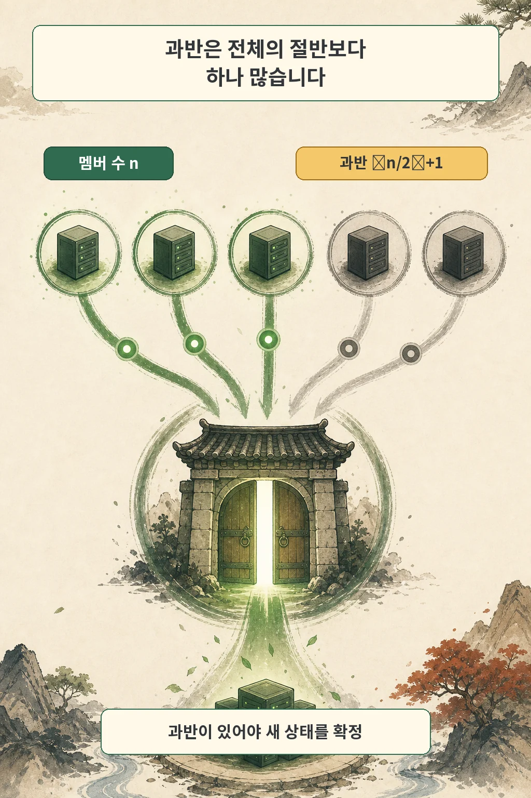
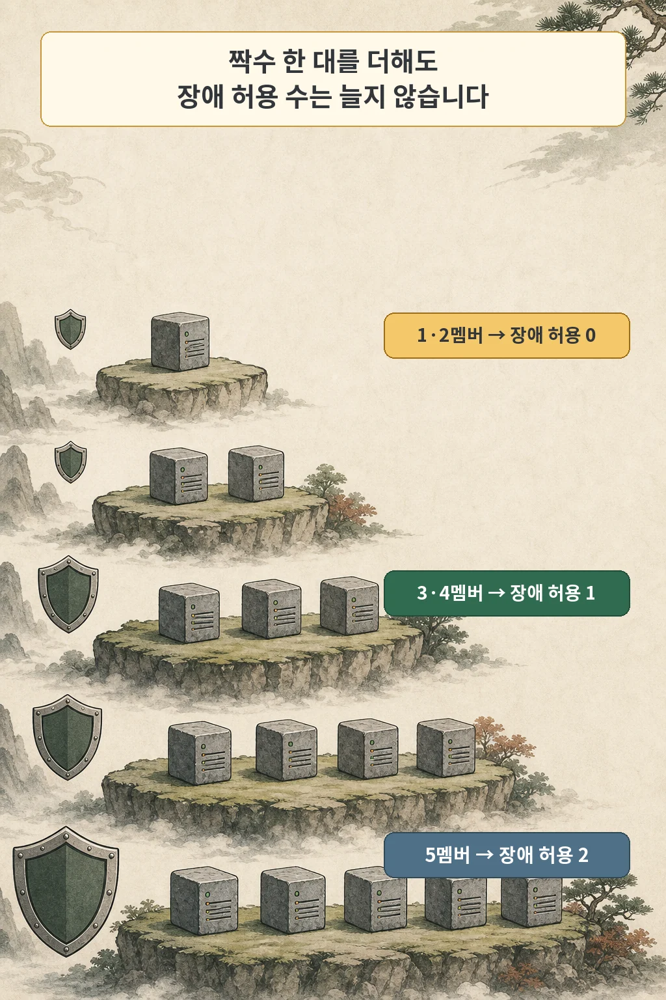
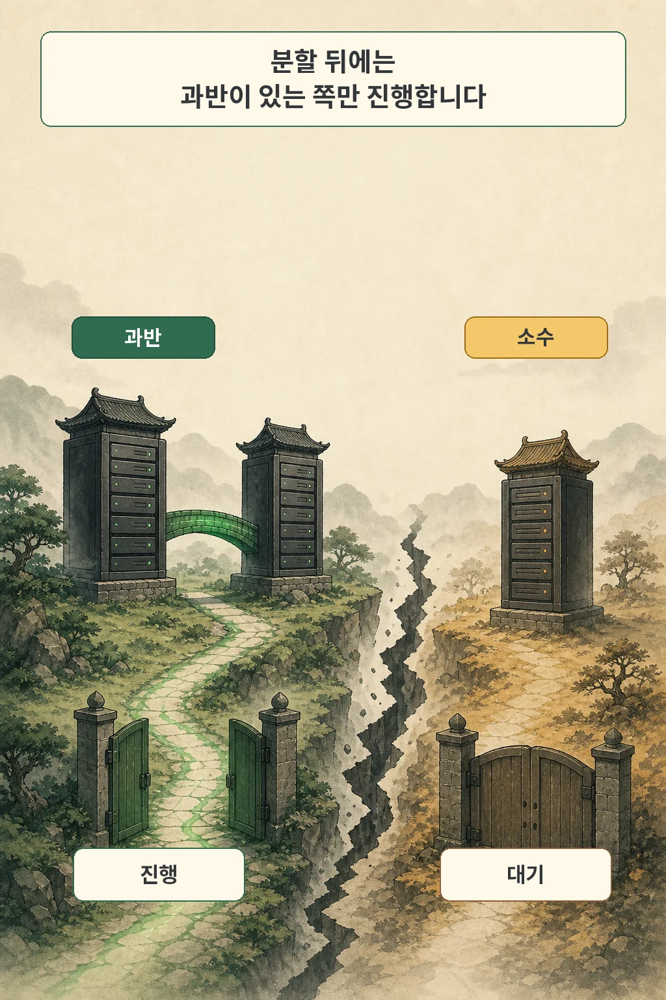
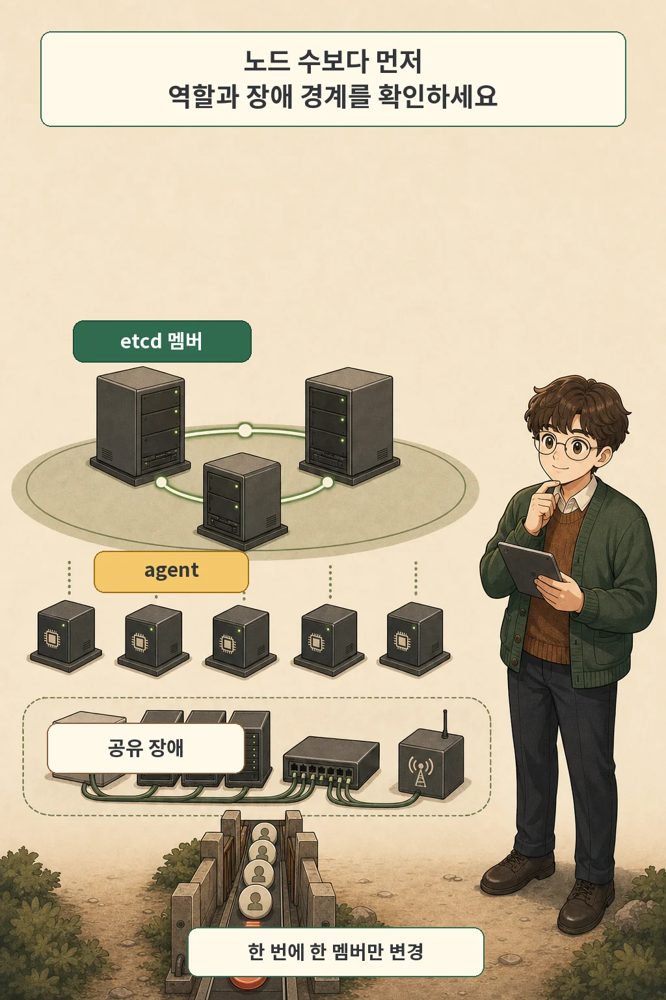

홈랩에 K3s 제어면을 올릴 때 서버 두 대와 세 대를 비교하는 경우가 많습니다. 두 대면 한 대가 멈춰도 안전해 보이지만, 둘 다 etcd 투표 멤버라면 한 대만 빠져도 새 상태를 결정하지 못하거든요. 제가 세 대를 고른 이유도 이 한 칸 차이 때문이므로, 장비 수를 정할 때는 과반과 장애 허용 수부터 계산해야 합니다.

글·해설: 다메카솔

## 먼저 답부터 계산합니다

etcd의 장애 허용 여부는 단순한 정수 계산 두 줄로 갈립니다.

- **과반**: `floor(멤버 수 / 2) + 1`
- **장애 허용 수**: `멤버 수 - 과반`

예를 들어 다섯 멤버라면 `floor(5/2) + 1` 공식에 따라 과반이 3대가 됩니다. 다섯 대 중 두 대가 멈춰도 세 대가 남아 합의를 이어 가는 셈이죠.

## 쿼럼은 ‘살아 있는 서버 수’보다 엄격합니다

etcd는 Kubernetes의 원하는 상태를 저장하는 일관된 key-value store입니다. 새 상태를 확정하려면 투표 멤버의 과반 동의가 필요하며, 과반이 모이지 않으면 새 쓰기를 진행하지 않습니다.

이 원칙 때문에 프로세스 생존과 클러스터 결정 가능 여부는 다릅니다. 두 멤버 중 하나만 살아도 etcd 프로세스는 실행되지만, 과반 2를 채우지 못해 새 상태를 확정하지 못한 채 대기하게 됩니다.

정수 나눗셈으로 1멤버부터 7멤버까지 비교하면 홀수와 짝수의 차이가 바로 보입니다.

| 투표 멤버 수 | 필요한 과반 | 장애 허용 수 |
| ---: | ---: | ---: |
| 1 | 1 | 0 |
| 2 | 2 | 0 |
| 3 | 2 | 1 |
| 4 | 3 | 1 |
| 5 | 3 | 2 |
| 6 | 4 | 2 |
| 7 | 4 | 3 |

짝수로 한 대를 더해도 장애 허용 수는 늘지 않습니다. 바로 앞 홀수 구성과 같은 수의 장애만 견디면서 필요한 과반만 한 표씩 늘어나는 편입니다.

## 2멤버가 1멤버보다 HA가 아닌 이유

1멤버는 한 대가 살아 있어야 하고, 2멤버 역시 두 대 모두 살아 있어야 동작하므로 장애 허용 수는 똑같이 0입니다. 다만 이 계산을 적용하기 전에 두 노드의 역할부터 구분해야 합니다.

- **embedded etcd 투표 멤버 여부**: 두 노드가 모두 투표 멤버인가?
- **외부 datastore 여부**: control plane이 외부 DB를 쓰는가?
- **server·agent 분리 여부**: 한 대는 server이고 다른 한 대는 agent인가?
- **애플리케이션 replica 혼동**: 일반 파드 replica 두 개를 말하는가?

이 계산은 **etcd 투표 멤버**에만 적용됩니다. K3s agent를 열 대 추가해도 embedded etcd 투표 수는 그대로이고, server 역할을 분리했다면 모든 server가 etcd 멤버인 것도 아니거든요.

세 대와 네 대 구성을 비교해도 원리는 같습니다. 3멤버는 과반이 두 대라 한 대 장애를 견디지만, 네 번째 멤버를 추가해 4멤버가 되면 과반이 세 대로 올라가면서도 장애 허용 수는 여전히 한 대에 머뭅니다. 네 번째 장비는 용량이나 다른 역할에 도움을 주고, 두 대 장애까지 버티려면 다섯 번째 멤버가 필요하므로 홀수 구성을 권장합니다.

## 네트워크가 둘로 갈라지면 어느 쪽이 살아남나

가령 세 멤버가 네트워크 분할로 2 대 1로 갈라졌다고 볼까요? 서로 통신하는 두 멤버 쪽은 과반을 만들어 결정을 계속하지만, 혼자 고립된 멤버는 살아 있어도 새 상태를 확정하지 못한 채 대기합니다.

양쪽이 서로 다른 값을 확정하지 않도록 가용성을 일부 포기해 일관성을 지키는 셈이죠. 네트워크가 회복되면 소수 쪽은 과반이 확정한 상태를 다시 따라갑니다.

이때 노드의 물리 배치도 함께 따져 봐야 합니다. 세 대를 별도 미니PC로 나눠도 같은 멀티탭이나 스위치에 묶여 있으면 한 번의 장애로 과반을 잃기 쉽거든요. 반대로 멀리 떨어진 네트워크에 무작정 분산하면 지연이 커져 합의와 leader election이 흔들릴 수 있습니다.

좋은 장애 도메인은 두 조건의 균형에 달려 있습니다.

1. 한 번의 전원·장비·네트워크 장애가 과반을 동시에 없애지 않게 배치합니다.
2. 정상 상태에서 과반이 안정적인 지연 안에 응답하도록 유지합니다.

## 노드를 추가하기 전에 다시 계산해야 합니다

멤버 변경도 합의가 필요한 쓰기이므로 이미 과반을 잃은 뒤에는 정상적인 멤버 추가로 복구하기 어렵습니다. 세 대 중 한 대가 고장 난 상태에서 새 멤버부터 더해 네 대로 만들면, 새 과반이 세 대로 올라가 남아 있던 두 대만으로 진행하지 못하는 위험이 생기죠.

etcd v3.6의 `strict-reconfig-check` 옵션은 가동 중인 멤버 수가 새 구성의 과반보다 적어지는 요청을 거부하도록 설계됐습니다. 하지만 안전장치가 운영 계획을 대신하지는 못하므로 변경 전 절차를 먼저 점검해야 합니다.

K3s의 embedded etcd는 배포판이 멤버 수명주기를 직접 관리합니다. 일반 `etcdctl member add/remove` 예시를 바로 실행하기보다 현재 K3s 버전의 노드 제거·재가입·snapshot 복구 절차를 따르는 편이 안전합니다.

멤버를 바꾸기 전에는 아래 순서를 문서로 확인해 두세요.

1. 현재 etcd 역할을 가진 server와 health를 확인합니다.
2. 변경 전 멤버 수, 과반, 장애 허용 수를 적어 둡니다.
3. 고장 멤버 교체인지, 정상 멤버 확장인지 구분합니다.
4. 한 번에 한 멤버씩만 변경하고 다시 health를 확인합니다.
5. 변경 후 멤버 수와 물리 장애 도메인을 다시 적습니다.
6. 해당 K3s 버전의 snapshot과 복구 절차를 확인합니다.

## 3멤버 etcd가 해결하지 않는 것

세 대의 embedded etcd는 한 대 장애 뒤에도 Kubernetes 제어면 상태를 합의하기 위한 조건일 뿐입니다. 아래 영역까지는 자동으로 해결하지 않으므로 별도로 챙겨야 합니다.

- **접속 경로**: API server 고정 주소와 load balancer
- **워크로드 배치**: 애플리케이션 replica와 Pod 분산
- **데이터 계층**: 데이터베이스 복제와 장애 조치
- **스토리지 계층**: Longhorn 같은 분산 스토리지의 replica
- **공통 인프라**: 공유 전원·스위치·디스크 풀 장애
- **논리 손상 복구**: 잘못된 삭제나 손상에서 돌아갈 백업

etcd replica는 현재 시점의 상태를 맞추는 합의 구성이고, snapshot과 백업은 과거 상태로 복구하기 위한 별도 계층이거든요. 쿼럼이 살아 있어도 잘못된 삭제는 정상 합의를 거쳐 모든 멤버에 반영됩니다.

## 내 클러스터를 계산하는 표

| 질문 | 내 환경의 답 |
| --- | --- |
| datastore는 embedded etcd인가, 외부 DB인가? |  |
| 실제 etcd 투표 멤버는 몇 개인가? |  |
| 필요한 과반은 몇 개인가? |  |
| 동시에 몇 멤버 장애를 허용하는가? |  |
| 멤버들이 공유하는 전원·스위치·스토리지는 무엇인가? |  |
| 한 장애 도메인이 사라지면 과반이 남는가? |  |
| 다음 멤버 변경 전후의 과반은 어떻게 바뀌는가? |  |
| snapshot과 복구 절차를 실제로 시험했는가? |  |

이 표에는 전체 노드 수가 아니라 `etcd` 투표 멤버만 적어야 세 대, 다섯 대, 외부 datastore 중 맞는 구성을 고를 수 있습니다.

제 홈랩은 한 대 장애 뒤에도 embedded etcd 제어면 합의를 이어 가는 것이 목표여서 두 대 대신 세 대를 선택했습니다. 네 대로 늘려도 장애 허용 수는 한 대뿐이니, 장비 수보다 데이터스토어 역할과 허용 장애 수부터 정하는 편이 명확합니다.

## 자주 묻는 질문

### 4멤버 etcd는 잘못된 구성인가요?

정상 동작할 수 있지만 3멤버와 장애 허용 수가 1로 같습니다. 네 번째 멤버의 운영 이점과 추가 지연·비용을 따져 봐야 하며, 내결함성만 목표라면 다음 홀수인 5멤버까지 계산하는 편이 낫습니다.

### 쿼럼이 있으면 백업은 필요 없나요?

백업은 쿼럼과 별개로 반드시 필요합니다. 쿼럼은 현재 상태의 일관성과 진행을 지키는 장치이고, 백업은 삭제·손상·운영 실수 뒤 과거 상태로 복구하기 위한 장치이기 때문이죠.

이 판단이 실제 운영 맥락으로 이어진 내용은 [홈랩 쿠버네티스 구축기 2편: 3노드여야 하는 이유, 그리고 빈 결과의 함정](/posts/three-node-etcd-quorum-context/)에서 확인할 수 있습니다.

## 출처

- [K3s: High Availability Embedded etcd](https://docs.k3s.io/datastore/ha-embedded)
- [K3s: Cluster Datastore](https://docs.k3s.io/datastore)
- [K3s: Managing Server Roles](https://docs.k3s.io/installation/server-roles)
- [etcd FAQ: failure tolerance](https://etcd.io/docs/v3.2/faq/)
- [etcd v3.6: Configuration options](https://etcd.io/docs/v3.6/op-guide/configuration/)
- [etcd: Design of runtime reconfiguration](https://etcd.io/docs/v3.5/op-guide/runtime-reconf-design/)

기술 설명은 2026년 7월 25일 확인한 공식 문서를 기준으로 작성했으며, K3s와 etcd 버전에 따라 멤버 관리·복구 절차가 달라질 수 있으므로 실제 변경 전 해당 버전 문서를 확인해야 합니다.

이 글의 본문과 이미지는 생성형 AI로 제작했습니다. 기획과 편집 기준은 다메카솔이 정했습니다.
