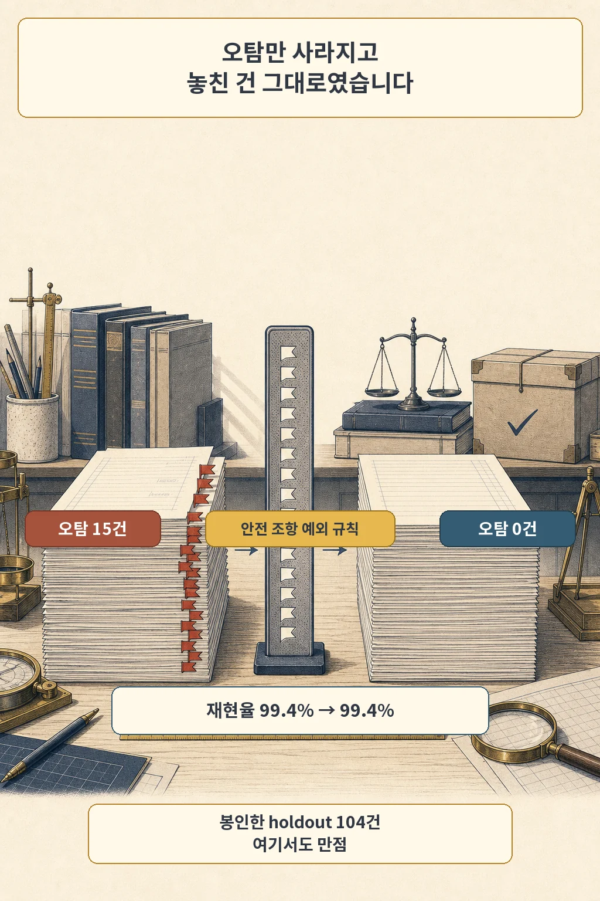
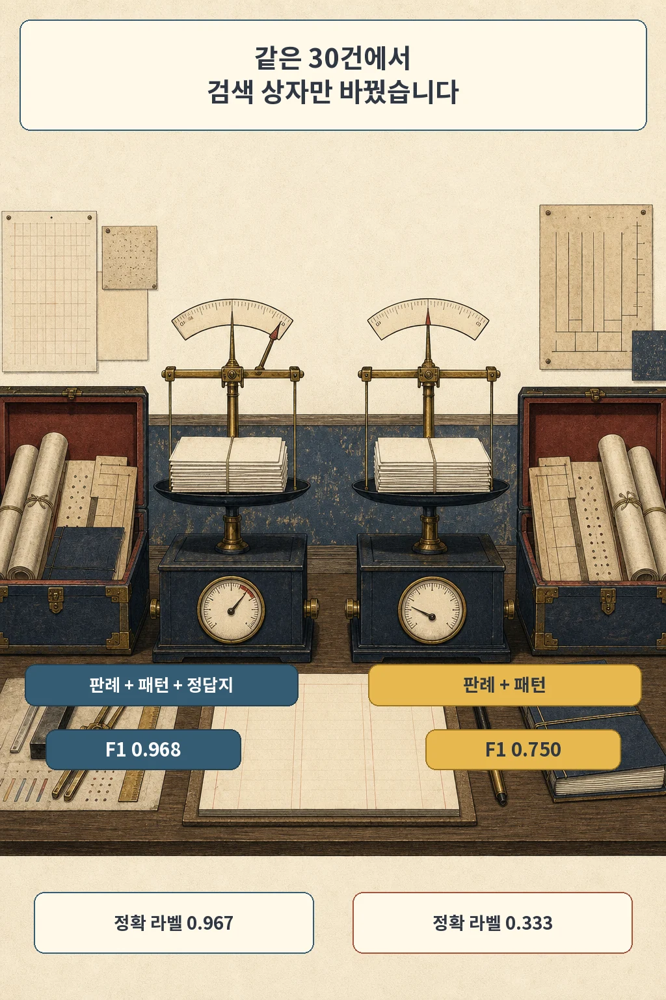

글·해설: 다메카솔

성적표에는 `0.997`이 찍혀 있었습니다. 판례를 근거로 임대차 계약서의 위험 조항을 찾아내는 개인 실험에서 2026년 2월 4일 평가 보고서는 골든셋 378건에 대해 이진 분류 F1 99.7%, 정밀도 100.0%, 재현율 99.4%(오탐 0건, 미탐 1건)를 기록했습니다. 하지만 다섯 달 뒤 검증 파이프라인을 다시 뜯어보면서, 그 숫자가 일반화된 탐지 실력이 아니라 **제가 고른 표본에 맞춘 규칙 적합도이자 검색 정답 누출의 결과**였다는 사실을 확인했습니다.

> 이 글은 개인 학습·포트폴리오 목적의 합성 내부 코퍼스 평가 기록이며, 법률 자문이나 실제 계약 안전 판정을 제공하지 않습니다.

## 핵심 내용

- **같은 분포의 홀드아웃과 표본 조준**: 2026년 2월 보고서에서 오탐이 15건에서 0건으로 줄어든 동안 재현율(99.4%)은 그대로였습니다. 104건의 홀드아웃(F1 1.0)과 해시 중복 검사까지 두었지만, 같은 합성 생성기 분포에서 나눈 데이터에 예외 규칙을 맞춘 결과였습니다.
- **검색 컬렉션 정답 누출과 사전 필터 병목**: 2026년 7월 8일 30건 통제 실험에서 검색 대상에 들어 있던 정답 코퍼스를 제거하자 F1은 0.968에서 0.750으로, 정확 라벨 일치는 0.967에서 0.333으로 떨어졌습니다. 같은 날 전체 350건 평가(F1 0.100)에서는 휴리스틱 사전 필터가 341건을 조기 탈락시켜 9건만 LLM 판정에 도달한 라우팅 병목을 분리해 냈습니다.
- **미접촉 표본 재측정과 보류(Abstain) 설계**: 정답 누출을 제거한 뒤 덮어 둔 100건에서 다시 측정한 결과는 재현율 1.000, 정밀도 0.533, F1 0.696(미탐 0건, 오탐 21건)이었습니다. 근거가 부족하거나 스키마·인용 검증에 실패한 출력이 ‘안전’으로 둔갑하지 않도록 ‘보류(추가 확인 필요)’ 상태로 보내는 회귀 테스트를 고정했습니다.

## 오탐만 사라지고, 놓친 것은 그대로였습니다

2026년 2월 보고서의 직전 단계 비교표에는 이미 징후가 드러나 있었습니다. 오탐이 15건에서 0건으로 줄어든 동안, 재현율은 99.4%에서 단 0.1%포인트도 움직이지 않았습니다.

탐지 모델 자체가 정교해졌다면 놓치는 조항(미탐)도 함께 줄어야 자연스러운데, 줄어든 것은 잘못 잡은 오탐뿐이었습니다. 그 사이에 수행한 작업은 안전 조항을 걸러 주는 정규표현식(regex) 예외 규칙을 추가한 것이었습니다. 눈앞의 378건에서 붉은 오탐 표식이 붙은 자리를 보고 그 자리에 딱 맞는 구멍을 뚫어 준 셈입니다.

그렇다고 홀드아웃 절차를 생략했던 것은 아닙니다. 104건을 별도로 동결했고, 승격된 데이터가 홀드아웃에 섞였는지와 정규화 문장 해시가 겹치는지 검사하는 누출 점검 스크립트도 돌렸습니다(2026년 2월 10일 집계 기준 홀드아웃 라벨 F1 1.0). 문제는 **홀드아웃이 조정 대상과 다른 분포에서 오지 않았다**는 점입니다. 동일한 합성 생성기에서 만든 378건을 쪼개 두었으니, 해시는 달라도 문장 패턴이 같아 예외 규칙이 그대로 통했습니다.

## 검색 상자에서 정답지를 빼 봤습니다

2026년 7월 8일, 새 LangGraph 파이프라인에서 검색이 참고하는 컬렉션 구성만 바꾼 통제 실험(동일 표본 30건, 동일 모델·프롬프트)을 실행했습니다.

| 검색 컬렉션 구성 (30건 통제 실험) | 정밀도 | 이진 F1 | 정확 라벨 일치 |
| --- | --- | --- | --- |
| **판례 + 패턴 + 정답 코퍼스 (누출 포함)** | 0.938 | 0.968 | **0.967** |
| **판례 + 패턴 (정답 코퍼스 제거)** | 0.600 | 0.750 | **0.333** |

조항을 판정할 때 참고하라고 넘긴 검색 컬렉션 안에 해당 조항의 정답 라벨이 붙은 예시 코퍼스가 함께 들어 있었습니다. 정답 코퍼스를 빼자 이진 F1(0.968 → 0.750)보다 **정확 라벨 일치도(0.967 → 0.333)**가 훨씬 크게 무너졌습니다. 위험 여부 자체보다 구체적으로 어떤 유형의 독소 조항인지 분류할 때 검색된 정답지를 그대로 베끼고 있었다는 뜻입니다.

## 350건 중 9건만 판정까지 갔습니다

같은 날(7월 8일) 전체 350건을 새 파이프라인에 태웠을 때는 F1 0.100(정밀도 0.889, 재현율 0.053)이 나왔습니다. 언뜻 모델 성능이 바닥난 것처럼 보였지만, 단계별 로그를 확인해 보니 원인은 모델이 아니라 앞단 라우팅에 있었습니다.

전체 350건 중 휴리스틱 사전 필터를 통과해 검색과 LLM 판정까지 도달한 조항이 단 9건뿐이었고(그중 8건은 실제 독소 조항), 나머지 341건은 판정기가 호출조차 되지 않았습니다. 실제로 같은 날 표본 10건에 사전 필터를 우회해 검색과 판정을 강제로 실행하자 재현율은 1.000으로 올라갔습니다. `0.100`은 모델의 추론 능력이 아니라 사전 필터 라우팅의 성적이었습니다.

## 정답지를 치우고 다시 잰 성적표

2026년 7월 10일, 정답 코퍼스 누출을 제거한 상태에서 두 개의 100건 표본을 측정했습니다. 하나는 프롬프트 규칙을 조정할 때 참고한 표본 계열과 겹치지 않는 100건이고, 다른 하나는 조정 과정에서 아예 열어 보지 않고 덮어 둔 100건입니다.

| 평가 지표 (2026-07-10) | 조정에 쓴 표본 계열 (100건) | 덮어 둔 미접촉 표본 (100건) |
| --- | --- | --- |
| **표본 구성 (독소 / 안전)** | 70건 / 30건 | 24건 / 76건 |
| **정밀도 (Precision)** | 0.931 | **0.533** |
| **재현율 (Recall)** | 0.957 | **1.000** |
| **이진 F1** | 0.944 | **0.696** |
| **정확 라벨 일치** | 0.490 | **0.530** |

두 표본의 독소/안전 비율(70:30 대 24:76)이 다르므로 F1 수치 차이에 일반화 격차와 클래스 분포 효과가 함께 섞여 있다는 점은 감안해야 합니다.

그럼에도 덮어 둔 표본(오른쪽 열)이 보여주는 경향은 명확합니다. **미탐 0건, 오탐 21건**입니다. 위험한 독소 조항 24건은 하나도 놓치지 않았지만, 적법한 안전 조항 76건 중 21건을 위험하다고 잘못 경보했습니다. 오탐으로 잡힌 조항들은 과실에 따른 책임, 차임 연체에 따른 갱신 거절, 통상 소모품 수선비 부담, 상호 비밀유지, 항목별 공과금 정산처럼 실무에서 흔히 쓰이는 적법 조항들이었습니다.

여기서 2026년 2월(regex 엔진)과 7월(LangGraph 프롬프트 조정)을 돌아보면 똑같은 실수가 반복됐음을 알 수 있습니다. 2월에는 378건의 오탐 15건을 지우는 regex 예외를 넣었고, 7월에는 조정 표본의 오탐 5건을 지우려고 “48시간 통지, 3일 납부 독촉, 동의된 방문은 안전하다”는 지엽적 예외 문구를 프롬프트에 넣었습니다. 두 번 모두 눈앞의 표본에서는 오탐이 사라졌지만, 보지 않은 표본으로 나가자 다시 오탐이 터져 나왔습니다.

## 놓치지 않는 쪽을 고르고, 대가를 함께 적었습니다

정밀도 0.533과 재현율 1.000 중 무엇을 우선할지는 도메인 성격에 달린 선택입니다. 임대차 계약서를 검토하는 사용자에게 위험한 독소 조항을 안전하다고 통과시키는 오류(미탐)와, 적법한 조항을 한 번 더 확인하게 만드는 오류(오탐)의 무게는 같지 않습니다. 그래서 위험 조항을 놓치지 않는 쪽(재현율 우선)을 선택했습니다.

다만 그 대가인 오탐 21건을 숨기고 재현율 1.000만 내세우면 성적표가 아니라 광고가 됩니다. 그래서 단일 대표 점수로 뭉개지 않고 **재현율 1.000, 정밀도 0.533, F1 0.696, 정확 라벨 일치 0.530(인용 충실도 0.378)**을 측정 조건(정답 코퍼스 제외, 미접촉 100건 표본)과 함께 나란히 기록하는 형식으로 바꿨습니다.

## 판단 못 내린 것을 안전으로 보내지 않습니다

점수 기록 방식을 고치는 것과 별개로, 파이프라인 내부 오류가 발생할 때 결과가 어디로 흐르는지도 고정해야 했습니다.

2026년 7월 7일 설계 기록에는 **보류(Abstain) 규칙**을 명시했습니다. 검색 근거가 부족하거나 모델 출력이 스키마·인용·라벨 일관성 검증을 통과하지 못하면 위험 판단을 확정하지 않고 ‘보류(추가 확인 필요)’로 넘기며, 사용자 화면에 “안전합니다”나 “보장됩니다” 같은 단정적 표현을 쓰지 않도록 금지했습니다. 만약 검색 실패나 파싱 오류로 위험 신호가 비었을 때 기본값이 ‘안전(초록불)’으로 떨어지면, 시스템이 가장 모르는 순간에 사용자를 가장 안심시키는 역설이 벌어지기 때문입니다.

이 원칙은 같은 날 자동화 테스트로 고정했습니다. 판정기가 비어 있는 상태로 조항을 입력했을 때 개별 라벨과 종합 판정이 모두 보류 상태로 떨어지고 사람 검토 필요 플래그가 켜지는지 검사해, 판정 경로가 조용히 초록불로 회귀하는 것을 막았습니다.

## 다메카솔의 해석과 기록의 한계

F1 0.696(정밀도 0.533, 인용 충실도 0.378)은 결코 완성된 성능이 아닙니다. 이번 기록의 의미는 높은 점수를 달성한 데 있는 것이 아니라, **점수를 만든 규칙 조정 표본과 점수를 측정한 평가 표본을 분리하고 누출을 걷어내 성적표의 눈금을 바로잡은 것**에 있습니다(참고로 2026년 2월 4일 보고서의 378건과 2월 8일 게이트 스냅숏의 승격 후 406건은 당시 스냅숏에 평가셋 크기가 누락되어 동일 집합 여부를 확정하지 못했으므로 각각 해당 일자 보고서 기준으로만 인용했습니다).

다음 편에서는 이 오탐 21건을 줄이기 위해 또다시 표본별 땜질 예외를 붙이는 대신, 적법 조항의 법리적 범주를 넓게 정의하고 동일한 미접촉 홀드아웃에서 통제된 전후 비교로 측정하는 과정을 다룹니다.

## 출처

- 개인 프로젝트 평가 보고서: 규칙 엔진 탐지 정확도(2026-02-04, 골든셋 378건), 품질 게이트 전후 스냅숏(2026-02-08), 홀드아웃 동결과 누출 점검(2026-02-08 / 집계 2026-02-10)
- 개인 프로젝트 평가 보고서: 전체 baseline 350건 및 검색 컬렉션 통제 비교 30건(2026-07-08), 조정 표본 계열 100건 및 덮어 둔 표본 100건 재측정(2026-07-10)
- 개인 프로젝트 설계 및 Git 기록: 계약 분석 그래프와 보류 정책 및 보류 동작 테스트 추가(2026-07-07)

이 글의 본문과 이미지는 생성형 AI로 제작했습니다. 기획과 편집 기준은 다메카솔이 정했습니다. 만화 이미지는 텍스트 없는 원화에 결정적 레터링을 합성해 만들었습니다. 외부 이미지 자산과 법령·판례 원문은 사용하지 않았습니다.
