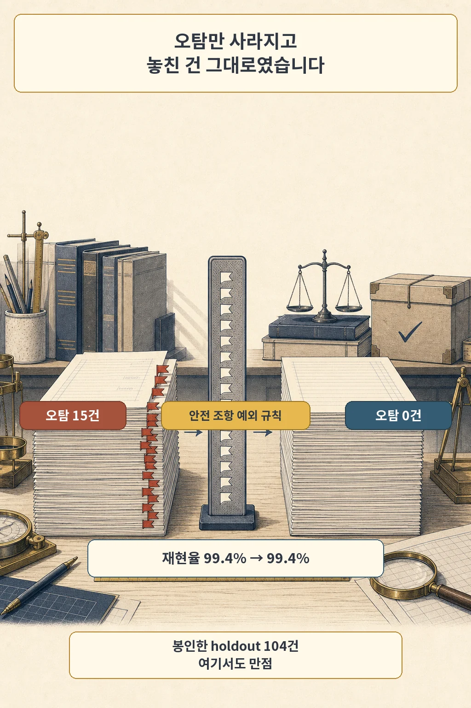
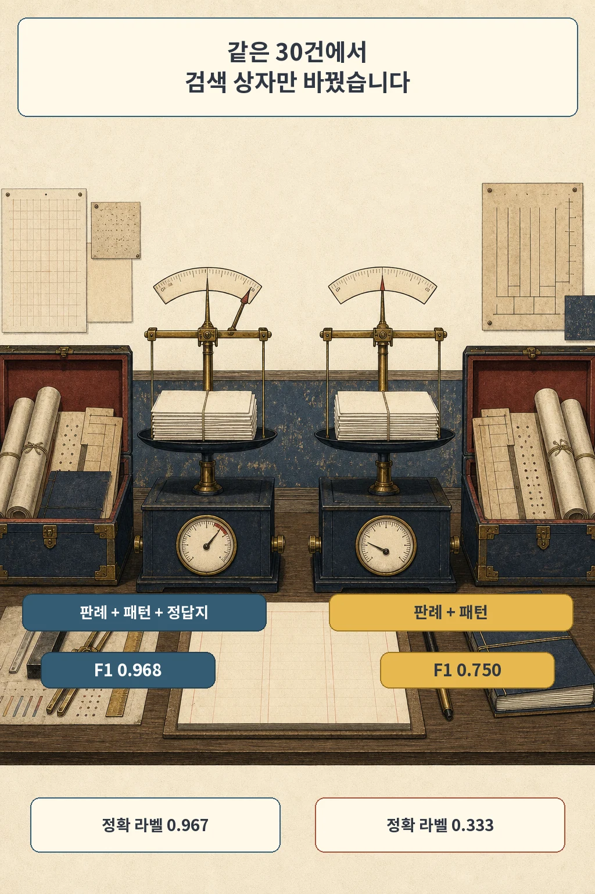

평가 성적표에 만점에 가까운 점수가 찍히면 모델이나 규칙이 제 실력을 낸다고 믿기 쉽습니다. 하지만 2026년 2월 임대차 계약서 위험 조항 탐지를 다룬 개인 평가 실험에서 받아 든 F1 0.997이라는 성적은 일반화 실력이 아니었습니다. 다섯 달 뒤 파이프라인을 다시 뜯어보니, 그 숫자는 **조정 표본에 맞춘 예외 규칙과 검색 정답지 누출이 만든 착시**였거든요.

글·해설: 다메카솔

## 핵심 내용

- **같은 분포의 홀드아웃(held-out)**: 2월 규칙 엔진 평가에서 오탐이 15건에서 0건으로 줄 동안 재현율(99.4%)은 불변이었고, 104건 홀드아웃(F1 1.0)도 같은 합성 분포에서 나눈 표본이었습니다.
- **정답 누출과 라우팅 병목**: 7월 8일 30건 통제 실험에서 정답지를 빼자 정확 라벨 일치가 0.967에서 0.333으로 급락했고, 350건 평가(F1 0.100)에서는 사전 필터가 341건을 걸러낸 병목이 드러났습니다.
- **미접촉 재측정과 보류 기준**: 누출 제거 후 덮어 둔 100건에서 재현율 1.000, 정밀도 0.533, F1 0.696(오탐 21건, 미탐 0건)을 얻었고, 불확실한 출력을 '보류'로 보내는 테스트를 고정했습니다.

## 오탐만 사라지고, 놓친 것은 그대로였습니다

초기 보고서를 다시 살피면 이미 의심할 만한 신호가 보입니다. 당시 시스템은 LLM이 아니라 확장 정규표현식(regex) 기반 규칙 엔진이었는데요, 골든셋 평가와 직전 단계 비교표에 어색한 흐름이 그대로 남아 있습니다.

| 2026년 2월 규칙 엔진 평가 | 수치 및 비교 |
| --- | --- |
| **골든셋 (2026-02-04, 378건)** | 이진 F1 99.7% · 정밀도 100.0% · 재현율 99.4% (오탐 0건, 미탐 1건) |
| **직전 단계 대비 변화** | 오탐 15건 → 0건 감소 / 재현율 99.4% 그대로 유지 |
| **홀드아웃 (2026-02-10 집계, 104건)** | 동결·해시 중복 점검 통과 / 라벨 F1 1.0 |
| **게이트 스냅숏 (2026-02-08)** | 승격 전 0.997 / 승격 후 406건 0.950 (집합 크기 기록 누락으로 단독 인용) |

탐지 규칙 자체가 정교해졌다면 미탐도 함께 줄어드는 편이 자연스럽습니다. 하지만 줄어든 것은 오탐뿐이었고, 그 사이에 한 일이라곤 안전 조항을 거르는 regex 예외 규칙을 덧붙인 것뿐이었죠. 눈앞의 평가셋에서 붉은 오탐 표식이 뜬 자리마다 딱 맞는 구멍을 뚫어 준 셈입니다.

홀드아웃 절차를 건너뛴 것도 아니었습니다. 별도 표본을 동결해 승격 데이터 혼입과 정규화 문장 해시 중복을 살피는 누출 점검 스크립트까지 돌렸거든요. 문제는 **홀드아웃이 조정 대상과 다른 분포에서 오지 않았다**는 데 있었습니다. 같은 합성 생성기에서 뽑은 데이터를 쪼개 두었으니 해시는 달라도 문장 패턴이 겹쳐 예외 규칙이 그대로 통했습니다.

## 검색 상자에서 정답지를 빼 봤습니다

2026년 7월 8일에는 새 LangGraph 파이프라인에서 검색 컬렉션 구성만 바꾸는 통제 실험을 진행했습니다. 표본 서른 건과 모델, 프롬프트를 고정한 채 검색 참고 상자에서 정답 코퍼스를 뺐을 때 결과가 어떻게 갈리는지 확인했죠.

| 검색 컬렉션 구성 (30건 통제 실험) | 정밀도 | 이진 F1 | 정확 라벨 일치 |
| --- | --- | --- | --- |
| **판례 + 패턴 + 정답 코퍼스 (누출 포함)** | 0.938 | 0.968 | **0.967** |
| **판례 + 패턴 (정답 코퍼스 제거)** | 0.600 | 0.750 | **0.333** |

정답 코퍼스를 빼자 이진 F1보다 **정확 라벨 일치도**가 훨씬 가파르게 무너졌습니다. 위험 여부만 가리는 수준을 넘어 구체적으로 어떤 독소 조항인지 분류할 때, 검색된 정답지를 그대로 베끼고 있었다는 뜻이죠.

## 350건 중 9건만 판정까지 갔습니다

같은 날 전체 표본을 새 파이프라인에 태웠을 때는 추론 능력이 바닥난 것처럼 보였습니다. 물론 2월 규칙 엔진과 7월 LangGraph 파이프라인은 시스템과 조건이 달라서, 두 점수를 직접 견주어 성능 하락으로 읽으면 오해하기 쉽습니다.

- **전체 baseline (2026-07-08, 350건)**: 정밀도 0.889 · 재현율 0.053 · 이진 F1 0.100 · 보류율 0.000
- **사전 필터 통과량**: 350건 중 9건만 검색과 판정에 도달 (독소 8건, 안전 1건 / 341건 탈락)
- **우회 스모크 (10건)**: 사전 필터 없이 강제 실행 시 재현율 1.000 · 이진 F1 0.727 기록

로그를 열어 보니 병목은 LLM이 아니라 앞단 라우팅이었습니다. 판정기는 호출되기만 하면 독소 조항을 잘 찾았지만, 휴리스틱 사전 필터가 대다수 조항을 입구에서 돌려보내 판정까지 닿은 표본이 극소수였던 겁니다.

## 정답지를 치우고 다시 잰 성적표

검색 누출을 없앤 뒤 2026년 7월 10일에는 조정 표본 계열과 겹치지 않는 표본, 그리고 아예 열어 보지 않은 미접촉 표본을 각각 백 건씩 측정했습니다.

| 평가 지표 (2026-07-10) | 조정 표본 계열 (100건) | 미접촉 표본 (100건) |
| --- | --- | --- |
| **표본 구성 (독소 / 안전)** | 70건 / 30건 | 24건 / 76건 |
| **정밀도 / 재현율** | 0.931 / 0.957 | **0.533 / 1.000** |
| **이진 F1 / 정확 라벨 일치** | 0.944 / 0.490 | **0.696 / 0.530** |
| **인용 충실도 / 보류율** | - | **0.378 / 0.100** |

두 표본은 독소와 안전 비율이 크게 달라서, 점수 차이에 일반화 격차와 클래스 분포 효과가 함께 섞여 있음을 감안해야 합니다.

그럼에도 덮어 둔 표본이 드러낸 경향은 뚜렷합니다. 독소 조항 스물네 건은 하나도 놓치지 않았지만(미탐 0건), 안전 조항 일흔여섯 건 가운데 스물한 건을 위험하다고 잘못 경보했거든요. 예를 들어 과실에 따른 책임, 차임 연체에 따른 갱신 거절, 통상 소모품 수선비 부담, 상호 비밀유지, 항목별 공과금 정산처럼 실무에서 흔히 쓰는 적법 조항들이 대거 오탐으로 걸렸습니다.

실패 과정을 복기해 보면 2월과 7월 모두 똑같은 방식의 교정을 반복했습니다.

- **2026년 2월 (regex 엔진)**: 오탐 15건을 지우려 안전 조항 예외 규칙을 추가했으나, 같은 분포 밖에서 한계가 드러남
- **2026년 7월 (프롬프트 조정)**: 조정 표본 오탐 5건을 지우려 "48시간 통지, 3일 납부 독촉, 동의된 방문은 안전하다"는 예외 문구를 넣었으나, 미접촉 표본에서 오탐 21건 재발

## 놓치지 않는 쪽을 고르고, 보류 기준을 세웠습니다

정밀도와 재현율 가운데 무엇을 앞세울지는 오류 비용에 달려 있습니다. 임대차 계약서 검토에서는 위험 조항을 통과시키는 미탐이 안전 조항을 재확인하게 만드는 오탐보다 훨씬 치명적이거든요. 그래서 재현율 우선을 택하되 오탐의 대가까지 숨기지 않으려고, 단일 점수 대신 재현율·정밀도·F1·정확 라벨 일치·인용 충실도를 측정 조건과 나란히 적는 성적표로 바꾸었습니다.

내부 오류 시 결과가 흐르는 방향도 2026년 7월 7일 설계 기록에서 고정했습니다. 근거가 부족하거나 출력이 스키마·인용·라벨 검증을 통과하지 못하면 판단을 확정하지 않고 '보류(추가 확인 필요)'로 넘기며, 화면에서도 "안전합니다"나 "보장됩니다" 같은 단정적 표현은 쓰지 못하게 막았습니다.

검색 실패나 파싱 오류로 위험 신호가 비었을 때 기본값이 '안전'으로 떨어지면, 시스템이 가장 모르는 순간에 사용자를 가장 안심시키는 역설이 벌어집니다. 이를 막으려고 같은 날 추가한 자동화 테스트에서는 판정기가 빈 상태로 조항을 넣을 때 개별·종합 판정이 모두 보류로 떨어지고 사람 검토 플래그가 켜지는지 확인하도록 묶어 두었습니다.

## 성적표의 눈금을 바로잡고 남긴 기준

미접촉 표본의 점수는 아직 갈 길이 먼 수치이지만, 이번 기록의 가치는 **조정 표본과 평가 표본을 분리하고 검색 누출을 걷어내 성적표의 눈금을 바로잡았다**는 데 있습니다. 다음 편에서는 오탐을 줄이려고 또다시 표본별 땜질 예외를 붙이는 대신, 적법 조항의 법리적 범주를 넓혀 동일한 미접촉 홀드아웃에서 통제된 전후 비교로 검증하는 과정을 다룹니다.

## 출처

- 개인 프로젝트 평가 보고서: 규칙 엔진 탐지 정확도(2026-02-04, 골든셋 378건), 품질 게이트 전후 스냅숏(2026-02-08), 홀드아웃 동결과 누출 점검(2026-02-08 / 집계 2026-02-10)
- 개인 프로젝트 평가 보고서: 전체 baseline 350건 및 검색 컬렉션 통제 비교 30건(2026-07-08), 조정 표본 계열 100건 및 덮어 둔 표본 100건 재측정(2026-07-10)
- 개인 프로젝트 설계 및 Git 기록: 계약 분석 그래프와 보류 정책 및 보류 동작 테스트 추가(2026-07-07)

이 글의 본문과 이미지는 생성형 AI로 제작했습니다. 기획과 편집 기준은 다메카솔이 정했습니다. 합성 내부 코퍼스를 활용한 개인 학습·포트폴리오 평가 기록이며, 법률 자문이나 실제 계약 판정을 제공하지 않고 외부 이미지 자산과 법령·판례 원문도 사용하지 않았습니다.
